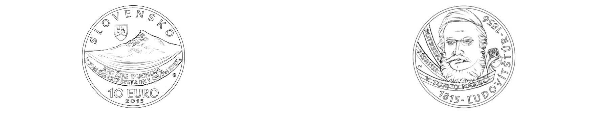

## 195

OZNÁMENIE

Národnej banky Slovenska

zo 14. júla 2015

## o vydaní strieborných zberateľských euromincí v nominálnej hodnote 10 eur pri príležitosti 200. výročia narodenia Ľudovíta Štúra

1. Úvodné ustanovenia

- a) Národná banka Slovenska podľa § 17h ods. 1 zákona Národnej rady Slovenskej republiky č. 566/1992 Zb. o Národnej banke Slovenska v znení neskorších predpisov a podľa § 1 ods. 2 písm. d) zákona Národnej rady Slovenskej republiky č. 1/1993 Z. z. o Zbierke zákonov Slovenskej republiky v znení zákona č. 275/2002 Z. z. oznamuje, že vydáva do obehu strieborné zberateľské euromince v nominálnej hodnote 10 eur pri príležitosti 200. výročia narodenia Ľudovíta Štúra (ďalej len "zberateľská eurominca").

- b) Zberateľská eurominca má štatút zákonného platidla len v Slovenskej republike.

- c) Zberateľská eurominca sa razí zo zliatiny obsahujúcej 900 dielov striebra a 100 dielov medi; jej hmotnosť je 18 g a priemer 34 mm. Pri razbe zberateľskej euromince je povolená horná a dolná odchýlka v priemere 0,1 mm; povolená horná odchýlka v hmotnosti je 0,4 g a v obsahu striebra 10/1000.

2. Vzhľad zberateľskej euromince

- a) Na líci zberateľskej euromince je vyobrazený vrch Kriváň, v ktorého spodnej časti je citát Ľudovíta Štúra charakterizujúci jeho osobnosť "KTO ŽIJE DUCHOM, V TOM ŽIJE CELÝ SVET A ON V CELOM SVETE". Štátny znak Slovenskej republiky je v hornej časti mincového poľa. Názov štátu "SLOVENSKO" je v opise zľava doprava pri hornom okraji zberateľskej euromince. V spodnej časti mincového poľa je označenie nominálnej hodnoty zberateľskej euromince "10 EURO". Pod ním je letopočet "2015". Značka Mincovne Kremnica, štátny podnik, ktorú tvorí skratka "MK" umiestnená medzi dvoma razidlami, je v pravej časti zberateľskej euromince.

- b) Na rube zberateľskej euromince je vyobrazený portrét Ľudovíta Štúra kompozične doplnený trikolórou s nápisom časti názvu jeho diela "POTREBA PÍSANIA V TOMTO NÁREČÍ". Trikolóra je ukončená lipovými kvetmi s listom. Pri okraji zberateľskej euromince je v opise zľava doprava nápis s menom, priezviskom a letopočtami narodenia a úmrtia Ľudovíta Štúra "1815 - ĽUDOVÍT ŠTÚR - 1856". Štylizovaná iniciálka priezviska autora výtvarného návrhu zberateľskej euromince Štefana Novotného "N" je umiestnená pri ľavom okraji zberateľskej euromince.

- c) Na hrane mince je nápis do hĺbky "VÝZNAMNÁ OSOBNOSŤ SLOVENSKÉHO NÁRODA". Začiatok a koniec nápisu je oddelený lipovým listom.

- 

Štát vydania: Slovenská republika

Začiatok vydávania: október 2015

Jozef Makúch v. r.
