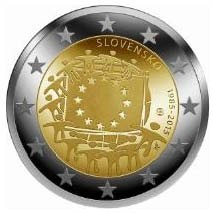

## 207

OZNÁMENIE

Národnej banky Slovenska

z 28. júla 2015

## o vydaní pamätných euromincí v nominálnej hodnote 2 eurá pri príležitosti 30. výročia vlajky Európskej únie

1. Úvodné ustanovenia

- a) Národná banka Slovenska podľa § 17h ods. 1 zákona Národnej rady Slovenskej republiky č. 566/1992 Zb. o Národnej banke Slovenska v znení neskorších predpisov a podľa § 1 ods. 2 písm. d) zákona Národnej rady Slovenskej republiky č. 1/1993 Z. z. o Zbierke zákonov Slovenskej republiky v znení zákona č. 275/2002 Z. z. oznamuje, že pri príležitosti 30. výročia vlajky Európskej únie vydáva do obehu pamätné euromince v nominálnej hodnote 2 eurá (ďalej len "pamätná eurominca").

- b) Pamätná eurominca má rovnaké technické parametre ako obehové euromince1) a na jej národnej strane bude použitý pamätný motív [bod 2 písm. b)].

- c) Pamätná eurominca má štatút zákonného platidla v celej eurozóne.

2. Vzhľad pamätnej euromince

- a) Pamätná eurominca sa vydáva s novou spoločnou európskou stranou.2)

- b) Na národnej strane pamätnej euromince je vyobrazená vlajka Európskej únie, ktorá je jedným z jej symbolov. Vlajka Európskej únie je kompozične doplnená dvanástimi postavami symbolizujúcimi obyvateľov Európskej únie. V hornej časti pamätnej euromince je v opise vnútorného kruhu zľava doprava nápis "SLOVENSKO" a v jej pravej časti sú letopočty "1985 - 2015". Značka Mincovne Kremnica, štátny podnik, ktorú tvorí skratka "MK" umiestnená medzi dvoma razidlami, je vpravo od vlajky Európskej únie a štylizované iniciálky autora výtvarného návrhu národnej strany pamätnej euromince Georgea Stamatopoulosa "ΓΣ" sú umiestnené v pravej spodnej časti mincového poľa. Pri okraji pamätnej euromince je dvanásť do kruhu umiestnených hviezd Európskej únie.

- c) Na hrane pamätnej euromince je nápis "SLOVENSKÁ REPUBLIKA". Začiatok a koniec nápisu je oddelený dvoma hviezdami, medzi ktorými je lipový list.

- 

- Štát vydania: Slovenská republika

- Začiatok vydávania: september 2015

Jozef Makúch v. r.
