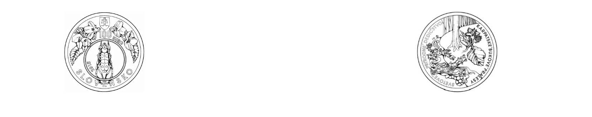

## 258

OZNÁMENIE

Národnej banky Slovenska

z 29. septembra 2015

## o vydaní zlatých zberateľských euromincí v nominálnej hodnote 100 eur s tematikou Svetové prírodné dedičstvo – Karpatské bukové pralesy

1. Úvodné ustanovenia

- a) Národná banka Slovenska podľa § 17h ods. 1 zákona Národnej rady Slovenskej republiky č. 566/1992 Zb. o Národnej banke Slovenska v znení neskorších predpisov a podľa § 1 ods. 2 písm. d) zákona Národnej rady Slovenskej republiky č. 1/1993 Z. z. o Zbierke zákonov Slovenskej republiky v znení zákona č. 275/2002 Z. z. oznamuje, že vydáva do obehu zlaté zberateľské euromince v nominálnej hodnote 100 eur s tematikou Svetové prírodné dedičstvo – Karpatské bukové pralesy (ďalej len „zberateľská eurominca“).

- b) Zberateľská eurominca má štatút zákonného platidla len v Slovenskej republike.

- c) Zberateľská eurominca sa razí zo zliatiny obsahujúcej 900 dielov zlata, 75 dielov striebra a 25 dielov medi; jej hmotnosť je 9,5 g a priemer 26 mm. Pri razbe euromince je povolená horná a dolná odchýlka v priemere 0,1 mm; povolená horná odchýlka v hmotnosti je 0,08 g a v obsahu zlata 10/1000.

2. Vzhľad zberateľskej euromince

- a) Na líci zberateľskej euromince je vyobrazený typický predstaviteľ fauny bukových pralesov fuzáč alpský, ktorý je kompozične vsadený do kruhového rámu. V hornej časti mincového poľa sú vyobrazené kvety a listy zubačky žliazkatej. Pri hornom okraji zberateľskej euromince je štátny znak Slovenskej republiky. Pod ním je označenie nominálnej hodnoty zberateľskej euromince „100 EURO“. V spodnej časti mincového poľa je v opise zľava doprava názov štátu „SLOVENSKO“. Vľavo od fuzáča alpského je letopočet „2015“.

- b) Na rube zberateľskej euromince sú v pravej časti vyobrazené listy a plody buka lesného v prostredí bukového pralesa. V opise zľava doprava je v ľavej časti zberateľskej euromince nápis „SVETOVÉ PRÍRODNÉ DEDIČSTVO“ a v jej pravej časti nápis „KARPATSKÉ BUKOVÉ PRALESY“. Štylizované iniciálky mena a priezviska autorky výtvarného návrhu zberateľskej euromince Márie Poldaufovej „MP“ a značka Mincovne Kremnica, štátny podnik, ktorú tvorí skratka „MK“ umiestnená medzi dvoma razidlami, sú v ľavej hornej časti zberateľskej euromince.

- c) Hrana zberateľskej euromince je vrúbkovaná.

Štát vydania: Slovenská republika

Začiatok vydávania: december 2015

v z. Ján Tóth v. r.
