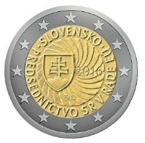

## 306

OZNÁMENIE

Národnej banky Slovenska

z 29. septembra 2015

## o vydaní pamätných euromincí v nominálnej hodnote 2 eurá pri príležitosti prvého predsedníctva Slovenskej republiky v Rade Európskej únie

1. Úvodné ustanovenia

- a) Národná banka Slovenska podľa § 17h ods. 1 zákona Národnej rady Slovenskej republiky č. 566/1992 Zb. o Národnej banke Slovenska v znení neskorších predpisov a podľa § 1 ods. 2 písm. d) zákona Národnej rady Slovenskej republiky č. 1/1993 Z. z. o Zbierke zákonov Slovenskej republiky v znení zákona č. 275/2002 Z. z. oznamuje, že pri príležitosti prvého predsedníctva Slovenskej republiky v Rade Európskej únie vydáva do obehu pamätné euromince v nominálnej hodnote 2 eurá (ďalej len „pamätná eurominca“).

- b) Pamätná eurominca má rovnaké technické parametre ako obehové euromince1) a na jej národnej strane bude použitý pamätný motív [bod 2 písm. b)].

- c) Pamätná eurominca má štatút zákonného platidla v celej eurozóne.

2. Vzhľad pamätnej euromince

- a) Pamätná eurominca sa vydáva s novou spoločnou európskou stranou.2)

- b) Na národnej strane pamätnej euromince je v centrálnej kompozícii dominantne vyobrazený štátny znak Slovenskej republiky s dostredivými dynamickými líniami na pozadí, čo znázorňuje postavenie a význam Slovenskej republiky počas jej predsedníctva v Rade Európskej únie. Vpravo od štátneho znaku Slovenskej republiky je letopočet „2016“. V opise vnútorného kruhu je zľava doprava nápis „SLOVENSKO“, ktorý je grafickými značkami oddelený od nápisu „PREDSEDNÍCTVO SR V RADE EÚ“. Značka Mincovne Kremnica, štátny podnik, ktorú tvorí skratka „MK“ umiestnená medzi dvoma razidlami, a štylizované iniciálky autora výtvarného návrhu národnej strany pamätnej euromince akad. mal. Vladimíra Pavlicu „VP“ sú umiestnené v spodnej časti kompozície. Pri okraji pamätnej euromince je dvanásť do kruhu umiestnených hviezd Európskej únie.

- c) Na hrane pamätnej euromince je nápis „SLOVENSKÁ REPUBLIKA“. Začiatok a koniec nápisu je oddelený dvoma hviezdami, medzi ktorými je lipový list.

- 

- Štát vydania: Slovenská republika

- Začiatok vydávania: marec 2016

Jozef Makúch v. r.
