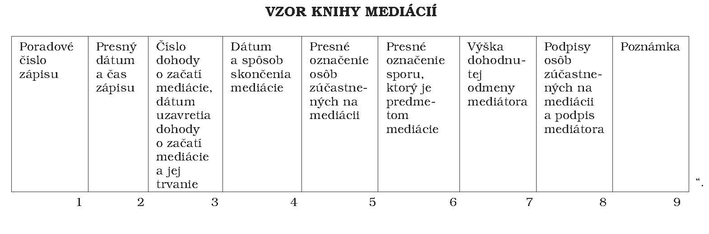

# Čl. I

Zákon č. 420/2004 Z. z. o mediácii a o doplnení niektorých zákonov v znení zákona č. 136/2010 Z. z., zákona č. 141/2010 Z. z. a zákona č. 332/2011 Z. z. sa mení a dopĺňa takto:

- 1. V § 1a sa odkaz „4a“ nahrádza odkazom „4ba“.

  - Poznámka pod čiarou k odkazu 4ba znie:

  - „4ba)

  - § 3 až 6 a § 10 až 16 zákona č. 136/2010 Z. z. o službách na vnútornom trhu a o zmene a doplnení niektorých zákonov.“.

- 2. V § 2 sa odsek 2 dopĺňa písmenom c), ktoré znie:

- „c)

- spotrebiteľským sporom spor vyplývajúci zo spotrebiteľskej zmluvy4bb) alebo súvisiaci so spotrebiteľskou zmluvou.“.

  - Poznámka pod čiarou k odkazu 4bb znie:

  - „4bb)

  - § 52 ods. 1 Občianskeho zákonníka.“.

- 3. V § 4 odsek 2 znie:

- „(2)

- Mediátor

- a)

- je povinný

- 1.

- pri výkone mediácie dodržiavať všeobecne záväzné právne predpisy a rešpektovať rozhodnutia orgánov verejnej moci, ktoré sa týkajú sporu, ktorý je predmetom mediácie, a o ktorých má alebo musí mať v priebehu mediácie vedomosť,

- 2.

- vykonávať svoju činnosť osobne, čestne, svedomito, nezávisle, nestranne, dôsledne, s náležitou odbornou starostlivosťou, a pritom dbať na účelnosť a hospodárnosť výkonu mediácie,

- 3.

- správať sa spôsobom, ktorý neznižuje dôstojnosť a vážnosť mediácie, osoby mediátora, osôb zúčastnených na mediácii a osôb prizvaných mediátorom,

- 4.

- informovať pred začatím mediácie o svojom postavení v mediácii, o priebehu mediácie, zásadách, účele a spôsobe vedenia mediácie, o spôsoboch jej ukončenia, výške odmeny za vykonanie mediácie a na požiadanie informovať osoby zúčastnené na mediácii o získanom vzdelaní a skúsenostiach,

- 5.

- poučiť osoby zúčastnené na mediácii pred začatím mediácie o ich právach, ktoré môžu byť mediáciou dotknuté, a o dôsledkoch mediácie,

- 6.

- rešpektovať názory osôb zúčastnených na mediácii a vytvárať podmienky na ich vzájomnú komunikáciu a na zmierlivé riešenie, ktoré bude zohľadňovať ich záujmy,

- 7.

- podpísať dohodu, ktorá je výsledkom mediácie, alebo odmietnuť podpísať dohodu, ktorá je výsledkom mediácie, ak je zrejmé, že odporuje zákonu, obchádza zákon alebo sa prieči dobrým mravom; odmietnutie podpisu mediátor vyznačí v zápisnici a na požiadanie vydá osobe zúčastnenej na mediácii písomné potvrdenie o dôvodoch odmietnutia podpisu dohody, ktorá je výsledkom mediácie,

- 8.

- osobám zúčastneným na mediácii vyhotoviť potvrdenie o skončení mediácie a osobám prizvaným k mediácii vyhotoviť potvrdenie o účasti na mediácii, ak o to mediátora požiadajú,

- 9.

- bez zbytočného odkladu informovať osoby zúčastnené na mediácii o všetkých skutočnostiach, pre ktoré by mohol byť z výkonu mediácie vylúčený, ak so zreteľom na jeho pomer k veci alebo k osobám zúčastneným na mediácii alebo k ich zástupcom možno mať pochybnosti o jeho nezaujatosti,

- 10.

- viesť knihu mediácií a v rámci nej viesť prehľadnú evidenciu mediácií, ktoré vykonáva,

- b)

- nesmie

- 1.

- sám rozhodovať o spore, ktorý je predmetom mediácie, alebo nútiť osoby zúčastnené na mediácii, aby prijali ním navrhované riešenie sporu,

- 2.

- vykonať mediáciu v spore, ak v tom istom spore alebo v spore s ním súvisiacom poskytol právne služby, notárske služby alebo poradenstvo a odbornú pomoc inej osobe, ktorej záujmy sú v rozpore so záujmami toho, kto o vykonanie mediácie žiada,

- 3.

- vykonať mediáciu v spore, ak sú jeho záujmy alebo záujmy osôb jemu blízkych v rozpore so záujmami osôb, ktoré o vykonanie mediácie žiadajú.“.

- 4. V § 4 ods. 3 sa na konci pripája táto veta: „Ak ide o mediáciu spotrebiteľského sporu, nesmie jej výška závisieť od výsledku mediácie, a odmenu mediátora môže spotrebiteľ znášať vo výške neprevyšujúcej 10 % odmeny, najviac však vo výške 20 eur; zvyšnú časť odmeny hradí vždy osoba zúčastnená na mediácii, ktorá je dodávateľom alebo jeho právnym nástupcom. Mediátor zapísaný v zozname mediátorov mediačného centra nesmie za výkon mediácie prijímať odmenu alebo akékoľvek výhody od inej osoby ako od mediačného centra, v ktorého zozname je zapísaný.“.

- 5. V § 4 sa za odsek 4 vkladá nový odsek 5, ktorý znie:

- „(5)

- Mediátor vykonáva mediáciu prevažne v kancelárii, ktorá sa zapisuje do registra mediátorov; kanceláriou mediátora je aj kancelária v mediačnom centre, v ktorého zozname je zapísaný. Na tento účel je mediátor povinný zriadiť a udržiavať kanceláriu.“.

  - Doterajší odsek 5 sa označuje ako odsek 6.

- 6. § 4 sa dopĺňa odsekom 7, ktorý znie:

- „(7)

- Ustanovenia § 11 ods. 5, 7 a 8 sa vzťahujú primerane aj na mediátora a ustanovenie § 11 ods. 6 sa na mediátora vzťahuje, ak vykonáva mediáciu v spotrebiteľskom spore. Ak od mediátora s ohľadom na výkon jeho činnosti nemožno spravodlivo požadovať zriadenie a udržiavanie webového sídla, zverejňuje mediátor informácie podľa tohto zákona v priestoroch kancelárie.“.

- 7. V § 6 sa slová „§ 4 ods. 5“ nahrádzajú slovami „§ 4 ods. 6“.

- 8. V § 7 ods. 4 sa na konci bodka nahrádza bodkočiarkou a pripájajú sa tieto slová: „to neplatí, ak ide o spotrebiteľskú zmluvu.“.

- 9. V § 7 ods. 5 sa na konci pripájajú tieto slová: „alebo nejde o spotrebiteľskú zmluvu“.

- 10. V § 8 ods. 1 sa na konci pripája táto veta: „Do registrov ministerstvo zapisuje údaje v rozsahu podľa tohto zákona.“.

- 11. V § 8 ods. 2 písm. d) sa za slovo „mediátora“ vkladajú slová „a vykonaní odbornej skúšky mediátora, nie staršie ako šesť mesiacov od vykonania skúšky“.

- 12. V § 8 sa odsek 2 dopĺňa písmenom e), ktoré znie:

- „e)

- nebol podľa tohto zákona inak ako na vlastnú žiadosť vyčiarknutý z registra mediátorov.“.

- 13. V § 8 sa odsek 5 dopĺňa písmenom g), ktoré znie:

- „g)

- opakovane v období jedného roka poruší zákon alebo povinnosti ustanovené týmto zákonom závažným spôsobom.“.

- 14. V § 8 ods. 7 sa na konci pripájajú tieto slová: „a spĺňa podmienky podľa tohto zákona. Ministerstvo vyčiarkne z registra mediačných centier mediačné centrum, ktoré prestalo spĺňať podmienky na zápis do registra mediačných centier alebo opakovane v období jedného roka poruší zákon alebo povinnosti ustanovené týmto zákonom.“.

- 15. V § 8 odsek 8 znie:

- „(8)

- Ministerstvo zapíše do registra vzdelávacích inštitúcií vzdelávaciu inštitúciu, ktorá získala akreditáciu na vzdelávanie v oblasti mediácie podľa osobitného predpisu.“.

- 16. V § 8 ods. 9 druhej vete sa na konci bodka nahrádza bodkočiarkou a pripájajú sa tieto slová: „to neplatí, ak nie sú splnené podmienky na zápis.“.

- 17. § 8 sa dopĺňa odsekom 11, ktorý znie:

- „(11)

- Mediátor, mediačné centrum a vzdelávacia inštitúcia sú povinní ministerstvu oznámiť a preukázať zmeny údajov zapisovaných v registri bezodkladne, odkedy sa o nich dozvedeli alebo mohli dozvedieť; ministerstvo zmeny do registra zapíše bezodkladne po ich preukázaní.“.

- 18. Za § 8 sa vkladá § 8a, ktorý vrátane nadpisu znie:

- 㤠8a

- Dočasné pozastavenie výkonu činnosti mediátora

- (1)

- Ministerstvo môže rozhodnutím dočasne pozastaviť výkon činnosti mediátora, ak mediátor o pozastavenie výkonu písomne požiada a preukáže existenciu vážnych rodinných alebo osobných dôvodov. Ministerstvo môže rozhodnutím dočasne pozastaviť výkon činnosti mediátora aj z iného dôležitého dôvodu. Ministerstvo rozhodnutie zruší, ak pominú dôvody jeho vydania a dočasné pozastavenie výkonu činnosti mediátora nezanikne podľa odseku 2.

- (2)

- Dočasné pozastavenie výkonu činnosti mediátora na základe jeho písomnej žiadosti nemôže trvať viac ako tri roky. Dočasné pozastavenie výkonu činnosti mediátora zaniká uplynutím doby stanovenej v rozhodnutí ministerstva, uplynutím troch rokov od pozastavenia výkonu činnosti alebo prvým dňom mesiaca nasledujúceho po mesiaci, v ktorom mediátor ministerstvu písomne oznámil zánik dôvodov pozastavenia výkonu činnosti mediátora.

- (3)

- Ak dočasné pozastavenie výkonu činnosti mediátora trvá, nesmie mediátor vykonávať činnosť podľa tohto zákona.

- (4)

- Dočasné pozastavenie výkonu činnosti mediátora sa zapisuje do registra mediátorov spolu s uvedením jeho trvania.“.

- 19. § 9 vrátane nadpisu znie:

- 㤠9

- Odborná príprava mediátora a odborná skúška mediátora

- (1)

- Cieľom odbornej prípravy mediátora je získanie osobitných kvalifikačných predpokladov potrebných na výkon činnosti mediátora podľa tohto zákona.

- (2)

- Odborná príprava mediátora trvá 200 hodín a je zameraná pomerne na

- a)

- výučbu o základoch práva, o odvetviach občianskeho práva, pracovného práva, obchodného práva, rodinného práva a právnych predpisov určených na ochranu spotrebiteľa (ďalej len „základy právneho poriadku“),

- b)

- oblasť interpersonálnej komunikácie, teórie konfliktov a psychologických aspektov ich riešenia,

- c)

- oblasť pravidiel správania sa mediátora a tréning jeho sociálnych zručností a

- d)

- vedenie procesu mediácie, prípravu dohody o začatí mediácie a dohody, ktorá je výsledkom mediácie.

- (3)

- Po odbornej príprave mediátor vykoná odbornú skúšku, ktorou sa posudzujú odborné vedomosti, schopnosti a zručnosti uchádzača. Odborná skúška mediátora nie je súčasťou odbornej prípravy mediátora a odbornú skúšku mediátora musí uchádzač vykonať do troch mesiacov od skončenia odbornej prípravy mediátora. Odborná skúška pozostáva z teoretickej časti a praktickej časti; praktická časť obsahuje riešenie prípadovej štúdie, ktoré zahŕňa všetky fázy mediácie vrátane spísania dohody, ktorá je výsledkom mediácie. Ak uchádzač na odbornej skúške neuspeje, má bez opakovania odbornej prípravy právo najneskôr do jedného mesiaca, odkedy na odbornej skúške neuspel, vykonať opakovanú skúšku. Ak uchádzač ani na opakovanej skúške neuspeje, má právo na preskúšanie ministerstvom. Uchádzač, ktorý neuspeje na opakovanej skúške ani pri preskúšaní ministerstvom, sa o vykonanie ďalšej odbornej skúšky môže uchádzať až po opätovnom vykonaní odbornej prípravy, a to najskôr po uplynutí jedného roka od vykonania neúspešnej opakovanej skúšky.“.

- 20. Poznámka pod čiarou k odkazu 8 znie:

- „8)

- Zákon č. 568/2009 Z. z. o celoživotnom vzdelávaní a o zmene a doplnení niektorých zákonov v znení neskorších predpisov.“.

- 21. § 10a až 14 vrátane nadpisov znejú:

- 㤠10a

- Ďalšie vzdelávanie mediátora

- (1)

- Mediátor je povinný sa podľa tohto zákona sústavne vzdelávať.

- (2)

- Ministerstvo prostredníctvom vzdelávacích inštitúcií zapísaných v registri vzdelávacích inštitúcií organizuje každý rok najmenej jeden odborný seminár ako súčasť ďalšieho vzdelávania mediátorov. Program odborného seminára a jeho rozsah určuje ministerstvo. Vzdelávacia inštitúcia vydá mediátorovi osvedčenie o účasti na odbornom seminári, ktoré mediátor bezodkladne predloží ministerstvu.

- (3)

- Ak sa mediátor nezúčastní aspoň jedného odborného seminára počas roka, ministerstvo nariadi jeho preskúšanie.

- (4)

- Ak ministerstvo nariadi preskúšanie, mediátor je povinný zúčastniť sa na preskúšaní v termíne určenom ministerstvom; ak pri preskúšaní mediátor nevyhovie, môže preskúšanie v termíne určenom ministerstvom zopakovať. Ak mediátor preskúšanie v termíne určenom ministerstvom nevykoná alebo pri opakovanom preskúšaní nevyhovie, ministerstvo mediátora vyčiarkne z registra mediátorov.

- (5)

- Podrobnosti o ďalšom vzdelávaní a o preskúšaní mediátora ministerstvom upraví všeobecne záväzný právny predpis, ktorý vydá ministerstvo.

- Mediačné centrum

- § 11

- (1)

- Za podmienok podľa tohto zákona môže fyzická osoba alebo právnická osoba zriadiť mediačné centrum (ďalej len „zriaďovateľ“). Mediačné centrum je právnická osoba vykonávajúca činnosť podľa odseku 2 v sídle zapísanom v registri mediačných centier.

- (2)

- Mediačné centrum

- a)

- určuje osobitné predpoklady a zameranie, ktoré musí spĺňať mediátor uchádzajúci sa o zápis do zoznamu mediátorov vedeného mediačným centrom,

- b)

- zapisuje mediátorov do zoznamu mediátorov, vedie zoznam a eviduje zmeny v zozname mediátorov zapísaných v mediačnom centre; zoznam a zmeny v zozname mediátorov zverejňuje bezodkladne na svojom webovom sídle,

- c)

- zabezpečuje materiálne podmienky na výkon mediácie mediátormi zapísanými v zozname,

- d)

- poskytuje ministerstvu súčinnosť pri výkone právomoci podľa tohto zákona,

- e)

- organizuje osvetovú činnosť zameranú na podporu mediácie a ďalšie aktivity zamerané na podporu rozvoja mediácie.

- (3)

- Orgány mediačného centra a jeho pracovníci nesmú v priebehu mediácie do výkonu mediácie nijako zasahovať, najmä nesmú ovplyvňovať mediátora.

- (4)

- Zriaďovateľ je bezodkladne po zriadení a zaregistrovaní mediačného centra a aj v prípade zmien v ministerstvom registrovaných údajoch povinný v Obchodnom vestníku9) zverejniť

- a)

- zriadenie mediačného centra,

- b)

- zriadenie pobočiek mediačného centra, ak ich zriadil,

- c)

- prijatý štatút zriadeného mediačného centra a vnútorné predpisy upravujúce výkon mediácie, ak boli prijaté,

- d)

- zoznam mediátorov, ktorí pôsobia v zriadenom mediačnom centre, a jeho zmeny.

- (5)

- Mediačné centrum je povinné zriadiť, zabezpečovať prevádzku a aktualizáciu webového sídla, na ktorom sú v jasnej, ľahko zrozumiteľnej a používateľsky jednoduchej forme zverejnené informácie o mediačnom centre v rozsahu:

- a)

- meno, priezvisko a bydlisko zriaďovateľa, ktorý je fyzickou osobou, alebo názov, sídlo a identifikačné číslo zriaďovateľa, ktorý je právnickou osobou,

- b)

- názov, sídlo a identifikačné číslo mediačného centra, adresa na doručovanie, adresa na podávanie podaní v elektronickej podobe, telefonický kontakt,

- c)

- skutočnosť, že mediačné centrum je zapísané v registri vedenom ministerstvom s uvedením čísla zápisu,

- d)

- aktuálny zoznam členov orgánov mediačného centra s uvedením mena a priezviska,

- e)

- zoznam mediátorov a zoznam mediátorov vykonávajúcich mediáciu spotrebiteľských sporov vedený mediačným centrom s uvedením mena a priezviska, ak mediačné centrum rieši spotrebiteľské spory,

- f)

- členstvo v nadnárodných organizáciách, ktoré sa zaoberajú riešením cezhraničných spotrebiteľských sporov, ak mediačné centrum rieši spotrebiteľské spory,

- g)

- druhy spotrebiteľských sporov, ktoré je mediačné centrum oprávnené riešiť, ak podľa štatútu je toto oprávnené riešiť iba určité druhy spotrebiteľských sporov, ak mediačné centrum rieši spotrebiteľské spory,

- h)

- právne predpisy, podľa ktorých postupujú mediátori, úplné znenie štatútu a rokovacieho poriadku vrátane ich dodatkov, príloh a zmien, sadzobníka poplatkov a pravidiel ich úhrady,

- i)

- jazyk, v ktorom je možné viesť mediáciu a urobiť podanie,

- j)

- informácia, že mediáciu je možné ukončiť spôsobom podľa tohto zákona,

- k)

- priemerná dĺžka trvania mediácie spotrebiteľského sporu, ak mediačné centrum rieši spotrebiteľské spory,

- l)

- informácia o záväznosti a právnych účinkoch mediácie pre osoby zúčastnené na mediácii,

- m)

- správa o činnosti mediačného centra podľa odseku 6, ak mediačné centrum rieši spotrebiteľské spory.

- (6)

- Spotrebiteľské spory môže riešiť iba mediačné centrum, ktoré spĺňa podmienky podľa tohto zákona. Mediačné centrum, ktoré rieši spotrebiteľské spory, je povinné vypracovať a zverejniť správu o činnosti mediačného centra v súvislosti s riešením spotrebiteľských sporov za kalendárny rok najneskôr do 31. marca nasledujúceho roka. Správa musí obsahovať informácie o

- a)

- počte mediácií spotrebiteľských sporov a najčastejších nárokoch, ktorých sa osoby zúčastnené na mediácii domáhajú,

- b)

- najčastejších skutočnostiach, ktoré vedú k spotrebiteľským sporom,

- c)

- počte mediácií spotrebiteľských sporov, ktoré boli skončené, a o dôvode ich skončenia,

- d)

- priemernej dĺžke trvania mediácie spotrebiteľského sporu,

- e)

- miere, v akej sú dohody, ktoré sú výsledkom mediácie dobrovoľne plnené, ak má mediačné centrum takéto informácie,

- f)

- členstve, prípadne spolupráci mediačného centra s nadnárodnými organizáciami, ktoré sa zaoberajú riešením cezhraničných spotrebiteľských sporov.

- (7)

- Na základe žiadosti poskytne mediačné centrum informácie podľa odsekov 5 a 6 aj na trvalom médiu.

- (8)

- Mediačné centrum spracúva a zverejňuje osobné údaje fyzických osôb v rozsahu nevyhnutnom na účely tohto zákona v súlade s osobitným predpisom.10)

- § 12

- Štatút mediačného centra

- Štatút mediačného centra ustanoví

- a)

- organizačnú štruktúru mediačného centra,

- b)

- zameranie mediačného centra,

- c)

- osobitné predpoklady, ktoré musí spĺňať uchádzač o zápis do zoznamu mediátorov, ktorý vedie mediačné centrum,

- d)

- pravidlá o odmene mediátora a osobitné pravidlá riešenia spotrebiteľských sporov, ak mediačné centrum rieši spotrebiteľské spory.

- § 13

- Zoznam mediátorov mediačného centra a výkon mediácie

- (1)

- Mediačné centrum vedie zoznam mediátorov a zoznam mediátorov vykonávajúcich mediáciu spotrebiteľských sporov pôsobiacich v mediačnom centre; zoznam mediátorov je verejne prístupný.

- (2)

- Mediačné centrum zapíše do zoznamu mediátorov mediátora, ktorý spĺňa predpoklady podľa zákona a osobitné predpoklady podľa jeho štatútu.

- (3)

- Na účely výkonu mediácie mediačné centrum zabezpečí náhodný, nezávislý a nestranný výber mediátora. Ak mediátor z dôvodov podľa § 14 ods. 8 nebude v mediácii pokračovať, určí mediačné centrum iného mediátora.

- (4)

- V zozname mediátorov príslušného mediačného centra sa uvedie meno a priezvisko mediátora, adresa jeho trvalého pobytu a osobitné predpoklady požadované na zápis.

- (5)

- Zodpovednosťou mediačného centra za škodu nie je dotknutá zodpovednosť mediátora za škodu spôsobenú podľa tohto zákona.

- § 14

- Začiatok mediácie, koniec mediácie a kniha mediácií

- (1)

- V dohode o začatí mediácie sa osoby zúčastnené na mediácií s mediátorom dohodnú na mediácii konkrétneho sporu; dohoda musí mať písomnú formu a označuje sa poradovým číslom podľa evidencie vedenej mediátorom v knihe mediácií. Dohoda o začatí mediácie obsahuje najmä

- a)

- presné označenie osôb zúčastnených na mediácii,

- b)

- presné označenie mediátora a jeho kancelárie,

- c)

- vymedzenie konkrétneho sporu, ktorý je predmetom mediácie,

- d)

- výšku odmeny mediátora, spôsob jej určenia alebo dohodu o bezplatnom výkone mediácie a

- e)

- dobu, na ktorú je uzavretá, alebo dobu, počas ktorej má mediácia prebiehať.

- (2)

- Ak odsek 3 neustanovuje inak, začína sa mediácia uzavretím dohody o začatí mediácie osobami zúčastnenými na mediácii alebo zástupcami konajúcimi v rozsahu oprávnenia konať za zastúpeného a mediátorom a jej zápisom do knihy mediácií vedenej mediátorom. Zápis dohody o začatí mediácie a zápis o skončení mediácie podľa tohto zákona v knihe mediácií má pre plynutie premlčacej lehoty a zánik práva rovnaké právne účinky ako uplatnenie práva na súde. Potvrdený odpis dohody o začatí mediácie a zápisov v knihe mediácií opatrený pečiatkou mediátora a dátumom uloženia dohody alebo vykonania zápisov v knihe mediácií vydá mediátor, okrem osôb oprávnených podľa osobitných predpisov, aj súdu na účely súdneho konania.

- (3)

- Mediátor je povinný vždy a aj písomne poučiť strany, že ak čo i len jedna zo strán alebo mediátor so začatím mediácie podľa odseku 2 pred jej začatím nesúhlasí, začína sa mediácia uložením dohody o začatí mediácie uzavretej osobami zúčastnenými na mediácii alebo zástupcami konajúcimi v rozsahu oprávnenia konať za zastúpeného a mediátorom v Notárskom centrálnom registri listín zriadenom podľa osobitného zákona,11) (ďalej len „register listín“) a mediácia sa končí uložením potvrdenia o skončení mediácie v registri listín; na tento účel mediátor overí totožnosť osôb, ich oprávnenie a rozsah oprávnenia v mediácii konať. Uloženie dohody o začatí mediácie a potvrdenia o skončení mediácie v registri listín má pre plynutie premlčacej lehoty a zánik práva rovnaké právne účinky ako uplatnenie práva na súde. Potvrdenie o skončení mediácie obsahuje najmä presné označenie osôb zúčastnených na mediácii, označenie dohody o riešení sporu mediáciou alebo dohody o začatí mediácie s uvedením času jej uloženia a označenie spôsobu ukončenia mediácie. Osvedčený odpis dohody o začatí mediácie a potvrdenia o skončení mediácie uložených v registri listín vydá notár okrem osôb oprávnených podľa osobitného predpisu12) aj súdu na účely súdneho konania.

- (4)

- Kniha mediácií je neprenosná, mediátorom vedená evidencia časovo usporiadaných zápisov o uzavretí dohôd o začatí mediácie a s tým súvisiacich zápisov o skončení mediácie; prílohou každého zápisu je mediátorom potvrdený odpis dohody o začatí mediácie. Knihu mediácií mediátor vedie v elektronickej podobe a listinnej podobe vo forme pevne zviazaného registra a obsahuje tieto údaje:

- a)

- poradové číslo zápisu,

- b)

- presný dátum a čas zápisu,

- c)

- číslo dohody o začatí mediácie, dátum uzavretia dohody o začatí mediácie a jej trvanie,

- d)

- dátum a spôsob skončenia mediácie,

- e)

- presné označenie osôb zúčastnených na mediácii,

- f)

- presné označenie sporu, ktorý je predmetom mediácie,

- g)

- výšku dohodnutej odmeny mediátora,

- h)

- podpisy osôb zúčastnených na mediácii a podpis mediátora,

- i)

- poznámku.

- (5)

- Kniha mediácií sa ukladá a vedie pre každý kalendárny rok samostatne a mediátor je povinný archivovať knihu mediácií v elektronickej podobe a listinnej podobe počas trvania zápisu mediátora v registri mediátorov a päť rokov po vyčiarknutí z registra mediátorov. Vzor knihy mediácií ustanovuje príloha č. 2.

- (6)

- Ak sa vedie súdne konanie alebo rozhodcovské konanie, ktorému predchádzala mediácia v členskom štáte, plynutie premlčacích a prekluzívnych lehôt počas mediácie sa posudzuje podľa práva štátu, v ktorom sa mediácia vykonávala; ustanovenia osobitného predpisu tým nie sú dotknuté.13) V mediácii cezhraničného spotrebiteľského sporu sa rozhodujúce právo určí podľa všeobecne záväzných právnych predpisov platných na území Slovenskej republiky, najmä prednostne aplikovateľných predpisov práva Európskej únie.14)

- (7)

- Mediátor je povinný ihneď a z dôležitých dôvodov, najneskôr pracovný deň nasledujúci po uzavretí dohody o začatí mediácie alebo po skončení mediácie vykonať zápis v knihe mediácií alebo požiadať o uloženie dohody alebo potvrdenia o skončení mediácie v registri listín. Mediátor zodpovedá za škodu spôsobenú porušením tejto povinnosti, ibaže preukáže, že konal s náležitou odbornou starostlivosťou a vyvinul všetko potrebné úsilie, ktoré od neho možno spravodlivo požadovať.

- (8)

- Mediácia sa končí

- a)

- dňom uzavretia dohody, ktorá je výsledkom mediácie,

- b)

- dňom písomného vyhlásenia mediátora po konzultácii s osobami zúčastnenými na mediácii, že mediácia nebude pokračovať,

- c)

- dňom právoplatnosti rozhodnutia o dočasnom pozastavení činnosti mediátora alebo dňom právoplatnosti rozhodnutia o vyčiarknutí mediátora z registra mediátorov,

- d)

- dňom, keď mediátor odmietol k dohode, ktorá je výsledkom mediácie, pripojiť svoj podpis; túto skutočnosť mediátor zaznamená s uvedením dôvodu v zápisnici,

- e)

- dňom doručenia písomného vyhlásenia osoby zúčastnenej na mediácii adresovaného mediátorovi, že mediácia je skončená, alebo

- f)

- dňom doručenia písomného vyhlásenia jednej z osôb zúčastnených na mediácii adresovaného druhej osobe zúčastnenej na mediácii a mediátorovi, že mediácia je skončená,

- g)

- dňom, keď účastník mediácie spor, ktorý je predmetom mediácie, predložil na rozhodnutie súdu alebo rozhodcovskému orgánu,

- h)

- uplynutím 90 dní v prípade mediácie spotrebiteľského sporu a v ostatných prípadoch uplynutím šiestich mesiacov od začatia mediácie, ak si osoby zúčastnené na mediácii v ostatných prípadoch nedohodli dlhšiu dobu, po ktorej uplynutí sa mediácia skončí,

- i)

- dňom smrti alebo vyhlásenia za mŕtveho mediátora alebo niektorého účastníka mediácie; to neplatí, ak mediáciu vykonával mediátor v mediačnom centre.“.

  - Poznámky pod čiarkou k odkazom 9 až 14 znejú:

  - „9)

  - Zákon č. 200/2011 Z. z. o Obchodnom vestníku a o zmene a doplnení niektorých zákonov.

  - 10)

  - Zákon č. 122/2013 Z. z. o ochrane osobných údajov a o zmene a doplnení niektorých zákonov v znení zákona č. 84/2014 Z. z.

  - 11)

  - § 73k zákona Slovenskej národnej rady č. 323/1992 Zb. o notároch a notárskej činnosti (Notársky poriadok) v znení neskorších predpisov.

  - 12)

  - § 73k ods. 4 zákona č. 323/1992 Zb. v znení neskorších predpisov.

  - 13)

  - Napríklad § 10 ods. 4 zákona č. 97/1963 Zb.

  - 14)

  - Zákon č. 97/1963 Zb.

  - Nariadenie Európskeho parlamentu a Rady (ES) č. 593/2008 zo 17. júna 2008 o rozhodnom práve pre zmluvné záväzky (Rím I) (Ú. v. EÚ L 177, 4. 7. 2008).

  - Nariadenie Európskeho parlamentu a Rady (ES) č. 864/2007 z 11. júla 2007 o rozhodnom práve pre mimozmluvné záväzky (Rím II) (Ú. v. EÚ L 40, 31. 7. 2007).“.

- 22. § 16a vrátane nadpisu znie:

- 㤠16a

- Prechodné ustanovenia k úpravám účinným od 1. januára 2016

- (1)

- Ustanoveniami tohto zákona sa spravujú aj právne vzťahy vzniknuté pred 1. januárom 2016; vznik týchto právnych vzťahov, ako aj nároky z nich vzniknuté pred 1. januárom 2016 sa však posudzujú podľa predpisov účinných do 31. decembra 2015.

- (2)

- Ustanovenia tohto zákona sa použijú aj na mediáciu, ktorá sa začala podľa právnych predpisov účinných do 31. decembra 2015. Do knihy mediácií sa môžu zapísať mediácie, ktorých vykonávanie sa začne po 31. decembri 2015.

- (3)

- Mediátor zapísaný v registri mediátorov podľa predpisov účinných do 31. decembra 2015 sa považuje za mediátora podľa tohto zákona. Povinnosti podľa tohto zákona je mediátor povinný splniť najneskôr do troch mesiacov odo dňa nadobudnutia účinnosti tohto zákona. Na základe osvedčenia vydaného podľa predpisov účinných do 31. decembra 2015 možno žiadateľa do registra mediátorov zapísať na základe písomnej žiadosti podanej ministerstvu najneskôr do šestich mesiacov odo dňa nadobudnutia účinnosti tohto zákona.

- (4)

- Osvedčenia o účasti na odbornom seminári organizovanom ako súčasť ďalšieho vzdelávania mediátorov vydané podľa predpisov účinných do 31. decembra 2015 sa považujú za osvedčenia o účasti na odbornom seminári podľa predpisov účinných od 1. januára 2016.

- (5)

- Mediačné centrum, ktoré je právnickou osobou, je povinné zosúladiť svoju činnosť s ustanoveniami tohto zákona najneskôr do troch mesiacov odo dňa nadobudnutia účinnosti tohto zákona, inak ministerstvo mediačné centrum vyčiarkne z registra mediačných centier; ministerstvo v týchto prípadoch mediačné centrum vyčiarkne aj z registra vzdelávacích inštitúcií, ak mediačné centrum bolo zapísané aj v tomto registri. Mediačné centrum, ktoré nespĺňa podmienky podľa tohto zákona, je povinné podať žiadosť o registráciu podľa tohto zákona najneskôr do troch mesiacov odo dňa nadobudnutia účinnosti tohto zákona, inak ministerstvo mediačné centrum vyčiarkne z registra mediačných centier. Ak ministerstvo žiadosť o registráciu mediačného centra podľa tohto zákona zamietne, rozhodne súčasne o vyčiarknutí mediačného centra zaregistrovaného podľa predpisov účinných do 31. decembra 2015 z registra mediačných centier; ministerstvo v týchto prípadoch mediačné centrum vyčiarkne aj z registra vzdelávacích inštitúcií, ak mediačné centrum bolo zapísané aj v tomto registri.“.

- 23. Za § 16a sa vkladá § 17, ktorý znie:

- 㤠17

- Týmto zákonom sa preberajú právne záväzné akty Európskej únie uvedené v prílohe č. 1.“.

- 24. Názov prílohy znie: „ZOZNAM PREBERANÝCH PRÁVNE ZÁVÄZNÝCH AKTOV EURÓPSKEJ ÚNIE“.

- 25. V prílohe sa doterajší text označuje ako bod 1 a dopĺňa sa bodom 2, ktorý znie:

- „2.

- Smernica Európskeho parlamentu a Rady 2013/11/EÚ z 21. mája 2013 o alternatívnom riešení spotrebiteľských sporov, ktorou sa mení nariadenie (ES) č. 2006/2004 a smernica 2009/22/ES (smernica o alternatívnom riešení spotrebiteľských sporov) (Ú. v. EÚ L 165, 18. 6. 2013).“.

- 26. Doterajšia príloha sa označuje ako príloha č. 1 a dopĺňa sa príloha č. 2, ktorá vrátane nadpisu znie:

- „Príloha č. 2 k zákonu č. 420 /2004 Z. z.

- VZOR KNIHY MEDIÁCIÍ“.

- 
