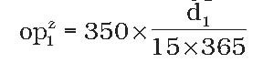
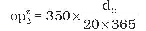

# Čl. I

Zákon č. 98/1987 Zb. o osobitnom príspevku baníkom v znení zákona č. 160/1989 Zb., zákona č. 235/1992 Zb., zákona č. 311/2001 Z. z. a zákona č. 200/2009 Z. z. sa mení a dopĺňa takto:

- 1. § 2 a 3 vrátane nadpisu nad paragrafom znejú:

- „Podmienky nároku

- § 2

- (1)

- Oprávneným na priznanie osobitného príspevku, ak tento zákon neustanovuje inak, je fyzická osoba, ktorá

- a)

- dosiahla najvyššiu prípustnú expozíciu zo zamestnania v baníctve so stálym pracoviskom pod zemou v hlbinných baniach na území Slovenskej republiky alebo

- b)

- pre ohrozenie chorobou z povolania zo zamestnania v baníctve so stálym pracoviskom pod zemou v hlbinných baniach na území Slovenskej republiky nesmie vykonávať doterajšiu prácu.

- (2)

- Oprávneným na priznanie osobitného príspevku je aj fyzická osoba, ktorá odpracovala najmenej 15 rokov v zamestnaní v baníctve so stálym pracoviskom pod zemou v hlbinných baniach na území Slovenskej republiky, z toho najmenej 10 rokov ako rubač, lámač, razič alebo hĺbič.

- (3)

- Oprávneným na priznanie osobitného príspevku je aj fyzická osoba, ktorá odpracovala najmenej 20 rokov v zamestnaní v baníctve so stálym pracoviskom pod zemou v hlbinných baniach na území Slovenskej republiky.

- (4)

- Oprávneným na priznanie osobitného príspevku je aj fyzická osoba, ktorá z dôvodu uskutočňovania útlmového programu schváleného vládou Slovenskej republiky prestala vykonávať zamestnanie v baníctve so stálym pracoviskom pod zemou v hlbinných baniach na území Slovenskej republiky, v ktorom bola zamestnaná spolu viac ako tri roky.

- (5)

- Nárok na priznanie osobitného príspevku vzniká oprávneným osobám uvedeným v odsekoch 2 a 3 dovŕšením veku 55 rokov.

- § 3

- (1)

- Osobitný príspevok nepatrí, ak tento zákon neustanovuje inak, ak oprávnený na jeho priznanie

- a)

- vykonáva prácu v zamestnaní v baníctve so stálym pracoviskom pod zemou v hlbinných baniach na území Slovenskej republiky; to neplatí, ak ide o oprávneného podľa § 2 ods. 1 písm. a), ktorý nedovŕšil vek 55 rokov,

- b)

- dovŕšil dôchodkový vek,

- c)

- je poberateľom doplatku do priemerného zárobku z titulu ohrozenia chorobou z povolania vo vyššej sume alebo v rovnakej sume, ako je osobitný príspevok, na ktorý by mal nárok,

- d)

- je poberateľom invalidného dôchodku vo vyššej sume alebo v rovnakej sume, ako je osobitný príspevok, na ktorý by mal nárok,

- e)

- je poberateľom úrazovej renty vo vyššej sume alebo v rovnakej sume, ako je osobitný príspevok, na ktorý by mal nárok,

- f)

- je poberateľom opakujúcej sa dávky výsluhového zabezpečenia podľa osobitného predpisu8) alebo opakujúcej sa dávky, ktorá sa považuje za dávku výsluhového zabezpečenia podľa osobitného predpisu,8)

- g)

- je poberateľom starobného dôchodku alebo predčasného starobného dôchodku,

- h)

- je poberateľom obdobnej dávky alebo obdobného plnenia z cudziny, ako sú uvedené v písmenách c) až e), pričom obdobná dávka alebo obdobné plnenie z cudziny je vo vyššej sume alebo v rovnakej sume, ako je osobitný príspevok, na ktorý mal nárok,

- i)

- je poberateľom obdobnej dávky alebo obdobného plnenia z cudziny, ako sú uvedené v písmenách f) a g).

- (2)

- Odsek 1 sa použije rovnako aj vtedy, ak sa dávky a plnenia podľa odseku 1 priznajú spätne za obdobie, v ktorom sa vyplácal osobitný príspevok.“.

- Poznámka pod čiarou k odkazu 8 znie:

- „“.

- 8)

- Zákon č. 328/2002 Z. z. o sociálnom zabezpečení policajtov a vojakov a o zmene a doplnení niektorých zákonov v znení neskorších predpisov.“.

- 2. V § 4 sa vypúšťa odsek 2.

  - Súčasne sa zrušuje označenie odseku 1.

- 3. V § 5 ods. 3 sa slová „§ 2 ods. 2 až 4“ nahrádzajú slovami „§ 2 ods. 2 a 3“.

- 4. V § 5 sa za odsek 3 vkladajú nové odseky 4 až 8, ktoré znejú:

- „(4)

- Suma osobitného príspevku podľa odsekov 2 a 3 sa zvyšuje o sumu, ktorá sa určí

- a)

- ako súčin čísla 350 a podielu počtu dní v zamestnaní v baníctve so stálym pracoviskom pod zemou v hlbinných baniach na území Slovenskej republiky ako rubač, lámač, razič alebo hĺbič, ktoré presahujú minimálnu dobu, ktorú poberateľ osobitného príspevku musel dosiahnuť na vznik nároku na osobitný príspevok podľa § 2 ods. 2 a 3, alebo dobu podľa § 2 ods. 1 písm. a) a čísla 15 vynásobeného číslom 365,

- b)

- ako súčin čísla 350 a podielu počtu dní v zamestnaní v baníctve so stálym pracoviskom pod zemou v hlbinných baniach na území Slovenskej republiky, ktoré presahujú minimálnu dobu, ktorú poberateľ osobitného príspevku musel dosiahnuť na vznik nároku na osobitný príspevok podľa § 2 ods. 2 a 3, alebo dobu podľa § 2 ods. 1 písm. a) okrem dní, v ktorých oprávnený bol zamestnaný ako rubač, lámač, razič alebo hĺbič a čísla 20 vynásobeného číslom 365.

- (5)

- Suma zvýšenia osobitného príspevku podľa odseku 4 sa zlučuje s osobitným príspevkom.

- (6)

- Výsledná suma osobitného príspevku podľa odseku 5 sa zaokrúhli na celý eurocent nahor.

- (7)

- Na účel poskytovania osobitného príspevku sa to isté obdobie podľa odseku 4 zohľadňuje len raz.

- (8)

- Osobitný príspevok sa podľa odseku 4 nezvyšuje, ak počet dní v zamestnaní v baníctve so stálym pracoviskom pod zemou v hlbinných baniach na území Slovenskej republiky presahujúci minimálnu dobu, ktorú poberateľ osobitného príspevku musel dosiahnuť na vznik nároku na osobitný príspevok podľa § 2 ods. 2 a 3, alebo dobu podľa § 2 ods. 1 písm. a) nepresahuje 90 dní.“.

  - Doterajšie odseky 4 až 8 sa označujú ako odseky 9 až 13.

- 5. V § 5 ods. 9 a 10 sa slová „ods. 5“ nahrádzajú slovami „ods. 4“, slová „rokov v baníctve“ sa nahrádzajú slovami „rokov v zamestnaní v baníctve“ a vypúšťajú sa slová „v ktorom je možné dosiahnuť najvyššiu prípustnú expozíciu“ a slová „v ktorom možno dosiahnuť najvyššiu prípustnú expozíciu“.

- 6. V § 5 ods. 10 sa slová „prechodu do iného“ nahrádzajú slovom „skončenia“.

- 7. V § 5 sa za odsek 10 vkladá nový odsek 11, ktorý znie:

- „(11)

- Sumy osobitného príspevku sa každoročne na obdobie od 1. januára do 31. decembra príslušného kalendárneho roka určujú vo výške súčinu sumy osobitného príspevku a súčinu indexov medziročného rastu priemernej mesačnej nominálnej mzdy zamestnanca v hospodárstve Slovenskej republiky (ďalej len „priemernej mesačnej mzdy“) zistených Štatistickým úradom Slovenskej republiky za každý kalendárny rok, ktorý predchádza príslušnému kalendárnemu roku od roku 2015. Ak dôjde k poklesu priemernej mesačnej mzdy v kalendárnom roku v porovnaní s predchádzajúcim kalendárnym rokom, rozhodujúcim indexom za kalendárny rok, v ktorom došlo k poklesu priemernej mesačnej mzdy, je index vo výške 1. Výsledné sumy osobitného príspevku určené podľa tohto odseku sa zaokrúhľujú na celý eurocent nahor. Príslušný kalendárny rok je rok, v ktorom sa určenie osobitného príspevku podľa tohto odseku vykonáva. Osobitný príspevok vyplácaný k 1. januáru príslušného kalendárneho roka sa určuje podľa tohto odseku na obdobie od 1. januára príslušného kalendárneho roka do 31. decembra príslušného kalendárneho roka a osobitný príspevok priznaný od 1. januára príslušného kalendárneho roka do 31. decembra príslušného kalendárneho roka sa určuje na obdobie odo dňa jeho priznania do 31. decembra príslušného kalendárneho roka. Suma, ktorá je rozdielom medzi výškou osobitného príspevku v príslušnom kalendárnom roku a výškou osobitného príspevku v predchádzajúcom kalendárnom roku, patriaca za mesiace január až marec v príslušnom kalendárnom roku, sa vypláca jednorazovo najneskôr v mesiaci apríl príslušného kalendárneho roka.“.

  - Doterajšie odseky 11 až 13 sa označujú ako odseky 12 až 14.

- 8. V § 5 odsek 12 znie:

- „(12)

- Ak oprávnený na priznanie osobitného príspevku je súčasne poberateľom doplatku do priemerného zárobku z titulu ohrozenia chorobou z povolania, invalidného dôchodku alebo úrazovej renty, alebo obdobnej dávky, alebo obdobného plnenia z cudziny, ktorých výška je nižšia ako výška osobitného príspevku, na poberanie ktorého má oprávnený nárok, poskytuje sa osobitný príspevok len vo výške rozdielu medzi jeho plnou výškou a invalidným dôchodkom alebo medzi jeho plnou výškou a úrazovou rentou alebo medzi jeho plnou výškou a doplatkom do priemerného zárobku z titulu ohrozenia chorobou z povolania alebo medzi jeho plnou výškou a obdobnou dávkou alebo obdobným plnením z cudziny.“.

- 9. V § 5 ods. 13 sa slová „celé koruny hore“ nahrádzajú slovami „celý eurocent nahor“.

- 10. V § 5 odsek 14 znie:

- „(14)

- Ak sú súčasne splnené podmienky nároku na osobitný príspevok v rozdielnych výškach, patrí iba jeden osobitný príspevok, a to vyšší. Pri rovnakej sume osobitného príspevku patrí iba jedna dávka, ktorú si oprávnený zvolil.“.

- 11. V § 6 odseky 2 a 3 znejú:

- „(2)

- Organizácia je povinná do dvoch mesiacov od doručenia žiadosti o uplatnenie nároku na osobitný príspevok alebo žiadosti o uplatnenie nároku na zvýšenie osobitného príspevku podľa § 5 ods. 4 doručiť do vlastných rúk žiadateľa písomné oznámenie o tom, či mu bol osobitný príspevok priznaný, alebo nie alebo či mu bol osobitný príspevok zvýšený podľa § 5 ods. 4, alebo nie; pred posúdením žiadosti je povinná zadovážiť si všetky potrebné podklady.

- (3)

- Oznámenie organizácie o priznaní osobitného príspevku alebo o priznaní zvýšenia osobitného príspevku podľa § 5 ods. 4 musí obsahovať údaj, od kedy sa osobitný príspevok priznáva alebo od kedy sa osobitný príspevok zvyšuje podľa § 5 ods. 4, výšku osobitného príspevku, spôsob určenia výšky osobitného príspevku, dôvody priznania a deň splatnosti, a ak ide o osobitný príspevok podľa § 2 ods. 4, aj dobu jeho poskytovania; oznámenie o nepriznaní osobitného príspevku alebo o nepriznaní zvýšenia osobitného príspevku musí byť odôvodnené. Oznámenie musí obsahovať poučenie o možnosti obrátiť sa na súd.“.

- 12. § 6 sa dopĺňa odsekmi 4 až 6, ktoré znejú:

- „(4)

- Organizácia je povinná aj bez žiadosti zabezpečiť zvýšenie osobitného príspevku podľa § 5 ods. 4 pre každý novopriznávaný osobitný príspevok, ak sú jej známe skutočnosti preukazujúce oprávnenosť nároku.

- (5)

- Organizácia je povinná aj bez žiadosti zabezpečiť určenie súm osobitného príspevku podľa § 5 ods. 11 platných pre príslušný kalendárny rok pre každý novopriznávaný, ako aj vyplácaný osobitný príspevok.

- (6)

- Na zaslanie oznámenia o určení osobitného príspevku podľa § 5 ods. 11 organizáciou oprávnenému sa primerane vzťahujú ustanovenia odsekov 2 a 3.“.

- 13. V § 11 ods. 2 sa slová „v jednom roku“ nahrádzajú slovami „uplynutím troch rokov“.

- 14. V § 11 odseky 3 a 4 znejú:

- „(3)

- Ak bol nárok na osobitný príspevok alebo nárok na zvýšenie osobitného príspevku uplatnený po uplynutí troch rokov odo dňa vzniku nároku, patria jednotlivé splátky osobitného príspevku alebo jeho časti najdlhšie za obdobie troch rokov spätne predo dňom podania žiadosti v príslušnej organizácii.

- (4)

- Premlčacia doba neplynie odo dňa podania žiadosti v príslušnej organizácii do dňa, keď bude doručené oznámenie o priznaní alebo o nepriznaní osobitného príspevku alebo o priznaní alebo o nepriznaní zvýšenia osobitného príspevku.“.

- 15. V § 12 sa slová „v troch rokoch“ nahrádzajú slovami „uplynutím troch rokov“ a slová „v desiatich rokoch sa nahrádzajú slovami „o desať rokov“.

- 16. V § 13 ods. 1 sa na konci pripája táto veta: „Poberateľ osobitného príspevku je povinný osobitný príspevok alebo jeho časť vrátiť aj vtedy, keď nastane skutočnosť podľa § 3 ods. 2.“.

- 17. V § 13 sa za odsek 1 vkladá nový odsek 2, ktorý znie:

- „(2)

- Útvar sociálneho zabezpečenia Ministerstva vnútra Slovenskej republiky, Ministerstva spravodlivosti Slovenskej republiky, Ministerstva financií Slovenskej republiky, Slovenskej informačnej služby, Národného bezpečnostného úradu, Finančného riaditeľstva Slovenskej republiky a Vojenský úrad sociálneho zabezpečenia sú povinné organizácii v lehotách ňou určených bezodplatne oznamovať údaje, poskytovať doklady a súčinnosť, ktoré sú potrebné na účely poskytovania osobitného príspevku v rozsahu upravenom týmto zákonom.“.

  - Doterajší odsek 2 sa označuje ako odsek 3.

- 18. V § 14 sa na konci pripájajú tieto slová: „alebo žiadosť o zvýšenie osobitného príspevku“.

- 19. Za § 17b sa vkladá § 17ba, ktorý vrátane nadpisu znie:

- 㤠17ba

- Prechodné ustanovenie k právnej úprave účinnej od 1. januára 2016

- (1)

- Nárok na osobitný príspevok, ktorý bol priznaný podľa právnej úpravy účinnej do 31. mája 2009, nezaniká ani po 31. decembri 2015, ak podľa právnej úpravy účinnej od 1. januára 2016 nárok na osobitný príspevok nevzniká.

- (2)

- Organizácia je povinná zabezpečiť prepočet výšky osobitného príspevku podľa právnej úpravy účinnej od 1. januára 2016 u poberateľa osobitného príspevku podľa právnej úpravy účinnej do 31. decembra 2015, ak oprávnenosť nároku preukazuje písomná dokumentácia, ktorú má k dispozícii. Suma, ktorá tvorí rozdiel medzi výškou osobitného príspevku podľa právnej úpravy účinnej do 31. decembra 2015 a výškou osobitného príspevku podľa právnej úpravy účinnej od 1. januára 2016, patriaca za obdobie od 1. januára 2016, sa vypláca jednorazovo najneskôr do 30. apríla 2016.“.

- 20. Zákon sa dopĺňa prílohou, ktorá vrátane nadpisu znie:

- „Príloha k zákonu č. 98/1987 Zb. v znení zákona č. 408/2015 Z. z.

- VZORCE NA VÝPOČET SUMY ZVÝŠENIA OSOBITNÉHO PRÍSPEVKU

- 1. Vzorec na výpočet sumy zvýšenia osobitného príspevku podľa § 5 ods. 4 písm. a)

- 

- opz1 = suma zvýšenia osobitného príspevku

- d1 = počet dní v zamestnaní v baníctve so stálym pracoviskom pod zemou v hlbinných baniach na území Slovenskej republiky ako rubač, lámač, razič alebo hĺbič, ktoré presahujú dobu 15 rokov v zamestnaní v baníctve so stálym pracoviskom pod zemou v hlbinných baniach na území Slovenskej republiky, z toho najmenej 10 rokov ako rubač, lámač, razič alebo hĺbič alebo dobu 20 rokov v zamestnaní v baníctve so stálym pracoviskom pod zemou v hlbinných baniach na území Slovenskej republiky alebo dobu potrebnú na dosiahnutie najvyššej prípustnej expozície zo zamestnania v baníctve so stálym pracoviskom pod zemou v hlbinných baniach na území Slovenskej republiky.

- 2. Vzorec na výpočet sumy zvýšenia osobitného príspevku podľa § 5 ods. 4 písm. b)

- 

- opz2 = suma zvýšenia osobitného príspevku

- d2 = počet dní v zamestnaní v baníctve so stálym pracoviskom pod zemou v hlbinných baniach na území Slovenskej republiky, ktoré presahujú dobu 15 rokov v zamestnaní v baníctve so stálym pracoviskom pod zemou v hlbinných baniach na území Slovenskej republiky, z toho najmenej 10 rokov ako rubač, lámač, razič alebo hĺbič, alebo dobu 20 rokov v zamestnaní v baníctve so stálym pracoviskom pod zemou v hlbinných baniach na území Slovenskej republiky, alebo dobu potrebnú na dosiahnutie najvyššej prípustnej expozície zo zamestnania v baníctve so stálym pracoviskom pod zemou v hlbinných baniach na území Slovenskej republiky okrem dní, v ktorých oprávnený bol zamestnaný ako rubač, lámač, razič alebo hĺbič.“.
