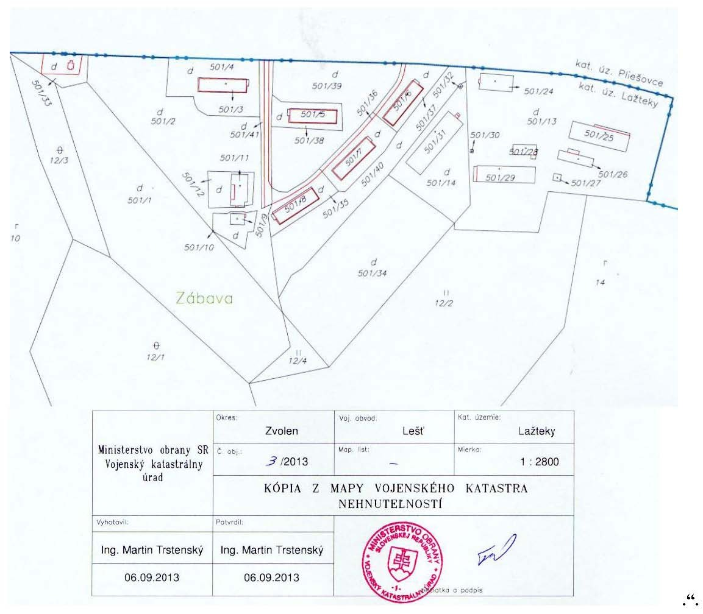

# Čl. I

Nariadenie vlády Slovenskej republiky č. 157/2006 Z. z. o zmene hraníc Vojenského obvodu Lešť a Vojenského obvodu Valaškovce sa dopĺňa takto:

- 1. Za § 1 sa vkladá § 1a, ktorý znie:

- 㤠1a

- (1)

- Hranice Vojenského obvodu Lešť sa menia tak, že z katastrálneho územia Lažteky sa vyčleňujú pozemky s výmerou 76 274 m2 a začleňujú sa do územia obce Pliešovce, katastrálne územie Pliešovce.

- (2)

- Zoznam pozemkov, ktoré sa podľa odseku 1 vyčleňujú z územia Vojenského obvodu Lešť, je podľa katastrálneho územia, parcelných čísel, druhov pozemkov a výmer uvedený v prílohe č. 1a; tieto pozemky sú vyznačené v kópii z mapy vojenského katastra nehnuteľností, ktorá je v prílohe č. 1b.“.

- 2. Za prílohu č. 1 sa vkladajú prílohy č.1a a 1b, ktoré znejú:

- „Príloha č. 1a k nariadeniu vlády č. 157/2006 Z. z.

- ZOZNAM POZEMKOV VYČLENENÝCH Z ÚZEMIA VOJENSKÉHO OBVODU LEŠŤ

- Katastrálne územie Lažteky

- parcela číslo 501/1 501/2 501/3 501/4 501/5 501/6 501/7 501/8 501/9 501/10 501/11 501/12 501/13 501/14 501/24 501/25 501/26 501/27 501/28 501/29 501/30 501/31 501/32 501/33 501/34 501/35 501/36 501/37 501/38 501/39 501/40 501/41 | druh pozemku zastavaná plocha a nádvorie zastavaná plocha a nádvorie zastavaná plocha a nádvorie zastavaná plocha a nádvorie zastavaná plocha a nádvorie zastavaná plocha a nádvorie zastavaná plocha a nádvorie zastavaná plocha a nádvorie zastavaná plocha a nádvorie zastavaná plocha a nádvorie zastavaná plocha a nádvorie zastavaná plocha a nádvorie zastavaná plocha a nádvorie zastavaná plocha a nádvorie zastavaná plocha a nádvorie zastavaná plocha a nádvorie zastavaná plocha a nádvorie zastavaná plocha a nádvorie zastavaná plocha a nádvorie zastavaná plocha a nádvorie zastavaná plocha a nádvorie zastavaná plocha a nádvorie zastavaná plocha a nádvorie zastavaná plocha a nádvorie zastavaná plocha a nádvorie zastavaná plocha a nádvorie zastavaná plocha a nádvorie zastavaná plocha a nádvorie zastavaná plocha a nádvorie zastavaná plocha a nádvorie zastavaná plocha a nádvorie zastavaná plocha a nádvorie | výmera (m2) 15 364 9 686 426 2 439 419 427 429 433 97 593 316 663 13 882 2 955 333 676 224 33 160 612 6 820 10 1 041 9 411 897 1 270 1 037 724 5 597 4 263 1 031

- Spolu z katastrálneho územia Lažteky do katastrálneho územia Pliešovce 76 274

- Príloha č. 1b k nariadeniu vlády č. 157/2006 Z. z.“.

- 
