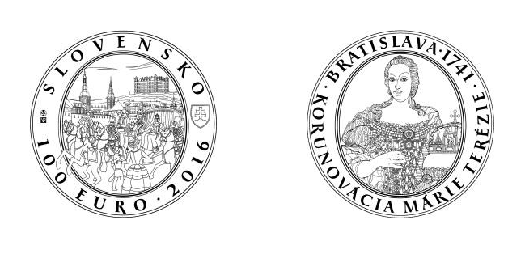

## 150

OZNÁMENIE

Národnej banky Slovenska

z 8. marca 2016

## o vydaní zlatých zberateľských euromincí v nominálnej hodnote 100 eur pri príležitosti 275. výročia korunovácie Márie Terézie v Bratislave

1. Úvodné ustanovenia

- a) Národná banka Slovenska podľa § 17h ods. 1 zákona Národnej rady Slovenskej republiky č. 566/1992 Zb. o Národnej banke Slovenska v znení neskorších predpisov a podľa § 12 ods. 1 písm. b) zákona č. 400/2015 Z. z. o tvorbe právnych predpisov a o Zbierke zákonov Slovenskej republiky a o zmene a doplnení niektorých zákonov oznamuje, že vydáva do obehu zlaté zberateľské euromince v nominálnej hodnote 100 eur pri príležitosti 275. výročia korunovácie Márie Terézie v Bratislave (ďalej len „zberateľská eurominca“).

- b) Zberateľská eurominca má štatút zákonného platidla len v Slovenskej republike.

- c) Zberateľská eurominca sa razí zo zliatiny obsahujúcej 900 dielov zlata, 75 dielov striebra a 25 dielov medi; jej hmotnosť je 9,5 g a priemer 26 mm. Pri razbe euromince je povolená horná a dolná odchýlka v priemere 0,1 mm; povolená horná odchýlka v hmotnosti je 0,08 g a v obsahu zlata 10/1000.

2. Vzhľad zberateľskej euromince

- a) Na líci zberateľskej euromince je v oválnom medailóne vyobrazený dobový výjav z korunovačného sprievodu Márie Terézie v Bratislave. Štátny znak Slovenskej republiky je vpravo od medailónu. Názov štátu „SLOVENSKO“ je v opise v hornej časti mincového poľa. V jeho spodnej časti je v opise označenie nominálnej hodnoty zberateľskej euromince „100 EURO“, ktoré je grafickou značkou oddelené od letopočtu „2016“. Značka Mincovne Kremnica, štátny podnik, ktorú tvorí skratka „MK“ umiestnená medzi dvoma razidlami, a štylizované iniciálky mena a priezviska autora výtvarného návrhu zberateľskej euromince akad. mal. Vladimíra Pavlicu „VP“ sú umiestnené vľavo od medailónu.

- b) Na rube zberateľskej euromince je v oválnom medailóne vyobrazený portrét Márie Terézie. V opise sú nápisy „KORUNOVÁCIA MÁRIE TERÉZIE“ a „BRATISLAVA“ a letopočet korunovácie „1741“, ktoré sú od seba oddelené grafickými značkami.

- c) Hrana zberateľskej euromince je vrúbkovaná.

- 

Štát vydania: Slovenská republika

Začiatok vydávania: máj 2016

Jozef Makúch v. r.
