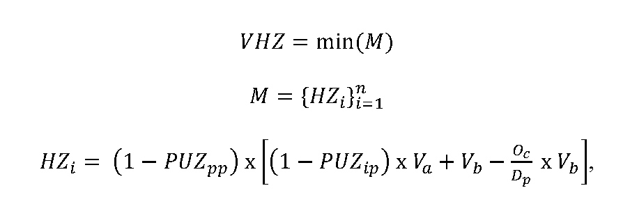

# § 1

(1) Výsledná hodnotiaca známka podľa § 12 ods. 6 zákona sa vypočíta podľa vzorcov:

kde:

VHZ – výsledná hodnotiaca známka, ktorá sa vypočíta ako minimálna hodnota z množiny (M) hodnotiacich známok (HZi),

HZi – hodnotiaca známka za plnenie podľa zmluvy, koncesnej zmluvy alebo rámcovej dohody (ďalej len „plnenie“); to platí rovnako pre opakované plnenia podľa zmluvy alebo rámcovej dohody,

M – množina všetkých hodnotiacich známok za plnenie alebo opakované plnenie,

i – identifikátor hodnotiacej známky, ktorým je množina celých kladných čísel od 1 po n, pričom n predstavuje celkový počet opakovaných plnení; zároveň platí, že ak i = 1, potom VHZ = HZi,

PUZpp – PUZpp = 0, ak nedošlo k predčasnému ukončeniu zmluvy verejným obstarávateľom alebo obstarávateľom z dôvodu podstatného porušenia povinností dodávateľa (ďalej len „podstatné porušenie“), alebo = 1, ak došlo k predčasnému ukončeniu zmluvy z dôvodu podstatného porušenia,

PUZip – PUZip = 0, ak nedošlo k predčasnému ukončeniu zmluvy verejným obstarávateľom alebo obstarávateľom z dôvodu iného porušenia povinností dodávateľa, ako je podstatné porušenie (ďalej len „iné porušenie“), alebo = 1, ak došlo k predčasnému ukončeniu zmluvy z dôvodu iného porušenia,

Va – váha kritéria kvality predčasné ukončenie zmluvy z dôvodu iného porušenia,

Vb – váha kritéria kvality celkové trvanie omeškania dodávateľa, ku ktorému došlo z dôvodov na strane dodávateľa (ďalej len „celkové omeškanie“),

Oc – celkové omeškanie v dňoch; ide o číslo z množiny celých kladných čísel a 0, ak je jeho hodnota väčšia ako hodnota Dp, = hodnote Dp,

Dp – plánovaná dodávka v dňoch podľa zmluvy; ide o číslo z množiny celých kladných čísel okrem 0.

(2) Váha kritéria kvality predčasné ukončenie zmluvy z dôvodu iného porušenia (Va) je 80 a váha kritéria kvality celkové omeškanie (Vb) je 20.

(3) Do kritéria celkové omeškanie sa nezapočítava prípustné omeškanie dohodnuté v zmluve, koncesnej zmluve alebo rámcovej dohode.

(4) Výsledná hodnotiaca známka sa matematicky zaokrúhli na celé číslo.
