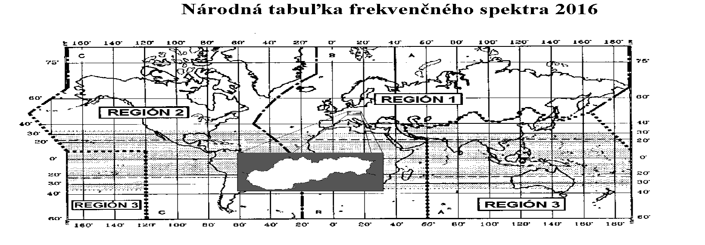

# Čl. I

Nariadenie vlády Slovenskej republiky č. 420/2012 Z. z., ktorým sa ustanovuje národná tabuľka frekvenčného spektra v znení nariadenia vlády Slovenskej republiky č. 505/2013 Z. z. a nariadenia vlády Slovenskej republiky č. 372/2014 Z. z. sa mení takto:

- Príloha vrátane nadpisu znie:

- „Príloha k nariadeniu vlády č. 420/2012 Z. z.

- 

- [Národná tabuľka frekvenčného spektra 2016 2. časť](assets/f54d42207a997b675f9a35d2f01c1369140e12f2fe8d310e7d57e3348f95c732.pdf)
