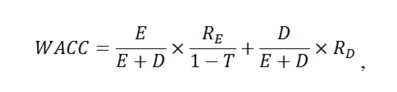
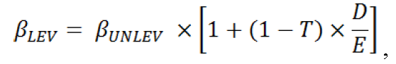

# § 5 Spôsob určenia výšky primeraného zisku

(1) Primeraný zisk zohľadňuje rozsah potrebných investícií na zabezpečenie dlhodobej spoľahlivej, bezpečnej a efektívnej prevádzky siete, primeranú návratnosť prevádzkových aktív a stimuláciu stabilného dlhodobého podnikania.

(2) Výška primeraného zisku je určená ako reálna miera výnosnosti regulačnej bázy aktív pred zdanením na regulačné obdobie (WACC) vypočítaná podľa vzorca

kde

T je sadzba dane z príjmov,

E je vlastné imanie v eurách k 31. decembru 2015,

D sú cudzie zdroje v eurách k 31. decembru 2015,

RD je reálna cena cudzích zdrojov (priemerná výška úverov poskytnutých nefinančným spoločnostiam na obdobie piatich a viac rokov s výškou úveru nad jeden milión eur), ustanovuje sa vo výške 3,73 %,

RE je reálna cena vlastného kapitálu a vlastných zdrojov vypočítaná podľa vzorca

RE = RF + βLEV x (RM - RF),

kde

RF je výnosnosť bezrizikového aktíva, ustanovuje sa vo výške 3,03 %,

βLEV je vážený koeficient β, ktorý definuje citlivosť akcie spoločnosti na riziko trhu so zohľadnením sadzby dane z príjmov a podielu cudzích zdrojov, vypočítaný podľa vzorca

kde

βUNLEV je nevážený koeficient bez vplyvu sadzby dane z príjmov a podielu cudzích zdrojov, ustanovuje sa vo výške 0,53,

D/E je pomer cudzích zdrojov k vlastnému imaniu, ustanovuje sa vo výške 60 % v prospech cudzieho kapitálu,

(RM – RF) je celková riziková prémia, ustanovuje sa vo výške 4,54.

(3) Reálna miera výnosnosti regulačnej bázy aktív (WACC) pred zdanením sa na celé regulačné obdobie ustanovuje vo výške 6,47 %.

(4) Reálna miera výnosnosti regulačnej bázy aktív (WACC) je určená konštantne na celé regulačné obdobie. Ak bude v jednotlivých parametroch odchýlka vyššia ako 10 %, miera výnosnosti regulačných aktív sa prehodnotí a zmena sa zverejní na webovom sídle úradu do 30. júna kalendárneho roku.

(5) Ustanovenia odseku 1 až 4 sa nevzťahujú na ustanovenia § 6 až 8.
