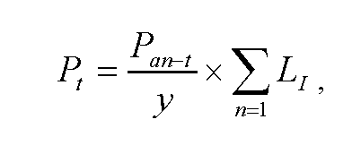
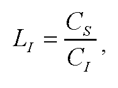

# § 8 Postup a podmienky uplatňovania ceny za prístup do prepravnej siete a prepravu plynu

(1) Ceny za prístup do prepravnej siete a prepravu plynu na rok t sa navrhujú vo forme vstupno-výstupného tarifného systému (ďalej len „tarifný systém“), ktorý obsahuje osobitné tarify pre vstupné body do prepravnej siete a osobitné tarify pre výstupné body z prepravnej siete.28) Výsledná tarifa je tým nižšia, čím je vyššia zmluvne dohodnutá denná prepravná kapacita.

(2) Tarifný systém je zložený z

- a) taríf vzťahujúcich sa na objednanú dennú prepravnú kapacitu,

- b) taríf vzťahujúcich sa na množstvo skutočne prepraveného plynu, určených podľa osobitného predpisu,26b)

- c) ceny za prerušiteľnú kapacitu,

- d) neutralizačného poplatku,

- e) platby za prekročenie dennej prepravnej kapacity na príslušnom vstupnom bode alebo výstupnom bode.

(3) Ustanovenia odsekov 4 až 12 sa vzťahujú na iné prepojovacie body ako prepojovacie body uvedené v § 6 ods. 2 a 3.

(4) Tarify vzťahujúce sa na objednanú dennú prepravnú kapacitu sa navrhujú pre dennú prepravnú kapacitu objednanú na obdobie jedného roka a pre dennú prepravnú kapacitu objednanú na obdobie kratšie ako jeden rok a členia sa takto:

- a) tarifa Ten1, ktorá sa používa na ocenenie prístupu a prepravy plynu cez vstupné body do prepravnej siete s dennou kapacitou do 18 200 MWh/d vrátane,

- b) tarifa Ten2, ktorá sa používa na ocenenie prístupu a prepravy plynu cez vstupné body do prepravnej siete s dennou kapacitou nad 18 200 MWh/d do 100 000 MWh/d vrátane,

- c) tarifa Ten3, ktorá sa používa na ocenenie prístupu a prepravy plynu cez vstupné body do prepravnej siete s dennou kapacitou nad 100 000 MWh/d do 416 000 MWh/d vrátane,

- d) tarifa Ten4, ktorá sa používa na ocenenie prístupu a prepravy plynu cez vstupné body do prepravnej siete s dennou kapacitou nad 416 000 MWh/d do 1 372 800 MWh/d vrátane,

- e) tarifa Ten5, ktorá sa používa na ocenenie prístupu a prepravy plynu cez vstupné body do prepravnej siete s dennou kapacitou nad 1 372 800 MWh/d,

- f) tarifa Tex1, ktorá sa používa na ocenenie prístupu a prepravy plynu cez výstupné body z prepravnej siete s dennou kapacitou do 18 200 MWh/d vrátane,

- g) tarifa Tex2, ktorá sa používa na ocenenie prístupu a prepravy plynu cez výstupné body z prepravnej siete s dennou kapacitou nad 18 200 MWh/d do 100 000 MWh/d vrátane,

- h) tarifa Tex3, ktorá sa používa na ocenenie prístupu a prepravy plynu cez výstupné body z prepravnej siete s dennou kapacitou nad 100 000 MWh/d do 416 000 MWh/d vrátane,

- i) tarifa Tex4, ktorá sa používa na ocenenie prístupu a prepravy plynu cez výstupné body z prepravnej siete s dennou kapacitou nad 416 000 MWh/d do 1 372 800 MWh/d vrátane,

- j) tarifa Tex5, ktorá sa používa na ocenenie prístupu a prepravy plynu cez výstupné body z prepravnej siete s dennou kapacitou nad 1 372 800 MWh/d.

(5) Výsledná tarifa na vstupnom bode do prepravnej siete na rok t sa vypočíta podľa vzorca

Pen(n)(t) = Tent × (1 – αt/1 000 000 * Cent) × Iy/m/d,

kde

Tent je východisková sadzba tarify na vstupnom bode do prepravnej siete na rok t v eurách/(MWh/d)/y podľa odseku 3,

αt je faktor dennej kapacity určený v rozmedzí 0 až 1 pre jednotlivé tarifné skupiny podľa odseku 3 pre vstupný bod do prepravnej siete na rok t tak, že zohľadňuje pokles ceny za prístup do prepravnej siete a prepravu plynu v závislosti od rastúceho množstva prepraveného plynu,

Cent je zmluvne dohodnutá denná kapacita na vstupnom bode do prepravnej siete na rok t v MWh/d,

Iy/m/d je faktor doby trvania zmluvy o prístupe do prepravnej siete a preprave plynu v rokoch/mesiacoch/dňoch.

(6) Pri ročných zmluvách o prístupe do prepravnej siete a preprave plynu sa Iy vypočíta podľa vzorca

Iy = 1,006 – 0,006 × Dy,

kde

Dy je doba vykonávania prepravy plynu podľa zmluvy v rokoch.

(7) Pri mesačných zmluvách o prístupe do prepravnej siete a preprave plynu sa Im vypočíta podľa vzorca

Im = 0,1 + 0,1 × Dm,

kde

Dm je doba vykonávania prepravy plynu podľa zmluvy v mesiacoch.

(8) Pri denných zmluvách o prístupe do prepravnej siete a preprave plynu sa Id vypočíta podľa vzorca

Id = 0,001 + 0,0072 × Dd,

kde

Dd je doba vykonávania prepravy plynu podľa zmluvy v dňoch.

(9) Pri zmluvách o prístupe do prepravnej siete a preprave plynu v dĺžke trvania jeden rok je hodnota Iy rovná 1. Hodnota Iy klesá v závislosti od dohodnutého počtu rokov trvania vykonávania prepravy plynu dohodnutej na základe zmluvy, pričom výsledná tarifa pre zmluvu s trvaním 20 a viac rokov je najviac vo výške 0,886-násobku výslednej tarify pre zmluvu s trvaním jeden rok. Faktor doby trvania pri mesačných zmluvách o prístupe do prepravnej siete a preprave plynu sa určuje tak, aby výsledná tarifa pre zmluvu s trvaním jeden mesiac bola najviac vo výške 2,4-násobku mesačnej platby pre zmluvu s trvaním jeden rok. Faktor doby trvania pri denných zmluvách o prístupe do prepravnej siete a preprave plynu sa určuje tak, aby výsledná tarifa pre zmluvu s trvaním jeden deň bola najviac vo výške 2,993-násobku dennej platby pre zmluvu s trvaním jeden rok.

(10) Výsledná tarifa na výstupnom bode z prepravnej siete na rok t sa vypočíta podľa vzorca

Pex(n)(t) = Text × (1 – αt/1 000 000 * Cext) × Iy/m/d,

kde

Text je východisková sadzba tarify na výstupnom bode z prepravnej siete na rok t v eurách/(MWh/d)/y podľa odseku 3,

αt je faktor dennej kapacity určený v rozmedzí od 0 až 1 pre jednotlivé tarifné skupiny podľa odseku 3 pre výstupný bod z prepravnej siete na rok t tak, že zohľadňuje pokles ceny za prístup do prepravnej siete a prepravu plynu v závislosti od rastúceho množstva prepraveného plynu,

Cext je zmluvne dohodnutá denná kapacita na výstupnom bode z prepravnej siete na rok t v MWh/d,

Iy/m/d je faktor doby trvania zmluvy o prístupe do prepravnej siete a preprave plynu v rokoch/mesiacoch/dňoch.

(11) Ročná platba Pt za prístup a prepravu plynu vstupným alebo výstupným bodom pri prerušiteľnej kapacite pre rok t pri ročnej zmluve za prístup do prepravnej siete a prepravu plynu sa vypočíta podľa vzorca

kde

Pan-t je ročná platba za prepravnú kapacitu bez prerušenia,

y je celkový počet dní v príslušnom roku,

LI je faktor odrážajúci mieru prerušenia a vypočítaný podľa vzorca

kde

CS je dostupná hodnota prerušiteľnej prepravnej kapacity pri prerušení alebo obmedzení prepravy plynu prevádzkovateľom prepravnej siete,

CI je zmluvná denná prerušiteľná prepravná kapacita.

(12) Na odberateľa plynu, ktorý je pripojený do prepravnej siete a ktorý je výrobcom elektriny a súčasne poskytovateľom podporných služieb v elektroenergetike na základe zmluvy o poskytovaní podporných služieb a dodávke regulačnej elektriny, sa po preukázaní skutočne dodaného množstva regulačnej elektriny a po preukázaní množstva plynu potrebného na výrobu regulačnej elektriny neuplatňuje platba za prekročenie dennej prepravnej kapacity na príslušnom výstupnom bode, pričom platba užívateľa prepravnej siete za prepravu plynu podľa platného cenového rozhodnutia tým nie je dotknutá.

(13) Neutralizačný poplatok pre každý rok regulačného obdobia vyjadrený v eurách na energetickú jednotku pridelenej prepravnej kapacity sa určí ako rozdiel medzi príjmami prevádzkovateľa prepravnej siete a nákladmi na vykonávanie vyvažovacej činnosti a upravuje sa podľa skutočného stavu neutralizačného účtu v roku t-2.

(14) Prevádzkovateľ prepravnej siete vedie neutralizačný účet, na ktorom sú evidované údaje súvisiace s realizáciou vyvažovacích činností, najmä

- a) prijaté platby za neutralizačný poplatok od užívateľov prepravnej siete,

- b) ekonomicky oprávnené náklady vynaložené v nevyhnutnom rozsahu na vykonávanie vyváženia prepravnej siete podľa § 4 ods. 1 okrem nákladov podľa § 4 ods. 1 písm. a), b) a l),

- c) výnosy prevádzkovateľa prepravnej siete z predaja plynu predaného ako výsledok vyvažovacej činnosti vyváženia siete,

- d) náklady prevádzkovateľa prepravnej siete na nákup plynu pre zabezpečenie vyváženia siete.
