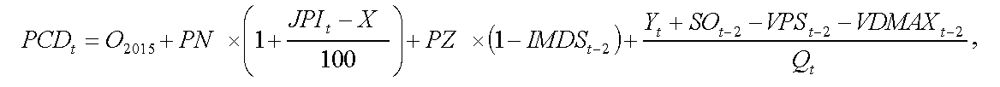
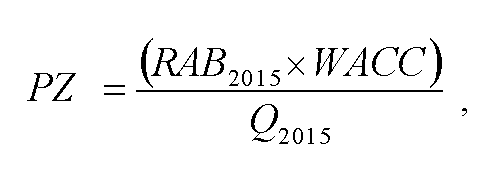
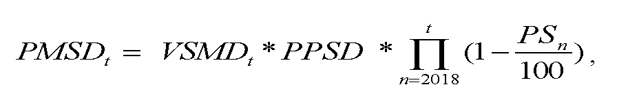

# § 11 Výpočet maximálnej ceny za prístup do distribučnej siete a distribúciu plynu

(1) Maximálna cena za prístup do distribučnej siete a distribúciu plynu PCDt v eurách na jednotku množstva distribuovaného plynu pre jednotlivé roky regulačného obdobia sa vypočíta podľa vzorca

kde

O2015 je ročná hodnota regulačných odpisov regulovaného subjektu v eurách na jednotku množstva distribuovaného plynu Q2015 na základe hodnoty regulovanej bázy aktív regulovaného subjektu RAB nevyhnutne využívaných na výkon regulovanej činnosti k 31. decembru 2015, zohľadňujúca dobu technickej životnosti aktív podľa prílohy č. 12,

PN sú ročné prevádzkové náklady regulovaného subjektu v eurách na jednotku množstva distribuovaného plynu Q2015 súvisiace s regulovanou činnosťou určené podľa § 4 ods. 1, okrem odpisov a nákladov na krytie strát a vlastnej spotreby v distribučnej sieti a určené ako priemerné ročné prevádzkové náklady nevyhnutne vynaložené na regulovanú činnosť za predchádzajúce regulačné obdobie za roky 2012 až 2016, pričom PN sú určené na celé regulačné obdobie a výpočet PN sa predloží regulovaným subjektom ako súčasť návrhu ceny na prvý rok regulačného obdobia spolu s odôvodnením výpočtu jednotlivých nákladových položiek,

PZ je hodnota primeraného zisku regulovaného subjektu, ktorá sa vypočíta podľa vzorca

kde

RAB2015 je hodnota regulovanej bázy aktív vo východiskovom roku regulačného obdobia v eurách používaného výhradne na regulovanú činnosť určená k 31. decembru 2015,

WACC je určená miera výnosnosti regulačnej bázy aktív podľa § 5 ods. 2 a 3,

Q2015 je celkový objem množstva distribuovaného plynu vypočítaný z priemerného množstva distribuovaného plynu v rokoch t-4 až t-2 a očakávanej skutočnosti v roku t-1,

JPIt je aritmetický priemer zverejnených hodnôt ukazovateľa „jadrová inflácia“ za obdobie posledných 12 mesiacov predchádzajúcich predloženiu návrhu ceny podľa osobitného predpisu4) uvedených na webovom sídle Štatistického úradu Slovenskej republiky v časti „Jadrová a čistá inflácia – oproti rovnakému obdobiu minulého roku v percentách“,

X je faktor efektivity, ustanovuje sa pre celé regulačné obdobie vo výške 3,5 %; ak je hodnota rozdielu JPIt a X nižšia ako 0, na účely výpočtu maximálnej ceny za prístup do distribučnej siete a distribúciu plynu na rok t sa hodnota rozdielu rovná 0,

IMDSt-2 je index miery využitia dosiahnutých disponibilných zdrojov regulovaného subjektu, ktorý je určený na základe využitia dosiahnutých disponibilných zdrojov regulovaného subjektu za rok t-2 na obnovu a rozvoj siete v intervale 0 až 1,

VPSt-2 je hodnota skutočných ročných výnosov za pripojenie do distribučnej siete v eurách za rok t-2,

VDMAXt-2 je hodnota skutočných ročných výnosov za prekročenie zmluvne dohodnutej dennej distribučnej kapacity v eurách za rok t-2,

Yt je hodnota nákladov na krytie strát plynu a vlastnej spotreby plynu v distribučnej sieti vyjadrená v eurách podľa odsekov 6 a 7; pre rok 2017 sa hodnota Yt vypočíta podľa odseku 6, pre roky 2018 až 2021 sa hodnota Yt vypočíta podľa odseku 7,

SOt-2 je hodnota odpisov v eurách zo skutočne zaradeného nového dlhodobého majetku nevyhnutne potrebného na zabezpečenie prevádzkyschopnosti siete zohľadňujúca technickú dobu životnosti zaradeného majetku v roku t-2 podľa tabuľky v prílohe č. 12; pre rok 2017 sa hodnota SOt-2 rovná 0,

Qt je plánované množstvo distribuovaného plynu na rok t.

(2) Na účely cenovej regulácie za prístup do distribučnej siete a distribúciu plynu pre prevádzkovateľa distribučnej siete, ktorý distribuuje plyn distribučnou sieťou, do ktorej je pripojených viac ako 100 000 odberateľov, je O2015 určená na základe hodnoty regulovanej bázy aktív regulovaného subjektu nevyhnutne využívaných na výkon regulovanej činnosti k 31. decembru 2015 zohľadňujúca dobu technickej životnosti aktív podľa prílohy č. 12.

(3) Regulačné odpisy O2015 pre prevádzkovateľa distribučnej siete, ktorý distribuuje plyn distribučnou sieťou, sú regulačné odpisy hmotného majetku a nehmotného majetku nevyhnutne využívaného na regulovanú činnosť vypočítané ako podiel zostatkovej ceny hmotného majetku a nehmotného majetku a doby technickej životnosti jednotlivých druhov hmotného majetku a nehmotného majetku podľa príloh č. 12 a 20, zníženej o dobu od zaradenia do účtovnej evidencie do 31. decembra 2015. Zostatková cena hmotného a nehmotného majetku je rozdiel obstarávacej ceny hmotného a nehmotného majetku a sumy odpisov v jednotlivých rokoch odo dňa zaradenia majetku do účtovnej evidencie.

(4) Regulačná báza aktív RAB pre prevádzkovateľa distribučnej siete, ktorý distribuuje plyn distribučnou sieťou, je hodnota aktív slúžiaca výhradne na vykonávanie regulovaných činností, ktorá sa určí ako suma zostatkovej ceny hmotného a nehmotného majetku podľa prílohy č. 20 a nájomného podľa § 4 ods. 1 písm. h), alebo na základe znaleckého posudku na stanovenie všeobecnej hodnoty zariadení prevádzkovateľa distribučnej siete slúžiacich výhradne na výkon regulovanej činnosti k 31. decembru 2015 podľa osobitného predpisu.29)

(5) Hodnoty vstupujúce do výpočtov podľa odseku 1 sa odôvodňujú analýzami, ktoré sa predkladajú s návrhom ceny.

(6) Hodnota nákladov na krytie strát plynu a vlastnej spotreby plynu v distribučnej sieti Y2017 v eurách sa vypočíta ako súčin ceny plynu na krytie strát plynu a vlastnej spotreby plynu v distribučnej sieti v eurách na jednotku množstva plynu podľa odseku 8 a priemerného ročného množstva plynu vstupujúceho do distribučnej siete za predchádzajúce regulačné obdobie za roky 2012 až 2015 v jednotkách množstva plynu a počiatočnej percentuálnej výšky strát v distribučnej sieti, najviac vo výške 2 %.

(7) Hodnota nákladov na krytie strát plynu a vlastnej spotreby plynu v distribučnej sieti pre roky 2018 až 2021 sa vypočíta ako súčin ceny plynu na krytie strát plynu a vlastnej spotreby plynu v distribučnej sieti v eurách na jednotku množstva plynu podľa odseku 8 a povoleného množstva strát v distribučnej sieti PMSDt. Povolené množstvo strát v distribučnej sieti PMSDt v jednotkách množstva plynu pre potreby výpočtu nákladov na krytie strát plynu a vlastnej spotreby plynu v distribučnej sieti Yt pre roky 2018 až 2021 sa vypočíta podľa vzorca

kde

VSMDt je množstvo plynu vstupujúceho do distribučnej siete za rok t v jednotkách množstva plynu,

PPSD je počiatočná percentuálna výška strát v distribučnej sieti z priemerného množstva plynu vstupujúceho do distribučnej siete určená podľa odseku 6,

PSn je faktor efektivity poklesu strát v distribučnej sieti, ustanovuje sa pre jednotlivé roky regulačného obdobia vo výške 0,25 %.

(8) Cena plynu na krytie strát a vlastnej spotreby v distribučnej sieti CPSt sa vypočíta podľa vzorca

CPSt = CENCG,t + kspd,

kde

CENCG,t je aritmetický priemer denných cien zverejnených burzou EEX (European Energy Exchange) na jej webovom sídle, produktu NCG Natural Gas Year Futures Cal-t v eurách na megawatthodinu za obdobie 12 kalendárnych mesiacov predchádzajúcich mesiacu, v ktorom sa predkladá návrh ceny,

kspd je koeficient zohľadňujúci medzinárodnú prepravu plynu na územie Slovenskej republiky, ustanovuje sa vo výške 1,25 eura na megawatthodinu.

(9) Na účely prepočtu jednotiek množstva plynu vyjadrených v metroch kubických na jednotky energie sa použije hodnota spaľovacieho tepla objemového vo výške 10,69 kWh/m3.

(10) Ustanovenia o návrhu ceny sa primerane vzťahujú aj na návrh na zmenu cenového rozhodnutia.
