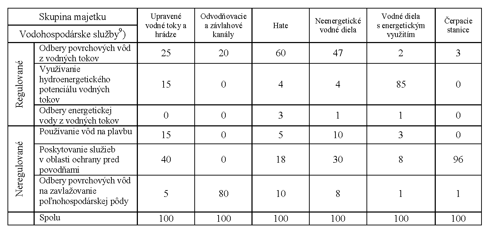

# § 4 Rozsah, štruktúra a výška ekonomicky oprávnených nákladov

(1) Ekonomicky oprávnenými nákladmi sú:

- a) primerané technologické náklady,

- b) osobné náklady;3) za ekonomicky oprávnené náklady sa považujú aj priemerné osobné náklady na jedného zamestnanca na rok t zvýšené oproti určeným nákladom na rok t-1 najviac o výšku aritmetického priemeru zverejnených hodnôt ukazovateľa „jadrová inflácia“ za mesiace júl až december roku t-2 a za január až jún roku t-1 zverejnených na webovom sídle Štatistického úradu Slovenskej republiky v časti „Jadrová a čistá inflácia – oproti rovnakému obdobiu minulého roku v %“,

- c) náklady na plnenie povinností podľa osobitných predpisov,4)

- d) odpisy hmotného majetku a nehmotného majetku, pričom za ekonomicky oprávnené náklady sa považujú rovnomerné odpisy hmotného majetku a nehmotného majetku najviac vo výške zohľadňujúcej dobu technickej životnosti z obstarávacej ceny5) majetku evidovaného v účtovníctve regulovaného subjektu,

- e) nájomné za prenajatý hmotný majetok a nehmotný majetok, o ktorom účtuje vlastník a ktorý sa používa výhradne na regulovanú činnosť, najviac vo výške odpisov podľa písmena d),

- f) náklady na opravy a údržbu majetku využívaného na zabezpečenie regulovanej činnosti v rozsahu zabezpečujúcom výkon regulovanej činnosti v primeranej výške okrem nákladov na technické zhodnotenie hmotného majetku a nehmotného majetku podľa osobitného predpisu,6)

- g) úrok z úveru poskytnutého bankou alebo pobočkou zahraničnej banky7) na obstaranie hmotného majetku alebo nehmotného majetku, ktorý sa používa výhradne na regulovanú činnosť.

(2) Na účely odseku 1 sa rozumie

- a) opravou súhrn činností, ktorými sa odstraňujú následky poškodenia, opotrebenia celku, skupín alebo dielcov na účel uvedenia zariadenia do prevádzkyschopného stavu,

- b) údržbou súhrn činností zabezpečujúcich technickú spôsobilosť a hospodárnosť prevádzky zariadenia, ktorými sa spomaľuje fyzické opotrebenie, predchádza sa jeho následkom a odstraňujú sa drobnejšie chyby, spravidla bez demontáže dielov a bez výmeny súčiastok.

(3) Ekonomicky oprávnené náklady sa určujú na jednotlivé regulované a neregulované činnosti v rozsahu, v akom sa jednotlivé skupiny vodohospodárskeho hmotného majetku v percentách využívajú na vodohospodárske služby8) podľa tabuľky9)

(4) Výška ekonomicky oprávnených nákladov sa pri predaji hmotného majetku, ktorý sa používal na vykonávanie regulovanej činnosti, zníži o kladný rozdiel predajnej ceny a zostatkovej ceny hmotného majetku podľa ods. 1 písm. d).

(5) Ekonomicky oprávnenými nákladmi nie sú:

- a) sankcie,

- b) náklady spojené s nevyužitými prevádzkami a výrobnými kapacitami,

- c) odpisy nevyužívaného dlhodobého majetku, odpisy „goodwill“ a odpisy hmotného majetku a nehmotného majetku vylúčeného z odpisovania,10)

- d) odmeny členov štatutárneho orgánu a iných orgánov regulovaného subjektu za výkon funkcie, ktorí nie sú v pracovnoprávnom vzťahu s regulovaným subjektom,

- e) platby poistného za poistenie zodpovednosti za škody spôsobené členmi štatutárnych orgánov a členmi iných orgánov regulovaného subjektu,

- f) príspevky na životné poistenie, príspevky na účelové sporenie zamestnanca a príspevky na doplnkové dôchodkové sporenie11) platené zamestnávateľom okrem príspevkov na doplnkové dôchodkové sporenie podľa ods. 1 písm. c),

- g) odstupné a odchodné presahujúce výšku ustanovenú osobitným predpisom,12)

- h) príspevky na stravovanie zamestnancov nad rozsah ustanovený osobitným predpisom,13)

- i) cestovné náhrady nad rozsah ustanovený osobitným predpisom,14)

- j) náklady na tvorbu sociálneho fondu nad rozsah ustanovený osobitným predpisom,15)

- k) náklady na poskytovanie osobných ochranných pracovných prostriedkov nad rozsah ustanovený osobitným predpisom,16)

- l) náklady na dobrovoľné poistenie osôb,

- m) manká a škody na majetku vrátane škody zo zníženia cien nevyužiteľných zásob a likvidácie zásob,

- n) náklady vyplývajúce z chýb vo výpočtoch, v kalkulačných prepočtoch alebo v účtovníctve, duplicitne účtované náklady,

- o) náklady na reprezentáciu a dary,

- p) odmeny a dary pri životných jubileách a pri odchode do dôchodku,

- q) náklady na starostlivosť o zdravie zamestnancov a na vlastné zdravotnícke zariadenia nad rozsah ustanovený osobitným predpisom,17)

- r) príspevky a náklady na rekreačné, regeneračné, rekondičné a ozdravné pobyty, ak povinnosť ich uhrádzania neustanovuje osobitný predpis,18)

- s) náklady na údržbu a prevádzku školiacich a rekreačných zariadení,

- t) náklady vynaložené na obstaranie materiálu, služieb a na činnosti nesúvisiace s výkonom regulovaných činností,

- u) daň z nehnuteľnosti platená za vzdelávacie zariadenia a rekreačné zariadenia,

- v) štipendiá poskytnuté študentom vysokých škôl a žiakom,

- w) odpis nedobytnej pohľadávky okrem pohľadávok za odbery podzemnej vody a za vypúšťanie odpadových vôd,

- x) náklady na tvorbu rezerv nad rozsah ustanovený osobitným predpisom,19)

- y) rozdiely zo zmien použitých účtovných metód a účtovných zásad,20)

- z) náklady na tvorbu opravných položiek,

- aa) náklady spojené s prípravou a zabezpečením nerealizovanej investičnej výstavby,

- ab) straty z predaja dlhodobého majetku a zásob,

- ac) zostatková cena predaného alebo vyradeného hmotného majetku a nehmotného majetku,

- ad) náklady na reklamu alebo propagáciu uskutočňovanú formou podpory športových, kultúrnych a zábavných podujatí a iných činností,

- ae) spotreba pohonných látok nad rozsah ustanovený osobitným predpisom,21)

- af) náklady na výkon regulovanej činnosti, ktorý je realizovaný iným ako regulovaným subjektom, v ktorom má regulovaný subjekt majetkovú účasť, zistené podľa § 31 ods. 3 písm. d) zákona,

- ag) straty z obchodov s finančnými a komoditnými derivátmi,

- ah) úrazové dávky poskytované podľa osobitného predpisu, 22)

- ai) ostatné náklady, ktoré nie sú uvedené v odseku 1.

(6) Do ekonomicky oprávnených nákladov na odber povrchových vôd nemožno zahrnúť náklady spojené s odberom povrchovej vody podľa osobitného predpisu23) a náklady súvisiace s dodávkou povrchovej vody odberateľovi.
