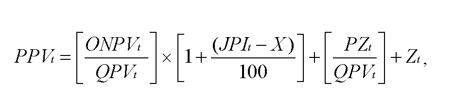

# § 8 Spôsob výpočtu pevnej ceny za odber povrchovej vody a výšky primeraného zisku

(1) Pevná cena za odber povrchovej vody v eurách na objemovú jednotku na rok t sa vypočíta podľa vzorca

ak (JPIt – X) < 0, na účely výpočtu pevnej ceny sa hodnota rozdielu JPI a X rovná nule,

kde

PPVtje pevná cena za odber povrchovej vody v eurách na objemovú jednotku v roku t,

ONPVt sú ekonomicky oprávnené náklady v eurách na odber povrchovej vody v cene schválenej alebo určenej úradom na rok t-1; vo výpočte ceny na prvý rok regulačného obdobia sa použijú skutočné ekonomicky oprávnené náklady v roku t-2 podľa § 4 ods. 2,

PZtje maximálna výška primeraného zisku v eurách vypočítaná podľa odseku 2,

QPVt je množstvo povrchovej vody v objemových jednotkách odobratej odberateľmi z vodných tokov v cene schválenej alebo určenej úradom na rok t-1; vo výpočte ceny na prvý rok regulačného obdobia sa použije skutočné množstvo odobratej povrchovej vody v roku t-2,

JPIt je aritmetický priemer zverejnených hodnôt ukazovateľa „jadrová inflácia“ za posledných 12 mesiacov predchádzajúcich mesiacu, v ktorom sa návrh ceny predkladá, zverejnených na webovom sídle Štatistického úradu Slovenskej republiky v časti „Jadrová a čistá inflácia – oproti rovnakému obdobiu minulého roku v %“,

X je faktor efektivity; pre regulačné obdobie sa ustanovuje vo výške 3,5 %,

Zt je hodnota zmeny v eurách na objemovú jednotku, ktorá sa použije vo výpočte, ak sa postupuje v cenovom konaní o zmene rozhodnutia podľa § 17 ods. 2 písm. d) zákona; hodnota zmeny vyjadruje zmenu ekonomických parametrov, ktoré ovplyvňujú ekonomicky oprávnené náklady regulovaného subjektu, z ktorých sa vychádzalo pri určení pevnej ceny za odber povrchovej vody v eurách na objemovú jednotku a odôvodňuje sa analýzami pripojenými k návrhu na zmenu cenového rozhodnutia.

(2) Maximálny primeraný zisk za odber povrchovej vody v eurách na rok t sa vypočíta podľa vzorca

PZt =ONPVt × WACC.
