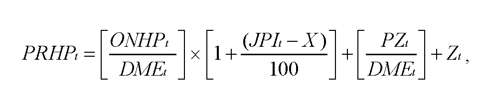

# § 9 Spôsob výpočtu pevnej ceny za využívanie hydroenergetického potenciálu a výšky primeraného zisku

(1) Na určenie pevnej ceny za využívanie hydroenergetického potenciálu sa vypočíta priemerná cena za využívanie hydroenergetického potenciálu v eurách na jednotku dodanej mechanickej energie v roku t podľa vzorca

ak (JPIt – X) < 0, na účely výpočtu priemernej ceny sa hodnota rozdielu JPI a X rovná nule,

kde

PRHPt je priemerná cena za využívanie hydroenergetického potenciálu v eurách na jednotku dodanej mechanickej energie v roku t,

ONHPt sú ekonomicky oprávnené náklady v eurách na využívanie hydroenergetického potenciálu v cene schválenej alebo určenej úradom na rok t-1; vo výpočte ceny na prvý rok regulačného obdobia sa použijú skutočné ekonomicky oprávnené náklady v roku t-2 podľa § 4

ods. 2,

PZt je maximálna výška primeraného zisku v eurách vypočítaná podľa odseku 2,

DMEt je množstvo dodanej mechanickej energie v jednotkách množstva mechanickej energie vypočítané z množstva predpokladanej vyrobenej elektrickej energie pri predpokladanej 97-percentnej účinnosti energetických zariadení, v cene schválenej alebo určenej úradom na rok t-1; vo výpočte ceny na prvý rok regulačného obdobia sa použije skutočné množstvo dodanej mechanickej energie v roku t-2,

JPIt je aritmetický priemer zverejnených hodnôt ukazovateľa „jadrová inflácia“ za posledných 12 mesiacov predchádzajúcich mesiacu, v ktorom sa návrh ceny predkladá, zverejnených na webovom sídle Štatistického úradu Slovenskej republiky v časti „Jadrová a čistá inflácia – oproti rovnakému obdobiu minulého roku v %“,

X je faktor efektivity; pre regulačné obdobie sa ustanovuje vo výške 3,5 %,

Zt je hodnota zmeny v eurách na jednotku dodanej mechanickej energie, ktorá sa použije vo výpočte, ak sa postupuje v cenovom konaní o zmene rozhodnutia podľa § 17 ods. 2 písm. d) zákona; hodnota zmeny vyjadruje zmenu ekonomických parametrov, ktoré ovplyvňujú ekonomicky oprávnené náklady regulovaného subjektu, z ktorých sa vychádzalo pri výpočte priemernej ceny za využívanie hydroenergetického potenciálu v eurách na jednotku dodanej mechanickej energie a odôvodňuje sa analýzami pripojenými k návrhu na zmenu cenového rozhodnutia.

(2) Maximálny primeraný zisk za využívanie hydroenergetického potenciálu v eurách na rok t sa vypočíta podľa vzorca

PZt = ONHPt × WACC.

(3) Pevná cena za využívanie hydroenergetického potenciálu sa predkladá ako tarifa pre jednotlivé skupiny využívateľov hydroenergetického potenciálu.

(4) Tarify pre jednotlivé skupiny využívateľov hydroenergetického potenciálu sa vypočítajú podľa vzorca

Tt = PRHPt × k,

kde

Tt je tarifa za využívanie hydroenergetického potenciálu v eurách na jednotku dodanej mechanickej energie v roku t,

k je koeficient rozloženia ekonomicky oprávnených nákladov a primeraného zisku medzi jednotlivé skupiny využívateľov hydroenergetického potenciálu vodného toku určený podľa odseku 5.

(5) Skupiny využívateľov hydroenergetického potenciálu sa členia podľa inštalovaného výkonu vodných elektrární a koeficient rozloženia nákladov k sa ustanovuje takto:

- a) 0,30 pri inštalovanom výkone od 100 kW do 1 000 kW vrátane,

- b) 0,50 pri inštalovanom výkone od 1 001 kW do 10 000 kW vrátane,

- c) 1,02 pri inštalovanom výkone nad 10 000 kW.

(6) Návrh taríf za využívanie hydroenergetického potenciálu na rok t sa predkladá tak, aby ich vážený priemer prepočítaný na jednotku dodanej mechanickej energie neprekročil priemernú cenu za využívanie hydroenergetického potenciálu vypočítanú podľa odseku 1.
