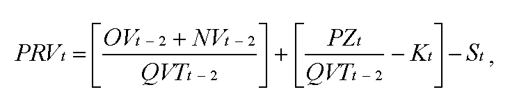
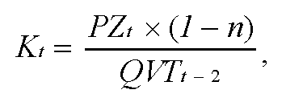
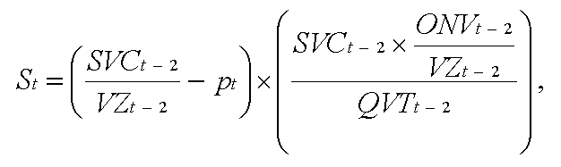
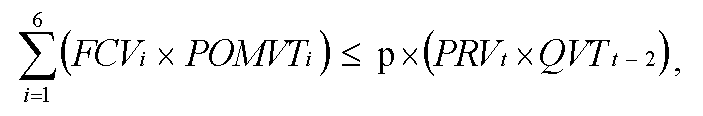
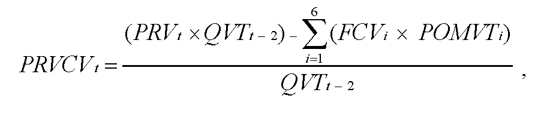
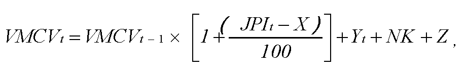
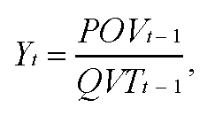

# § 8 Spôsob výpočtu maximálnej ceny za výrobu, distribúciu a dodávku pitnej vody a výšky primeraného zisku

(1) Maximálna cena za výrobu a dodávku pitnej vody, maximálna cena za výrobu a distribúciu pitnej vody, maximálna cena za dodávku pitnej vody alebo maximálna cena za výrobu a dodávku pitnej vody pre skupinu odberateľov sa skladá z fixnej zložky maximálnej ceny v eurách za rok a variabilnej zložky maximálnej ceny v eurách na objemovú jednotku, pričom je maximálna v jednotlivých zložkách ceny. Pri tvorbe maximálnej ceny sa zohľadňuje štruktúra odberateľov a navrhuje sa tak, aby zohľadňovala nákladovosť odberných miest odberateľov v tarifných skupinách.

(2) Na určenie maximálnej ceny za výrobu a dodávku pitnej vody, maximálnej ceny za výrobu a distribúciu pitnej vody, maximálnej ceny za dodávku pitnej vody alebo maximálnej ceny za výrobu a dodávku pitnej vody pre skupinu odberateľov v eurách na objemovú jednotku na prvý rok regulačného obdobia sa vypočíta priemerná cena podľa vzorca

kde

PRVt je priemerná cena za výrobu, distribúciu a dodávku pitnej vody v eurách na objemovú jednotku,

OVt-2 sú odpisy hmotného majetku a nehmotného majetku a nájomné za prenajatý hmotný majetok a nehmotný majetok v eurách využívaný výhradne na výrobu, distribúciu a dodávku pitnej vody v roku t-2 podľa § 4 ods. 1 písm. e) a f),

NVt-2 sú skutočné ekonomicky oprávnené prevádzkové náklady v eurách na výrobu, distribúciu a dodávku pitnej vody v roku t-2 podľa § 4 okrem OVt-2,

QVTt-2 je skutočné množstvo dodanej pitnej vody v objemových jednotkách pre všetkých odberateľov v roku t-2 vrátane vlastnej spotreby,

PZt je primeraný zisk v eurách vypočítaný podľa odseku 3, pričom maximálny primeraný zisk je 0,08 eura na 1 m3 skutočného množstva dodanej pitnej vody v roku t-2 vrátane vlastnej spotreby, alebo podľa odseku 4; pri výpočte ceny za dodávku pitnej vody sa uplatní najviac polovica hodnoty PZt,

Kt je faktor využitia kapacity vodárenského majetku používaného na výrobu, distribúciu a dodávku pitnej vody podľa odseku 5,

St je faktor strát pitnej vody v eurách na objemovú jednotku podľa odseku 6. Pre regulovaný subjekt, ktorého dodávka pitnej vody verejným vodovodom nepresiahne 1 000 000 m3, sa St rovná nule.

(3) Primeraný zisk PZt v eurách sa vypočíta podľa vzorca

PZt = RAB2015 × WACCt,

kde

RAB2015je účtovná hodnota (zostatková cena) hmotného majetku a nehmotného majetku v eurách v roku 2015 používaného na regulovanú činnosť podľa prílohy č. 14.

(4) Primeraný zisk PZt pre regulovaný subjekt, ktorého dodávka pitnej vody verejným vodovodom nepresiahne 1 000 000 m3, je najviac 0,04 eura na 1 m3 skutočného množstva dodanej pitnej vody v roku t-2 vrátane vlastnej spotreby.

(5) Hodnota faktora využitia vodárenského majetku používaného na výrobu, distribúciu a dodávku pitnej vody v eurách na objemovú jednotku sa vypočíta podľa vzorca

kde

n je koeficient využitia projektovanej kapacity vodárenského majetku používaného na výrobu, distribúciu a dodávku pitnej vody, ktorý sa vypočíta ako priemer podielov skutočne využívanej kapacity a celkovej projektovanej kapacity jednotlivého vodárenského majetku podľa prílohy č. 18. Vypočítaná hodnota sa matematicky zaokrúhli na dve desatinné miesta.

(6) Hodnota faktora strát pitnej vody St v eurách na objemovú jednotku sa vypočíta podľa vzorca

pričom vypočítaná hodnota podielu SVCt-2 a VZt-2 sa zaokrúhli na dve desatinné miesta; ak je menšia ako hodnota koeficientu pt, hodnota faktora strát pitnej vody St sa rovná nule,

kde

SVCt-2 je celkový objem strát vo verejnom vodovode v objemových jednotkách v roku t-2 podľa prílohy č. 19; ak objem vlastnej spotreby vody VS v objemových jednotkách v roku t-2 presiahne

4 % z celkového objemu surovej vody z vodárenských zdrojov VZ v roku t-2, potom SVCt-2 je objem zvýšený o presahujúci objem vlastnej spotreby vody VS,

VZt-2 je celkový objem surovej vody z vodárenských zdrojov v objemových jednotkách v roku t-2 podľa prílohy č. 19,

pt je hodnota koeficienta technicky a ekonomicky akceptovateľných skutočných strát pitnej vody 0,2, ktorá zohľadňuje najviac 20 % strát z celkového objemu surovej vody z vodárenských zdrojov,

ONVt-2 sú celkové skutočné ekonomicky oprávnené náklady v eurách na výrobu, distribúciu a dodávku pitnej vody v roku t-2 podľa § 4.

(7) Ak sa návrh ceny predkladá prvýkrát, vypočíta sa priemerná cena za výrobu, distribúciu a dodávku pitnej vody v eurách na objemovú jednotku na rok t podľa odseku 2, pričom sa na výpočet použijú plánované údaje na rok t.

(8) Fixná zložka maximálnej ceny za výrobu a dodávku pitnej vody, maximálnej ceny za výrobu a distribúciu pitnej vody, maximálnej ceny za dodávku pitnej vody alebo maximálnej ceny za výrobu a dodávku pitnej vody pre skupinu odberateľov (ďalej len „fixná zložka maximálnej ceny pitnej vody“) sa určuje podľa fixnej zložky maximálnej ceny pitnej vody v eurách za rok v príslušnej tarifnej skupine.

(9) Odberné miesta odberateľov pitnej vody sa členia do tarifných skupín

- a) podľa menovitého priemeru DN vodomera21) na odbernom mieste takto:

- Tarifná skupina | DN vodomera na odbernom mieste

- T1 | do DN 20 (vrátane)

- T2 | od DN 25

- T3 | od DN 40

- T4 | od DN 65

- T5 | od DN 100

- T6 | od DN 150

- b) bez osadeného vodomera a určené na distribúciu pitnej vody do tarifnej skupiny T1,

- c) s osadeným združeným vodomerom do tarifnej skupiny podľa menovitého priemeru DN väčšieho meradla.

(10) Fixná zložka maximálnej ceny pitnej vody v eurách za rok na odberné miesto v tarifných skupinách T1 až T6 sa vypočíta podľa vzorca

FCVi = PRVt × m ×ti,

kde i = 1,...6,

FCVi je fixná zložka maximálnej ceny pitnej vody v tarifnej skupine Ti v eurách za rok; vypočítaná hodnota sa matematicky zaokrúhli na celé číslo.

PRVt je priemerná cena za výrobu, distribúciu a dodávku pitnej vody v eurách na objemovú jednotku,

m je koeficient fixnej zložky maximálnej ceny pitnej vody podľa odseku 12,

ti je technický parameter pre výpočet fixnej zložky v tarifnej skupine Ti, ktorý sa určuje v závislosti od menovitého priemeru DN vodomera na odbernom mieste, pričom zohľadňuje aj nákladovosť odberného miesta.

(11) Fixná zložka maximálnej ceny pitnej vody v eurách za rok pre tarifnú skupinu T1 sa vypočíta podľa vzorca

FCV1 = PRVt × m × t1,

kde

m je koeficient fixnej zložky maximálnej ceny pitnej vody podľa odseku 12,

t1 sa rovná 1.

(12) Hodnota koeficientu fixnej zložky maximálnej ceny pitnej vody m sa ustanovuje vo výške 10, ktorá predstavuje množstvo pitnej vody 10 m3 za rok.

(13) Fixné zložky maximálnej ceny pitnej vody v tarifných skupinách T2 až T6 sa vypočítajú podľa vzorca uvedeného v odseku 10, pričom technické parametre t2 až t6 pre jednotlivé tarifné skupiny sa navrhujú tak, aby zohľadňovali výšku nákladov na odberné miesto podľa menovitého priemeru vodomera a súčasne musí platiť

kde

FCVi je fixná zložka maximálnej ceny pitnej vody v eurách za rok v tarifnej skupine Ti,

POMVTi je počet odberných miest odberateľov v tarifnej skupine Ti v roku t-2 zaradených podľa odseku 9,

p je parameter, ktorého hodnota v percentách je určená v odseku 14.

(14) Sumárna hodnota fixných zložiek maximálnej ceny pitnej vody v eurách za rok v jednotlivých tarifných skupinách T1 až T6 nesmie prekročiť 10 % z celkových ročných tržieb za regulovanú činnosť vypočítaných ako súčin priemernej ceny za výrobu, distribúciu a dodávku pitnej vody na objemovú jednotku podľa odseku 2 a skutočného množstva dodanej pitnej vody v objemových jednotkách pre všetkých odberateľov v roku t-2 vrátane vlastnej spotreby.

(15) Na určenie variabilnej zložky maximálnej ceny za výrobu a dodávku pitnej vody, maximálnej ceny za výrobu a distribúciu pitnej vody, maximálnej ceny za dodávku pitnej vody alebo maximálnej ceny za výrobu a dodávku pitnej vody pre skupinu odberateľov (ďalej len „variabilná zložka maximálnej ceny pitnej vody“) v eurách na objemovú jednotku pre všetky tarifné skupiny T1 až T6 sa vypočíta priemerná variabilná zložka maximálnej ceny pitnej vody podľa vzorca

kde

PRVCVt je priemerná variabilná zložka maximálnej ceny za výrobu, distribúciu a dodávku pitnej vody v eurách na objemovú jednotku,

PRVt je priemerná cena za výrobu, distribúciu a dodávku pitnej vody v eurách na objemovú jednotku,

QVTt-2 je skutočné množstvo dodanej pitnej vody v objemových jednotkách pre všetkých odberateľov v roku t-2 vrátane vlastnej spotreby,

FCVi je fixná zložka maximálnej ceny pitnej vody v eurách za rok v tarifnej skupine Ti,

POMVTi je počet odberných miest odberateľov v tarifnej skupine Ti v roku t-2 zaradených podľa odseku 9,

(16) Variabilná zložka maximálnej ceny pitnej vody sa navrhuje najviac do výšky vypočítanej priemernej variabilnej zložky maximálnej ceny za výrobu, distribúciu a dodávku pitnej vody. Pri návrhu variabilnej zložky maximálnej ceny pitnej vody sa prihliada na sociálne, environmentálne a ekonomické dôsledky úhrady za vodohospodárske služby, ako aj na geografické podmienky a klimatické podmienky príslušného regiónu.

(17) Variabilná zložka maximálnej ceny za výrobu a dodávku pitnej vody v eurách na objemovú jednotku sa navrhuje tak, aby vážený priemer variabilnej zložky maximálnej ceny za výrobu a dodávku pitnej vody a variabilnej zložky maximálnej ceny za výrobu a distribúciu pitnej vody prepočítaný na objemovú jednotku neprekročil priemernú variabilnú zložku maximálnej ceny za výrobu, distribúciu a dodávku pitnej vody v eurách na objemovú jednotku na rok t vypočítanú podľa odseku 15.

(18) Variabilná zložka maximálnej ceny za výrobu a distribúciu pitnej vody, ak regulovaný subjekt predáva pitnú vodu inému regulovanému subjektu, sa navrhuje tak, že je znížená o priemerné náklady spojené s dodávkou pitnej vody konečným odberateľom a nepresiahne 70 % variabilnej zložky maximálnej ceny za výrobu a dodávku pitnej vody.

(19) Variabilná zložka maximálnej ceny za dodávku pitnej vody vypočítaná podľa odseku 15 sa navrhuje najviac do výšky, ktorá nepresiahne 10 % zvýšenie oproti variabilnej zložke maximálnej ceny za výrobu a dodávku pitnej vody regulovaného subjektu, od ktorého regulovaný subjekt pitnú vodu nakupuje.

(20) Návrh variabilnej zložky maximálnej ceny pitnej vody pre jednotlivé skupiny odberateľov sa predkladá tak, aby variabilné zložky maximálnych cien zohľadňovali ekonomicky oprávnené náklady jednotlivých skupín odberateľov a výšku primeraného zisku.

(21) Variabilná zložka maximálnej ceny pitnej vody v eurách na objemovú jednotku na ďalšie roky regulačného obdobia sa vypočíta podľa vzorca

ak (JPIt – X) < 0, na účely výpočtu variabilnej zložky maximálnej ceny pitnej vody sa hodnota rozdielu JPIt a X rovná nule,

kde

VMCVt je variabilná zložka maximálnej ceny pitnej vody v eurách na objemovú jednotku na rok t,

VMCVt-1 je variabilná zložka maximálnej ceny pitnej vody v eurách na objemovú jednotku schválená alebo určená v cenovom rozhodnutí na rok t-1 zohľadňujúca ekonomicky oprávnené náklady a primeraný zisk,

JPIt je aritmetický priemer zverejnených hodnôt ukazovateľa „jadrová inflácia“ za posledných 12 mesiacov predchádzajúcich mesiacu, v ktorom sa návrh ceny predkladá, zverejnených na webovom sídle Štatistického úradu Slovenskej republiky v časti „Jadrová a čistá inflácia – oproti rovnakému obdobiu minulého roku v %“,

X je faktor efektivity podľa § 5 ods. 6,

Yt je faktor investičného rozvoja v eurách na objemovú jednotku vypočítaný podľa odseku 22,

NK je medziročná zmena faktora využitia kapacity vodárenského majetku používaného na výrobu, distribúciu a dodávku pitnej vody v eurách na objemovú jednotku (Kt-1 – Kt),

Z je hodnota zmeny v eurách na objemovú jednotku, ktorá sa vo výpočte použije, ak sa postupuje v cenovom konaní o zmene rozhodnutia podľa § 17 ods. 2 písm. d) zákona; hodnota zmeny vyjadruje zmenu ekonomických parametrov, ktoré ovplyvňujú prevádzkové náklady NV regulovaného subjektu, z ktorých sa vychádzalo pri určení variabilnej zložky maximálnej ceny pitnej vody v eurách na objemovú jednotku a odôvodňuje sa analýzami pripojenými k návrhu na zmenu cenového rozhodnutia.

(22) Faktor investičného rozvoja Yt je prioritne určený na podporu investícií do vodárenského majetku využívaného na výrobu, distribúciu a dodávku pitnej vody a vypočíta sa podľa vzorca

kde

POVt-1 je hodnota odpisov v eurách z nového hmotného majetku a nehmotného majetku využívaného výhradne na výrobu, distribúciu a dodávku pitnej vody skutočne zaradeného do účtovníctva od 1. januára 2016 do konca roka t-1 najviac vo výške podľa § 4 ods. 1 písm. e); to platí aj pre prevádzkové spoločnosti, ktoré si takýto majetok prenajímajú, pričom hodnota POVt-1 sa preukazuje nájomnou zmluvou,

QVTt-1 je skutočné množstvo dodanej pitnej vody v objemových jednotkách pre všetkých odberateľov v roku t-1 vrátane vlastnej spotreby.
