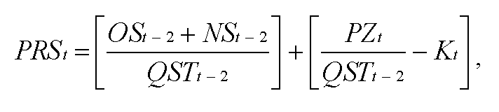
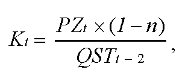
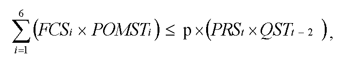
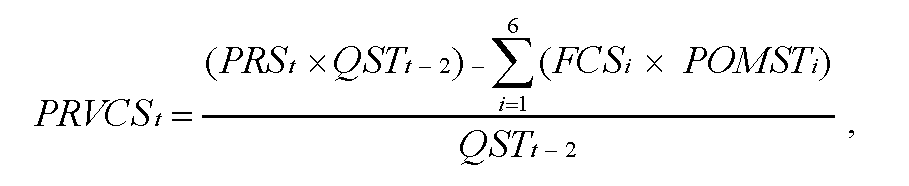
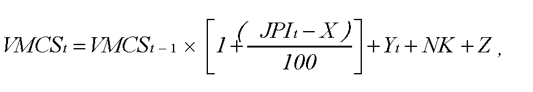
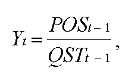

# § 9 Spôsob výpočtu maximálnej ceny za odvádzanie a čistenie odpadovej vody a výšky primeraného zisku

(1) Maximálna cena za odvádzanie a čistenie odpadovej vody, maximálna cena za odvádzanie odpadovej vody, maximálna cena za čistenie odpadovej vody alebo maximálna cena za odvádzanie a čistenie odpadovej vody pre skupinu producentov sa skladá z fixnej zložky maximálnej ceny v eurách za rok a variabilnej zložky maximálnej ceny v eurách na objemovú jednotku, pričom je maximálna v jednotlivých zložkách ceny. Pri tvorbe maximálnej ceny sa zohľadňuje štruktúra producentov a navrhuje sa tak, aby zohľadňovala nákladovosť odberných miest producentov v tarifných skupinách.

(2) Na určenie maximálnej ceny za odvádzanie a čistenie odpadovej vody, maximálnej ceny za odvádzanie odpadovej vody, maximálnej ceny za čistenie odpadovej vody alebo maximálnej ceny za odvádzanie a čistenie odpadovej vody pre skupinu producentov v eurách na objemovú jednotku na prvý rok regulačného obdobia sa vypočíta priemerná cena podľa vzorca

kde

PRSt je priemerná cena za odvádzanie a čistenie odpadovej vody v eurách na objemovú jednotku,

OSt-2 sú odpisy hmotného majetku a nehmotného majetku a nájomné za prenajatý hmotný majetok a nehmotný majetok v eurách využívaný výhradne na odvádzanie a čistenie odpadovej vody v eurách v roku t-2 podľa § 4 ods. 1 písm. e) a f),

NSt-2 sú skutočné ekonomicky oprávnené prevádzkové náklady v eurách na odvádzanie a čistenie odpadovej vody v roku t-2 podľa § 4 okrem OSt-2,

QSTt-2 je skutočné množstvo odvedenej a čistenej odpadovej vody v objemových jednotkách pre všetkých producentov v roku t-2,

PZt je primeraný zisk v eurách vypočítaný podľa odseku 3, pričom maximálny primeraný zisk je 0,10 eura na 1 m3 skutočného množstva odvedenej odpadovej vody v roku t-2 vrátane vlastnej produkcie odpadovej vody, alebo vypočítaný podľa odseku 4; pri výpočte ceny za čistenie odpadovej vody sa uplatní najviac polovica hodnoty PZt,

Kt je faktor využitia kapacity vodárenského majetku používaného na odvádzanie a čistenie odpadovej vody vypočítaný podľa odseku 5.

(3) Primeraný zisk PZt sa vypočíta podľa vzorca

PZt = RAB2015 × WACCt,

kde

RAB2015 je účtovná hodnota (zostatková cena) hmotného majetku a nehmotného majetku v eurách v roku 2015 používaného na regulovanú činnosť podľa prílohy č. 14.

(4) Primeraný zisk PZt pre regulovaný subjekt, ktorého odvedené a čistené množstvo odpadovej vody verejnou kanalizáciou nepresiahne 1 000 000 m3, je najviac 0,05 eura za 1 m3 skutočného množstva odvedenej odpadovej vody v roku t-2 vrátane vlastnej produkcie odpadovej vody.

(5) Hodnota faktora využitia vodárenského majetku používaného na odvádzanie a čistenie odpadovej vody v eurách na objemovú jednotku sa vypočíta podľa vzorca

kde

n je koeficient využitia projektovanej kapacity vodárenského majetku využívaného na odvádzanie a čistenie odpadovej vody, ktorý sa vypočíta ako priemer podielov skutočne využívanej kapacity a celkovej projektovanej kapacity jednotlivého vodárenského majetku podľa prílohy č. 18. Vypočítaná hodnota sa matematicky zaokrúhli na dve desatinné miesta.

(6) Ak sa návrh ceny predkladá prvýkrát, vypočíta sa priemerná cena za odvádzanie a čistenie odpadovej vody, za odvádzanie odpadovej vody alebo za čistenie odpadovej vody v eurách na objemovú jednotku na rok t podľa odseku 2, pričom sa na výpočet použijú plánované údaje na

rok t.

(7) Fixná zložka maximálnej ceny za odvádzanie a čistenie odpadovej vody, maximálnej ceny za odvádzanie odpadovej vody, maximálnej ceny za čistenie odpadovej vody alebo maximálnej ceny za odvádzanie a čistenie odpadovej vody pre skupinu producentov (ďalej len „fixná zložka maximálnej ceny odpadovej vody“) sa určuje podľa fixnej zložky maximálnej ceny odpadovej vody v eurách za rok v príslušnej tarifnej skupine.

(8) Odberné miesta producentov odpadovej vody sa členia do tarifných skupín

- a) podľa § 8 ods. 9 písm. a),

- b) bez osadeného vodomera pitnej vody a na ktorom sa odvádza odpadová voda od iného regulovaného subjektu do tarifnej skupiny T1,

- c) ak je vlastný zdroj jediným zdrojom pitnej vody, podľa menovitého priemeru DN vodomera osadeného na odbere z vlastného zdroja,

- d) ak množstvo odvádzaných odpadových vôd nie je merané a pitná voda je odoberaná z viacerých zdrojov, podľa menovitého priemeru DN vodomera, ktorým by bolo možné merať celkové množstvo pitnej vody odobratej z rôznych zdrojov za rovnomerného prietoku vody vodomerom, pričom toto celkové množstvo sa určí podľa osobitného predpisu,22)

- e) ak je osadený združený vodomer z dôvodu nerovnomerného odberu pitnej vody, podľa meradla s väčším menovitým priemerom DN; ak sa časť odoberanej pitnej vody spotrebuje podľa osobitného predpisu,23) potom podľa meradla s menším menovitým priemerom DN a rovnako aj vtedy, ak je takéto meradlo osadené z dôvodu zabezpečenia vody na hasenie požiaru,

- f) ak je množstvo odvedenej odpadovej vody merané, podľa menovitého priemeru DN vodomera vhodného na meranie rovnakého prietoku pitnej vody.

(9) Fixná zložka maximálnej ceny odpadovej vody v eurách za rok na odberné miesto v tarifných skupinách T1 až T6 sa vypočíta podľa vzorca

FCSi = PRSt × m × ti,

kde i = 1,...6,

FCSi je fixná zložka maximálnej ceny odpadovej vody v eurách za rok v tarifnej skupine Ti; vypočítaná hodnota sa matematicky zaokrúhli na celé číslo,

PRSt je priemerná cena za odvádzanie a čistenie odpadovej vody v eurách na objemovú jednotku,

m je koeficient fixnej zložky maximálnej ceny odpadovej vody podľa odseku 11,

ti je technický parameter pre výpočet fixnej zložky v tarifných skupinách Ti, ktorý sa určuje v závislosti od menovitého priemeru DN vodomera na odbernom mieste, pričom zohľadňuje nákladovosť odberného miesta.

(10) Fixná zložka maximálnej ceny odpadovej vody v eurách za rok pre tarifnú skupinu T1 sa vypočíta podľa vzorca

FCS1 = PRSt × m × t1,

kde

m je koeficient fixnej zložky maximálnej ceny odpadovej vody podľa odseku 11,

t1 sa rovná 1.

(11) Hodnota koeficientu fixnej zložky maximálnej ceny odpadovej vody m sa ustanovuje vo výške 10, ktorá predstavuje množstvu odvedenej a čistenej odpadovej vody 10 m3 za rok.

(12) Fixné zložky maximálnej ceny odpadovej vody v tarifných skupinách T2 až T6 sa vypočítajú podľa vzorca uvedeného v odseku 9, pričom technické parametre t2 až t6 pre jednotlivé tarifné skupiny sa navrhujú tak, aby zohľadňovali výšku nákladov na odberné miesto v príslušnej tarifnej skupine a súčasne musí platiť

kde

FCSi je fixná zložka maximálnej ceny odpadovej vody v eurách za rok v tarifnej skupine Ti,

POMSTi je počet odberných miest producentov v tarifnej skupine Ti v roku t-2 zaradených podľa odseku 8,

p je parameter, ktorého hodnota v percentách je určená v odseku 13.

(13) Sumárna hodnota fixných zložiek maximálnej ceny odpadovej vody v eurách v jednotlivých tarifných skupinách T1 až T6 nesmie prekročiť 10 % celkových ročných tržieb za regulovanú činnosť vypočítaných ako súčin priemernej ceny za odvádzanie a čistenie odpadovej vody na objemovú jednotku podľa odseku 2 a skutočného množstva odvedenej a čistenej odpadovej vody v objemových jednotkách pre všetkých producentov v roku t-2 vrátane vlastnej produkcie.

(14) Na určenie variabilnej zložky maximálnej ceny za odvádzanie a čistenie odpadovej vody, maximálnej ceny za odvádzanie odpadovej vody, maximálnej ceny za čistenie odpadovej vody alebo maximálnej ceny za odvádzanie a čistenie odpadovej vody pre skupinu producentov (ďalej len „variabilná zložka maximálnej ceny odpadovej vody“) v eurách na objemovú jednotku pre všetky tarifné skupiny T1 až T6 sa vypočíta priemerná variabilná zložka maximálnej ceny podľa vzorca

kde

PRVCSt je priemerná variabilná zložka maximálnej ceny za odvádzanie a čistenie odpadovej vody v eurách na objemovú jednotku,

PRSt je priemerná cena za odvádzanie a čistenie odpadovej vody v eurách na objemovú jednotku,

QSTt-2 je skutočné množstvo odvedenej a čistenej odpadovej vody v objemových jednotkách pre všetkých producentov v roku t-2 vrátane vlastnej produkcie,

FCSi je fixná zložka maximálnej ceny odpadovej vody v eurách za rok v tarifnej skupine Ti,

POMSTi je počet odberných miest producentov v tarifnej skupine Ti v roku t-2 zaradených podľa odseku 8.

(15) Variabilná zložka maximálnej ceny odpadovej vody sa navrhuje najviac do výšky vypočítanej priemernej variabilnej zložky maximálnej ceny za odvádzanie a čistenie odpadovej vody. Pri návrhu variabilnej zložky maximálnej ceny odpadovej vody sa prihliada na sociálne, environmentálne a ekonomické dôsledky úhrady za vodohospodárske služby, ako aj na geografické podmienky a klimatické podmienky príslušného regiónu.

(16) Variabilná zložka maximálnej ceny za odvádzanie a čistenie odpadovej vody v eurách na objemovú jednotku sa navrhuje tak, aby vážený priemer variabilnej zložky maximálnej ceny za odvádzanie a čistenie odpadovej vody a variabilnej zložky maximálnej ceny za čistenie odpadovej vody prepočítaný na objemovú jednotku neprekročil priemernú variabilnú zložku maximálnej ceny za odvádzanie a čistenie odpadovej vody v eurách na objemovú jednotku na rok t vypočítanú podľa odseku 14.

(17) Variabilná zložka maximálnej ceny za čistenie odpadovej vody, ak regulovaný subjekt aj čistí odpadovú vodu odvádzanú od iného regulovaného subjektu, sa navrhuje tak, že je znížená o priemerné náklady spojené s odvádzaním odpadovej vody od konečných producentov a nepresiahne 70 % variabilnej zložky maximálnej ceny za odvádzanie a čistenie odpadovej vody.

(18) Variabilná zložka maximálnej ceny za odvádzanie a čistenie odpadovej vody vypočítaná podľa odseku 14 sa regulovaným subjektom, ktorý odvádza odpadovú vodu na čistenie inému regulovanému subjektu, navrhuje najviac do výšky, ktorá nepresiahne 30 % zvýšenie oproti variabilnej zložke maximálnej ceny za odvádzanie a čistenie odpadovej vody regulovaného subjektu, ktorý odpadovú vodu potom následne odvádza a čistí vo svojej čistiarni odpadových vôd.

(19) Návrh variabilnej zložky maximálnej ceny za odvádzanie a čistenie odpadovej vody pre jednotlivé skupiny producentov sa predkladá tak, aby variabilné zložky maximálnych cien zohľadňovali ekonomicky oprávnené náklady jednotlivých skupín producentov a výšku primeraného zisku.

(20) Variabilná zložka maximálnej ceny odpadovej vody v eurách na objemovú jednotku na ďalšie roky regulačného obdobia sa vypočíta podľa vzorca

ak (JPIt – X) < 0, na účely výpočtu maximálnej ceny sa hodnota rozdielu JPIt a X rovná nule,

kde

VMCSt je variabilná zložka maximálnej ceny odpadovej vody v eurách na objemovú jednotku na rok t,

VMCSt-1 je variabilná zložka maximálnej ceny odpadovej vody v eurách na objemovú jednotku schválená alebo určená v cenovom rozhodnutí na rok t-1 zohľadňujúca ekonomicky oprávnené náklady a primeraný zisk,

JPIt je aritmetický priemer zverejnených hodnôt ukazovateľa „jadrová inflácia“ za posledných 12 mesiacov predchádzajúcich mesiacu, v ktorom sa návrh ceny predkladá, zverejnených na webovom sídle Štatistického úradu Slovenskej republiky v časti „Jadrová a čistá inflácia – oproti rovnakému obdobiu minulého roku v %“,

X je faktor efektivity podľa § 5 ods. 6,

Yt je faktor investičného rozvoja v eurách na objemovú jednotku vypočítaný podľa odseku 21,

NK je medziročná zmena faktora využitia kapacity vodárenského majetku používaného na odvádzanie a čistenie odpadovej vody v eurách na objemovú jednotku (Kt-1 – Kt),

Z je hodnota zmeny v eurách na objemovú jednotku, ktorá sa vo výpočte použije, ak sa postupuje v cenovom konaní o zmene rozhodnutia podľa § 17 ods. 2 písm. d) zákona; hodnota zmeny vyjadruje zmenu ekonomických parametrov, ktoré ovplyvňujú prevádzkové náklady NS regulovaného subjektu a z ktorých sa vychádzalo pri určení variabilnej zložky maximálnej ceny odpadovej vody v eurách na objemovú jednotku a odôvodňuje sa analýzami pripojenými k návrhu na zmenu cenového rozhodnutia.

(21) Faktor investičného rozvoja Yt je prioritne určený na podporu investícií do vodárenského majetku využívaného na odvádzanie a čistenie odpadovej vody a vypočíta sa podľa vzorca

kde

POSt-1 je hodnota odpisov v eurách z nového hmotného majetku a nehmotného majetku využívaného výhradne na odvádzanie a čistenie odpadovej vody skutočne zaradeného do účtovníctva od 1. 1. 2016 do konca roka t-1 najviac vo výške podľa § 4 ods. 1 písm. e); to platí aj pre prevádzkové spoločnosti, ktoré si takýto majetok prenajímajú, pričom hodnota POSt-1 sa preukazuje nájomnou zmluvou,

QSTt-1 je skutočné množstvo odvedenej a čistenej odpadovej vody v objemových jednotkách pre všetkých producentov v roku t-1 vrátane vlastnej produkcie.
