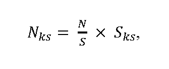

# § 5 Rozpočítavanie množstva dodaného tepla za dodávku tepla na vykurovanie podľa podlahovej plochy bytu a nebytového priestoru

(1) Ak v objekte rozpočítavania nie sú zapojené pomerové rozdeľovače tepla ani určené meradlá na meranie tepla u konečných spotrebiteľov podľa § 18 ods. 4 písm. a) zákona, náklady na dodané teplo na vykurovanie sa rozpočítavajú konečným spotrebiteľom podľa vzorca

kde

Nks sú náklady pre konečného spotrebiteľa vyjadrené v eurách,

N sú náklady na dodané teplo na vykurovanie za objekt rozpočítavania vyjadrené v eurách,

S je celková podlahová plocha bytov, vykurovaných nebytových priestorov a spoločných priestorov vyjadrená v metroch štvorcových,

Sks je podlahová plocha bytu, vykurovaného nebytového priestoru a spoluvlastníckeho podielu na spoločných priestoroch konečného spotrebiteľa vyjadrená v metroch štvorcových.

(2) Ak sú v objekte rozpočítavania aj byty alebo nebytové priestory s individuálnym vykurovaním, cez ktoré prechádzajú spoločné rozvody vykurovacej sústavy centrálneho zásobovania teplom, náklady za dodané teplo na vykurovanie sa rozdelia na základnú zložku a spotrebnú zložku, pričom základná zložka tvorí 30 % a spotrebná zložka 70 % z celkových nákladov. Obidve zložky sa rozpočítavajú konečným spotrebiteľom v pomere podlahovej plochy bytu, nebytových priestorov a spoluvlastníckeho podielu na spoločných priestoroch konečného spotrebiteľa k celkovej podlahovej ploche všetkých bytov, nebytových priestorov a spoločných priestorov v objekte rozpočítavania, pričom základná zložka nákladov sa rozpočítava aj medzi užívateľov bytov a nebytových priestorov s individuálnym vykurovaním okrem prípadov, keď byt alebo nebytový priestor s individuálnym vykurovaním má polohu podľa § 7 ods. 3 písm. a).

(3) Náklady na dodané teplo do spoločných priestorov sa rozpočítavajú konečným spotrebiteľom podľa spoluvlastníckeho podielu na spoločných priestoroch podľa odseku 1.

(4) Ak sa spoločné priestory využívajú inak ako na účel, na ktorý sa zriadili, a nevyužívajú sa v prospech všetkých konečných spotrebiteľov, náklady na dodané teplo do týchto priestorov sa rozpočítavajú podľa podlahovej plochy bytu a nebytových priestorov tým konečným spotrebiteľom, ktorí spoločné priestory užívajú.

(5) Ak počas zúčtovacieho obdobia došlo k zmene konečného spotrebiteľa, náklady na dodané teplo na vykurovanie a na prípravu teplej úžitkovej vody podľa § 4 ods. 2 sa konečnému spotrebiteľovi rozpočítavajú v pomere nákladov na dodané teplo podľa jednotlivých mesiacov k celkovým nákladom na dodané teplo za zúčtovacie obdobie podľa prílohy č. 1 alebo v pomere počtu dennostupňov v jednotlivých mesiacoch k celkovému počtu dennostupňov za zúčtovacie obdobie, ak sa dotknutí koneční spotrebitelia nedohodnú inak.

(6) Ak vlastníci bytov a nebytových priestorov rozhodnú podľa osobitného predpisu5) inak, rozpočítavanie množstva dodaného tepla na vykurovanie podľa odsekov 3 až 5 sa neuplatňuje.
