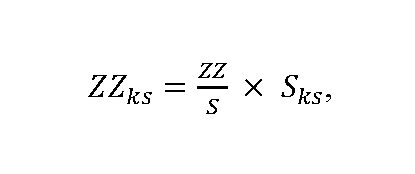
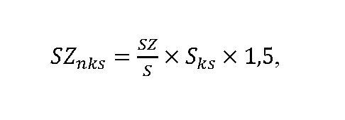
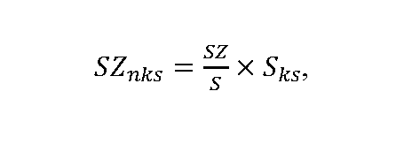
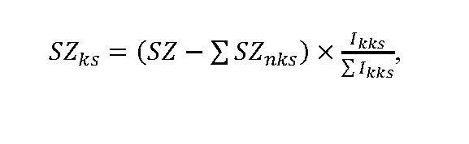

# § 7 Rozpočítavanie množstva dodaného tepla na vykurovanie podľa pomerových rozdeľovačov tepla alebo určených meradiel na meranie tepla

(1) Ak sú v objekte rozpočítavania zapojené pomerové rozdeľovače tepla rovnakého typu alebo určené meradlá1) na meranie tepla rovnakej triedy presnosti na meranie množstva tepla u konečných spotrebiteľov, náklady na množstvo dodaného tepla na vykurovanie sa rozdelia na základnú zložku a spotrebnú zložku. Základná zložka tvorí 60 % a spotrebná zložka tvorí 40 % z celkových nákladov na množstvo dodaného tepla na vykurovanie, ak sa vlastníci bytov a nebytových priestorov nedohodnú inak.

(2) Základná zložka sa rozpočítava konečným spotrebiteľom podľa vzorca

kde je

ZZks základná zložka pre konečného spotrebiteľa vyjadrená v eurách,

ZZ základná zložka vyjadrená v eurách,

S celková podlahová plocha bytov, vykurovaných nebytových priestorov a spoločných priestorov upravená podľa odseku 3, vyjadrená v metroch štvorcových,

Sks podlahová plocha bytu, vykurovaného nebytového priestoru a spoluvlastníckeho podielu na spoločných priestoroch konečného spotrebiteľa upravená podľa odseku 3, vyjadrená v metroch štvorcových.

(3) Základná zložka na dodané teplo podľa odseku 2 sa rozpočítava aj medzi užívateľov bytov a nebytových priestorov, ktorí majú individuálne vykurovanie, pričom podlahová plocha bytu alebo nebytového priestoru s individuálnym vykurovaním sa vynásobí koeficientom

- a) 0,0 pri bytoch a nebytových priestoroch v nadstavbách a vstavbách do podkrovia, pri bytoch a nebytových priestoroch alebo ich častiach, ktoré sa nachádzajú na prízemí alebo na najvyššom podlaží alebo nad priestormi, ktoré nie sú vykurované, alebo v tých bytoch a nebytových priestoroch s individuálnym vykurovaním, cez ktoré neprechádzajú spoločné rozvody vykurovacej sústavy centrálneho zásobovania teplom,

- b) 0,50 pri ostatných bytoch a nebytových priestoroch s individuálnym vykurovaním.

(4) Konečnému spotrebiteľovi, ktorý neumožnil zapojiť pomerové rozdeľovače tepla alebo určené meradlo1) na meranie tepla alebo neumožnil ich odčítanie, alebo neoprávnene do nich zasahoval, čím spôsobil ich nesprávnu funkciu, alebo ich poškodil, sa určí spotrebná zložka podľa vzorca

kde je

SZnks spotrebná zložka pre konečného spotrebiteľa určená náhradným výpočtom vyjadrená v eurách,

SZ spotrebná zložka vyjadrená v eurách,

S celková podlahová plocha vykurovaných bytov, nebytových priestorov a spoločných priestorov vyjadrená v metroch štvorcových,

Sks podlahová plocha vykurovaného bytu, nebytového priestoru a spoluvlastníckeho podielu na spoločných priestoroch konečného spotrebiteľa vyjadrená v metroch štvorcových.

(5) Pri poruche pomerových rozdeľovačov tepla alebo určeného meradla1) na meranie tepla sa spotrebná zložka konečnému spotrebiteľovi určí podľa vzorca

kde je

SZnks spotrebná zložka pre konečného spotrebiteľa určená náhradným výpočtom vyjadrená v eurách,

SZ spotrebná zložka vyjadrená v eurách,

S celková podlahová plocha vykurovaných bytov, nebytových priestorov a spoločných priestorov vyjadrená v metroch štvorcových,

Sks podlahová plocha vykurovaného bytu alebo miestnosti s poruchou pomerového rozdeľovača tepla, nebytového priestoru alebo miestnosti s poruchou pomerového rozdeľovača tepla a spoluvlastníckeho podielu na spoločných priestoroch konečného spotrebiteľa vyjadrená v metroch štvorcových.

(6) Rozdiel nákladov spotrebnej zložky a nákladov určených náhradným spôsobom podľa odsekov 4 a 5 sa rozpočítava medzi konečných spotrebiteľov podľa indikovaných údajov pomerových rozdeľovačov tepla alebo určených meradiel na meranie tepla s použitím korekcií, ktoré zohľadňujú nepriaznivú polohu miestnosti bytu alebo nebytového priestoru konečného spotrebiteľa podľa prílohy č. 2, ak koneční spotrebitelia nerozhodnú podľa osobitného predpisu5) inak, alebo metódou, ktorá priamo zohľadňuje nepriaznivú polohu miestnosti. Spotrebná zložka pre jedného konečného spotrebiteľa sa určí podľa vzorca

kde je

SZks spotrebná zložka pre konečného spotrebiteľa vyjadrená v eurách,

SZ spotrebná zložka vyjadrená v eurách,

SZnks súčet nákladov na spotrebnú zložku určených náhradným spôsobom vyjadrený v eurách,

Ikk skorigované indikované údaje pomerových rozdeľovačov tepla alebo určených meradiel na meranie tepla konečného spotrebiteľa vyjadrené v kilowatthodinách,

∑Ikks súčet všetkých korigovaných indikovaných údajov pomerových rozdeľovačov tepla alebo určených meradiel na meranie tepla v objekte rozpočítavania vyjadrený v kilowatthodinách.

(7) Náklady na dodané teplo do spoločných priestorov určené podľa odsekov 2 až 6 sa rozpočítavajú medzi všetkých konečných spotrebiteľov podľa spoluvlastníckeho podielu na spoločných priestoroch, ak koneční spotrebitelia nerozhodnú podľa osobitného predpisu5) inak.

(8) Ak sa spoločné priestory využívajú inak ako na účel, na ktorý sa zriadili, a nevyužívajú sa v prospech všetkých konečných spotrebiteľov, náklady na dodané teplo do spoločných priestorov sa rozpočítavajú podľa podlahovej plochy bytu a nebytových priestorov tým konečným spotrebiteľom, ktorí spoločné priestory užívajú.

(9) Ak sa počas kalendárneho roka zmení cena tepla, na rozpočítavanie spotrebnej zložky ku dňu účinnosti novej ceny tepla sa použijú pomerné množstvá z celoročných indikovaných údajov pomerových rozdeľovačov tepla alebo určených meradiel na meranie tepla podľa prílohy č. 1 alebo sa zabezpečí archivácia údajov alebo odčítanie pomerových rozdeľovačov tepla alebo určených meradiel na meranie tepla.

(10) Ak počas zúčtovacieho obdobia došlo k zmene konečného spotrebiteľa, náklady na dodané teplo na vykurovanie a na prípravu teplej úžitkovej vody podľa § 4 ods. 2 sa konečnému spotrebiteľovi rozpočítavajú v pomere odčítaných indikovaných údajov pomerových rozdeľovačov tepla alebo určených meradiel na meranie tepla konečného spotrebiteľa k celkovým indikovaným údajom pomerových rozdeľovačov tepla alebo určených meradiel na meranie tepla konečného spotrebiteľa za zúčtovacie obdobie.
