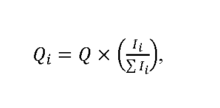

# § 8 Rozpočítavanie množstva dodaného tepla na prípravu teplej úžitkovej vody na odberné miesta

(1) Na rozpočítavanie nákladov na prípravu teplej úžitkovej vody sa využívajú určené meradlá na meranie množstva dodaného tepla na prípravu teplej úžitkovej vody na odbernom mieste a určené meradlá na meranie pretečeného množstva teplej úžitkovej vody spotrebovanej konečným spotrebiteľom.

(2) Ak dodávateľ, ktorý dodáva teplo na prípravu teplej úžitkovej vody, meria množstvo dodanej teplej úžitkovej vody na odbernom mieste, množstvo dodaného tepla na prípravu teplej úžitkovej vody pre objekt rozpočítavania sa určí podľa vzorca

kde je

Qi množstvo dodaného tepla na prípravu teplej úžitkovej vody pre i-ty objekt rozpočítavania vyjadrené v kilowatthodinách,

Q množstvo dodaného tepla na prípravu teplej úžitkovej vody v mieste jej prípravy vyjadrené v kilowatthodinách,

Ii indikovaný údaj určeného meradla na odbernom mieste i-teho objektu rozpočítavania za zúčtovacie obdobie vyjadrený v metroch kubických,

∑Ii súčet všetkých indikovaných údajov určených meradiel na odberných miestach v jednom okruhu zásobovania teplej úžitkovej vody za zúčtovacie obdobie vyjadrený v metroch kubických.

(3) Ak dodávateľ, ktorý dodáva teplo na prípravu teplej úžitkovej vody, nemeria množstvo dodanej teplej úžitkovej vody na odbernom mieste, za indikovaný údaj určeného meradla na odbernom mieste sa považuje súčet indikovaných údajov určených meradiel množstva teplej úžitkovej vody spotrebovanej konečnými spotrebiteľmi v bytoch, v nebytových priestoroch a spoločných priestoroch v objekte rozpočítavania. Pri rozpočítavaní množstva dodaného tepla na prípravu teplej úžitkovej vody pre objekt rozpočítavania sa postupuje podľa odseku 2.

(4) Súčet indikovaných údajov určených meradiel na meranie množstva dodaného tepla na prípravu teplej úžitkovej vody spotrebovanej konečnými spotrebiteľmi za kalendárny rok nahlasuje odberateľ dodávateľovi do 31. januára nasledujúceho kalendárneho roka. Ak v kalendárnom roku došlo k zmene ceny tepla určenej podľa osobitného predpisu,3) odberateľ tieto údaje nahlasuje osobitne za obdobie predchádzajúce zmene ceny tepla a osobitne za obdobie nasledujúce po zmene ceny tepla.
