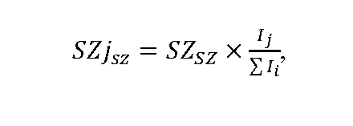
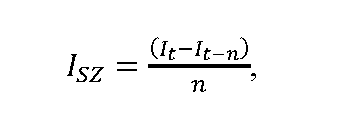

# § 9 Rozpočítavanie množstva dodaného tepla na prípravu teplej úžitkovej vody v objekte rozpočítavania

(1) Náklady na prípravu teplej úžitkovej vody na objekt rozpočítavania určené podľa § 4 ods. 2 a § 8 sa rozdelia na základnú zložku a spotrebnú zložku. Základná zložka tvorí 20 % a spotrebná zložka 80 % nákladov na prípravu teplej úžitkovej vody v objekte rozpočítavania.

(2) Základná zložka sa rozpočítava medzi konečných spotrebiteľov rovnakým dielom na každý byt a nebytový priestor v objekte rozpočítavania, ak sú zabezpečené technické podmienky na odber teplej úžitkovej vody z centrálneho rozvodu u konečného spotrebiteľa.

(3) Spotrebná zložka sa rozpočítava medzi konečných spotrebiteľov podľa vzorca

kde je

SZjsz spotrebná zložka tepla v teplej úžitkovej vode pre j-teho konečného spotrebiteľa vyjadrená v eurách,

SZsz spotrebná zložka tepla v teplej úžitkovej vode podľa odseku 1 vyjadrená v eurách,

Ij indikovaný údaj určeného meradla1) na meranie množstva teplej úžitkovej vody u j-teho konečného spotrebiteľa za zúčtovacie obdobie vyjadrený v metroch kubických,

∑Ii súčet všetkých indikovaných údajov určených meradiel na meranie množstva teplej úžitkovej vody v objekte rozpočítavania za zúčtovacie obdobie vrátane určených náhradných indikovaných údajov vyjadrený v metroch kubických.

(4) Odpočty indikovaných údajov určených meradiel na meranie množstva teplej úžitkovej vody u konečných spotrebiteľov vykonáva dodávateľ alebo odberateľ, ktorý rozpočítava dodané teplo a množstvo tepla na prípravu teplej úžitkovej vody, najmenej raz ročne ku koncu zúčtovacieho obdobia.

(5) Konečnému spotrebiteľovi, ktorý neumožní odpočet určeného meradla na meranie množstva teplej úžitkovej vody, sa určí náhradný indikovaný údaj vo výške 1,5-násobku priemernej hodnoty indikovaných údajov na byt a nebytový priestor v objekte rozpočítavania. Spotrebná zložka sa určí podľa odseku 3. V nasledujúcom zúčtovacom období sa indikovaný údaj na výpočet spotrebnej zložky určí ako aritmetický priemer indikovaných údajov určeného meradla odčítaných v danom roku a v poslednom roku, v ktorom bol indikovaný údaj určeného meradla odčítaný, podľa vzorca

kde je

Isz indikovaný údaj na určenie spotrebnej zložky v zúčtovacom období vyjadrený v metroch kubických,

It stav určeného meradla odčítaný v danom roku vyjadrený v metroch kubických,

It-n stav určeného meradla odčítaný v roku, v ktorom sa odčítanie určeného meradla vykonalo posledný raz, vyjadrený v metroch kubických,

n počet rokov, za ktoré je vykonaný odpočet určeného meradla.

(6) Náhradný indikovaný údaj pre konečného spotrebiteľa sa môže určiť aj odborným odhadom, ak odpočet určeného meradla na meranie množstva teplej úžitkovej vody sa vykoná dodatočne najneskôr do 31. januára nasledujúceho kalendárneho roka alebo na základe predchádzajúcich pravidelných odpočtov určeného meradla na meranie množstva teplej úžitkovej vody u konečného spotrebiteľa. Takýto postup sa primerane použije aj pri poruche určeného meradla na meranie množstva teplej úžitkovej vody.

(7) Ak sa preukáže, že konečný spotrebiteľ ovplyvnil určené meradlo na meranie množstva teplej úžitkovej vody, zavinil, že určené meradlo na meranie množstva teplej úžitkovej vody nespĺňa podmienky určeného meradla, neumožnil určené meradlo nainštalovať, určené meradlo demontoval alebo inak znefunkčnil, určí sa tomuto konečnému spotrebiteľovi náhradný indikovaný údaj vo výške trojnásobku priemernej hodnoty indikovaných údajov určených meradiel na meranie teplej úžitkovej vody na byt a nebytový priestor v objekte rozpočítavania. Spotrebná zložka sa určí podľa odseku 3.
