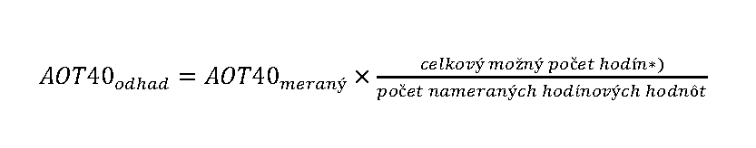

Príloha č. 3 k vyhláške č. 244/2016 Z. z.

- CIEĽOVÉ HODNOTY NA OCHRANU ZDRAVIA ĽUDÍ A NA OCHRANU VEGETÁCIE A DLHODOBÉ CIELE

  - Časť I Cieľové hodnoty pre arzén, kadmium, nikel a benzo(a)pyrén na ochranu zdravia ľudí a vegetácie Znečisťujúca látka | Priemerované obdobie | Cieľová hodnota1)

  - As | 1 kalendárny rok | 6 ng/m3

  - Cd | 1 kalendárny rok | 5 ng/m3

  - Ni | 1 kalendárny rok | 20 ng/m3

  - BaP | 1 kalendárny rok | 1 ng/m3

    - Poznámka:

      - Pre celkový obsah vo frakcii častíc PM10 priemerne za kalendárny rok.

  - Časť II Cieľové hodnoty a dlhodobé ciele pre ozón

    - A. Vymedzenie pojmov

      - AOT40 vyjadrený v (µg/m3) × h je súčet rozdielov medzi hodinovými koncentráciami väčšími ako 80 µg/m3 (= 40 častí na miliardu) a 80 µg/m3 počas daného obdobia pri používaní len 1-hodinových hodnôt nameraných každý deň od 8.00 do 20.00 hod. stredoeurópskeho času (SEČ).

    - B. Kritériá

      - Pri zhromažďovaní údajov a výpočte štatistických ukazovateľov sa na kontrolu platnosti použijú tieto kritériá:

    - Parameter | Vyžadovaný podiel platných údajov

    - 1-hodinové hodnoty | 75 % (t. j. 45 minút)

    - 8-hodinové hodnoty | 75 % (t. j. 6 hodín)

    - Najväčšia denná 8-hodinová stredná hodnota z 8 po sebe nasledujúcich hodín | 75 % hodinových pohyblivých priemerov z 8 po sebe nasledujúcich hodín (t. j. 18 8-hodinových priemerov za deň)

    - AOT40 | 90 % 1-hodinových hodnôt počas doby určenej na vypočítanie hodnoty AOT401)

    - Ročná stredná hodnota | 75 % 1-hodinových hodnôt letného obdobia od apríla do septembra a 75 % hodnôt zimného obdobia od januára do marca a od októbra do decembra samostatne

    - Počet prekročení a najväčšie hodnoty za mesiac | 90 % denných najväčších 8-hodinových stredných hodnôt (t. j. 27 dostupných denných hodnôt za mesiac), 90 % 1-hodinových hodnôt od 8.00 do 20.00 hod. SEČ

    - Počet prekročení a najväčšie hodnoty za rok | päť zo šiestich mesiacov počas letného obdobia od apríla do septembra

    - Poznámka:

    - 1) Ak nie sú k dispozícii všetky možné merané údaje, na vypočítanie hodnôt AOT40 sa použije tento faktor:

    - 

    - *) Predstavuje počet hodín v rámci doby uvedenej v definícii AOT40, t. j. od 8.00 do 20.00 h SEČ každoročne od 1. mája do 31. júla na ochranu vegetácie a každoročne od 1. apríla do 30. septembra na ochranu lesov.

    - C. Cieľové hodnoty pre ozón

    - Cieľ | Priemerované obdobie | Cieľová hodnota

    - Ochrana zdravia ľudí | najväčšia denná 8-hodinová stredná hodnota1) | 120 µg/m3 sa neprekročí viac ako 25 dní za kalendárny rok v priemere troch rokov2)

    - Ochrana vegetácie | od mája do júla | AOT40 vypočítaný z 1-hodinových hodnôt 18 000 (µg/m3) × h v priemere piatich rokov2)

      - Poznámky:

        - 1) Najväčšia denná 8-hodinová stredná hodnota koncentrácie sa vyberie preskúmaním 8-hodinových plávajúcich priemerov vypočítaných z hodinových údajov a aktualizovaných každú hodinu. Každý takto vypočítaný 8- hodinový priemer sa priradí ku dňu, v ktorom končí, t. j. prvým výpočtovým obdobím pre ktorýkoľvek deň je obdobie od 17.00 hod. predchádzajúceho dňa do 1.00 hod. daného dňa; posledným výpočtovým obdobím pre ktorýkoľvek jeden deň je obdobie od 16.00 hod. do konca daného dňa.

        - 2) Ak nemožno určiť trojročné alebo päťročné priemery na základe úplných a po sebe nasledujúcich súborov ročných údajov, najmenšie ročné údaje vyžadované na kontrolu dodržiavania cieľových hodnôt sú tieto pre cieľovú hodnotu na ochranu:

        - – zdravia ľudí: platné údaje za jeden rok,

        - – vegetácie: platné údaje za tri roky.

    - D. Dlhodobé ciele pre ozón

    - Cieľ | Priemerované obdobie | Dlhodobý cieľ1)

    - Ochrana zdravia ľudí | najväčšia denná 8-hodinová stredná hodnota v kalendárnom roku | 120 µg/m3

    - Ochrana vegetácie | od mája do júla | AOT40 vypočítaný z 1-hodinových hodnôt 6 000 (µg/m3) × h

    - 1) Dátum, ku ktorému by sa mali dosiahnuť dlhodobé ciele, nie je určený.
