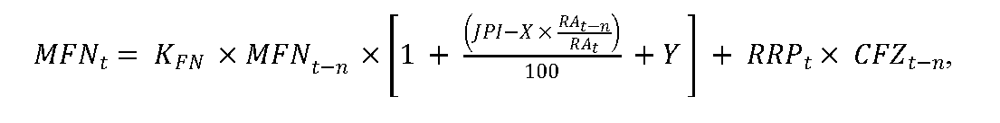
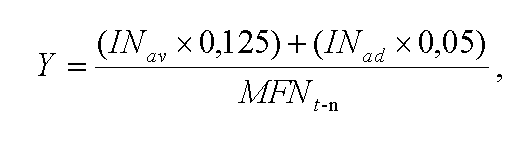
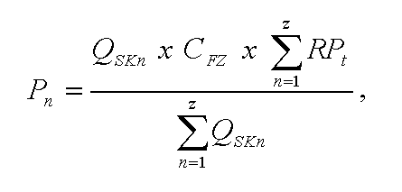
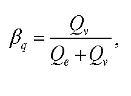
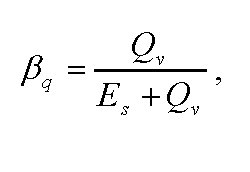

# § 4 Rozsah, štruktúra a výška ekonomicky oprávnených nákladov

(1) Ekonomicky oprávnenými nákladmi sú:

- a) primeraná výška nákladov na zabezpečenie potrebného množstva priameho materiálu, ktorý slúži na výrobu tepla, alebo potrebného množstva nakupovaného tepla, pričom v návrhu ceny je maximálna výška nákladov určená podľa ukazovateľov energetickej účinnosti určených pri poslednom overovaní hospodárnosti prevádzky sústav tepelných zariadení3) pred podaním návrhu ceny, výhrevnosti paliva a ceny paliva alebo nakupovaného tepla; pri výrobe tepla z obnoviteľných zdrojov energie sa za primeranú výšku nákladov považuje maximálna cena za jednotkový energetický obsah v palive v eurách /kWh v cene tepla určenej alebo schválenej,

- b) primeraná výška nákladov na elektrinu, dopravu paliva, technologické hmoty a technologickú vodu, na palivo na vlastnú spotrebu tepla vykazovanú v rámci overovania hospodárnosti prevádzky sústav tepelných zariadení3) na výrobu tepla súvisiacu s výrobou tepla, ktorá nie je súčasťou ukazovateľa energetickej účinnosti,2)

- c) osobné náklady,4) ktorých maximálna výška na účely kalkulácie ekonomicky oprávnených nákladov je ustanovená podľa odseku 10 písm. a),

- d) náklady na plnenie povinností podľa osobitných predpisov;5) pri poplatkoch za znečisťovanie ovzdušia len poplatky za znečisťujúce látky vypustené do ovzdušia pri dodržaní podmienok a požiadaviek podľa osobitného zákona6) a pri skleníkových plynoch náklady vypočítané ako množstvo spotrebovaných ton CO2 maximálne do výšky vypočítanej podľa odsekov 7 a 8 vynásobené cenou určenou ako aritmetický priemer denných uzatváracích cien (settlement price) oficiálneho kurzového lístka zverejneného burzou EEX (European Energy Exchange) na jej webovom sídle, za produkt EU Emission Allowances - Spot Market v eurách na tony CO2 za kalendárny mesiac, v ktorom sa nákup emisných kvót realizoval,

- e) náklady na overenie hospodárnosti prevádzky sústavy tepelných zariadení po odberné miesto v termínoch podľa osobitného predpisu3) a náklady na vykonanie energetického auditu v termíne podľa osobitného predpisu,7)

- f) odpisy obstaraného nového hmotného majetku a nehmotného majetku,8) pričom pri hmotnom majetku sa za ekonomicky oprávnené náklady považujú odpisy najviac do výšky rovnomerných odpisov hmotného majetku,9)

- g) odpisy obstaraného už prevádzkovaného hmotného majetku a nehmotného majetku8) vo výške rovnomerných odpisov9) z jeho kúpnej ceny maximálne do výšky rovnomerných odpisov zo všeobecnej hodnoty hmotného majetku určenej znaleckým posudkom pre hmotný majetok a nehmotný majetok zaradený do účtovníctva regulovaného subjektu po 15. júli 2011,

- h) odpisy obstaraného už prevádzkovaného hmotného majetku a nehmotného majetku,8) pričom pri hmotnom majetku sa považujú za ekonomicky oprávnené náklady odpisy najviac do výšky rovnomerných odpisov hmotného majetku9) zaradeného do účtovníctva regulovaného subjektu pred 15. júlom 2011,

- i) náklady na obstaranie hmotného majetku, ktorý má samostatné prevádzkové určenie, dobu použiteľnosti dlhšiu ako jeden rok, jeho obstarávacia cena je nižšia ako vstupná cena podľa osobitného predpisu10) a je používaný výhradne na regulovanú činnosť,

- j) nájomné za prenájom hmotného majetku a nehmotného majetku, o ktorom vlastník účtuje a ktorý sa používa výhradne na regulovanú činnosť, najviac do výšky 28 eur/kW regulačného príkonu z prenajatého zariadenia na výrobu a rozvod tepla,

- k) nájomné za prenájom nehnuteľnosti alebo jej časti, v ktorej je na podlahovej ploche umiestnené tepelné zariadenie vo vlastníctve alebo v nájme regulovaného subjektu, ktoré sa používa výhradne na regulovanú činnosť, najviac vo výške 35 eur/m2 podlahovej plochy/rok; nájomné za prenájom nehnuteľnosti alebo jej časti súvisiacej s výrobou a dodávkou tepla a ostatných priestorov alebo plôch na skládku paliva a nespálených zvyškov paliva a produktov odsírenia najviac vo výške 15 eur/m2 plochy/rok,

- l) náklady na opravy a údržbu tepelných zariadení vrátane osobných nákladov4) zamestnancov vykonávajúcich opravy a údržbu tepelných zariadení okrem nákladov na technické zhodnotenie hmotného majetku a nehmotného majetku podľa osobitného predpisu;11) náklady na plánované generálne opravy môžu byť rozložené rovnomerne počas nasledujúcich piatich rokov, ak to regulovaný subjekt uvedie v návrhu ceny tepla,

- m) úrok z úveru poskytnutého bankou alebo pobočkou zahraničnej banky12) na nákup hmotného majetku alebo nehmotného majetku, ktorý sa používa výhradne na regulovanú činnosť, alebo z prevádzkového úveru na refinancovanie nákladov na nákup paliva,

- n) úrok z úveru poskytnutého inou právnickou osobou ako bankou alebo pobočkou zahraničnej banky12) na nákup hmotného majetku alebo nehmotného majetku, ktorý sa používa výhradne na regulovanú činnosť, alebo z prevádzkového úveru na refinancovanie nákladov na nákup paliva maximálne vo výške 2,5 % ročne,

- o) náklady na poistenie hmotného majetku regulovaného subjektu, ktorý sa používa výhradne na regulovanú činnosť.

(2) Ekonomicky oprávnenými nákladmi nie sú

- a) sankcie,

- b) náklady spojené s nevyužitými výrobnými kapacitami; nevyužitými výrobnými kapacitami sú zariadenia na výrobu tepla, ktoré nie je potrebné prevádzkovať na zabezpečenie zmluvne dohodnutého ročného množstva tepla dodávaného z iného zariadenia na výrobu tepla v tej istej sústave tepelných zariadení,

- c) odpisy nevyužívaného dlhodobého hmotného majetku, odpisy „goodwill“ a odpisy hmotného majetku a nehmotného majetku vylúčeného z odpisovania,13)

- d) odpisy hmotného majetku a nehmotného majetku,8) ak doba od termínu nadobudnutia tohto majetku regulovaným subjektom je dlhšia ako doba životnosti hmotného a nehmotného majetku podľa prílohy č. 1,

- e) odmeny členov štatutárnych orgánov a iných orgánov regulovaného subjektu za výkon funkcie, ktorí nie sú v pracovnoprávnom vzťahu s regulovaným subjektom,

- f) platby poistného za poistenie zodpovednosti za škody spôsobené členmi štatutárnych orgánov a členmi iných orgánov regulovaného subjektu,

- g) príspevky na životné poistenie a príspevky na účelové sporenie zamestnanca,

- h) odstupné a odchodné presahujúce výšku ustanovenú osobitným predpisom,15)

- i) príspevky na stravovanie zamestnancov nad rozsah ustanovený osobitným predpisom,16)

- j) cestovné náhrady nad rozsah ustanovený osobitným predpisom,17)

- k) tvorba sociálneho fondu nad rozsah ustanovený osobitným predpisom,18)

- l) náklady na poskytovanie osobných ochranných pracovných prostriedkov nad rozsah ustanovený osobitným predpisom,19)

- m) dobrovoľné poistenie osôb,

- n) manká a škody na majetku vrátane škody zo zníženia cien nevyužiteľných zásob a likvidácie zásob,

- o) náklady vyplývajúce z chýb vo výpočtoch, v kalkulačných prepočtoch alebo v účtovníctve, duplicitne účtované náklady,

- p) náklady na reprezentáciu a dary,

- q) odmeny a dary pri životných jubileách a pri odchode do dôchodku,

- r) náklady na starostlivosť o zdravie zamestnancov a na vlastné zdravotnícke zariadenia nad rozsah ustanovený osobitným predpisom,20)

- s) príspevky a náklady na rekreačné, regeneračné, rekondičné a ozdravné pobyty, ak povinnosť ich uhrádzania neustanovuje osobitný predpis,21)

- t) náklady na údržbu a prevádzku školiacich a rekreačných zariadení a iných zariadení, ktoré nesúvisia s regulovanou činnosťou,

- u) daň z nehnuteľnosti platená za školiace a rekreačné zariadenia,

- v) štipendiá poskytnuté študentom a žiakom stredných odborných škôl,

- w) odpis nedobytnej pohľadávky,

- x) tvorba rezerv nad rozsah ustanovený osobitným predpisom,22)

- y) rozdiely zo zmien použitých účtovných metód a účtovných zásad,23)

- z) tvorba opravných položiek,

- aa) náklady vynaložené na odstránenie nedostatkov zistených pri kolaudačnom konaní,

- ab) náklady spojené s prípravou a zabezpečením nerealizovanej investičnej výstavby,

- ac) straty z predaja dlhodobého majetku a zásob,

- ad) zostatková cena predaného alebo vyradeného hmotného majetku a nehmotného majetku,

- ae) náklady na reklamu alebo propagáciu uskutočňovanú formou podpory športových, kultúrnych a zábavných podujatí a iných činností,

- af) spotreba pohonných látok nad rozsah ustanovený osobitným predpisom,24)

- ag) náklady na palivo a nakupované teplo súvisiace s nehospodárnou výrobou a rozvodom tepla z dôvodu nedodržania normatívnych ročných účinností, ktoré boli východiskom na určenie alebo schválenie maximálnej ceny tepla,

- ah) odpisy z časti obstarávacej hodnoty hmotného majetku, ktorá bola obstaraná z prostriedkov Európskej únie, zo štátneho rozpočtu, bezodplatným prevodom hmotného majetku alebo investíciou v rámci projektu verejno-súkromného partnerstva,

- ai) nájomné za prenájom hmotného majetku a nehmotného majetku obstaraného finančným prenájmom,

- aj) nájomné za prenájom hmotného majetku a nehmotného majetku odpredaného a následne prenajatého pôvodnému vlastníkovi alebo za opätovný prenájom prenajatého hmotného majetku a nehmotného majetku,

- ak) náklady na výkon regulovanej činnosti, ktoré sú vyššie ako náklady zistené na základe overovania primeranosti nákladov podľa § 31 ods. 3 písm. d) zákona,

- al) náklady na investíciu na obnovu tepelných zariadení, vynaložením ktorých sa nezabezpečí udržanie alebo zlepšenie energetickej efektívnosti,25)

- am) ostatné náklady, ktoré nie sú uvedené v odseku 1.

(3) Ekonomicky oprávnené variabilné náklady sú

- a) náklady na nákup paliva a variabilné náklady na nákup tepla do maximálnej výšky určenej podľa ukazovateľov energetickej účinnosti určených pri poslednom overovaní hospodárnosti prevádzky sústav tepelných zariadení3) staršom ako 30 dní pred podaním návrhu ceny, výhrevnosti paliva a ceny paliva alebo nakupovaného tepla v roku t a vypočítajú sa podľa vzorca

- NEOP = NU + 0,5 x (NN - NU),

- ak NN< NU, potom NEOP = NN,

- kde

- NEOP sú ročné ekonomicky oprávnené náklady v skutočnej variabilnej cene tepla,

- NU sú ročné náklady fakturované dodávateľom paliva alebo tepla,

- NN sú ročné náklady na nákup paliva alebo na nákup tepla určené podľa ukazovateľov energetickej účinnosti určených pri poslednom overovaní hospodárnosti sústav tepelných zariadení3) staršom ako 30 dní pred podaním návrhu ceny, výhrevnosti paliva a ceny paliva alebo nakupovaného tepla,

- b) ostatné variabilné náklady, ktoré zahŕňajú náklady v primeranej výške na dopravu paliva, náklady na elektrinu, technologickú vodu, technologické hmoty, náklady na odvoz a likvidáciu nespálených zvyškov paliva a produktov odsírenia, poplatky za znečisťovanie ovzdušia podľa odseku 1 písm. d) a náklady na nákup emisných kvót podľa odseku 1 písm. d).

(4) Maximálna výška ceny

- a) zemného plynu bez nákladov na prepravu, distribúciu a uskladňovanie zemného plynu a bez spotrebnej dane zo zemného plynu na rok t v eurách/kWh sa vypočíta podľa vzorca

- CZPt = 1,15 × CENCGt × kp,

- kde

- CENCGt je aritmetický priemer denných cien zverejnených burzou EEX (European Energy Exchange) na webovom sídle www.powernext.com/futures-market-data v časti All contracts, Settlement prices on Seasons and Calendars, produktu NCG Calendar + 1 v eurách na megawatthodinu za obdobie od 1. januára roku t-1 do 30. júna roku t-1,

- kp je korekčný koeficient, ktorého hodnota nie je menšia ako 1,

- b) dendromasy na rok t v eurách/kWh sa vypočíta podľa vzorca

- Cdendromasa = 0,019 × ka,

- kde

- ka je korekčný koeficient,

- c) peliet na rok t v eurách/kWh sa vypočíta podľa vzorca

- Cpelety = 0,038 × kb,

- kde

- kb je korekčný koeficient,

- d) poľnohospodárskej biomasy na rok t v eurách/kWh sa vypočíta podľa vzorca

- Cpoľnohospodárska biomasa = 0,023 × kc,

- kde

- kc je korekčný koeficient,

- e) skládkového plynu alebo plynu z čističiek odpadových vôd na rok t v eurách/kWh sa vypočíta podľa vzorca

- CČOVplyn = 0,022 × kd,

- kde

- kd je korekčný koeficient,

- f) bioplynu vyrobeného anaeróbnou fermentačnou technológiou na rok t v eurách/kWh sa vypočíta podľa vzorca

- Cbioplyn = 0,035 × ke,

- kde

- ke je korekčný koeficient,

- g) hnedého uhlia na rok t v eurách/kWh sa vypočíta podľa vzorca

- Chnedé uhlie = 0,020 × kf,

- kde

- kf je korekčný koeficient,

- h) čierneho uhlia na rok t v eurách/kWh sa vypočíta podľa vzorca

- Cčierne uhlie = 0,017 × kg,

- kde

- kg je korekčný koeficient.

(5) Hodnoty korekčných koeficientov kp, ka, kb, kc, kd, ke, kf a kg na rok t a ich zmeny sú uverejnené na webovom sídle úradu.

(6) Ekonomicky oprávneným nákladom je náklad na palivo so zmluvne dohodnutou cenou vo výške podľa odseku 4 pre rok t počas celého trvania platnosti zmluvnej ceny.

(7) Ekonomicky oprávnené náklady na nákup emisných kvót sa určia ako rozdiel nákladov na emisné kvóty vypočítané z výroby tepla s najlepšou dostupnou technológiou (BAT) a bezodplatne pridelených emisných kvót. Emisné kvóty s technológiou BAT sa vypočítajú z vyrobeného tepla, emisných faktorov pre palivá, výhrevnosti použitých palív a účinnosti použitých technológií, ktorá je

- a) 0,85 pre kotol spaľujúci uhlie,

- b) 0,80 pre kotol spaľujúci ťažký vykurovací olej,

- c) 0,90 pre kotol spaľujúci zemný plyn,

- d) 0,70 pre kotol spaľujúci biomasu,

- e) 0,75 pre spaľovací motor a plynovú turbínu.

(8) Ak sa teplo vyrába rôznymi technológiami, ekonomicky oprávnené náklady na emisné kvóty s technológiou BAT sú súčtom nákladov vypočítaných z vyrobeného tepla podľa spotreby jednotlivých palív, emisných faktorov pre palivá, výhrevnosti použitých palív a účinností pre jednotlivé technológie podľa odseku 7.

(9) Pri výrobe tepla zo slnečnej energie, geotermálnej energie a aerotermálnej energie alebo z elektriny vyrobenej zo slnečnej energie sa do variabilných nákladov zahrnie najmenej 30 % z ekonomicky oprávnených celkových nákladov a ostatné náklady tvoria fixné náklady.

(10) Ekonomicky oprávnené fixné náklady sú

- a) náklady regulovanej zložky fixných nákladov, ktoré sa pre každý návrh ceny určia v rozsahu podľa prílohy č. 2 podľa celkového regulačného príkonu všetkých odberných zariadení v kilowattoch

  - 1. do 300 kW vrátane, maximálne 16 800 eur,

  - 2. nad 300 kW do 3 500 kW vrátane, maximálne 56 eur/kW,

  - 3. nad 3 500 kW do 5 200 kW vrátane, maximálne 196 000 eur + 41 eur/kW za každý ďalší kilowatt nad 3 500 kW,

  - 4. nad 5 200 kW do 13 000 kW vrátane, maximálne 265 700 eur + 40 eur/kW za každý ďalší kilowatt nad 5 200 kW,

  - 5. nad 13 000 kW do 21 000 kW vrátane, maximálne 577 700 eur + 34 eur/kW za každý ďalší kilowatt nad 13 000 kW,

  - 6. nad 21 000 kW, maximálne 849 700 eur + 28 eur/kW za každý ďalší kilowatt nad 21 000 kW,

- b) ostatné fixné náklady v primeranej výške nevyhnutné na vykonávanie regulovanej činnosti, ktoré zahŕňajú fixné náklady na nákup tepla, poistenie majetku, dane, nájomné, revízie a na zákonné prehliadky, náklady na overenie účtovnej závierky audítorom, odpisy hmotného majetku a nehmotného majetku priamo súvisiaceho s výrobou a rozvodom tepla, náklady na údržbu a opravy priamo súvisiace s výrobou a rozvodom tepla, úroky z investičného úveru a prevádzkového úveru.

(11) Maximálna výška celkových ekonomicky oprávnených fixných nákladov v návrhu ceny regulovaného subjektu na rok t sa vypočíta podľa vzorca

ak RAt-n/RAt > 1, na výpočet maximálnej výšky ekonomicky oprávnených fixných nákladov sa použije hodnota RAt-n/RAt = 1,

ak RAt-n=RAt, na výpočet maximálnej výšky ekonomicky oprávnených fixných nákladov sa použije hodnota (JPI – X × RAt-n/RAt) = 0,

ak (JPI – X × RAt-n/RAt) < 0, na výpočet maximálnej výšky ekonomicky oprávnených fixných nákladov sa použije hodnota (JPI – X × RAt-n/RAt) = 0,

kde

MFNt je maximálna výška ekonomicky oprávnených fixných nákladov okrem nákladov na nákup tepla v eurách za výrobu, distribúciu a dodávku tepla na rok t bez primeraného zisku,

MFNt-n je výška fixných nákladov okrem nákladov na nákup tepla v eurách za výrobu, distribúciu a dodávku tepla schválená alebo určená v cenovom rozhodnutí na rok t-n bez primeraného zisku,

KFN je koeficient fixných nákladov; na rok 2019 sa KFN ustanovuje vo výške 1,02 a na roky 2020 a 2021 sa KFN ustanovuje vo výške 1,

JPI je aritmetický priemer hodnôt jadrovej inflácie za obdobie od júla roku t-2 do júna roku t-1 zverejnených Štatistickým úradom Slovenskej republiky v percentách,

X je faktor efektivity využívania nákladov na výrobu, distribúciu a dodávku tepla v percentách, ktorého hodnota na regulačné obdobie sa ustanovuje vo výške 3,50 %,

RAt je predpokladaná výška neobežných aktív súvisiacich s regulovanou činnosťou v roku t,

RAt-n sú neobežné aktíva súvisiace s regulovanou činnosťou v roku t-n, ktoré boli uplatnené v schválenej alebo určenej cene v cenovom rozhodnutí na rok t-n,

RRPt je údaj, ktorý predstavuje kladný rozdiel regulačného príkonu odberných zariadení, ktoré boli pripojené do sústavy tepelných zariadení a regulačného príkonu odberných zariadení, ktoré boli odpojené zo sústavy tepelných zariadení v období od roku t-n, v ktorom bola schválená alebo určená cena cenovým rozhodnutím,

CFZt-n je schválená alebo určená cena fixnej zložky ceny tepla bez primeraného zisku v roku t-n,

Y je faktor investičného rozvoja v tepelnej energetike, ktorý zohľadňuje náklady v roku t na modernizáciu, rekonštrukciu a výstavbu nového tepelného zariadenia na základe predloženého stavebného povolenia alebo ohlásenia stavebnému úradu,26) ak ich cieľom bude zvýšenie energetickej účinnosti tepelných zariadení alebo zníženie prevádzkových nákladov pri výrobe tepla alebo distribúcii tepla, a náklady na ekologizáciu zariadenia na výrobu tepla, ktorý sa vypočíta podľa vzorca

kde

INav sú náklady na modernizáciu, rekonštrukciu, ekologizáciu a výstavbu zariadenia na výrobu tepla po odčítaní príspevku poskytnutého z prostriedkov štátneho rozpočtu alebo z prostriedkov Európskej únie; pri kombinovanej výrobe elektriny a tepla sa náklady INav vypočítajú z celkových nákladov na modernizáciu, rekonštrukciu alebo výstavbu zariadenia na výrobu elektriny a tepla vynásobených koeficientom delenia nákladov βq,

INad sú náklady na modernizáciu, rekonštrukciu a výstavbu zariadenia na distribúciu tepla po odčítaní príspevku poskytnutého z prostriedkov štátneho rozpočtu alebo z prostriedkov Európskej únie.

(12) Faktor investičného rozvoja Y podľa odseku 11 zahŕňa aj náklady vlastníka na modernizáciu, rekonštrukciu a výstavbu zariadenia na výrobu alebo distribúciu tepla na prenajatom tepelnom zariadení.

(13) Ak sa opatrenia súvisiace s faktorom investičného rozvoja Y uplatneného v cene tepla na rok t nerealizovali, platí pre výpočet výšky maximálnych ekonomicky oprávnených fixných nákladov MFNt podľa odseku 11 hodnota Y = 0.

(14) Po skončení roku t sa celkový objem ekonomicky oprávnených fixných nákladov a primeraného zisku na dodávku tepla môže prerozdeliť medzi jednotlivé odberné miesta odberateľov podľa skutočne dodaného množstva tepla v roku t podľa vzorca

kde

Pn je platba odberateľa na odbernom mieste v eurách,

RPt je regulačný príkon odberného miesta odberateľa v roku t vypočítaný podľa § 6 ods. 3 v kilowattoch,

CFZ je skutočná fixná zložka ceny tepla v eurách za kilowatt,

QSKn je skutočná dodávka tepla na odberné miesto odberateľa v roku t v kilowatthodinách,

z je počet odberných miest odberateľov, ktorí majú dohodnuté prerozdelenie fixných nákladov a primeraného zisku, bez odberných miest odberateľov tepla, ktorí si vyrábajú časť tepla samostatne, a odberateľov, ktorí odobrané teplo ďalej dodávajú odberateľom za schválenú alebo určenú cenu.

(15) Ak má regulovaný subjekt dohodnutý pre výpočet regulačného príkonu podľa § 6 ods. 4 aj iný počet hodín ako 5 300, prerozdelenie ekonomicky oprávnených fixných nákladov sa vykoná pre každú skupinu odberateľov s rovnakým počtom hodín na výpočet regulačného príkonu primerane podľa odseku 14.

(16) V zariadení na kombinovanú výrobu27) sa ekonomicky oprávnené náklady na výrobu tepla určia tak, že k osobitným nákladom na výrobu tepla v zariadení na kombinovanú výrobu z prílohy č. 3 sa pripočíta časť spoločných nákladov kombinovanej výroby z prílohy č. 4 prislúchajúca výrobe tepla podľa odseku 18, ktorá sa vypočíta vynásobením jednotlivých položiek spoločných nákladov v prílohe č. 5 koeficientom delenia. Do osobitných nákladov na výrobu tepla zariadením na kombinovanú výrobu sa zahrnú len náklady na zariadenia, ktoré by neboli inštalované, keby sa vyrábala len elektrina, napríklad čerpadlá vykurovacej vody, čerpadlá kondenzátu pary na vykurovanie, redukčné stanice.

(17) Spoločné množstvo paliva na výrobu elektriny a tepla sa určí

- a) pri výrobe elektriny protitlakovou parnou turbínou alebo kondenzačnou parnou turbínou s odberom pary zo súčtu normatívneho množstva paliva na dodávku tepla a normatívneho množstva paliva spotrebovaného na výrobu elektriny vypočítaného z množstva vyrobenej elektriny a merného množstva tepla potrebného na výrobu elektriny (kWh/GJ),

- b) pri výrobe elektriny plynovou turbínou alebo spaľovacím motorom z účinnosti výroby elektriny a množstva vyrobenej elektriny.

(18) Časť spoločných nákladov kombinovanej výroby elektriny a tepla prislúchajúca výrobe tepla sa určí tak, aby tieto náklady neboli vyššie ako pri delení spoločných nákladov kombinovanej výroby elektriny a tepla energetickou metódou. Spoločné náklady kombinovanej výroby elektriny a tepla nezahŕňajú náklady zariadení, ktoré by neboli inštalované, keby sa nevyrábala elektrina, napríklad generátor, parná turbína vrátane kondenzátora, čerpadlá turbínového kondenzátu, chladiace čerpadlá, chladiace veže a potrubia, vyvedenie a transformácia vyrobenej elektriny. Koeficienty delenia nákladov pripadajúce na výrobu tepla βq sa vypočítajú

- a) pri výrobe elektriny protitlakovou parnou turbínou alebo kondenzačnou parnou turbínou s odberom pary podľa vzorca

- 

- kde

- Qe je teplo spotrebované na výrobu elektriny v megawatthodinách,

- Qv je využiteľné teplo na dodávku tepla v megawatthodinách,

- b) pri výrobe elektriny plynovou turbínou alebo spaľovacím motorom podľa vzorca

- 

- kde

- Es je svorková výroba elektriny v megawatthodinách,

- Qv je využiteľné teplo v megawatthodinách.

(19) Ak regulovaný subjekt vykonáva aj neregulovanú činnosť, do regulovanej zložky fixných nákladov sa zahrnú spoločné náklady na vykonávanie regulovanej činnosti podľa § 2 písm. c) štvrtého bodu zákona a neregulovanej činnosti, najviac do výšky zodpovedajúcej pomeru dosiahnutých tržieb z regulovanej činnosti k celkovým tržbám v roku t-2.

(20) Náklady každého zdroja, množstvo vyrobeného tepla na každom zdroji, ako aj náklady súvisiace s distribúciou tepla príslušnej sústavy tepelných zariadení sa vyhodnocujú osobitne.

(21) Na účely tejto vyhlášky sa rozumie

- a) zariadením na výrobu tepla zariadenie na premenu rôznych foriem energie na teplo, ktoré zahŕňa stavebnú časť a technologické zariadenie v rámci stavebnej časti po primárny alebo tepelný rozvod,

- b) opravou súhrn činností, ktorými sa odstraňujú následky poškodenia, opotrebenia celku, skupín alebo dielcov na účel uvedenia zariadenia do prevádzkyschopného stavu,

- c) údržbou súhrn činností zabezpečujúcich technickú spôsobilosť a hospodárnosť prevádzky zariadenia, pri ktorých sa spomaľuje fyzické opotrebenie, predchádza sa jeho následkom a odstraňujú sa drobnejšie chyby, spravidla bez demontáže dielov a bez výmeny súčiastok,

- d) modernizáciou úprava, pri ktorej sa zvýši vybavenosť, úžitkové vlastnosti a rozšíri sa použiteľnosť zariadenia,

- e) rekonštrukciou úprava, ktorou sa zmení účel použitia, technické parametre alebo nastáva kvalitatívna zmena výkonnosti zariadenia; za zmenu technických parametrov nemožno považovať zámenu použitého materiálu pri dodržaní porovnateľných vlastností zariadenia.
