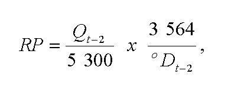
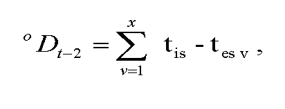
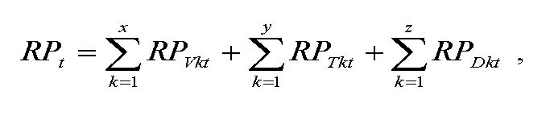

# § 6 Postup a podmienky uplatňovania ceny

(1) Maximálna cena tepla sa skladá z variabilnej zložky maximálnej ceny tepla so spotrebnou daňou28) z elektriny, uhlia, zemného plynu a so spotrebnou daňou z minerálneho oleja a fixnej zložky maximálnej ceny tepla s primeraným ziskom a určuje sa pre obchodný vzťah medzi dodávateľom a odberateľom.29)

(2) Variabilná zložka maximálnej ceny tepla v eurách za kilowatthodinu sa určuje na objednané množstvo tepla a uplatňuje sa za namerané množstvo tepla. Fixná zložka maximálnej ceny tepla s primeraným ziskom sa určí v eurách na kilowatt celkového regulačného príkonu.

(3) Regulačný príkon odberného zariadenia so spotrebou tepla na vykurovanie a spotrebou tepla v teplej úžitkovej vode sa na rok t vypočíta ako podiel skutočne dodaného množstva tepla, osobitne pre teplo na vykurovanie a pre teplo v teplej úžitkovej vode, v kilowatthodinách v roku t-2 do odberného zariadenia, počtu hodín 5 300 a podielu dennostupňov podľa vzorca

kde

Qt-2 je skutočné množstvo dodaného tepla v roku t-2,

oDt-2 je priemerný počet dennostupňov v roku t-2, ktorý sa zverejní na webovom sídle úradu do 30. júna roku t-1 a je vypočítaný podľa vzorca

kde

x je počet vykurovacích dní v roku t-2 určených podľa osobitného predpisu,30)

tis je vnútorná teplota vykurovaných priestorov (20°C),

tesv je teplota vonkajšieho vzduchu vo v-tom dni vykurovacieho obdobia v roku t-2 určená z údajov Slovenského hydrometeorologického ústavu.

(4) Regulačný príkon odberného zariadenia na technologickú spotrebu vo výrobných procesoch sa vypočíta ako podiel skutočne dodaného množstva tepla v kilowatthodinách v roku t-2 do odberného zariadenia a počtu hodín 8 000, ak sa dodávateľ a odberateľ nedohodnú na inom počte hodín. Pri odbernom zariadení, v ktorom si časť tepla na vykurovanie a na prípravu teplej úžitkovej vody vyrába odberateľ tepla samostatne, sa na výpočet regulačného príkonu podľa odseku 3 použije počet hodín 4 000, ak sa dodávateľ s odberateľom nedohodnú inak. Regulačný príkon odberného zariadenia medzi dodávateľom a odberateľom, ktorý je súčasne aj dodávateľom, sa môže určiť aj dohodou.

(5) Regulačný príkon nového odberného zariadenia sa vypočíta ako podiel objednaného množstva tepla na vykurovanie a prípravu teplej úžitkovej vody alebo na technologické využitie na rok t v kilowatthodinách a počtu hodín podľa spôsobu využitia dodávky tepla podľa odsekov 3 a 4.

(6) Celkový regulačný príkon na rok t sa vypočíta ako súčet regulačných príkonov všetkých odberných zariadení podľa vzorca

kde

RPt je celkový regulačný príkon v kilowattoch,

RPVkt je regulačný príkon odberného zariadenia so spotrebou tepla na vykurovanie a spotrebou tepla v teplej úžitkovej vode v kilowattoch,

RPTkt je regulačný príkon odberného zariadenia s technologickou spotrebou tepla vo výrobnom procese v kilowattoch,

RPDkt je regulačný príkon odberného zariadenia so spotrebou doplnkového tepla v kilowattoch,

x, y, z je počet odberných zariadení pre jednotlivé druhy odberných zariadení.
