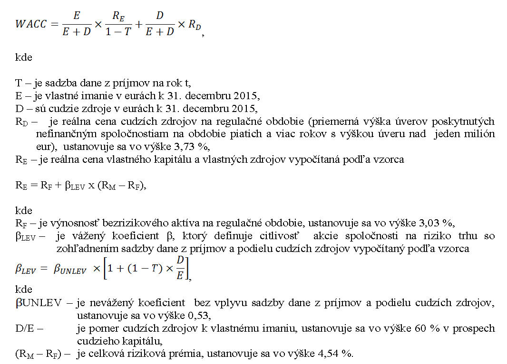

# § 5

(1) Primeraný zisk zohľadňuje rozsah potrebných investícií na zabezpečenie dlhodobej spoľahlivej, bezpečnej a efektívnej prevádzky sústavy, primeranú návratnosť prevádzkových aktív a stimuláciu stabilného dlhodobého podnikania.

(2) Výška primeraného zisku v percentách je určená ako miera výnosnosti regulačnej bázy aktív pred zdanením na regulačné obdobie, kde

WACC je reálna miera výnosnosti regulačnej bázy aktív pred zdanením na regulačné obdobie vypočítaná podľa vzorca

(3) Reálna miera výnosnosti regulačnej bázy aktív (WACC) je určená konštantne na celé regulačné obdobie vo výške 6,47 %. Ak bude odchýlka v jednotlivých parametroch vyššia ako 10 %, miera výnosnosti regulačných aktív sa zverejní na webovom sídle úradu do 30. júna kalendárneho roku.
