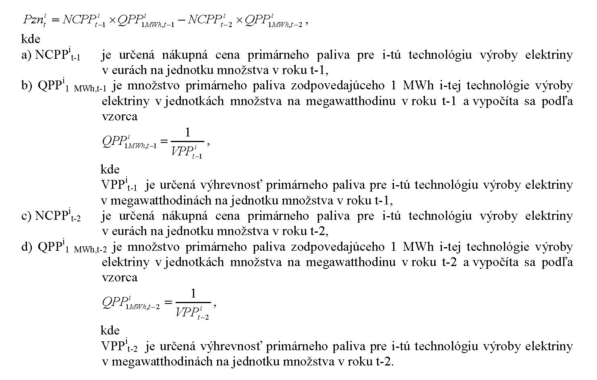

# § 8

(1) Príplatok Pznit v eurách na jednotku množstva elektriny na rok t pre i-té technológie výroby elektriny zohľadňujúci vývoj ceny primárneho paliva i-tej technológie na výrobu elektriny z obnoviteľných zdrojov energie alebo vývoj ceny primárneho paliva z neobnoviteľného zdroja energie i-tej technológie na výrobu elektriny vysoko účinnou kombinovanou výrobou sa vypočíta podľa vzorca

(2) Pznit sa uplatní na rok, ak je hodnota zmeny väčšia ako 5 % zo súčinu nákupnej ceny NCPPit-2 a množstva primárneho paliva QPPi1 MWh,t-2 určených podľa odseku 1.

(3) Hodnoty Pznit v eurách na jednotku množstva elektriny na rok t pre i-té technológie výroby elektriny zohľadňujúce vývoj ceny primárneho paliva i-tej technológie na výrobu elektriny z obnoviteľných zdrojov energie alebo vývoj ceny primárneho paliva z neobnoviteľného zdroja energie i-tej technológie na výrobu elektriny vysoko účinnou kombinovanou výrobou sa zverejňujú na webovom sídle úradu najneskôr do 30. júna kalendárneho roku t-1.
