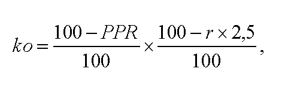

# § 9

(1) Cena elektriny vyrobenej z obnoviteľných zdrojov energie v zariadení výrobcu elektriny uvedeného do prevádzky od 1. januára 2017 sa určuje priamym určením pevnej ceny v eurách na megawatthodinu takto:

a) | z vodnej energie s celkovým inštalovaným výkonom zariadenia výrobcu elektriny |

| 1. do 100 kW vrátane | 111,25 eura/MWh,

| 2. od 101 kW do 200 kW vrátane | 109,15 eura/MWh,

| 3. od 201 kW do 500 kW vrátane | 106,80 eura/MWh,

| 4. od 501 kW do 1 MW vrátane | 105,11 eura/MWh,

| 5. od 1 MW do 5 MW vrátane | 97,95 eura/MWh,

b) | zo slnečnej energie s celkovým inštalovaným výkonom zariadenia výrobcu elektriny do 30 kW, ktoré je umiestnené na strešnej konštrukcii alebo obvodovom plášti jednej budovy spojenej so zemou pevným základom | 84,98 eura/MWh,

c) | z veternej energie | 44,18 eura/MWh,

d) | z geotermálnej energie | 108,71 eura/MWh,

e) | zo spaľovania alebo spoluspaľovania kombinovanou výrobou |

| 1. cielene pestovanej biomasy okrem obilnej slamy | 70,31 eura/MWh,

| 2. odpadnej biomasy ostatnej okrem obilnej slamy | 74,30 eura/MWh,

| 3. obilnej slamy | 92,17 eura/MWh,

| 4. biokvapaliny | 80,86 eura/MWh,

f) | zo spoluspaľovania biologicky rozložiteľných zložiek komunálneho odpadu s fosílnymi palivami kombinovanou výrobou; ak podiel biologicky rozložiteľnej zložky v komunálnom odpade je podľa osobitného predpisu,48) cena sa uplatní bez podmienky výroby elektriny kombinovanou výrobou | 74,83 eura/MWh,

g) | zo spaľovania |

| 1. skládkového plynu alebo plynu z čističiek odpadových vôd | 58,66 eura/MWh,

| 2. biometánu získaného z bioplynu vyrobeného anaeróbnou fermentačnou technológiou s celkovým výkonom zariadenia do 1 MW vrátane | 95,95 eura/MWh,

| 3. bioplynu vyrobeného anaeróbnou fermentačnou technológiou s celkovým výkonom zariadenia do 250 kW vrátane | 102,00 eura/MWh,

| 4. bioplynu vyrobeného anaeróbnou fermentačnou technológiou s celkovým výkonom zariadenia od 251 kW do 500 kW vrátane | 95,89 eur/MWh,

| 5. bioplynu vyrobeného anaeróbnou fermentačnou technológiou s celkovým výkonom zariadenia od 501 kW do 750 kW vrátane | 91,61 eura/MWh,

| 6. bioplynu vyrobeného anaeróbnou fermentačnou technológiou s celkovým výkonom zariadenia nad 751 kW | 90,02 eura/MWh,

| 7. plynu vyrobeného termochemickým splyňovaním biomasy v splyňovacom generátore | 84,72 eura/MWh,

| 8. fermentovanej zmesi vyrobenej aeróbnou fermentáciou biologicky rozložiteľného odpadu | 78,42 eura/MWh.

(2) Cena elektriny vyrobenej vysoko účinnou kombinovanou výrobou v zariadení výrobcu elektriny uvedeného do prevádzky od 1. januára 2017 sa určuje priamym určením pevnej ceny v eurách za megawatthodinu takto:

a) v spaľovacej turbíne s kombinovaným cyklom | 74,10 eura/MWh,

b) v spaľovacej turbíne s regeneráciou tepla | 74,05 eura/MWh,

c) v spaľovacom motore s palivom |

1. zemný plyn | 75,04 eura/MWh,

2. vykurovací olej | 73,67 eura/MWh,

3. zmes vzduchu a metánu | 68,90 eura/MWh,

4. z katalyticky spracovaného odpadu | 92,63 eura/MWh,

5. z termického štiepenia odpadov a jeho produktov | 85,11 eura/MWh,

d) v protitlakovej parnej turbíne alebo v kondenzačnej parnej turbíne s odberom tepla s palivom |

1. zemný plyn | 67,90 eura/MWh,

2. vykurovací olej | 67,10 eura/MWh,

3. hnedé uhlie | 68,29 eura/MWh,

4. čierne uhlie s celkovým inštalovaným výkonom zariadenia výrobcu elektriny do 50 MW vrátane | 62,81 eura/MWh,

5. čierne uhlie s celkovým inštalovaným výkonom zariadenia výrobcu elektriny nad 50 MW | 59,26 eura/MWh,

6. komunálny odpad | 62,51 eura/MWh,

7. plyn vyrobený termochemickým splyňovaním odpadu v splyňovacom generátore alebo termickým štiepením odpadu | 73,75 eura/MWh,

e) spaľovanie energeticky využiteľných plynov vznikajúcich pri hutníckej výrobe ocele | 80,02 eura/MWh,

f) v Rankinovom organickom cykle | 98,31 eura/MWh.

(3) Cena elektriny podľa odsekov 1 alebo 2 platí pre jedno zariadenie na výrobu elektriny výrobcu elektriny obsahujúce stavebnú časť a technologické zariadenie, v ktorých sa vykonáva celý proces premeny primárnej energie na elektrickú energiu. Ak zariadenie podľa odseku 1

písm. a) pozostáva z dvoch alebo viacerých technologických zariadení, ktoré majú spoločnú stavebnú časť, platí cena pre každé technologické zariadenie samostatne.

(4) Ak zariadenie výrobcu elektriny z obnoviteľných zdrojov energie alebo vysoko účinnou kombinovanou výrobou obsahuje súbor technologických zariadení, ktoré môžu byť prevádzkované samostatne, na účely doplatku sa použije technológia s nižšou cenou podľa odsekov 1 a 2. Pre zariadenia podľa odseku 1 písm. a), ktoré môžu byť prevádzkované samostatne, sa cena určí pre každé technologické zariadenie samostatne.

(5) Pre rekonštruované alebo modernizované zariadenie výrobcu elektriny z obnoviteľných zdrojov energie alebo vysoko účinnou kombinovanou výrobou v roku t a pre ktoré nebola určená cena na rok t-1, sa cena podľa odsekov 1 a 2 zníži o súčin ceny určenej podľa odsekov 1 a 2 a koeficientu objektivizácie ko podľa odseku 7.

(6) Pre rekonštruované alebo modernizované zariadenie výrobcu elektriny z obnoviteľných zdrojov energie, alebo vysoko účinnou kombinovanou výrobou v roku t a pre ktoré bola určená cena na rok t-1, sa cena podľa odsekov 1 a 2 zníži o súčin ceny určenej podľa odsekov 1 a 2 a koeficientu objektivizácie ko podľa odseku 7.

(7) Koeficient objektivizácie sa vypočíta podľa vzorca

kde

- a) PPR je percentuálny podiel rekonštruovaných častí zariadenia na výrobu elektriny ustanovený podľa osobitného predpisu,50)

- b) r je doba prevádzky zariadenia na výrobu elektriny od dátumu jeho prvého uvedenia do prevádzky alebo predchádzajúceho vykonania modernizácie alebo rekonštrukcie podľa osobitného predpisu46) v rokoch zaokrúhlená na dve desatinné miesta.

(8) Pre rekonštruované alebo modernizované zariadenie výrobcu elektriny z obnoviteľných zdrojov energie alebo vysoko účinnou kombinovanou výrobou, ktorého doba prevádzky zariadenia na výrobu elektriny od dátumu jeho prvého uvedenia do prevádzky alebo predchádzajúceho vykonania modernizácie alebo rekonštrukcie podľa osobitného predpisu46) je dlhšia ako 40 rokov, sa cena podľa odsekov 1 a 2 neznižuje.
