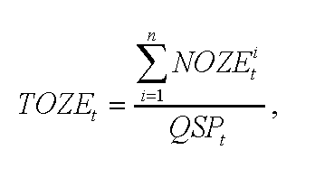
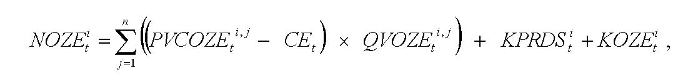
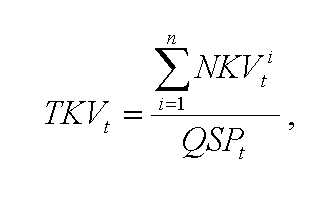
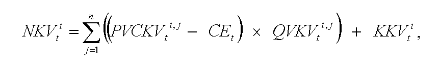
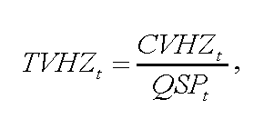
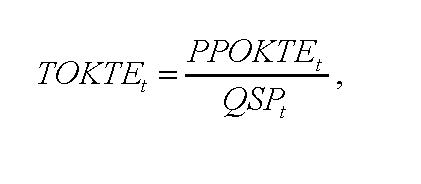

# § 12

(1) Tarifa za prevádzkovanie systému je zložená z

- a) tarify za výrobu elektriny z obnoviteľných zdrojov energie,

- b) tarify za výrobu elektriny vysoko účinnou kombinovanou výrobou,

- c) tarify za výrobu elektriny z domáceho uhlia,

- d) tarify za ostatné činnosti organizátora krátkodobého trhu s elektrinou.

(2) Tarifa za výrobu elektriny z obnoviteľných zdrojov energie TOZEt pre rok t sa určí podľa vzorca

kde

- a) NOZEit sú náklady na podporu výroby elektriny z obnoviteľných zdrojov energie prevádzkovateľa i-tej regionálnej distribučnej sústavy v roku t, ktoré sa určia podľa vzorca

- 

- kde

  - 1. PVCOZEi,jt je cena elektriny pre stanovenie doplatku pre j-té zariadenie na výrobu elektriny výrobcu elektriny z obnoviteľných zdrojov energie v eurách na jednotku množstva elektriny na rok t, ktoré je pripojené do i-tej regionálnej distribučnej sústavy alebo na ktorej vymedzenom území sa nachádza,

  - 2. CEt je aritmetický priemer denných cien oficiálneho kurzového lístka zverejneného burzou PXE (POWER EXCHANGE CENTRAL EUROPE) na jej webovom sídle, produktu F PXE SK BL Cal-t Settlement price v eurách na jednotku množstva elektriny na rok 2017 za obdobie od

  - 1. januára roku t-1 do 30. júna roku t-1 a na roky 2018 až 2021 za obdobie od 1. júla roku t-2 do 30. júna roku t-1,

  - 3. QVOZEi,jt je plánované množstvo elektriny, na ktoré je možné uplatniť doplatok, vyrobenej v roku t v j-tom zariadení na výrobu elektriny výrobcu elektriny z obnoviteľných zdrojov energie, pre ktoré prevádzkovateľ i-tej regionálnej distribučnej sústavy zabezpečuje podporu doplatkom, v jednotkách množstva elektriny,

  - 4. KPRDSit je korekcia nákladov spojených s podporou výroby elektriny z obnoviteľných zdrojov energie a vysoko účinnou kombinovanou výrobou vynaložených prevádzkovateľom i-tej regionálnej distribučnej sústavy v roku t-2 a výnosov z platieb na základe tarify za prevádzkovanie systému určenej pre prevádzkovateľa i-tej regionálnej distribučnej sústavy v roku t-2, pri výpočte NOZEit pre roky 2019 a nasledujúce sa KPRDSit rovná nule a pri výpočte NOZEit pre roky 2017 a 2018 sa KPRDSit určí podľa vzorca

  - KPRDSit = (SNPRDSit-2 − PNPRDSit-2) − (SVTPSdsit-2 − PVTPSdsit-2),

  - kde

    - 4a. SNPRDSit-2 sú skutočné náklady spojené s podporou výroby elektriny z obnoviteľných zdrojov energie a vysoko účinnou kombinovanou výrobou vynaložené prevádzkovateľom i-tej regionálnej distribučnej sústavy v roku t-2 na základe skutočných nameraných údajov o výrobe elektriny z obnoviteľných zdrojov energie a vysoko účinnou kombinovanou výrobou z určených meradiel,

    - 4b. PNPRDSit-2 sú plánované náklady spojené s podporou výroby elektriny z obnoviteľných zdrojov energie a vysoko účinnou kombinovanou výrobou prevádzkovateľa i-tej regionálnej distribučnej sústavy v roku t-2,

    - 4c. SVTPSdsit-2 sú skutočné výnosy z platieb na základe tarify za prevádzkovanie systému určenej pre prevádzkovateľa i-tej regionálnej distribučnej sústavy v roku t-2,

    - 4d. PVTPSdsit-2 sú plánované výnosy z platieb na základe tarify za prevádzkovanie systému určenej pre prevádzkovateľa i-tej regionálnej distribučnej sústavy v roku t-2,

    - 4e. KOZEit je korekcia nákladov na podporu výroby elektriny z obnoviteľných zdrojov energie vynaložených prevádzkovateľom i-tej regionálnej distribučnej sústavy v roku t-2 a výnosov z platieb na základe tarify na podporu výroby elektriny z obnoviteľných zdrojov energie určenej pre prevádzkovateľa i-tej regionálnej distribučnej sústavy v roku t-2, pri výpočte NOZEit pre roky 2017 a 2018 sa KOZEit rovná nule a pri výpočte NOZEit pre roky 2019 a nasledujúce sa KOZEit určí podľa vzorca

    - KOZEit = (SNOZEit-2 − PNOZEit-2) − (SVTOZEdsit-2 − PVTOZEdsit-2),

    - kde

      - 4ea. SNOZEit-2 sú skutočné náklady na podporu výroby elektriny z obnoviteľných zdrojov energie vynaložené prevádzkovateľom i-tej regionálnej distribučnej sústavy v roku t-2 na základe skutočných nameraných údajov o výrobe elektriny z obnoviteľných zdrojov energie z určených meradiel,

      - 4eb. PNOZEit-2 sú plánované náklady na podporu výroby elektriny z obnoviteľných zdrojov prevádzkovateľa i-tej regionálnej distribučnej sústavy v roku t-2,

      - 4ec. SVTOZEdsit-2 sú skutočné výnosy z platieb na základe tarify na podporu výroby elektriny z obnoviteľných zdrojov energie určenej pre prevádzkovateľa i-tej regionálnej distribučnej sústavy v roku t-2,

      - 4ed. PVTOZEdsit-2 sú plánované výnosy z platieb na základe tarify na podporu výroby elektriny z obnoviteľných zdrojov energie určenej pre prevádzkovateľa i-tej regionálnej distribučnej sústavy v roku t-2,

- b) QSPt je plánované množstvo elektriny spotrebovanej na vymedzenom území v roku t, ktoré sa určí podľa vzorca

- QSPt = QPKSt − QPvdt ×Kvdt ,

- kde

  - 1. QPKSt je celková plánovaná koncová spotreba elektriny na vymedzenom území v roku t,

  - 2. QPvdt je celkový plánovaný objem elektriny v jednotkách množstva elektriny v roku t spotrebovanej koncovými odberateľmi elektriny priamo pripojenými do prenosovej sústavy s dobou ročného využitia maxima v roku t-2 vyššou ako 6 800 hodín a súčasne pomernou odchýlkou subjektu zúčtovania menšou ako 0,025; dobou ročného využitia maxima sa rozumie podiel celkového ročného odobratého množstva elektriny v roku t-2 a aritmetického priemeru mesačných maxím štvrťhodinového výkonu odobratého z prenosovej sústavy za mesiace november roku t-4 až február roku t-3; splnenie podmienok zvýhodnenia odberového diagramu na rok t sa preukazuje znaleckým posudkom, ktorý sa predkladá prevádzkovateľovi prenosovej sústavy, organizátorovi krátkodobého trhu s elektrinou a úradu, a to tými koncovými odberateľmi priamo pripojenými do prenosovej sústavy, u ktorých je predpoklad splnenia týchto podmienok v roku t,

  - 3. Kvdt je koeficient zvýhodnenia odberového diagramu pre individuálne sadzby taríf koncových odberateľov elektriny priamo pripojených do prenosovej sústavy na rok t, ktorého hodnota je 0,95.

(3) Tarifa za výrobu elektriny vysoko účinnou kombinovanou výrobou TKVt pre rok t sa určí podľa vzorca

kde

- a) NKVit sú náklady na podporu výroby elektriny vysoko účinnou kombinovanou výrobou prevádzkovateľa i-tej regionálnej distribučnej sústavy v roku t, ktoré sa určia podľa vzorca

- 

  - 1. PVCKVi,jt je cena elektriny pre stanovenie doplatku pre j-té zariadenie na výrobu elektriny výrobcu elektriny vysoko účinnou kombinovanou výrobou v eurách na jednotku množstva elektriny na rok t, ktoré je pripojené do i-tej regionálnej distribučnej sústavy alebo na ktorej vymedzenom území sa nachádza,

  - 2. CEt je aritmetický priemer denných cien oficiálneho kurzového lístka zverejneného burzou PXE (POWER EXCHANGE CENTRAL EUROPE) na jej webovom sídle, produktu F PXE SK BL Cal-t Settlement price v eurách na jednotku množstva elektriny na rok 2017 za obdobie od

  - 1. januára roku t-1 do 30. júna roku t-1 a na roky 2018 až 2021 za obdobie od 1. júla roku t-2 do 30. júna roku t-1,

  - 3. QVKVi,jt je plánované množstvo elektriny, na ktoré je možné uplatniť doplatok, vyrobenej v roku t v j-tom zariadení na výrobu elektriny výrobcu elektriny vysoko účinnou kombinovanou výrobou, pre ktoré prevádzkovateľ i-tej regionálnej distribučnej sústavy zabezpečuje podporu doplatkom, v jednotkách množstva elektriny,

  - 4. KKVit je korekcia nákladov na podporu výroby elektriny vysoko účinnou kombinovanou výrobou vynaložených prevádzkovateľom i-tej regionálnej distribučnej sústavy v roku t-2 a výnosov z platieb na základe tarify na podporu výroby elektriny vysoko účinnou kombinovanou výrobou určenej pre prevádzkovateľa i-tej regionálnej distribučnej sústavy v roku t-2, pri výpočte NKVit pre roky 2017 a 2018 sa KKVit rovná nule a pri výpočte NKVit pre roky 2019 a nasledujúce sa KKVit určí podľa vzorca

  - KKVit = (SNKVit-2 − PNKVit-2) − (SVTKVdsit-2 − PVTKVdsit-2),

  - kde

    - 4a. SNKVit-2 sú skutočné náklady na podporu výroby elektriny vysoko účinnou kombinovanou výrobou vynaložené prevádzkovateľom i-tej regionálnej distribučnej sústavy v roku t-2 na základe skutočných nameraných údajov o výrobe elektriny vysoko účinnou kombinovanou výrobou z určených meradiel,

    - 4b. PNKVit-2 sú plánované náklady na podporu výroby elektriny vysoko účinnou kombinovanou výrobou prevádzkovateľa i-tej regionálnej distribučnej sústavy v roku t-2,

    - 4c. SVTKVdsit-2 sú skutočné výnosy z platieb na základe tarify na podporu výroby elektriny vysoko účinnou kombinovanou výrobou určenej pre prevádzkovateľa i-tej regionálnej distribučnej sústavy v roku t-2,

    - 4d. PVTKVdsit-2 sú plánované výnosy z platieb na základe tarify na podporu výroby elektriny vysoko účinnou kombinovanou výrobou určenej prevádzkovateľom i-tej regionálnej distribučnej sústavy v roku t-2,

- b) QSPt je plánované množstvo elektriny spotrebovanej na vymedzenom území v roku t.

(4) Tarifa za výrobu elektriny z domáceho uhlia TVHZt pre rok t sa určí podľa vzorca

kde

- a) CVHZt je pevná cena za výrobu elektriny z domáceho uhlia na rok t určená podľa § 10,

- c) QSPt je plánované množstvo elektriny spotrebovanej na vymedzenom území v roku t.

(5) Tarifa za ostatné činnosti organizátora krátkodobého trhu s elektrinou TOKTEt pre rok t sa určí podľa vzorca

kde

- a) PPOKTEt je maximálny výnos organizátora krátkodobého trhu s elektrinou v eurách v roku t, ktorý sa vypočíta podľa vzorca

- PPOKTEt = PNOKTE2015 + OOKTE2015 + PVAt + SOOKTE,t-2,

- kde

  - 1. PNOKTE2015 sú schválené alebo určené priemerné prevádzkové náklady za obdobie rokov 2012 až 2015 a očakávaná skutočnosť za rok 2016 súvisiace s činnosťami centrálnej evidencie údajov o prevádzke a meraniach elektriny v elektrizačnej sústave, centrálnou fakturáciou poplatkov súvisiacich s prevádzkou sústavy a súvisiacich činností a správou, zberom a sprístupňovaním nameraných údajov organizátorom krátkodobého trhu s elektrinou pre subjekty zúčtovania v eurách v roku t,

  - 2. OOKTE2015 sú odpisy majetku súvisiaceho s činnosťami centrálnej evidencie údajov o prevádzke a meraniach elektriny v elektrizačnej sústave, centrálnou fakturáciou poplatkov súvisiacich s prevádzkou sústavy a súvisiacich činností a správou, zberom a sprístupňovaním nameraných údajov určené na základe životnosti majetku využívaného na regulovanú činnosť podľa prílohy č. 1 tabuľky č. 2 k 31. decembru 2015,

  - 3. PVAt je primeraný zisk v roku t v eurách určený podľa vzorca

  - PVAt = RAB2015 × WACC ,

  - kde

    - 3a. RAB2015 je hodnota aktív využívaných s činnosťami centrálnej evidencie údajov o prevádzke a meraniach elektriny v elektrizačnej sústave, centrálnou fakturáciou poplatkov súvisiacich s prevádzkou sústavy a súvisiacich činností a správou, zberom a sprístupňovaním nameraných údajov organizátorom krátkodobého trhu s elektrinou k 31. decembru 2015,

    - 3b. WACC je miera výnosnosti regulačnej bázy aktív na regulačné obdobie určená podľa § 5 ods. 2 a 3,

    - 3c. SOOKTE,t-2 sú skutočné schválené alebo určené odpisy v eurách zo skutočnej hodnoty schválených alebo určených investícií v eurách zaradených do regulovaných aktív nevyhnutne využívaných v súvislosti s činnosťami centrálnej evidencie údajov o prevádzke a meraniach elektriny v elektrizačnej sústave, centrálnou fakturáciou poplatkov súvisiacich s prevádzkou sústavy a súvisiacich činností a správou, zberom a sprístupňovaním nameraných údajov roku t-2, pričom životnosti jednotlivých tried majetku sú v prílohe č. 1 tabuľke č. 2, na rok 2017 sa parameter SOOKTEt-2 rovná nule.

- b) QSPt je plánované množstvo elektriny spotrebovanej na vymedzenom území v roku t.

(6) Platba na podporu výroby elektriny z obnoviteľných zdrojov energie, na podporu výroby elektriny vysoko účinnou kombinovanou výrobou, na podporu výroby elektriny z domáceho uhlia a na ostatné činnosti organizátora krátkodobého trhu s elektrinou PTt uhrádzaná účastníkom trhu s elektrinou, ktorý si zvolil pre svoje odberné alebo odovzdávacie miesto režim prenesenej zodpovednosti za odchýlku51) účastníkovi trhu s elektrinou, ktorý za jeho odberné alebo odovzdávacie miesto prevzal zodpovednosť za odchýlku, sa určí podľa vzorca

PTt = (TOZEt + TKVt + TVHZt + TOKTEt) × QSKStoomt ,

kde

- a) TOZEt je tarifa za výrobu elektriny z obnoviteľných zdrojov energie pre rok t,

- b) TKVt je tarifa za výrobu elektriny vysoko účinnou kombinovanou výrobou pre rok t,

- c) TVHZt je tarifa za podporu výroby elektriny z domáceho uhlia pre rok t,

- d) TOKTEt je tarifa za ostatné činnosti organizátora krátkodobého trhu s elektrinou pre rok t,

- e) QSKStoomt je skutočná koncová spotreba elektriny na odbernom alebo odovzdávacom mieste v roku t, na ktorú sa uplatňuje tarifa za výrobu elektriny z obnoviteľných zdrojov energie, tarifa za výrobu elektriny vysoko účinnou kombinovanou výrobou, tarifa za podporu výroby elektriny z domáceho uhlia a tarifa za ostatné činnosti organizátora krátkodobého trhu s elektrinou, ktorá sa určí podľa vzorca

- QSKSoomt = QSKSoomt − QSKSoomt × Kvdt ,

- kde

  - 1. QSKSoomt je celková skutočná koncová spotreba elektriny na odbernom alebo odovzdávacom mieste v roku t; skutočná koncová spotreba elektriny je určená v súlade s prevádzkovým poriadkom organizátora krátkodobého trhu s elektrinou,

  - 2. QSvdoomt je celkový skutočný objem elektriny v jednotkách množstva elektriny v roku t spotrebovanej na odbernom alebo odovzdávacom mieste koncovým odberateľom elektriny priamo pripojeným do prenosovej sústavy s dobou ročného využitia maxima v roku t–2 vyššou ako 6 800 hodín a súčasne pomernou odchýlkou subjektu zúčtovania menšou ako 0,025; dobou ročného využitia maxima sa rozumie podiel celkového ročného odobratého množstva elektriny v roku t-2 a aritmetického priemeru mesačných maxím štvrťhodinového výkonu odobratého z prenosovej sústavy za mesiace november roku t-4 až február roku t-3,

  - 3. Kvdt je koeficient zvýhodnenia odberového diagramu pre individuálne sadzby taríf koncových odberateľov elektriny priamo pripojených do prenosovej sústavy na rok t, ktorého hodnota je 0,95.

(7) Ak účastník trhu s elektrinou, ktorý prevzal zodpovednosť za odchýlku za odberné alebo odovzdávacie miesto iného účastníka trhu s elektrinou nie je subjektom zúčtovania, platba PTt patrí účastníkovi trhu s elektrinou, do ktorého bilančnej skupiny sú tieto odberné a odovzdávacie miesta priradené.

(8) Pre odberateľa elektriny priamo pripojeného do prenosovej sústavy sa uplatňuje tarifa za výrobu elektriny z obnoviteľných zdrojov energie, tarifa za výrobu elektriny vysoko účinnou kombinovanou výrobou, tarifa za výrobu elektriny z domáceho uhlia a tarifa za ostatné činnosti organizátora krátkodobého trhu s elektrinou v eurách na jednotku množstva elektriny za spotrebovanú elektrinu vrátane elektriny vyrobenej vo vlastnom zariadení na výrobu elektriny a spotrebovanej na ostatnú vlastnú spotrebu elektriny výrobcu elektriny alebo dodanej iným odberateľom elektriny bez použitia prenosovej sústavy okrem vlastnej spotreby elektriny pri výrobe elektriny, ktorá nie je odobratá zo sústavy, a okrem elektriny na prečerpávanie v prečerpávacích vodných elektrárňach.

(9) Pre odberateľa elektriny pripojeného do regionálnej distribučnej sústavy sa uplatňuje tarifa za výrobu elektriny z obnoviteľných zdrojov energie, tarifa za výrobu elektriny vysoko účinnou kombinovanou výrobou, tarifa za výrobu elektriny z domáceho uhlia a tarifa za ostatné činnosti organizátora krátkodobého trhu s elektrinou za spotrebovanú elektrinu vrátane elektriny vyrobenej vo vlastnom zariadení na výrobu elektriny a spotrebovanej na ostatnú vlastnú spotrebu elektriny výrobcu elektriny alebo dodanej iným odberateľom elektriny bez použitia regionálnej distribučnej sústavy okrem vlastnej spotreby elektriny pri výrobe elektriny, ktorá nie je odobratá zo sústavy, a okrem elektriny na prečerpávanie v prečerpávacích vodných elektrárňach.

(10) Pre odberateľa elektriny pripojeného do miestnej distribučnej sústavy sa uplatňuje tarifa za výrobu elektriny z obnoviteľných zdrojov energie, tarifa za výrobu elektriny vysoko účinnou kombinovanou výrobou, tarifa za výrobu elektriny z domáceho uhlia a tarifa za ostatné činnosti organizátora krátkodobého trhu s elektrinou za spotrebovanú elektrinu vrátane elektriny vyrobenej vo vlastnom zariadení na výrobu elektriny alebo v inom zariadení na výrobu elektriny pripojených do tejto miestnej distribučnej sústavy a spotrebovanej na ostatnú vlastnú spotrebu elektriny výrobcu elektriny alebo dodanej odberateľom elektriny bez použitia sústavy okrem vlastnej spotreby elektriny pri výrobe elektriny, ktorá nie je odobratá zo sústavy, a okrem elektriny na prečerpávanie v prečerpávacích vodných elektrárňach.

(11) Tarifa za výrobu elektriny z obnoviteľných zdrojov energie, tarifa za výrobu elektriny vysoko účinnou kombinovanou výrobou, tarifa za výrobu elektriny z domáceho uhlia a tarifa za ostatné činnosti organizátora krátkodobého trhu s elektrinou sa uplatňuje aj pri odbere elektriny odberateľom elektriny, ktorý odoberá elektrinu od výrobcu elektriny bez použitia prenosovej sústavy alebo distribučnej sústavy, ak nejde o vzájomnú sústavu prevádzok, ktoré sú preukázateľne oddelené od elektrizačnej sústavy na vymedzenom území. Tarifa za výrobu elektriny z obnoviteľných zdrojov energie, tarifa za výrobu elektriny vysoko účinnou kombinovanou výrobou, tarifa za výrobu elektriny z domáceho uhlia a tarifa za ostatné činnosti organizátora krátkodobého trhu s elektrinou sa uplatňuje aj u odberateľa elektriny alebo výrobcu elektriny účastníkom trhu s elektrinou, ktorý prevzal zodpovednosť za odchýlku za odberné miesto odberateľa elektriny alebo odberné miesto výrobcu elektriny v mieste pripojenia do sústavy.

(12) Tarifa za výrobu elektriny z obnoviteľných zdrojov energie, tarifa za výrobu elektriny vysoko účinnou kombinovanou výrobou, tarifa za výrobu elektriny z domáceho uhlia a tarifa za ostatné činnosti organizátora krátkodobého trhu s elektrinou sa neuplatňuje na straty elektriny v sústave, na vlastnú spotrebu prevádzkovateľa sústavy pri prevádzkovaní sústavy, na vlastnú spotrebu elektriny pri výrobe elektriny, ktorá nie je odobratá zo sústavy, a na spotrebu elektriny na prečerpávanie v prečerpávacích vodných elektrárňach.

(13) Na účely cenovej regulácie sa do 30. apríla roku t predkladajú podľa prílohy č. 7 údaje

- a) o skutočných množstvách elektriny v roku t-1, očakávaných množstvách elektriny v roku t a plánovaných množstvách elektriny na rok t+1 prepravenej koncovým odberateľom elektriny vrátane údajov o množstve elektriny vyrobenej vo vlastnom zariadení na výrobu elektriny, v inom zariadení na výrobu elektriny a údaje o spotrebe takto vyrobenej elektriny spotrebovanej na vlastnú spotrebu elektriny, dodanej odberateľom elektriny bez použitia prenosovej alebo regionálnej distribučnej sústavy, vlastnej spotrebe elektriny pri výrobe elektriny prevádzkovateľmi distribučných sústav a výrobcami elektriny,

- b) o skutočných nákladoch a skutočných výnosoch za tarify za výrobu elektriny z obnoviteľných zdrojov energie, vysoko účinnou kombinovanou výrobou, z domáceho uhlia a za ostatné činnosti organizátora krátkodobého trhu s elektrinou v roku t-1 prevádzkovateľmi regionálnych distribučných sústav a organizátorom krátkodobého trhu s elektrinou.
