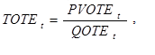

# § 13

(1) Tarifa za organizovanie a vyhodnotenie krátkodobého trhu s elektrinou TOTEt schválená alebo určená v cenovom rozhodnutí na rok t pre organizátora krátkodobého trhu s elektrinou v eurách za jednotku množstva elektriny nakúpenej a predanej účastníkom krátkodobého trhu s elektrinou sa uplatňuje voči subjektom zúčtovania, ktoré majú s organizátorom krátkodobého trhu s elektrinou uzatvorenú zmluvu o prístupe a podmienkach účasti na organizovanom krátkodobom trhu s elektrinou a sú tak účastníkmi krátkodobého trhu s elektrinou. Tarifa TOTEt sa určí podľa vzorca

kde

- a) PVOTEt je schválená alebo určená výška oprávnených nákladov, ktoré možno započítať do ceny, a výška primeraného zisku organizátora krátkodobého trhu s elektrinou z činnosti organizovanie a vyhodnotenie krátkodobého trhu s elektrinou v roku t,

- b) QOTEt je plánované množstvo elektriny v jednotkách množstva elektriny na rok t, s ktorou budú účastníci krátkodobého trhu s elektrinou obchodovať.

(2) Výška oprávnených nákladov, ktoré možno započítať do ceny, a výška primeraného zisku organizátora krátkodobého trhu s elektrinou z činnosti organizovanie a vyhodnotenie krátkodobého trhu s elektrinou PVOTEt v eurách v roku t sa vypočíta podľa vzorca

PVOTEt = PNOTE2015 + POOTE2015 + PVAt + SOote,t-2,

kde

- a) PNOTE2015 sú schválené alebo určené priemerné prevádzkové náklady za obdobie rokov 2012 až 2015 a očakávaná skutočnosť za rok 2016 súvisiace s organizovaním a vyhodnotením krátkodobého trhu s elektrinou v eurách na rok t,

- b) POOTE2015 sú odpisy majetku súvisiaceho s organizovaním a vyhodnotením krátkodobého trhu s elektrinou určené na základe životnosti majetku využívaného na regulovanú činnosť podľa prílohy č. 1 tabuľky č. 2 k 31. decembru 2015,

- c) PVAt je primeraný zisk za organizovanie a vyhodnotenie krátkodobého trhu s elektrinou v roku t v eurách vypočítaný podľa vzorca

- PVAt = RAB2015 × WACC ,

- kde

  - 1. RAB2015 je hodnota aktív využívaných v súvislosti s organizovaním a vyhodnotením krátkodobého trhu s elektrinou k 31. decembru 2015,

  - 2. WACC je miera výnosnosti regulačnej bázy aktív na regulačné obdobie určená podľa § 5

  - ods. 2 a 3,

- d) SOote,t-2 sú skutočné schválené alebo určené odpisy v eurách zo skutočnej hodnoty schválených alebo určených investícií v eurách zaradených do regulovaných aktív nevyhnutne využívaných v súvislosti s organizovaním a vyhodnotením krátkodobého trhu s elektrinou v roku t-2, pričom životnosti jednotlivých tried majetku sú v prílohe č. 1 tabuľke č. 2, na rok 2017 je parameter SOote,t-2 rovný nule.
