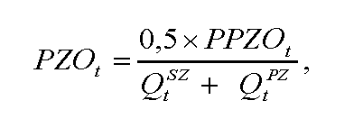
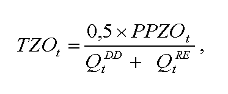

# § 14

(1) Pre subjekty zúčtovania sa uplatňujú tarify za zúčtovanie, vyhodnotenie a vysporiadanie odchýlok v štvrťhodinovom rozlíšení, kde maximálny výnos PPZOt v eurách v roku t sa vypočíta podľa vzorca

PPZOt= PNZOt + PVAt + PNZOt − KZOt ,

kde

- a) PNZOt sú plánované prevádzkové náklady súvisiace so zúčtovaním, vyhodnotením a vysporiadaním odchýlok zúčtovateľa odchýlok v eurách v roku t,

- b) PVAt je primeraný zisk za zúčtovanie, vyhodnotenie a vysporiadanie odchýlok v roku t v eurách vypočítaný podľa vzorca

- PVAt = RAB2015 × WACC ,

- kde

  - 1. RAB2015 je hodnota aktív využívaných v súvislosti so zúčtovaním, vyhodnotením a vysporiadaním odchýlok k 31. decembru 2015,

  - 2. WACC je miera výnosnosti regulačnej bázy aktív na regulačné obdobie určená podľa § 5

  - ods. 2 a 3,

- c) POZOt sú plánované odpisy v roku t majetku súvisiaceho výhradne s výkonom zúčtovania, vyhodnotenia a vysporiadania odchýlok,

- d) KZOt je faktor vyrovnania v eurách na rok t; KZOt sa vypočíta podľa vzorca

- KZOt = PZOt-2 × (SQSZt-2 + SQPZt-2 − QSZt-2 − QPZt-2 ) + TZOt-2 × (SQDDt-2 + SQREt-2 − QDDt-2 − QREt-2 ) ,

- kde

  - 1. PZOt-2 je ročná fixná platba za prístup do systému zúčtovania, vyhodnotenia a vysporiadania odchýlok v eurách v roku t-2 určená pre subjekt zúčtovania, ktorý si zvolil režim vlastnej zodpovednosti za odchýlku a ktorý má uzavretú zmluvu o zúčtovaní odchýlky, a pre subjekt, ktorý poskytuje podporné služby, ale má prenesenú zodpovednosť za odchýlku na inú bilančnú skupinu,

  - 2. SQSZt-2 je skutočný počet subjektov zúčtovania v roku t-2, ktoré si zvolili režim vlastnej zodpovednosti za odchýlku a ktoré majú uzavretú zmluvu o zúčtovaní odchýlky,

  - 3. SQPZt-2 je skutočný počet subjektov v roku t-2, ktoré poskytujú podporné služby, ale majú prenesenú zodpovednosť za odchýlku na inú bilančnú skupinu,

  - 4. QSZt-2 je predpokladaný počet subjektov zúčtovania v roku t-2, ktoré si zvolili režim vlastnej zodpovednosti za odchýlku a ktoré majú uzavretú zmluvu o zúčtovaní odchýlky,

  - 5. QPZt-2 je predpokladaný počet subjektov v roku t-2, ktoré poskytujú podporné služby, ale majú prenesenú zodpovednosť za odchýlku na inú bilančnú skupinu,

  - 6. TZOt-2 je tarifa za zúčtovanie, vyhodnotenie a vysporiadanie odchýlok v eurách za jednotku množstva elektriny v roku t-2 určená pre subjekt zúčtovania, ktorý si zvolil režim vlastnej zodpovednosti za odchýlku a ktorý má uzavretú zmluvu o zúčtovaní odchýlky, a pre subjekt, ktorý poskytuje podporné služby, ale má prenesenú zodpovednosť za odchýlku na inú bilančnú skupinu,

  - 7. SQDDt-2 je celkový skutočný objem dohodnutého množstva elektriny, ktorý sa vypočíta ako suma zmluvnej dodávky a zmluvného odberu vrátane plánovaných cezhraničných prenosov, bilančných skupín subjektov zúčtovania, ktoré si zvolili režim vlastnej zodpovednosti za odchýlku a ktoré majú uzavretú zmluvu o zúčtovaní odchýlky, podľa denných diagramov v jednotkách množstva elektriny v roku t-2,

  - 8. SQREt-2 je celkový skutočný objem poskytnutej regulačnej elektriny subjektov, ktoré poskytujú podporné služby, ale majú prenesenú zodpovednosť za odchýlku na inú bilančnú skupinu, v jednotkách množstva elektriny v roku t-2,

  - 9. QDDt-2 je celkový plánovaný objem dohodnutého množstva elektriny, ktorý sa vypočíta ako suma zmluvnej dodávky a zmluvného odberu vrátane plánovaných cezhraničných prenosov, bilančných skupín subjektov zúčtovania, ktoré si zvolili režim vlastnej zodpovednosti za odchýlku a ktoré majú uzavretú zmluvu o zúčtovaní odchýlky, podľa denných diagramov v jednotkách množstva elektriny v roku t-2,

  - 10. QREt-2 je celkový plánovaný objem poskytnutej regulačnej elektriny subjektov, ktoré poskytujú podporné služby, ale majú prenesenú zodpovednosť za odchýlku na inú bilančnú skupinu, v jednotkách množstva elektriny v roku t-2.

(2) Ročná fixná platba za prístup do systému zúčtovania, vyhodnotenia a vysporiadania odchýlok PZOt v eurách v roku t určená pre subjekt zúčtovania, ktorý si zvolil režim vlastnej zodpovednosti za odchýlku a ktorý má uzavretú zmluvu o zúčtovaní odchýlky, a pre subjekt, ktorý poskytuje podporné služby, ale má prenesenú zodpovednosť za odchýlku na inú bilančnú skupinu, sa vypočíta podľa vzorca

kde

- a) PPZOt je maximálny povolený výnos v eurách za zúčtovanie, vyhodnotenie a vysporiadanie odchýlok v roku t,

- b) QSZt je predpokladaný počet subjektov zúčtovania v roku t, ktoré si zvolili režim vlastnej zodpovednosti za odchýlku a ktoré majú uzavretú zmluvu o zúčtovaní odchýlky,

- c) QPZt je predpokladaný počet subjektov v roku t, ktoré poskytujú podporné služby, ale majú prenesenú zodpovednosť za odchýlku na inú bilančnú skupinu.

(3) Tarifa za zúčtovanie, vyhodnotenie a vysporiadanie odchýlok TZOt v eurách za jednotku množstva elektriny v roku t určená pre subjekt zúčtovania, ktorý si zvolil režim vlastnej zodpovednosti za odchýlku a ktorý má uzavretú zmluvu o zúčtovaní odchýlky, a pre subjekt, ktorý poskytuje podporné služby, ale má prenesenú zodpovednosť za odchýlku na inú bilančnú skupinu, sa vypočíta podľa vzorca

kde

- a) PPZOt je maximálny povolený výnos v eurách za zúčtovanie, vyhodnotenie a vysporiadanie odchýlok v roku t,

- b) QDDt je celkový plánovaný objem dohodnutého množstva elektriny, ktorý sa vypočíta ako suma zmluvnej dodávky a zmluvného odberu vrátane plánovaných cezhraničných prenosov elektriny, bilančných skupín subjektov zúčtovania, ktoré si zvolili režim vlastnej zodpovednosti za odchýlku a ktoré majú uzavretú zmluvu o zúčtovaní odchýlky, podľa denných diagramov v jednotkách množstva elektriny v roku t,

- c) QREt je celkový plánovaný objem poskytnutej regulačnej elektriny subjektov, ktoré poskytujú podporné služby, ale majú prenesenú zodpovednosť za odchýlku na inú bilančnú skupinu, v jednotkách množstva elektriny v roku t.

(4) Pre subjekty zúčtovania, ktoré si zvolili režim vlastnej zodpovednosti za odchýlku a ktoré majú uzavretú zmluvu o zúčtovaní odchýlky, a pre subjekty, ktoré poskytujú podporné služby, ale majú prenesenú zodpovednosť za odchýlku na inú bilančnú skupinu, sa uplatňuje ročná fixná platba za prístup do systému zúčtovania, vyhodnotenia a vysporiadania odchýlok PZOt podľa odseku 2 v eurách v roku t.

(5) Pre subjekty zúčtovania, ktoré si zvolili režim vlastnej zodpovednosti za odchýlku a ktoré majú uzavretú zmluvu o zúčtovaní odchýlky, sa uplatňuje tarifa za zúčtovanie, vyhodnotenie a vysporiadanie odchýlok TZOt podľa odseku 3 k jednotke množstva elektriny dohodnutého množstva elektriny ich bilančných skupín podľa denných diagramov v roku t.

(6) Pre subjekty, ktoré poskytujú podporné služby, ale majú prenesenú zodpovednosť za odchýlku na inú bilančnú skupinu, sa uplatňuje tarifa za zúčtovanie, vyhodnotenie a vysporiadanie odchýlok TZOt podľa odseku 3 k jednotke množstva elektriny objemu poskytnutej regulačnej elektriny určeného prevádzkovateľom prenosovej sústavy v roku t.
