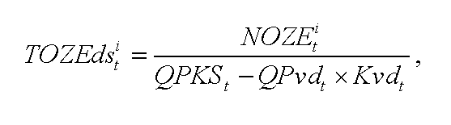
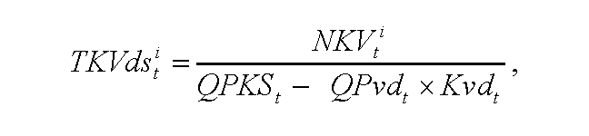

# § 15

(1) Náklady na podporu výroby elektriny z obnoviteľných zdrojov energie, podporu výroby elektriny vysoko účinnou vysoko účinnou kombinovanou výrobou, podporu výroby elektriny z domáceho uhlia a náklady za ostatné činnosti organizátora krátkodobého trhu s elektrinou NPSszti uhrádzané subjektom zúčtovania s vlastnou zodpovednosťou za odchýlku v súlade s prevádzkovým poriadkom organizátora krátkodobého trhu s elektrinou vo výške pre rok t vypočítanej podľa vzorca

NPSszti = (TOZEt + TKVt + TVHZt + TOKTEt) × (QSKSszti − QSvdszti × Kvdt ),

kde

- a) QSKSszti je skutočná celková koncová spotreba elektriny na odberných a odovzdávacích miestach priradených do bilančnej skupiny i-tého subjektu zúčtovania s vlastnou zodpovednosťou za odchýlku, na ktorú sa uplatňujú tarify za výrobu elektriny z obnoviteľných zdrojov energie, tarify za výrobu elektriny vysoko účinnou kombinovanou výrobou, tarify za výrobu elektriny z domáceho uhlia a tarify za ostatné činnosti organizátora krátkodobého trhu s elektrinou v roku t; skutočná koncová spotreba elektriny je určená v súlade s prevádzkovým poriadkom organizátora krátkodobého trhu s elektrinou,

- b) QSvdszti je celkový skutočný objem elektriny v jednotkách množstva elektriny spotrebovanej koncovými odberateľmi elektriny na odberných a odovzdávacích miestach priradených do bilančnej skupiny i-tého subjektu zúčtovania s vlastnou zodpovednosťou za odchýlku, ktorí sú priamo pripojení do prenosovej sústavy s dobou ročného využitia maxima v roku t-2 vyššou ako 6 800 hodín a súčasne pomernou odchýlkou subjektu zúčtovania menšou ako 0,025; dobou ročného využitia maxima sa rozumie podiel celkového ročného odobratého množstva elektriny v roku t-2 a aritmetického priemeru mesačných maxím štvrťhodinového výkonu odobratého z prenosovej sústavy za mesiace november roku t-4 až február roku t-3,

- c) Kvdt je koeficient zvýhodnenia odberového diagramu pre individuálne sadzby taríf koncových odberateľov elektriny priamo pripojených do prenosovej sústavy na rok t, ktorého hodnota je 0,95.

(2) Náklady spojené s podporou vyrobenej elektriny NPSdsti úhrádzané v súlade s prevádzkovým poriadkom organizátora krátkodobého trhu s elektrinou prevádzkovateľovi i-tej regionálnej distribučnej sústavy, ktorý zabezpečuje pre výrobcov elektriny podporu doplatkom, pre rok t sa vypočítajú podľa vzorca

NPSdsit = (TOZEdsit + TKVdsit) × (QSKSt − QSvdt × Kvdt ) ,

kde

- a) TOZEdsit je tarifa na podporu výroby elektriny z obnoviteľných zdrojov energie určená rozhodnutím pre i-tého prevádzkovateľa regionálnej distribučnej sústavy v eurách na jednotku množstva elektriny na rok t, ktorá sa vypočíta podľa vzorca

- 

- kde

  - 1. NOZEit sú celkové plánované náklady na podporu výroby elektriny z obnoviteľných zdrojov energie prevádzkovateľa i-tej regionálnej distribučnej sústavy v roku t,

  - 2. QPKSt je celková plánovaná koncová spotreba elektriny na vymedzenom území na rok t,

  - 3. QPvdt je celkový plánovaný objem elektriny v jednotkách množstva elektriny v roku t spotrebovanej koncovými odberateľmi elektriny priamo pripojenými do prenosovej sústavy s dobou ročného využitia maxima v roku t-2 vyššou ako 6 800 hodín a súčasne pomernou odchýlkou subjektu zúčtovania menšou ako 0,025; dobou ročného využitia maxima sa rozumie podiel celkového ročného odobratého množstva elektriny v roku t-2 a aritmetického priemeru mesačných maxím štvrťhodinového výkonu odobratého z prenosovej sústavy za mesiace november roku t-4 až február roku t-3,

  - 4. Kvdt je koeficient zvýhodnenia odberového diagramu pre individuálne sadzby taríf koncových odberateľov elektriny priamo pripojených do prenosovej sústavy na rok t, ktorého hodnota je 0,95,

- b) TKVdsit je tarifa na podporu výroby elektriny vysoko účinnou kombinovanou výrobou určená rozhodnutím pre i-tého prevádzkovateľa regionálnej distribučnej sústavy v eurách na jednotku množstva elektriny na rok t, ktorá sa vypočíta podľa vzorca

- 

- kde

  - 1. NKVit sú celkové plánované náklady na podporu výroby elektriny vysoko účinnou kombinovanou výrobou prevádzkovateľa i-tej regionálnej distribučnej sústavy v roku t,

  - 2. QPKSt je celková plánovaná koncová spotreba elektriny na vymedzenom území na rok t,

  - 3. QPvdt je celkový plánovaný objem elektriny v jednotkách množstva elektriny v roku t spotrebovanej koncovými odberateľmi elektriny priamo pripojenými do prenosovej sústavy s dobou ročného využitia maxima v roku t-2 vyššou ako 6 800 hodín a súčasne pomernou odchýlkou subjektu zúčtovania menšou ako 0,025; dobou ročného využitia maxima sa rozumie podiel celkového ročného odobratého množstva elektriny v roku t-2 a aritmetického priemeru mesačných maxím štvrťhodinového výkonu odobratého z prenosovej sústavy za mesiace november roku t-4 až február roku t-3,

  - 4. Kvdt je koeficient zvýhodnenia odberového diagramu pre individuálne sadzby taríf koncových odberateľov elektriny priamo pripojených do prenosovej sústavy na rok t, ktorého hodnota je 0,95,

- c) QSKSt je celková skutočná koncová spotreba elektriny na vymedzenom území v roku t; skutočná koncová spotreba elektriny je určená v súlade s prevádzkovým poriadkom organizátora krátkodobého trhu s elektrinou,

- d) QSvdt je celkový skutočný objem elektriny v jednotkách množstva elektriny v roku t spotrebovanej koncovými odberateľmi elektriny priamo pripojenými do prenosovej sústavy s dobou ročného využitia maxima v roku t–2 vyššou ako 6 800 hodín a súčasne pomernou odchýlkou subjektu zúčtovania menšou ako 0,025; dobou ročného využitia maxima sa rozumie podiel celkového ročného odobratého množstva elektriny v roku t-2 a aritmetického priemeru mesačných maxím štvrťhodinového výkonu odobratého z prenosovej sústavy za mesiace november roku t-4 až február roku t-3,

- e) Kvdt je koeficient zvýhodnenia odberového diagramu pre individuálne sadzby taríf koncových odberateľov elektriny priamo pripojených do prenosovej sústavy na rok t, ktorého hodnota je 0,95.

(3) Náklady NPSvt spojené s výrobou elektriny z domáceho uhlia podľa rozhodnutia ministerstva hospodárstva vo všeobecnom hospodárskom záujme NPSvt uhrádzané v súlade s prevádzkovým poriadkom organizátora krátkodobého trhu s elektrinou výrobcovi elektriny, ktorý na základe rozhodnutia ministerstva hospodárstva o uložení povinnosti vo všeobecnom hospodárskom záujme vyrába v roku t elektrinu z domáceho uhlia, pre rok t sa vypočítajú podľa vzorca

NPSvt = TVHZt × (QSKSt − QSvdt × Kvdt ) ,

kde

TVHZt je tarifa za výrobu elektriny z domáceho uhlia.
