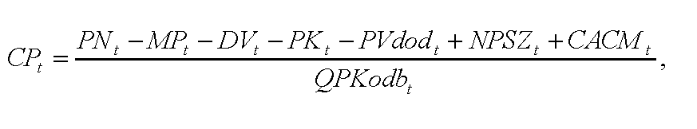
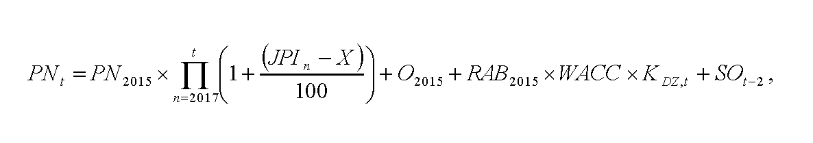
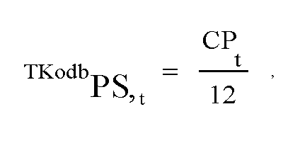
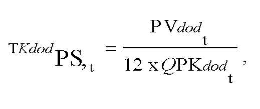

# § 17

(1) Maximálna cena za prístup do prenosovej sústavy a prenos elektriny CPt okrem strát elektriny pri prenose elektriny v eurách za megawatt rezervovanej kapacity na rok t sa vypočíta podľa vzorca

kde

- a) PNt sú ekonomicky oprávnené prevádzkové ročné náklady v roku t na regulovanú činnosť okrem nákladov na dispečerskú činnosť prevádzkovateľa prenosovej sústavy na zabezpečenie systémových služieb vypočítané podľa odseku 2,

- b) MPt je alikvotná časť plánovaných výnosov z medzinárodnej prevádzky zahrnutá do maximálnej ceny za prístup do prenosovej sústavy a prenos elektriny v eurách na rok t vypočítaná podľa vzorca

- MPt = ITCt + (1−m) × VAt,

- kde

  - 1. ITCt je celkový plánovaný čistý výnos v eurách na rok t po odpočítaní nákladov fakturovaných regulovanému subjektu z platieb účtovaných v rámci ITC mechanizmu,

  - 2. VAt je celkový plánovaný čistý výnos v eurách na rok t po odpočítaní nákladov fakturovaných regulovanému subjektu z aukcií prenosovej kapacity na cezhraničných profiloch prenosovej sústavy,

  - 3. m je koeficient určený cenovým rozhodnutím v rozsahu nula až jeden,

- c) DVt sú skutočné výnosy v eurách v roku t-2 z uplatnenia úhrad nákladov prevádzkovateľmi distribučných sústav, výrobcami elektriny a koncovými odberateľmi elektriny za pripojenie do prenosovej sústavy,

- d) PKt sú skutočné výnosy v eurách v roku t-2 z uplatnenia platieb za prekročenie rezervovanej kapacity odberu elektriny užívateľmi prenosovej sústavy,

- e) PVdodt je plánovaný výnos v eurách v roku t určený ako súčin 0,5 eura/MWh a plánovaného objemu dodávky elektriny do prenosovej sústavy v roku t výrobcami elektriny pripojenými do prenosovej sústavy,

- f) NPSZt sú náklady na projekty spoločného záujmu, ktoré nie sú evidované v majetku prevádzkovateľa prenosovej sústavy v eurách na rok t,

- g) CACMt sú schválené náklady na projekty prideľovania kapacity a riadenia preťaženia sústavy, ktoré nie sú evidované v majetku prevádzkovateľa prenosovej sústavy v eurách na rok t,

- h) QPKodbt je celkové plánované množstvo rezervovanej kapacity odberu elektriny v megawattoch na rok t fakturovanej užívateľom prenosovej sústavy.

(2) Ekonomicky oprávnené prevádzkové ročné náklady PNt v roku t na regulovanú činnosť okrem nákladov na dispečerskú činnosť prevádzkovateľa prenosovej sústavy na zabezpečenie systémových služieb sa vypočítajú podľa vzorca

kde

- a) PN2015 sú schválené alebo určené skutočné ekonomicky oprávnené prevádzkové priemerné ročné náklady v eurách za obdobie rokov 2012 až 2015 a očakávaná skutočnosť za rok 2016 súvisiace s regulovanou činnosťou okrem odpisov súvisiacich s regulovanou činnosťou a nákladov na dispečerskú činnosť prevádzkovateľa prenosovej sústavy na zabezpečenie systémových služieb,

- b) JPIn je aritmetický priemer indexov jadrovej inflácie zverejnených štatistickým úradom za obdobie od júla roku n-2 do júna roku n-1,

- c) X je faktor efektivity, ktorého hodnota v každom roku regulačného obdobia je 3,5; ak je hodnota rozdielu JPIn a X nižšia ako 0, na účely výpočtu maximálnej ceny za prístup do prenosovej sústavy a prenos elektriny na rok t sa hodnota rozdielu JPIn a X rovná 0,

- d) O2015 je schválená alebo určená východisková hodnota odpisov regulovaného subjektu v eurách vztiahnutých na RAB2015 a vypočítaná na základe údajov z účtovníctva regulovaného subjektu,

- e) RAB2015 je schválená alebo určená východisková hodnota regulačnej bázy aktív v eurách, ktorá sa rovná hodnote majetku regulačnej bázy aktív nevyhnutne súvisiacej s regulovanou činnosťou k 31. decembru 2015,

- f) WACC je miera výnosnosti regulačnej bázy aktív na regulačné obdobie určená podľa § 5 ods. 2 a 3,

- g) KDZ,t je koeficient miery využitia disponibilných zdrojov do investícií súvisiacich s regulovanou činnosťou; KDZt na rok 2017 sa rovná jednej a na roky 2018 až 2021 sa určuje v intervale od 0,90 do 1,00,

- h) SOt-2 sú skutočné schválené alebo určené odpisy v eurách zo skutočnej hodnoty schválených alebo určených investícií v eurách zaradených do regulovaných aktív nevyhnutne využívaných v súvislosti s výkonom regulovanej činnosti v roku t-2, pričom životnosti jednotlivých tried majetku sú v prílohe č. 1 tabuľke č. 2; na rok 2017 je parameter SOt-2 rovný nule.

(3) Mesačná tarifa za rezervovanú kapacitu odberu elektriny TKodbPS,t sa uplatňuje mesačne voči užívateľom prenosovej sústavy, ktorých rezervovaná kapacita odberu elektriny v roku t je vyššia ako 10 % rezervovanej kapacity dodávky elektriny v roku t. Výška mesačnej tarify za rezervovanú kapacitu odberu elektriny TKodbPS,t v eurách na megawatt rezervovanej kapacity odberu elektriny v roku t sa vypočíta podľa vzorca

kde

CPt je maximálna cena za prístup do prenosovej sústavy a prenos elektriny okrem strát elektriny pri prenose elektriny v eurách za megawatt na rok t vypočítaná podľa odseku 1.

(4) Mesačná tarifa za rezervovanú kapacitu dodávky elektriny TKdodPS,t sa uplatňuje mesačne voči užívateľom prenosovej sústavy, ktorých rezervovaná kapacita odberu elektriny v roku t nie je vyššia ako 10 % rezervovanej kapacity dodávky elektriny. Výška mesačnej tarify za rezervovanú kapacitu dodávky elektriny TKdodPS,t v eurách na megawatt rezervovanej kapacity dodávky elektriny v roku t sa vypočíta podľa vzorca

kde

- a) PVdodt je plánovaný výnos v eurách v roku t určený ako súčin 0,5 eura/MWh a plánovaného objemu dodávky elektriny do prenosovej sústavy v roku t výrobcami elektriny pripojenými do prenosovej sústavy,

- b) QPKdodt je celkové plánované množstvo rezervovanej kapacity dodávky elektriny v megawattoch na rok t fakturovanej užívateľom prenosovej sústavy.

(5) Cena za prekročenie rezervovanej kapacity odberu elektriny vypočítaná ako štvornásobok súčinu mesačnej tarify za rezervovanú kapacitu odberu elektriny TKodbPS,t a rozdielu medzi skutočným mesačným maximom štvrťhodinového výkonu odobratého z prenosovej sústavy a rezervovanou kapacitou odberu elektriny z prenosovej sústavy, a to osobitne za každý mesiac, v ktorom bolo skutočné mesačné maximum štvrťhodinového výkonu odobratého z prenosovej sústavy vyššie od rezervovanej kapacity odberu elektriny sa uplatní voči užívateľovi prenosovej sústavy, ktorého rezervovaná kapacita odberu elektriny je vyššia ako 10 % rezervovanej kapacity dodávky elektriny.
