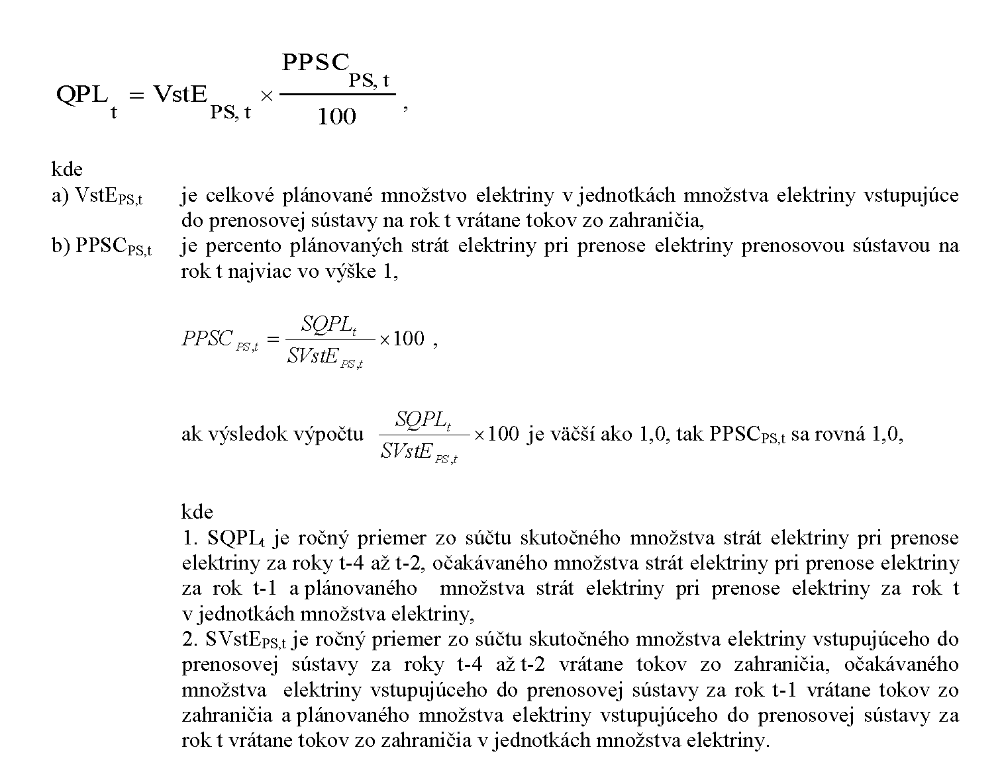
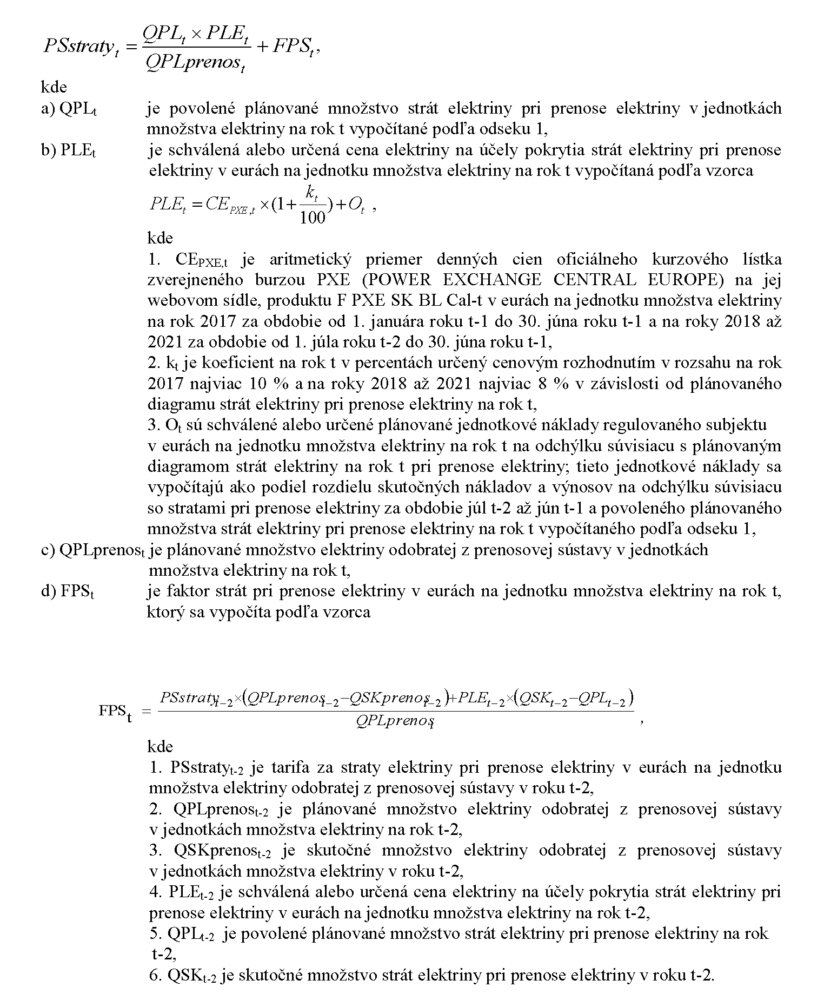

# § 18

(1) Povolené plánované množstvo strát elektriny pri prenose QPLt v jednotkách množstva elektriny na rok t sa vypočíta podľa vzorca

(2) Tarifa za straty elektriny pri prenose elektriny PSstratyt sa uplatňuje voči užívateľovi prenosovej sústavy. Výška tarify za straty elektriny pri prenose elektriny PSstratyt v eurách na jednotku množstva elektriny odobratej z prenosovej sústavy v roku t sa vypočíta podľa vzorca

