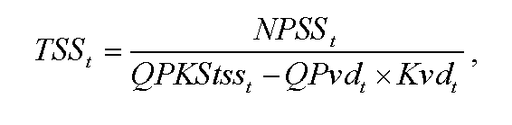
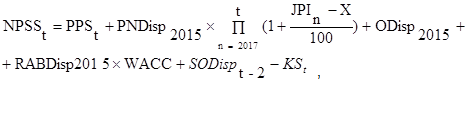

# § 20

(1) Tarifa za systémové služby TSSt sa vypočíta ako podiel plánovaných nákladov zvýšených o primeraný zisk na systémové služby podľa odseku 2 a celkovej plánovanej koncovej spotreby elektriny na vymedzenom území, na ktorú sa uplatňujú tarify za systémové služby, a vypočíta sa podľa vzorca

kde

- a) NPSSt sú plánované náklady na systémové služby s primeraným ziskom,

- b) QPKStsst je celková plánovaná koncová spotreba elektriny na vymedzenom území na rok t, na ktorú sa uplatňujú tarify sa systémové služby,

- c) QPvdt je celkový plánovaný objem elektriny v jednotkách množstva elektriny v roku t odobratej koncovými odberateľmi elektriny priamo pripojenými do prenosovej sústavy s dobou ročného využitia maxima v roku t-2 vyššou ako 6800 hodín a súčasne pomernou odchýlkou subjektu zúčtovania menšou ako 0,025; dobou ročného využitia maxima sa rozumie podiel celkového ročného preneseného množstva elektriny v roku t-2 a aritmetického priemeru mesačných maxím štvrťhodinového výkonu odobratého z prenosovej sústavy za mesiace november roku t-4 až február roku t-3; splnenie podmienok zvýhodnenia odberového diagramu na rok t sa preukazuje znaleckým posudkom, predloženým prevádzkovateľovi prenosovej sústavy, organizátorovi krátkodobého trhu s elektrinou a úradu, a to tými koncovými odberateľmi priamo pripojenými do prenosovej sústavy, u ktorých je predpoklad splnenia týchto podmienok v roku t,

- d) Kvdt je koeficient zvýhodnenia odberového diagramu pre individuálne sadzby taríf koncových odberateľov elektriny priamo pripojených do prenosovej sústavy na rok t, ktorého hodnota je 0,95.

(2) Plánované náklady na systémové služby s primeraným ziskom sa vypočítajú podľa vzorca

kde

- a) PPSt sú celkové schválené alebo určené plánované náklady prevádzkovateľa prenosovej sústavy na nákup podporných služieb v roku t, od poskytovateľov podporných služieb podľa osobitného predpisu52) v eurách,

- b) PNDisp2015 sú schválené alebo určené skutočné ekonomicky oprávnené prevádzkové priemerné ročné náklady v eurách v rokoch 2012 až 2015 a očakávaná skutočnosť 2016 na dispečerskú činnosť prevádzkovateľa prenosovej sústavy na zabezpečenie systémových služieb okrem odpisov,

- c) JPIn je aritmetický priemer indexov jadrovej inflácie zverejnených štatistickým úradom za obdobie od júla roku n-2 do júna roku n-1,

- d) X je faktor efektivity, ktorého hodnota v každom roku regulačného obdobia je 3,5; ak je hodnota rozdielu JPIn a X nižšia ako 0, na účely výpočtu plánovaných nákladov na systémové služby s primeraným ziskom na rok t sa hodnota rozdielu JPIn a X rovná 0,

- e) ODisp2015 je schválená alebo určená východisková hodnota odpisov regulovaného subjektu v eurách vztiahnutých na RABDisp2015 a vypočítaných na základe údajov z účtovníctva regulovaného subjektu,

- f) RABDisp2015 je schválená alebo určená východisková hodnota regulačnej bázy aktív v eurách, ktorá sa rovná hodnote majetku regulačnej bázy aktív nevyhnutne súvisiacej s dispečerskou činnosťou k 31. decembru 2015,

- g) WACC je miera výnosnosti regulačnej bázy aktív na regulačné obdobie určená podľa § 5 ods. 2 a 3,

- h) SODispt-2 sú skutočné schválené alebo určené odpisy v eurách na rok t-2 súvisiace s dispečerskou činnosťou vypočítané na základe dôb technických životností tried aktív nevyhnutne využívaných na regulovanú činnosť podľa prílohy č. 1 tabuľky č. 2 zo skutočných hodnôt schválených alebo určených investícií v eurách zaradených v roku t-2 do hodnoty regulačnej bázy aktív nevyhnutne využívaných na dispečerskú činnosť,

- i) KS t je faktor vyrovnania v eurách v roku t.

(3) Faktor vyrovnania KSt v eurách na rok t sa vypočíta podľa vzorca

KSt= NSSSt-2 − NPSSt-2 − (1−s)×(SPSt-2 −PPSt-2) − Naukct-2 − CVt-2 + 0,7×GCCt-2,

kde

- a) s je koeficient delenia rozdielu medzi skutočnými nákladmi a plánovanými nákladmi na nákup podporných služieb regulovaného subjektu medzi regulovaný subjekt a subjekty zúčtovania určený cenovým rozhodnutím v rozsahu 0,4 až 0,6,

- b) SPSt-2 sú celkové skutočné náklady prevádzkovateľa prenosovej sústavy na nákup podporných služieb od poskytovateľov podporných služieb v eurách v roku t-2,

- c) PPSt-2 sú celkové schválené alebo určené plánované náklady prevádzkovateľa prenosovej sústavy na nákup podporných služieb od poskytovateľov podporných služieb v eurách v roku t-2,

- d) Naukct-2 sú skutočné náklady prevádzkovateľa prenosovej sústavy na aukcie potrebné na dovoz podporných služieb zo zahraničia v roku t-2,

- e) CVt-2 je skutočný dopad z cezhraničných výmen elektriny v eurách v roku t-2, ktorý sa vypočíta podľa vzorca

- CVt-2 = NOcvt-2 − VOcvt-2 + NREcvt-2 − VREcvt-2 + Ncvt-2 − Vcvt-2 ,

- kde

  - 1. NOcvt-2 sú skutočné náklady prevádzkovateľa prenosovej sústavy ako subjektu zúčtovania odchýlok za spôsobenú odchýlku súvisiace s cezhraničným saldom a havarijnou výpomocou v roku t-2,

  - 2. VOcvt-2 sú skutočné výnosy prevádzkovateľa prenosovej sústavy ako subjektu zúčtovania odchýlok za spôsobenú odchýlku súvisiace s cezhraničným saldom a havarijnou výpomocou v roku t-2,

  - 3. NREcvt-2 sú skutočné náklady prevádzkovateľa prenosovej sústavy ako dodávateľa regulačnej elektriny z havarijnej výpomoci v roku t-2,

  - 4. VREcvt-2 sú skutočné výnosy prevádzkovateľa prenosovej sústavy ako dodávateľa regulačnej elektriny z havarijnej výpomoci v roku t-2,

  - 5. Ncvt-2 sú skutočné náklady prevádzkovateľa prenosovej sústavy za havarijnú výpomoc a dodávku elektriny v rámci cezhraničného redispečingu poskytnutú ostatnými prevádzkovateľmi prenosových sústav v roku t-2,

  - 6. Vcvt-2 sú skutočné výnosy prevádzkovateľa prenosovej sústavy za havarijnú výpomoc a dodávku elektriny v rámci cezhraničného redispečingu poskytnutú ostatným prevádzkovateľom prenosových sústav v roku t-2,

- f) GCCt-2 je skutočný dopad z regulačnej elektriny obstaranej v rámci systému GCC v eurách v roku t-2; GCCt-2 sa na regulačné obdobie vypočíta podľa vzorca

- GCCt-2 = VGCCt-2 − NGCCt-2 + VREGCCt-2 − NREGCCt-2 ,

- kde

  - 1. VGCCt-2 sú skutočné výnosy prevádzkovateľa prenosovej sústavy za predaj regulačnej elektriny obstaranej automatickou aktiváciou regulačnej elektriny s parametrami sekundárnej regulácie výkonu prostredníctvom riadiaceho informačného systému dispečingu prevádzkovateľa prenosovej sústavy v spolupráci so susednými prevádzkovateľmi prenosových sústav v rámci systému GCC v eurách v roku t-2,

  - 2. NGCCt-2 sú skutočné náklady prevádzkovateľa prenosovej sústavy na nákup regulačnej elektriny obstaranej automatickou aktiváciou regulačnej elektriny s parametrami sekundárnej regulácie výkonu prostredníctvom riadiaceho informačného systému dispečingu prevádzkovateľa prenosovej sústavy v spolupráci so susednými prevádzkovateľmi prenosových sústav v rámci systému GCC v eurách v roku t-2,

  - 3. VREGCCt-2 sú skutočné výnosy prevádzkovateľa prenosovej sústavy ako dodávateľa regulačnej elektriny typu sekundárnej regulácie výkonu obstaranej prevádzkovateľom prenosovej sústavy v systéme GCC v eurách v roku t-2,

  - 4. NREGCCt-2 sú skutočné náklady prevádzkovateľa prenosovej sústavy ako dodávateľa regulačnej elektriny typu sekundárnej regulácie výkonu obstaranej prevádzkovateľom prenosovej sústavy v systéme GCC v eurách v roku t-2,

- g) NSSSt-2 sú skutočné náklady spojené so systémovými službami vyúčtované prevádzkovateľom prenosovej sústavy v roku t-2,

- h) NPSSt-2 sú plánované náklady na systémové služby na rok t-2 s primeraným ziskom.

(4) Pre odberateľa elektriny priamo pripojeného do prenosovej sústavy sa uplatňuje tarifa za systémové služby TSSt v eurách na jednotku množstva elektriny za prenesenú elektrinu vrátane elektriny vyrobenej v jeho vlastnom zariadení na výrobu elektriny a spotrebovanej na ostatnú vlastnú spotrebu elektriny tohto odberateľa elektriny alebo dodanej iným odberateľom elektriny bez použitia prenosovej sústavy okrem vlastnej spotreby elektriny pri výrobe elektriny, ktorá nie je odobratá z nadradenej sústavy.

(5) Pre odberateľa elektriny pripojeného do regionálnej distribučnej sústavy sa uplatňuje tarifa za systémové služby TSSt za distribuovanú elektrinu vrátane elektriny vyrobenej v jeho vlastnom zariadení na výrobu elektriny a spotrebovanej na ostatnú vlastnú spotrebu elektriny tohto odberateľa elektriny alebo dodanej iným odberateľom elektriny bez použitia regionálnej distribučnej sústavy okrem vlastnej spotreby elektriny pri výrobe elektriny, ktorá nie je odobratá z nadradenej sústavy.

(6) Pre odberateľa elektriny pripojeného do miestnej distribučnej sústavy sa uplatňuje tarifa za systémové služby TSSt za všetku elektrinu odobratú z nadradenej sústavy a distribuovanú odberateľom elektriny pripojeným do tejto miestnej distribučnej sústavy vrátane elektriny vyrobenej vo vlastnom zariadení na výrobu elektriny alebo v inom zariadení na výrobu elektriny pripojených do tejto miestnej distribučnej sústavy a spotrebovanej na ostatnú vlastnú spotrebu elektriny alebo dodanej odberateľom elektriny bez použitia nadradenej sústavy okrem vlastnej spotreby elektriny pri výrobe elektriny, ktorá nie je odobratá z nadradenej distribučnej sústavy.

(7) Pre odberateľa elektriny, ktorý odoberá elektrinu od výrobcu elektriny bez použitia prenosovej sústavy alebo distribučnej sústavy, sa uplatňuje tarifa za systémové služby TSSt na množstvo takto odobratej elektriny.

(8) Tarifa za systémové služby sa neuplatňuje na straty elektriny v sústave, za vlastnú spotrebu prevádzkovateľa sústavy pri prevádzkovaní sústavy, za vlastnú spotrebu elektriny pri výrobe elektriny, ktorá nie je odobratá z nadradenej distribučnej sústavy ani za spotrebu elektriny na prečerpávanie v prečerpávacích vodných elektrárňach.
