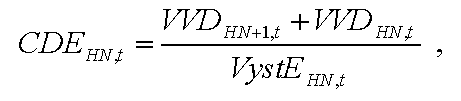
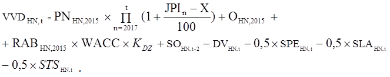
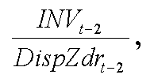
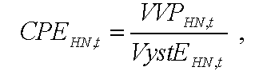
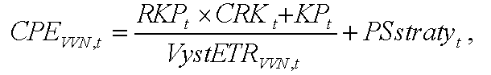
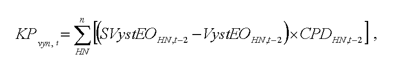

# § 24

(1) Maximálna cena za prístup do distribučnej sústavy a distribúciu elektriny na príslušnej napäťovej úrovni CDHN,t zohľadňuje vlastnú distribúciu elektriny a prenos elektriny vrátane strát pri prenose elektriny v eurách na jednotku množstva elektriny distribuovanej koncovým odberateľom elektriny v roku t a vypočíta sa podľa vzorca

CDHN,t = CDEHN,t + CPEHN,t ,

kde

- a) CDEHN,t je schválená alebo určená zložka maximálnej ceny za prístup do distribučnej sústavy a distribúciu elektriny na príslušnej napäťovej úrovni na rok t v eurách na jednotku množstva elektriny zohľadňujúca náklady a primeraný zisk vlastnej distribúcie elektriny podľa odseku 2,

- b) CPEHN,t je priemerná zložka ceny súvisiacej s používaním prenosovej sústavy za prístup do prenosovej sústavy a prenos elektriny vrátane strát pri prenose v eurách na jednotku množstva elektriny na príslušnej napäťovej úrovni na rok t podľa odseku 4.

(2) Schválená alebo určená zložka maximálnej ceny za prístup do distribučnej sústavy a distribúciu elektriny na príslušnej napäťovej úrovni CDEHN,t na rok t v eurách na jednotku množstva elektriny zohľadňujúca náklady a primeraný zisk vlastnej distribúcie elektriny sa vypočíta podľa vzorca

kde

- a) VystEHN,t je plánované množstvo distribuovanej elektriny v jednotkách množstva elektriny na rok t vystupujúce z príslušnej napäťovej úrovne vypočítané podľa vzorca

- VystEHN,t = VystEOHN,t + VystETRHN,t ,

- kde

  - 1. VystEOHN,t je plánované množstvo elektriny v jednotkách množstva elektriny na rok t distribuované na príslušnej napäťovej úrovni koncovým odberateľom elektriny a prevádzkovateľom miestnej distribučnej sústavy vypočítané ako ročný priemer zo súčtu skutočného príslušného množstva elektriny za roky t-4 až t-2, očakávaného príslušného množstva za rok t-1 a plánovaného príslušného množstva za rok t,

  - 2. VystETRHN,t je plánované množstvo elektriny v jednotkách množstva elektriny na rok t vystupujúce z príslušnej napäťovej úrovne do transformácie na nižšiu napäťovú úroveň vypočítané ako ročný priemer zo súčtu skutočného príslušného množstva elektriny za roky t-4 až t-2, očakávaného príslušného množstva za rok t-1 a plánovaného príslušného množstva za rok t,

- b) VVDHN+1,t je alikvotná časť povolených nákladov a zisku za distribúciu elektriny v eurách na rok t priradených z vyššej napäťovej úrovne vypočítaná podľa vzorca

- VVDHN+1,t = CDEHN+1,t × VystETRHN+1,t ,

- kde

  - 1. CDEHN+1,t je zložka maximálnej ceny za prístup do distribučnej sústavy a distribúciu elektriny na vyššej napäťovej úrovni na rok t v eurách na jednotku množstva elektriny; CDEHN+1,t sa na vstupe do napäťovej úrovne VVN rovná nule,

  - 2. VystETRHN+1,t je plánované množstvo elektriny v jednotkách množstva elektriny na rok t vystupujúce z vyššej napäťovej úrovne HN+1 do transformácie na napäťovú úroveň HN vypočítané ako ročný priemer zo súčtu skutočného príslušného množstva elektriny za roky t-4 až t-2, očakávaného príslušného množstva za rok t-1 a plánovaného príslušného množstva za rok t,

- c) VVDHN,t sú schválené alebo určené náklady a zisk za prístup do distribučnej sústavy a distribúciu elektriny v eurách na rok t na napäťovej úrovni, okrem alikvotnej časť povolených nákladov a zisku za distribúciu elektriny priradených z vyššej napäťovej úrovne, vypočítané podľa odseku 3,

- d) PNHN,t schválené alebo určené náklady a zisk za prístup do distribučnej sústavy a distribúciu elektriny v eurách na rok t na napäťovej úrovni okrem alikvotnej časti povolených nákladov a zisku za distribúciu elektriny priradených z vyššej napäťovej úrovne.

(3) Schválené alebo určené náklady a zisk za prístup do distribučnej sústavy a distribúciu elektriny v eurách na rok t na napäťovej úrovni okrem alikvotnej časti povolených nákladov a zisku za distribúciu elektriny priradených z vyššej napäťovej úrovne VVDHN,t sa vypočítajú podľa vzorca

kde

- a) PNHN,2015 sú priemerné schválené alebo určené skutočné ekonomicky oprávnené prevádzkové ročné náklady v eurách za obdobie rokov 2012 až 2015 a očakávaná skutočnosť 2016 na napäťovej úrovni súvisiace s regulovanou činnosťou okrem odpisov,

- b) JPIn je aritmetický priemer indexov jadrovej inflácie v percentách zverejnených štatistickým úradom za obdobie od júla roku n-2 do júna roku n-1,

- c) X je faktor efektivity, ustanovuje sa v každom roku regulačného obdobia vo výške 3,5 %; ak je hodnota rozdielu JPIn a X nižšia ako 0, na účely výpočtu maximálnej ceny za prístup do distribučnej sústavy a distribúciu elektriny na rok t sa hodnota rozdielu rovná 0,

- d) OHN,2015 je schválená alebo určená východisková hodnota odpisov regulovaného subjektu vo východiskovom roku regulačného obdobia v eurách vztiahnutá na RABHN,2015 na napäťovej úrovní a vypočítaných na základe zostatkovej doby technickej životnosti tried aktív nevyhnutne využívaných na regulovanú činnosť podľa prílohy č. 1 tabuľky č. 2,

- e) RABHN,2015 je schválená alebo určená východisková hodnota regulačnej bázy aktív na napäťovej úrovni v eurách a rovná sa hodnote regulačnej bázy aktív nevyhnutne súvisiacej s regulovanou činnosťou k 31. decembru 2015; regulačná báza aktív pre prevádzkovateľa regionálnej distribučnej sústavy, ktorý distribuuje elektrinu distribučnou sústavou, je hodnota aktív slúžiaca výhradne na vykonávanie regulovaných činností, ktorá sa určí na základe znaleckého posudku na stanovenie všeobecnej hodnoty zariadení prevádzkovateľa distribučnej sústavy slúžiacich výhradne na výkon regulovanej činnosti k 31. decembru 2015 podľa osobitného predpisu,55)

- f) WACC je miera výnosnosti regulačnej bázy aktív na regulačné obdobie určená podľa § 5 ods. 2 a 3,

- g) KDZ je koeficient miery využitia disponibilných zdrojov do investícií súvisiacich s regulovanou činnosťou; KDZ na regulačné obdobie sa určí podľa podielu

- 

- pričom, ak tento podiel je vyšší alebo rovný 0,5, tak KDZ = 1,00,

- menší ako 0,5 a zároveň vyšší alebo rovný 0,4, tak KDZ = 0,90,

- menší ako 0,4 a zároveň vyšší alebo rovný 0,3, tak KDZ = 0,80,

- menší ako 0,3 a zároveň vyšší alebo rovný 0,2, tak KDZ = 0,70,

- menší ako 0,2 a zároveň vyšší alebo rovný 0,1, tak KDZ = 0,60 alebo

- menší ako 0,1, tak KDZ = 0,50,

- kde

  - 1. INVt-2 je skutočná hodnota investícií na napäťovej úrovni v eurách zaradených do hodnoty regulačnej bázy aktív na napäťovej úrovni nevyhnutne využívaných pre regulovanú činnosť v roku t-2,

  - 2. DispZdrt-2 je súčet schválených alebo určených odpisov na napäťovej úrovni v eurách súvisiacich s regulovanou činnosťou v roku t-2 a vypočítaných na základe zostatkovej doby technickej životnosti tried aktív nevyhnutne využívaných pre regulovanú činnosť podľa prílohy č. 1 tabuľky č. 2 a zisku prevádzkovateľa distribučnej sústavy v roku t-2 v eurách po zdanení daňou z príjmov, ktorý sa vypočíta RAB × WACC × (1 − daň z príjmov), pričom WACC a daň z príjmov sa vzťahuje na obdobie t-2,

- h) SOHN,t-2 sú skutočné schválené alebo určené odpisy na napäťovej úrovni v eurách na rok t-2 súvisiace s regulovanou činnosťou z plánovanej hodnoty schválených alebo určených investícii na napäťovej úrovni v eurách zaradených do hodnoty regulačnej bázy aktív nevyhnutne využívaných na regulovanú činnosť v roku t-2 a vypočítané na základe doby technickej životnosti tried aktív nevyhnutne využívaných pre regulovanú činnosť podľa prílohy č. 1 tabuľky č. 2, na rok 2017 je parameter SOHN,t-2 rovný nule,

- i) DVHN,t sú skutočné dodatočné výnosy na napäťovej úrovni v eurách v roku t-2 z uplatnenia ceny za pripojenie do sústavy, zo sankcií za prekročenie rezervovanej kapacity a za skutočne zaplatené výnosy za neoprávnený odber elektriny,56)

- j) SPEHN,t sú skutočné výnosy na napäťovej úrovni v eurách v roku t-2 za elektrinu distribuovanú distribučnou sústavou57) v režime prepravy,

- k) SLAHN,t sú skutočné výnosy na napäťovej úrovni v eurách v roku t-2 zo zmlúv o poskytovaní služieb, prostredníctvom ktorých zabezpečuje vykonávanie regulovanej činnosti (SLA zmluvy)58); ide o výnosy, ktoré sú dosahované prostredníctvom majetku zahrnutého do RABHN,2015 a ľudských zdrojov financovaných prostredníctvom osobných nákladov zahrnutých v PNHN,2015,

- l) STSHN,t sú skutočné výnosy na napäťovej úrovni v eurách v roku t-2 zo služieb poskytovaných tretím stranám; ide o výnosy, ktoré sú dosahované prostredníctvom majetku zahrnutého do RABHN,2015 a ľudských zdrojov financovaných prostredníctvom osobných nákladov zahrnutých v PNHN,2015.

(4) Zložka maximálnej ceny za prístup do distribučnej sústavy a distribúciu elektriny v eurách na jednotku množstva elektriny na rok t CPEHN,t súvisiaca s používaním prenosovej sústavy sa rovná súčtu nákladov za prístup do prenosovej sústavy a prenos elektriny a strát pri prenose elektriny na príslušnej napäťovej úrovni.

(5) Zložka ceny za používanie prenosovej sústavy vrátane nákladov na straty pri prenose v eurách na jednotku množstva elektriny na príslušnej napäťovej úrovni v roku t sa vypočíta podľa vzorca

kde

- a) VVPHN,t sú vstupujúce náklady za prístup do prenosovej sústavy a prenos elektriny vrátane nákladov na straty pri prenose elektriny v eurách v roku t vypočítané podľa vzorca

- VVPHN,t = CPEHN+1,t × VystETRHN+1,t ,

- kde

  - 1. CPEHN+1,t je cena za prístup do prenosovej sústavy a prenos elektriny vrátane strát pri prenose elektriny v eurách na jednotku množstva elektriny na vyššej napäťovej úrovni distribúcie elektriny v roku t, z ktorej sa transformuje elektrina do príslušnej napäťovej úrovne; cena za prístup do prenosovej sústavy na napäťovej hladine vvn CPEVVN,t sa určí podľa odseku 6,

  - 2. VystETRHN+1,t je plánované množstvo elektriny v jednotkách množstva elektriny vstupujúce do príslušnej napäťovej úrovne cez transformáciu z vyššej napäťovej úrovne v roku t; plánované množstvo elektriny vstupujúce do napäťovej úrovne vvn VystETRVVN,t je rovné plánovanému množstvu elektriny odobratej z prenosovej sústavy,

- b) VystEHN,t je celkové plánované množstvo elektriny v jednotkách množstva elektriny vystupujúce z príslušnej napäťovej úrovne v roku t vypočítané podľa vzorca

- VystEHN,t = VystEOHN,t + VystETRHN,t,

- kde

  - 1. VystEOHN,t je plánované množstvo elektriny v jednotkách množstva elektriny distribuované na príslušnej napäťovej úrovni ku koncovým odberateľom elektriny v roku t,

  - 2. VystETRHN,t je plánované množstvo elektriny v jednotkách množstva elektriny vystupujúce z príslušnej napäťovej úrovne do transformácie na nižšiu napäťovú úroveň v roku t.

(6) Cena za prístup do prenosovej sústavy a prenos elektriny v eurách na jednotku množstva elektriny CPEVVN,t na vstupe do napäťovej úrovne veľmi vysokého napätia distribučnej sústavy je jednozložková cena zahŕňajúca náklady regulovaného subjektu na rezervovaný výkon, prenesenú elektrinu a straty elektriny pri prenose elektriny v roku t určené na základe schváleného návrhu ceny za prístup do prenosovej sústavy a prenos elektriny na rok t a vypočíta sa podľa vzorca

kde

- a) RKPt je rezervovaná kapacita v megawattoch na rok t uplatňovaná regulovanému subjektu prevádzkovateľom prenosovej sústavy,

- b) CRKt je cena za rezervovanú kapacitu v roku t v eurách na megawatt na rok uplatňovaná regulovanému subjektu prevádzkovateľom prenosovej sústavy,

- c) VystETRVVN,t je plánované množstvo elektriny v jednotkách množstva elektriny na rok t vstupujúce do napäťovej úrovne veľmi vysokého napätia regulovaného subjektu z prenosovej sústavy,

- d) PSstratyt je tarifa za straty pri prenose elektriny v eurách na jednotku množstva elektriny na rok t uplatňovaná regulovanému subjektu prevádzkovateľom prenosovej sústavy,

- e) KPt je faktor vyrovnania ceny za prístup do prenosovej sústavy a prenos elektriny v eurách, ktorý sa vypočíta podľa vzorca

- KPt = KPnak,t − KPvyn,t ,

- kde

  - 1. KPnak,t je korekcia nákladov za prístup do prenosovej sústavy a prenos elektriny v eurách, ktorá sa vypočíta podľa vzorca

- KPnak,t = (SVystETRVVN,t-2 − VystETRVVN,t-2 ) × PSstratyt-2 ,

- kde

  - 1a. SVystETRVVN,t-2 je skutočné množstvo elektriny v jednotkách množstva elektriny vstupujúce do príslušnej napäťovej úrovne cez transformáciu z vyššej napäťovej úrovne v roku t-2,

  - 1b. VystETRVVN,t-2 je plánované množstvo elektriny v jednotkách množstva elektriny vstupujúce do príslušnej napäťovej úrovne cez transformáciu z vyššej napäťovej úrovne v roku t-2,

  - 1c. PSstratyt-2 je tarifa za straty pri prenose elektriny v eurách na jednotku množstva elektriny v roku t-2 uplatňovaná regulovanému subjektu prevádzkovateľom prenosovej sústavy,

  - 2. KPvyn,t je korekcia výnosov z účtovania ceny CPDHN,t-2, ktorá sa vypočíta podľa vzorca

  - 

- kde

  - 2a. SVystEOHN,t-2 je skutočné množstvo elektriny v jednotkách množstva elektriny distribuované na príslušnej napäťovej úrovni ku koncovým odberateľom elektriny v roku t-2,

  - 2b. VystEOHN,t-2 je plánované množstvo elektriny v jednotkách množstva elektriny distribuované na príslušnej napäťovej úrovni koncovým odberateľom elektriny v roku t-2.

(7) Pre regulované subjekty, ktoré vykonávajú prenos elektriny cezhraničnými vedeniami, sa pre určenie ceny za prístup do sústavy a prenos elektriny týmito vedeniami použijú primerane ustanovenia § 16 až 18.
