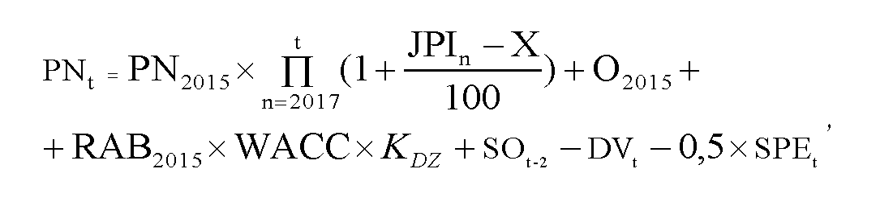
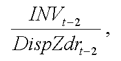
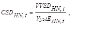
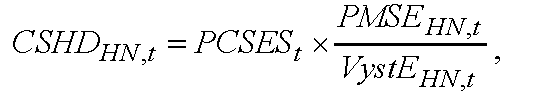
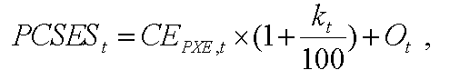
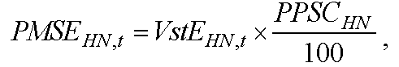

# § 27

(1) Maximálna cena za prístup do miestnej distribučnej sústavy a distribúciu elektriny CMDSt v eurách na jednotku množstva elektriny na rok t okrem strát elektriny pri distribúcii elektriny sa pre regulovaný subjekt, ktorý predkladá návrh ceny, vypočíta podľa vzorca

CMDSt = PNMDSt / (QDt+ QSt+ QSDSt),

kde

- a) PNMDSt sú schválené alebo určené náklady a zisk za prístup do distribučnej sústavy a distribúciu elektriny v eurách na rok t na napäťovej úrovni vrátane povolených nákladov za distribúciu elektriny od prevádzkovateľa sústavy, do ktorého sústavy je regulovaný subjekt pripojený, vypočítané podľa vzorca

- PNMDSt = PNt + PNSN+1t – KAt,

- kde

  - 1. PNSN+1t sú plánované schválené alebo určené ekonomicky oprávnené náklady v eurách na distribúciu elektriny v roku t, ktoré zahŕňajú náklady na distribúciu elektriny vrátane strát elektriny pri distribúcii elektriny od prevádzkovateľa sústavy, do ktorého sústavy je regulovaný subjekt pripojený,

  - 2. PNt schválené alebo určené náklady a zisk za prístup do distribučnej sústavy a distribúciu elektriny v eurách na rok t okrem povolených nákladov za distribúciu elektriny od prevádzkovateľa sústavy, do ktorého sústavy je regulovaný subjekt pripojený, vypočítané podľa vzorca

  - 

  - kde

    - 2a. PN2015 sú priemerné schválené alebo určené skutočné ekonomicky oprávnené prevádzkové ročné náklady v eurách za obdobie rokov 2012 až 2015 a očakávaná skutočnosť 2016 súvisiace s regulovanou činnosťou okrem odpisov,

    - 2b. JPIn je aritmetický priemer indexov jadrovej inflácie v percentách zverejnených štatistickým úradom za obdobie od júla roku t-2 do júna roku t-1,

    - 2c. X je faktor efektivity, ktorého hodnota v každom roku regulačného obdobia je 3,5; ak je hodnota rozdielu JPIn a X nižšia ako 0, na účely výpočtu maximálnej ceny za prístup do distribučnej sústavy a distribúciu elektriny na rok t sa hodnota rozdielu rovná 0,

    - 2d. O2015 je schválená alebo určená východisková hodnota odpisov regulovaného subjektu vo východiskovom roku regulačného obdobia v eurách vztiahnutá na RABHN,2015 na napäťovej úrovní a vypočítaných na základe zostatkovej doby technickej životnosti tried aktív nevyhnutne využívaných na regulovanú činnosť podľa prílohy č. 1 tabuľky č. 2,

    - 2e. RAB2015 je schválená alebo určená východisková hodnota regulačnej bázy aktív na napäťovej úrovni v eurách a rovná sa hodnote regulačnej bázy aktív nevyhnutne súvisiacej s regulovanou činnosťou k 31. decembru 2015; regulačná báza aktív pre prevádzkovateľa miestnej distribučnej sústavy, ktorý distribuuje elektrinu distribučnou sústavou, je hodnota aktív slúžiaca výhradne na vykonávanie regulovaných činností, a určí sa ako suma zostatkovej ceny hmotného a nehmotného majetku podľa prílohy č. 5 tabuľky č. 10 a nájomného podľa § 4 ods. 1 písm. h), alebo na základe znaleckého posudku na stanovenie všeobecnej hodnoty zariadení prevádzkovateľa distribučnej sústavy slúžiacich výhradne na výkon regulovanej činnosti k 31. decembru 2015 podľa osobitného predpisu,55)

    - 2f. WACC je miera výnosnosti regulačnej bázy aktív na regulačné obdobie určená podľa § 5 ods. 2 a 3,

    - 2g. KDZ je koeficient miery využitia disponibilných zdrojov do investícií súvisiacich s regulovanou činnosťou; KDZ na regulačné obdobie sa určí podľa podielu

    - 

    - pričom, ak tento podiel je vyšší alebo rovný 0,5, tak KDZ = 1,00,

    - menší ako 0,5 a zároveň vyšší alebo rovný 0,4, tak KDZ = 0,90,

    - menší ako 0,4 a zároveň vyšší alebo rovný 0,3, tak KDZ = 0,80,

    - menší ako 0,3 a zároveň vyšší alebo rovný 0,2, tak KDZ = 0,70,

    - menší ako 0,2 a zároveň vyšší alebo rovný 0,1, tak KDZ = 0,60, alebo

    - menší ako 0,1, tak KDZ = 0,50,

    - kde

      - 2ga. INVt-2je skutočná hodnota investícií na napäťovej úrovni v eurách zaradených do hodnoty regulačnej bázy aktív na napäťovej úrovni nevyhnutne využívaných pre regulovanú činnosť v roku t-2,

      - 2gb. DispZdrt-2je súčet schválených alebo určených odpisov na napäťovej úrovni v eurách súvisiacich s regulovanou činnosťou v roku t-2 a vypočítaných na základe zostatkovej doby technickej životnosti tried aktív nevyhnutne využívaných pre regulovanú činnosť podľa prílohy č. 1 tabuľky č. 2 a zisku prevádzkovateľa distribučnej sústavy v roku t-2 v eurách po zdanení daňou z príjmov, ktorý sa vypočíta RAB × WACC × (1 − daň z príjmov), pričom WACC a daň z príjmov sa vzťahuje na obdobie t-2,

    - 2h. SOHN,t-2 sú skutočné schválené alebo určené odpisy na napäťovej úrovni v eurách na rok t-2 súvisiace s regulovanou činnosťou z plánovanej hodnoty schválených alebo určených investícii na napäťovej úrovni v eurách zaradených do hodnoty regulačnej bázy aktív nevyhnutne využívaných na regulovanú činnosť v roku t-2 a vypočítané na základe doby technickej životnosti tried aktív nevyhnutne využívaných pre regulovanú činnosť podľa prílohy č. 1 tabuľky č. 2; na rok 2017 je parameter SOHN,t-2 rovný nule,

    - 2i. DVHN,t sú skutočné dodatočné výnosy na napäťovej úrovni v eurách v roku t-2 z uplatnenia ceny za pripojenie do sústavy, zo sankcií za prekročenie rezervovanej kapacity a za skutočne zaplatené výnosy za neoprávnený odber elektriny,56)

    - 2j. SPEHN,t sú skutočné výnosy na napäťovej úrovni v eurách v roku t-2 za elektrinu prepravovanú distribučnou sústavou,55)

  - 3. KAt je faktor vyrovnania ceny za prístup do distribučnej sústavy a distribúciu elektriny od prevádzkovateľa sústavy, do ktorého sústavy je regulovaný subjekt pripojený a ktorý sa vypočítava podľa vzorca

  - KAt = ((CMDSt-2 × (SQDt-2 + SQSt-2 + SQSDSt-2 )) − (CMDSt-2 × (QDt-2 + QSt-2 + QSDSt-2 ))) − (SNSN + 1t-2 − PNSN + 1t-2 ) ,

  - kde

    - 3a. CMDSt-2 je maximálna cena za prístup do miestnej distribučnej sústavy a distribúciu elektriny v eurách na jednotku množstva elektriny na rok t okrem strát elektriny pri distribúcii elektriny,

    - 3b. SQDt-2 je skutočné množstvo elektriny v jednotkách množstva elektriny v roku t-2, odobratej z distribučnej sústavy regulovaného subjektu koncovými odberateľmi elektriny,

    - 3c. SQSt-2 je skutočné množstvo elektriny spotrebované regulovaným subjektom okrem vlastnej spotreby pri distribúcii elektriny a vlastnej spotreby elektriny pri výrobe elektriny vo vlastnom zariadení na výrobu elektriny v jednotkách množstva elektriny v roku t-2,

    - 3d. SQSDSt-2 je skutočné množstvo elektriny spotrebované regulovaným subjektom, ktoré zahŕňa vlastnú spotrebu pri distribúcii elektriny regulovaného subjektu v jednotkách množstva elektriny v roku t-2,

    - 3e. QDt-2 je plánované množstvo elektriny v jednotkách množstva elektriny v roku t-2, odobratej z distribučnej sústavy regulovaného subjektu koncovými odberateľmi elektriny,

    - 3f. QSt-2 je plánované množstvo elektriny spotrebované regulovaným subjektom okrem vlastnej spotreby pri distribúcii elektriny a vlastnej spotreby elektriny pri výrobe elektriny vo vlastnom zariadení na výrobu elektriny v jednotkách množstva elektriny v roku t-2,

    - 3g. QSDSt-2 je plánované množstvo elektriny spotrebované regulovaným subjektom, ktoré zahŕňa vlastnú spotrebu pri distribúcii elektriny regulovaného subjektu v jednotkách množstva elektriny v roku t-2,

    - 3h. SNSN+1t-2 sú skutočné schválené alebo určené ekonomicky oprávnené náklady v eurách na distribúciu elektriny v roku t-2, ktoré zahŕňajú náklady na distribúciu elektriny vrátane strát elektriny pri distribúcii elektriny od prevádzkovateľa sústavy, do ktorého sústavy je regulovaný subjekt pripojený,

    - 3i. PNSN+1t-2 sú plánované schválené alebo určené ekonomicky oprávnené náklady v eurách na distribúciu elektriny v roku t-2, ktoré zahŕňajú náklady na distribúciu elektriny vrátane strát elektriny pri distribúcii elektriny od prevádzkovateľa sústavy, do ktorého sústavy je regulovaný subjekt pripojený,

- b) QDt je plánované množstvo elektriny v jednotkách množstva elektriny v roku t, odobratej z distribučnej sústavy regulovaného subjektu koncovými odberateľmi elektriny,

- c) QSt je plánované množstvo elektriny spotrebované regulovaným subjektom okrem vlastnej spotreby pri distribúcii elektriny a vlastnej spotreby elektriny pri výrobe elektriny vo vlastnom zariadení na výrobu elektriny v jednotkách množstva elektriny v roku t,

- d) QSDSt je plánované množstvo elektriny spotrebované regulovaným subjektom, ktoré zahŕňa vlastnú spotrebu pri distribúcii elektriny regulovaného subjektu v jednotkách množstva elektriny v roku t.

(2) Tarifa za straty elektriny pri distribúcii elektriny CSDHN,t v eurách na jednotku množstva elektriny sa v roku t vypočíta postupným výpočtom na jednotlivých napäťových úrovniach začínajúcim od napäťovej úrovne, do ktorej je distribučná sústava regulovaného subjektu pripojená, sa vypočíta podľa vzorca

kde

- a) VVSDHN,t sú náklady za straty pri distribúcii elektriny v eurách priradené príslušnej napäťovej úrovni vypočítané podľa odseku 3,

- b) VystEHN,t je celkové plánované množstvo elektriny v jednotkách množstva elektriny vystupujúce z príslušnej napäťovej úrovne v roku t vypočítané podľa vzorca

- VystEHN,t = VystEOHN,t + VystETRHN,t ,

- kde

  - 1. VystEOHN,t je plánované množstvo elektriny v jednotkách množstva elektriny na rok t distribuované na príslušnej napäťovej úrovni koncovým odberateľom elektriny a pre vlastnú spotrebu elektriny prevádzkovateľa sústavy regulovaného subjektu a ostatnú vlastnú spotrebu elektriny prevádzkovateľa sústavy regulovaného subjektu,

  - 2. VystETRHN,t je plánované množstvo elektriny v jednotkách množstva elektriny na rok t vystupujúce z príslušnej napäťovej úrovne do transformácie na nižšiu napäťovú úroveň.

(3) Náklady za straty elektriny pri distribúcii elektriny priradené príslušnej napäťovej úrovni VVSDHN,t v eurách v roku t skladajúce sa z alikvotnej časti nákladov za straty elektriny pri distribúcii elektriny priradených z vyššej napäťovej úrovne a nákladov za straty elektriny pri distribúcii vlastnej napäťovej úrovne sa vypočítajú podľa vzorca

VVSDHN,t = CSDHN+1,t × VystETRHN+1,t + CSHDHN,t × VystEHN,t ,

kde

- a) CSDHN+1,t je tarifa za straty elektriny pri distribúcii elektriny v eurách na jednotku množstva elektriny na vyššej napäťovej úrovni, z ktorej sa transformuje elektrina do príslušnej napäťovej úrovne; na distribučnej napäťovej úrovni, do ktorej je miestna distribučná sústava pripojená, sa tarifa za straty elektriny na vyššej napäťovej úrovni v eurách na jednotku množstva elektriny v roku t CMDSHN+1,t rovná nule,

- b) CSHDHN,t je cena za straty elektriny pri distribúcii elektriny v eurách na jednotku množstva elektriny príslušnej napäťovej úrovne v roku t podľa odseku 4,

- c) VystETRHN+1,t je plánované množstvo elektriny v jednotkách množstva elektriny vstupujúce z vyššej napäťovej úrovne do transformácie na nižšiu napäťovú úroveň v roku t,

- d) VystEHN,t je celkové plánované množstvo elektriny v jednotkách množstva elektriny vystupujúce z príslušnej napäťovej úrovne v roku t.

(4) Cena za straty pri distribúcii elektriny na príslušnej napäťovej úrovni CSHDHN,t v eurách na jednotku množstva elektriny v roku t sa vypočíta podľa vzorca

kde

- a) PCSES,t je schválená alebo určená cena elektriny na účely pokrytia strát elektriny pri distribúcii elektriny v eurách na jednotku množstva elektriny na rok t vypočítaná podľa vzorca

- 

- kde

  - 1. CEPXE,t je aritmetický priemer denných cien oficiálneho kurzového lístka zverejneného burzou PXE (POWER EXCHANGE CENTRAL EUROPE) na jej webovom sídle, produktu F PXE SK BL Cal-t Settlement price v eurách na jednotku množstva elektriny na rok 2017 za obdobie od 1. januára roku t-1 do 30. júna roku t-1 a na roky 2018 až 2021 za obdobie od 1. júla roku t-2 do 30. júna roku t-1,

  - 2. kt je koeficient na rok t v percentách určený cenovým rozhodnutím v rozsahu na rok 2017 najviac 12 % a na roky 2018 až 2021 najviac 6 % v závislosti od plánovaného diagramu strát elektriny pri distribúcii elektriny na rok t,

  - 3. Ot sú schválené alebo určené plánované náklady regulovaného subjektu za podiel na nákladoch na regulačnú elektrinu a za zúčtovanie rozdielov strát podľa osobitného predpisu59) na základe údajov poskytnutých organizátorom krátkodobého trhu s elektrinou a vyrovnávacej ceny elektriny na zúčtovanie rozdielov; vyrovnávacia cena elektriny na zúčtovanie rozdielov je určená vo výške určenej ceny na nákup elektriny na krytie strát v príslušnej sústave na príslušné obdobie na rok t,

- b) PMSEHN,t je povolené množstvo strát elektriny v jednotkách množstva elektriny na príslušnej napäťovej úrovni v roku t vypočítané podľa odseku 5.

(5) Povolené množstvo strát elektriny PMSEHN,t v jednotkách množstva elektriny na príslušnej napäťovej úrovni v roku t sa vypočíta podľa vzorca

kde

- a) VstE HN,t je celkové plánované množstvo elektriny v jednotkách množstva elektriny vstupujúce do príslušnej napäťovej úrovne v roku t z nadradenej distribučnej sústavy cez transformáciu z vyššej napäťovej úrovne, zo všetkých zdrojov elektriny pripojených na danú napäťovú úroveň, z prítokov elektriny z iných miestnych distribučných sústav,

- b) PPSCHN je hodnota percenta strát pri distribúcii elektriny na príslušnej napäťovej úrovni, v závislosti od napäťovej úrovne pripojenia miestnej distribučnej sústavy je najviac,

  - 1. ak je sústava pripojená na úrovni veľmi vysokého napätia,

    - 1a. 0,1 % na napäťovej úrovni veľmi vysokého napätia,

    - 1b. 2,2 % na napäťovej úrovni vysokého napätia,

    - 1c. 5 % na napäťovej úrovni nízkeho napätia,

  - 2. ak je sústava pripojená na napäťovej úrovni vysokého napätia,

    - 2a. 2,0 % na napäťovej úrovni vysokého napätia,

    - 2b. 5 % na napäťovej úrovni nízkeho napätia,

  - 3. ak je sústava pripojená na napäťovej úrovni nízkeho napätia, 1 % na napäťovej úrovni nízkeho napätia.

(6) Hodnota percenta strát elektriny pri distribúcii elektriny na príslušnej napäťovej úrovni PPSCHN sa pre miestnu distribučnú sústavu, ktorá je rozlohou porovnateľná s regionálnou distribučnou sústavou, určí individuálne v rozhodnutí.
