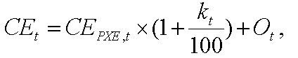

# § 29

(1) Maximálna cena za elektrinu CEt na účely dodávky elektriny zraniteľným odberateľom schválená alebo určená cenovým rozhodnutím sa vypočíta podľa vzorca

kde

- a) CEPXE,t je aritmetický priemer denných cien oficiálneho kurzového lístka zverejneného burzou PXE (POWER EXCHANGE CENTRAL EUROPE) na jej webovom sídle, produktu F PXE SK BL Cal-t Settlement price v eurách na jednotku množstva elektriny na rok 2017 za obdobie od 1. januára roku t-1 do 30. júna roku t-1 a na roky 2018 až 2021 za obdobie od 1. júla roku t-2 do 30. júna roku t-1,

- b) kt je koeficient na rok t v percentách určený cenovým rozhodnutím v rozsahu na rok 2017 najviac 12 % a na roky 2018 až 2021 najviac 8 % v závislosti od plánovaného diagramu dodávky elektriny pre zraniteľných odberateľov na rok t,

- c) Ot sú schválené náklady regulovaného subjektu na odchýlku súvisiace s dodávkou elektriny zraniteľným odberateľom v eurách na jednotku množstva elektriny v roku t; ak je regulovaným subjektom dodávateľ elektriny, ktorý je súčasne prevádzkovateľom miestnej distribučnej sústavy a nie je subjektom zúčtovania, hodnota Ot je maximálne vo výške aritmetickej priemernej hodnoty povolených odchýlok schválených alebo určených pre regulované subjekty na rok t podľa § 25 ods. 3.

(2) Jednopásmové sadzby podľa § 28 ods. 5 sú zložené z

- a) mesačnej platby za jedno odberné miesto NDOt; NDOt sú náklady na dodávku elektriny na jedno odberné miesto za mesiac, ktoré možno zahrnúť do ceny najviac vo výške jedného eura na jedno odberné miesto a mesiac,

- b) ceny za elektrinu CEDi v eurách na jednotku množstva elektriny, ktorá sa vypočíta podľa vzorca

- CEDi = KJPDi × CEt + PZt ,

- kde

  - 1. KJPDi je koeficient ceny jednopásmového odberu elektriny určený podľa odseku 5,

  - 2. CEt je cena elektriny určená podľa odseku 1,

  - 3. PZt je primeraný zisk v roku t v eurách na jednotku množstva elektriny podľa odseku 7, ktorý je možné zahrnúť do ceny,

  - 4. i je číselný znak jednopásmovej sadzby.

(3) Dvojpásmové sadzby podľa § 28 ods. 5 sú zložené z

- a) mesačnej platby za jedno odberné miesto NDOt; NDOt sú náklady na dodávku elektriny na jedno odberné miesto za mesiac, ktoré možno zahrnúť do ceny vo výške jedného eura na jedno odberné miesto a mesiac,

- b) ceny za elektrinu CEVTDi v eurách na jednotku množstva elektriny odobratej vo vysokom pásme, ktorá sa vypočíta podľa vzorca

- CEVTDi = KVTDi × CEt + PZt ,

- kde

  - 1. KVTDi je koeficient ceny odberu elektriny vo vysokom pásme podľa odseku 5,

  - 2. CEt je cena elektriny určená podľa odseku 1,

  - 3. PZt je primeraný zisk v roku t v eurách na jednotku množstva elektriny podľa odseku 7, ktorý je možné zahrnúť do ceny,

  - 4. i je číselný znak dvojpásmovej sadzby,

- c) ceny za elektrinu CENTDi v eurách na jednotku množstva elektriny odobratej v nízkom pásme, ktorá sa vypočíta podľa vzorca

- CENTDi = KNTDi × CEt + PZt ,

- kde

  - 1. KNTDi je koeficient ceny odberu elektriny v nízkom pásme podľa odseku 5,

  - 2. CEt je cena elektriny určená podľa odseku 1,

  - 3. PZt je primeraný zisk v roku t v eurách na jednotku množstva elektriny podľa odseku 7, ktorý je možné zahrnúť do ceny,

  - 4. i je číselný znak dvojpásmovej sadzby.

(4) Trojpásmová sadzba podľa § 28 ods. 5 je zložená z

- a) mesačnej platby za jedno odberné miesto NDOt; NDOt sú náklady na dodávku elektriny na jedno odberné miesto za mesiac, ktoré možno zahrnúť do ceny vo výške jedného eura na jedno odberné miesto a mesiac,

- b) ceny za elektrinu CEPTDi v eurách na jednotku množstva elektriny odobratej v prvom pásme, ktorá sa vypočíta podľa vzorca

- CEPTDi = KPTDi × CEt + PZt ,

- kde

  - 1. KPTDi je koeficient ceny odberu elektriny v prvom pásme podľa odseku 5,

  - 2. CEt je cena elektriny určená podľa odseku 1,

  - 3. PZt je primeraný zisk v roku t v eurách na jednotku množstva elektriny podľa odseku 7, ktorý je možné zahrnúť do ceny,

  - 4. i je číselný znak trojpásmovej sadzby,

- c) ceny za elektrinu CEDTDi v eurách na jednotku množstva elektriny odobratej v druhom pásme, ktorá sa vypočíta podľa vzorca

- CEDTDi = KDTDi × CEt + PZt ,

- kde

  - 1. KDTDi je koeficient ceny odberu elektriny v druhom pásme podľa odseku 5,

  - 2. CEt je cena elektriny určená podľa odseku 1,

  - 3. PZt je primeraný zisk v roku t v eurách na jednotku množstva elektriny podľa odseku 7, ktorý je možné zahrnúť do ceny,

  - 4. i je číselný znak trojpásmovej sadzby,

- d) ceny za elektrinu CETTDi v eurách na jednotku množstva elektriny odobratej v treťom pásme, ktorá sa vypočíta podľa vzorca

- CETTDi = KTTDi × CEt + PZt ,

- kde

  - 1. KTTDi je koeficient ceny odberu elektriny v treťom pásme podľa odseku 5,

  - 2. CEt je cena elektriny určená podľa odseku 1,

  - 3. PZt je primeraný zisk v roku t v eurách na jednotku množstva elektriny podľa odseku 7, ktorý je možné zahrnúť do ceny,

  - 4. i je číselný znak trojpásmovej sadzby.

(5) Koeficienty ceny jednopásmového odberu elektriny KJPDi, koeficienty ceny odberu elektriny vo vysokom pásme KVTDi, koeficienty ceny odberu elektriny v nízkom pásme KNTDi, koeficienty ceny odberu elektriny v prvom pásme KPTDi, koeficienty ceny odberu elektriny v druhom pásme KDTDi a koeficienty ceny odberu elektriny v treťom pásme KTTDi sa uvedú v návrhu ceny tak, aby vážený priemer cien elektriny bez primeraného zisku PZt všetkých sadzieb bol najviac vo výške rovnajúcej sa CEt podľa odseku 1.

(6) K sadzbám podľa odsekov 2 až 4 sa pripočíta cena za distribúciu elektriny vrátane prenosu elektriny a strát elektriny pri prenose a cena za straty elektriny pri distribúcii elektriny, tarifa za systémové služby, tarifa za podporu elektriny z obnoviteľných zdrojov energie, tarifa za podporu elektriny vyrobenej vysoko účinnou kombinovanou výrobou, tarifa za elektrinu vyrobenú z domáceho uhlia a tarifa za ostatné činnosti organizátora krátkodobého trhu s elektrinou podľa cenového rozhodnutia, ktorým boli schválené alebo určené ceny za prístup do distribučnej sústavy a distribúciu elektriny pre prevádzkovateľa distribučnej sústavy, do ktorej je zraniteľný odberateľ elektriny pripojený.

(7) Najvyššia miera primeraného zisku pri dodávke elektriny pre zraniteľných odberateľov, ktorý je možné zahrnúť do ceny za dodávku elektriny pre zraniteľných odberateľov, sa rovná najviac súčinu 8 % a ceny elektriny CEt, vrátane odchýlky určenej podľa odseku 1, najviac 3 eurá/MWh.

(8) Ak odberateľ má inštalovaný inteligentný merací systém a rozhodne sa odoberať elektrinu za neregulované ceny pri združenej dodávke, k neregulovanej cene elektriny sa pripočítava cena za distribúciu elektriny vrátane prenosu elektriny a strát elektriny pri prenose, cena za straty elektriny pri distribúcii elektriny podľa cenového rozhodnutia, ktorým boli schválené alebo určené ceny za prístup do distribučnej sústavy a distribúciu elektriny pre prevádzkovateľa distribučnej sústavy, do ktorej je odberateľ elektriny pripojený, tarifa za systémové služby, tarifa za podporu elektriny z obnoviteľných zdrojov energie, tarifa za podporu elektriny vyrobenej vysoko účinnou kombinovanou výrobou a tarifa za elektrinu vyrobenú z domáceho uhlia podľa cenového rozhodnutia.
