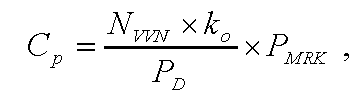

# § 36

(1) Maximálna cena za pripojenie Cp pri pripojení odberateľa elektriny alebo výrobcu elektriny do distribučnej sústavy od 52 kV vrátane do 110 kV v distribučnej sústave alebo pri zvýšení maximálnej rezervovanej kapacity od 52 kV vrátane do 110 kV v distribučnej sústave zahrnuje náklady na výstavbu požadovaného elektroenergetického zariadenia prevádzkovateľa distribučnej sústavy a všetky potrebné úpravy elektroenergetických zariadení v 110 kV distribučnej sústave a v prenosovej sústave a vypočíta sa podľa vzorca

kde

- a) NVVN sú celkové náklady prevádzkovateľa distribučnej sústavy súvisiace s výstavbou zariadení na pripojenie žiadateľov a súvisiace úpravy v distribučnej sústave a prenosovej sústave v eurách,

- b) PMRK je maximálna rezervovaná kapacita žiadateľa o pripojenie v megawattoch,

- c) PD je disponibilná kapacita na pripojenie vytvorená nevyhnutnými úpravami energetických zariadení v distribučnej sústave prevádzkovateľa distribučnej sústavy na základe žiadostí žiadateľov o pripojenie do distribučnej sústavy v megawattoch,

- d) ko je koeficient výšky spoluúčasti žiadateľa o pripojenie; ak je žiadateľom odberateľ elektriny, hodnota koeficientu ko sa rovná 0,5, ak je žiadateľom výrobca elektriny, hodnota koeficientu ko sa rovná jednej, a ak je žiadateľom výrobca elektriny z obnoviteľných zdrojov energie alebo vysoko účinnou kombinovanou výrobou, ko sa rovná 0,95.

(2) Ak sa zvýši maximálna rezervovaná kapacita existujúceho odberateľa elektriny alebo výrobcu elektriny, potom pre výpočet podľa odseku 1 platí, že

- a) NVVN je celkový náklad prevádzkovateľa distribučnej sústavy v eurách súvisiaci s pripojením žiadateľov na napäťovej úrovni od 52 kV vrátane do 110 kV za predchádzajúcich päť kalendárnych rokov,

- b) PD je celkový disponibilný výkon v megawattoch vytvorený nevyhnutnými úpravami elektroenergetických zariadení v sústave prevádzkovateľa distribučnej sústavy na základe žiadostí žiadateľov o pripojenie na napäťovej úrovni od 52 kV vrátane do 110 kV do distribučnej sústavy za predchádzajúcich päť kalendárnych rokov,

- c) PMRK je maximálna rezervovaná kapacita určená podľa § 35 ods. 4.

(3) Ak sa za predchádzajúcich päť kalendárnych rokov neuskutočnili nové pripojenia, použije sa na určenie ceny za pripojenie výpočet podľa odseku 1, kde

- 1. PMRK je maximálna rezervovaná kapacita určená podľa § 35 ods. 4,

- 2. NVVN sú celkové náklady prevádzkovateľa distribučnej sústavy na zvýšenie maximálnej rezervovanej kapacity pripojenia a súvisiace úpravy v distribučnej sústave a prenosovej sústave v eurách.

(4) Maximálna cena za pripojenie Cp určená podľa odseku 1 v eurách na megawatt na rok t-1 sa oznamuje úradu najneskôr do konca februára roku t. Na základe údajov od prevádzkovateľov regionálnych distribučných sústav sa vypočíta aritmetický priemer maximálnych cien za pripojenie Cp troch prevádzkovateľov regionálnych distribučných sústav, ktorý sa zverejňuje na webovom sídle úradu najneskôr do konca marca roku t. Táto maximálna cenu za pripojenie Cp sa uplatní na pripojenie uskutočnené od 1. apríla roku t do 31. marca roku t+1.

(5) Ak sa elektroenergetické zariadenie odberateľa elektriny alebo výrobcu elektriny pripája do miestnej distribučnej sústavy alebo ak sa zvyšuje maximálna rezervovaná kapacita existujúceho odberateľa elektriny alebo výrobcu elektriny v miestnej distribučnej sústave a pripojenie vyvolá náklady na pripojenie v regionálnej distribučnej sústave alebo v prenosovej sústave, maximálna cena za pripojenie zahrnuje náklady na pripojenie požadovaného elektroenergetického zariadenia u prevádzkovateľa miestnej distribučnej sústavy a vyvolané náklady na pripojenie v regionálnej distribučnej sústave alebo v prenosovej sústave.

(6) Podmienkou pripojenia zariadenia na výrobu elektriny výrobcu elektriny do miestnej distribučnej sústavy, ktorá je pripojená do regionálnej distribučnej sústavy, alebo na zvýšenie maximálnej rezervovanej kapacity existujúceho zariadenia na výrobu elektriny výrobcu elektriny pripojeného do miestnej distribučnej sústavy, ktorá je pripojená do regionálnej distribučnej sústavy, je uzatvorenie zmluvy o pripojení miestnej distribučnej sústavy do regionálnej distribučnej sústavy s maximálnou rezervovanou kapacitou vo výške celkového inštalovaného výkonu tohto zariadenia na výrobu elektriny najviac do výšky rezervovanej kapacity, ktorú je technicky možné dodať do regionálnej distribučnej sústavy.

(7) Maximálna cena za pripojenie prevádzkovateľa miestnej distribučnej sústavy, do ktorej sa elektroenergetické zariadenie odberateľa elektriny alebo výrobcu elektriny pripája a ktorá je pripojená do regionálnej distribučnej sústavy, sa vypočíta podľa odseku 1, pričom pre výpočet platí, že NVVN sú celkové preukázateľne vyvolané náklady prevádzkovateľa regionálnej distribučnej sústavy na zvýšenie maximálnej rezervovanej kapacity pripojenia a súvisiace úpravy v prenosovej sústave v eurách.
