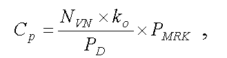
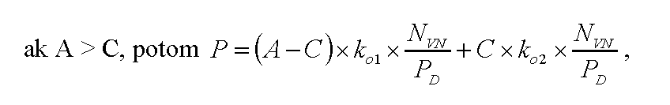
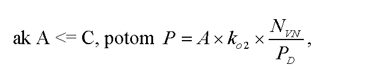

# § 37

(1) Maximálna cena za pripojenie Cp pri pripojení odberateľa elektriny alebo výrobcu elektriny do distribučnej sústavy od 1 kV vrátane do 52 kV alebo pri zvýšení maximálnej rezervovanej kapacity v distribučnej sústave od 1 kV vrátane do 52 kV zahrnuje náklady na výstavbu požadovaného elektroenergetického zariadenia prevádzkovateľa distribučnej sústavy a na všetky potrebné úpravy elektroenergetických zariadení v distribučnej sústave a vypočíta sa podľa vzorca

kde

- a) NVN sú celkové náklady prevádzkovateľa distribučnej sústavy v eurách súvisiace s výstavbou zariadení na pripojenie žiadateľov a súvisiacich úprav na napäťovej úrovni od 1 kV vrátane do 52 kV v roku t-1,

- b) PD je celkový disponibilný výkon v kilowattoch vytvorený nevyhnutnými úpravami elektroenergetických zariadení v sústave prevádzkovateľa distribučnej sústavy na základe žiadostí žiadateľov o pripojenie na napäťovej úrovni od 1 kV vrátane do 52 kV do distribučnej sústavy v roku t-1,

- c) PMRK je maximálna rezervovaná kapacita žiadateľa o pripojenie v kilowattoch,

- d) ko je koeficient výšky spoluúčasti žiadateľa o pripojenie, ktorého hodnota sa rovná

  - 1. 0,5, ak je žiadateľom o pripojenie odberateľ elektriny,

  - 2. 1,0, ak je žiadateľom o pripojenie výrobca elektriny okrem výrobcu elektriny podľa tretieho bodu,

  - 3. 0,95, ak je žiadateľom o pripojenie výrobca elektriny z obnoviteľných zdrojov energie alebo kombinovanou výrobou,

  - 4. ak je žiadateľom o pripojenie zariadenia na výrobu elektriny do napäťovej úrovne od 1 kV vrátane do 52 kV osoba, ktorej zariadenie na výrobu elektriny je pripojené do sústavy cez existujúce odberné miesto, a ak je zároveň jeho odberné miesto vybavené určeným meradlom s meraním výkonu, tak na účely určenia ceny za pripojenie zariadenia na výrobu elektriny sa postupuje podľa vzorca

  - 

  - kde

    - 4a. P je cena za pripojenie zariadenia na výrobu elektriny,

    - 4b. A je maximálna rezervovaná kapacita pripojenia zariadenia na výrobu elektriny, ktorou je inštalovaný výkon zariadenia na výrobu elektriny, ktorý chce pripojiť žiadateľ o pripojenie alebo o ktorý chce zvýšiť už existujúci inštalovaný výkon zariadenia na výrobu elektriny (požadovaná maximálna rezervovaná kapacita),

    - 4c. C je skutočne využitá maximálna rezervovaná kapacita odberného zariadenia, ktorou je najvyššia nameraná hodnota príkonu za obdobie najviac dvoch predchádzajúcich rokov, ktorú určí prevádzkovateľ distribučnej sústavy a ktorou je skutočne využitá maximálna rezervovaná kapacita v existujúcom odbernom mieste,

    - 4d. NVN sú celkové náklady prevádzkovateľa distribučnej sústavy v eurách súvisiace s pripojením žiadateľov na napäťovej úrovni od 1 kV vrátane do 52 kV v roku t-1,

    - 4e. PD je celkový disponibilný výkon v kilowattoch vytvorený nevyhnutnými úpravami elektroenergetických zariadení v sústave prevádzkovateľa distribučnej sústavy na základe žiadostí žiadateľov o pripojenie na napäťovej úrovni od 1 kV vrátane do 52 kV do distribučnej sústavy v roku t-1,

    - 4f. ko1 je koeficient výšky spoluúčasti žiadateľa o pripojenie, ktorého hodnota sa rovná 1,0, ak je žiadateľom o pripojenie výrobca elektriny (okrem výrobcu elektriny z obnoviteľných zdrojov energie alebo vysoko účinnou kombinovanou výrobou výrobcu elektriny), alebo 0,95, ak je žiadateľom o pripojenie výrobca elektriny z obnoviteľných zdrojov energie alebo vysoko účinnou kombinovanou výrobou,

    - 4g. ko2 je koeficient výšky spoluúčasti žiadateľa o pripojenie, ktorého hodnota sa rovná 0,5, ak sa pripojí do 12 mesiacov odo dňa nadobudnutia právoplatnosti stavebného povolenia, inak hodnota koeficienta výšky spoluúčasti sa rovná, 1 a

  - 

- e) NVN a PD sú skutočné hodnoty celkových nákladov a celkového disponibilného výkonu v roku t vtedy, ak neboli realizované pripojenia v miestnej distribučnej sústave v roku t-1.

(2) Maximálna cena za pripojenie Cp určená podľa odseku 1 v eurách na kilowatt na rok t-1 a na rok t sa oznamuje úradu najneskôr do konca februára roku t.

(3) Podmienkou pripojenia zariadenia na výrobu elektriny výrobcu elektriny do miestnej distribučnej sústavy, ktorá je pripojená do regionálnej distribučnej sústavy, alebo na zvýšenie maximálnej rezervovanej kapacity existujúceho zariadenia na výrobu elektriny výrobcu elektriny pripojeného do miestnej distribučnej sústavy, ktorá je pripojená do regionálnej distribučnej sústavy, je uzatvorenie zmluvy o pripojení miestnej distribučnej sústavy do regionálnej distribučnej sústavy s maximálnou rezervovanou kapacitou vo výške celkového inštalovaného výkonu tohto zariadenia na výrobu elektriny najviac do výšky rezervovanej kapacity, ktorú je technicky možné dodať do regionálnej distribučnej sústavy.
