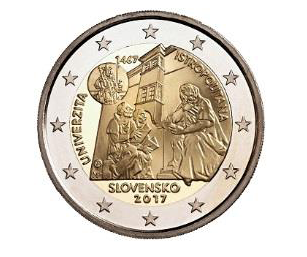

## 318

OZNÁMENIE

Národnej banky Slovenska

z 25. októbra 2016

## o vydaní pamätných euromincí v nominálnej hodnote 2 eurá pri príležitosti 550. výročia začatia činnosti Univerzity Istropolitany

1. Úvodné ustanovenia

- a) Národná banka Slovenska podľa § 17h ods. 1 zákona Národnej rady Slovenskej republiky č. 566/1992 Zb. o Národnej banke Slovenska v znení neskorších predpisov a podľa § 12 ods. 1 písm. b) zákona č. 400/2015 Z. z. o tvorbe právnych predpisov a o Zbierke zákonov Slovenskej republiky a o zmene a doplnení niektorých zákonov oznamuje, že pri príležitosti 550. výročia začatia činnosti Univerzity Istropolitany vydáva do obehu pamätné euromince v nominálnej hodnote 2 eurá (ďalej len „pamätná eurominca“).

- b) Pamätná eurominca má rovnaké technické parametre ako obehové euromince1) a na jej národnej strane bude použitý pamätný motív [bod 2 písm. b)].

- c) Pamätná eurominca má štatút zákonného platidla v celej eurozóne.

2. Vzhľad pamätnej euromince

- a) Pamätná eurominca sa vydáva s novou spoločnou európskou stranou.2)

- b) Na národnej strane pamätnej euromince sú vyobrazené postavy učiteľa a dvoch študentov na pozadí doplnené časťou priečelia historickej budovy v Bratislave, ktorá bola sídlom Univerzity Istropolitany. Kompozíciu v ľavej hornej časti mincového poľa dotvára medailón kráľa Mateja Korvína, zakladateľa univerzity. Názov štátu SLOVENSKO je v spodnej časti mincového poľa. Pod ním je letopočet 2017. V ľavej časti pamätnej euromince je v opise vnútorného kruhu nápis „UNIVERZITA“ a v jej pravej časti nápis „ISTROPOLITANA“. Nad medailónom je letopočet začatia činnosti Univerzity Istropolitany „1467“. Značka Mincovne Kremnica, štátny podnik, ktorú tvorí skratka „MK“ umiestnená medzi dvoma razidlami, a štylizované iniciálky autorky výtvarného návrhu národnej strany pamätnej euromince Márie Poldaufovej „MP“ sú umiestnené v spodnej časti kompozície. Pri okraji pamätnej euromince je dvanásť do kruhu umiestnených hviezd Európskej únie.

- c) Na hrane pamätnej euromince je nápis „SLOVENSKÁ REPUBLIKA“. Začiatok a koniec nápisu je oddelený dvoma hviezdami, medzi ktorými je lipový list.

- 

- Štát vydania: Slovenská republika

- Začiatok vydávania: január 2017

Jozef Makúch v. r.
