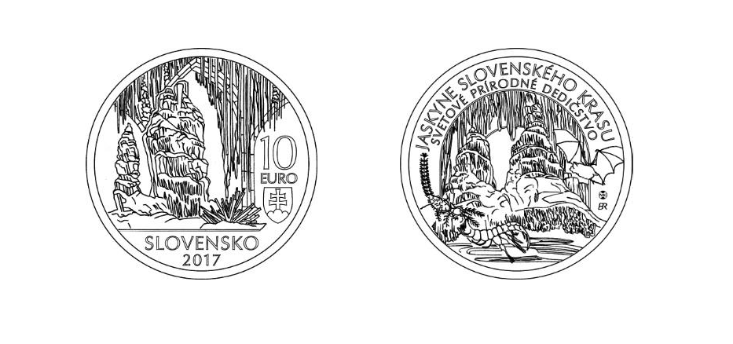

## 347

OZNÁMENIE

Národnej banky Slovenska

z 22. novembra 2016

## o vydaní strieborných zberateľských euromincí v nominálnej hodnote 10 eur s tematikou Svetové prírodné dedičstvo – Jaskyne Slovenského krasu

1. Úvodné ustanovenia

- a) Národná banka Slovenska podľa § 17h ods. 1 zákona Národnej rady Slovenskej republiky č. 566/1992 Zb. o Národnej banke Slovenska v znení neskorších predpisov a podľa § 12 ods. 1 písm. b) zákona č. 400/2015 Z. z. o tvorbe právnych predpisov a o Zbierke zákonov Slovenskej republiky a o zmene a doplnení niektorých zákonov oznamuje, že vydáva do obehu strieborné zberateľské euromince v nominálnej hodnote 10 eur s tematikou Svetové prírodné dedičstvo – Jaskyne Slovenského krasu (ďalej len „zberateľská eurominca“).

- b) Zberateľská eurominca má štatút zákonného platidla len v Slovenskej republike.

- c) Zberateľská eurominca sa razí zo zliatiny obsahujúcej 900 dielov striebra a 100 dielov medi; jej hmotnosť je 18 g a priemer 34 mm. Pri razbe zberateľskej euromince je povolená horná a dolná odchýlka v priemere 0,1 mm; povolená horná odchýlka v hmotnosti je 0,4 g a v obsahu striebra 10/1000.

2. Vzhľad zberateľskej euromince

- a) Na líci zberateľskej euromince sú vyobrazené stalagmity z jaskyne Domica, zvislé stalaktity a brká z Gombaseckej jaskyne a vpravo dole aragonitový útvar z Ochtinskej aragonitovej jaskyne. Hodnotu a monumentálnosť jaskýň Slovenského krasu metaforicky charakterizuje prvok chrámovej architektúry – gotický oblúk. V pravej časti mincového poľa je štátny znak Slovenskej republiky. V spodnej časti mincového poľa je názov štátu „SLOVENSKO“ a pod ním je letopočet „2017“. Nad štátnym znakom Slovenskej republiky je v dvoch riadkoch označenie nominálnej hodnoty zberateľskej euromince „10 EURO“.

- b) Na rube zberateľskej euromince je vyobrazený kvapľový útvar z Krásnohorskej jaskyne doplnený vzácnymi jaskynnými živočíchmi – šťúrovkou, krivákom jaskynným a netopierom. Pri hornom okraji mincového poľa je v opise text „JASKYNE SLOVENSKÉHO KRASU“ a pod ním text „SVETOVÉ PRÍRODNÉ DEDIČSTVO“. Značka Mincovne Kremnica, štátny podnik, ktorú tvorí skratka „MK“ umiestnená medzi dvoma razidlami, a štylizované iniciálky mena a priezviska autora zberateľskej euromince Branislava Ronaia „BR“ sú v pravej časti mincového poľa.

- c) Na hrane mince je nápis do hĺbky „– WORLD HERITAGE – PATRIMOINE MONDIAL“.

- 

- Štát vydania: Slovenská republika

- Začiatok vydávania: február 2017

Jozef Makúch v. r.
