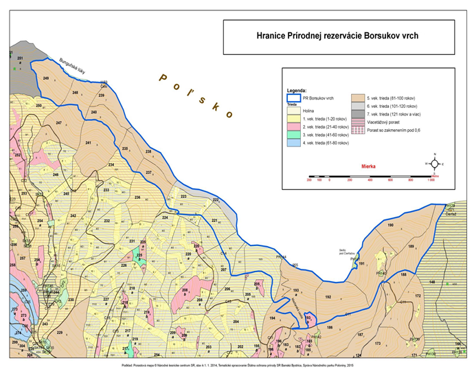

Príloha č. 2 k nariadeniu vlády č. 6/2016 Z. z.

- VYMEDZENIE HRANICE PRÍRODNEJ REZERVÁCIE

  - Územie prírodnej rezervácie je vymedzené podľa vektorových katastrálnych máp so stavom katastra nehnuteľností k 1. januáru 2015 a podľa digitálnej lesníckej porastovej mapy pre Lesný hospodársky celok Zboj Lesný celok Lesy LPM Zboj (kód plánu LA073) so stavom k 1. januáru 2014, z ktorých bola hranica prírodnej rezervácie prenesená do digitálnej Základnej mapy Slovenskej republiky (SVM50) v mierke 1:50 000.

- Popis hranice prírodnej rezervácie

  - Hranica prírodnej rezervácie vychádza z kóty Čierťaž 1 071 m n. m. na slovensko-poľskej štátnej hranici, odtiaľ schádza po bočnom hrebienku juhojuhozápadným smerom po hranici medzi lesnými dielcami 148 a 189 až po hospodársky kopec č. 89. Tu pokračuje najprv západným neskôr juhozápadným smerom po hranici medzi lesnými dielcami 188 a 189 a schádza na lesnú cestu – zvážnicu C11 idúcu z doliny Zbojského potoka na poľovnícku chatu Kýčera. Odtiaľto pokračuje severným okrajom zvážnice č. C11 približne západným a potom juhozápadným smerom až po hranicu lesného porastu 193B, ktorý tvorí mladina. Hranica prírodnej rezervácie potom obchádza túto mladinu najprv po východnej strane, potom po severnej a nakoniec opäť schádza južným smerom na zvážnicu č. C11. Odtiaľto zase pokračuje severným okrajom tejto zvážnice až po rázcestie zvážnice so starou lesnou cestou v miestnom názvosloví nazývanou ako Maďarská cesta. Tu sa hranica prudko stáča a pokračuje východoseverovýchodným, neskôr približne severným smerom východným okrajom tejto kľukatej cesty až po rázcestie so zvážnicou č. C14. Odtiaľto hranica prírodnej rezervácie ide približne severozápadným smerom po severnom okraji zvážnice č. C14, pričom reže lesné porasty č. 194, 205A, 206, 207 a 223 na dve časti. V mieste, kde táto zvážnica pretína poľovnícky chodník hranica prírodnej rezervácie opúšťa severný okraj zvážnice a vedie približne severozápadným smerom po poľovníckom chodníčku, ktorý tvorí zároveň juhozápadnú hranicu lesných dielcov 223, 237, 235, 240, 248 a 249. Pri hospodárskom kopci č. 125 potom opúšťa poľovnícky chodník a vedie najprv približne severoseverozápadným a potom východoseverovýchodným smerom po hranici medzi lesnými porastmi č. 249 a 251A a vychádza na okraj takzvaných Bunguľských lúk tiahnucich sa pozdĺž slovensko - poľskej štátnej hranice. Tu vedie hranica prírodnej rezervácie južným okrajom týchto lúk približne juhovýchodným smerom a vychádza na štátnu hranicu 130 m východne od kóty Čelo 1 159 m n. m. Odtiaľto prechádzajúc cez kóty Čelo a Borsukov vrch (991 m n. m.) smerom najprv na východ, potom na juhovýchod a neskôr na severoseverovýchod až po lúku č. PH141 v Sedle pod Čierťažou je hranica prírodnej rezervácie totožná so štátnou slovensko-poľskou hranicou. Lúku č. PH141 v Sedle pod Čierťažou obchádza po východnom okraji, najprv približne východným smerom a potom približne na severoseverovýchod a znovu sa vracia na štátnu hranicu, odkiaľ sa potom vracia po štátnej hranici približne severovýchodným smerom na východiskový bod na kótu Čierťaž.

- Zoznam parciel prírodnej rezervácie

  - Okres Snina

  - Katastrálne územie Nová Sedlica:

  - 1084/1 – časť, 1085, 1086 – časť, 1088/4 – časť, 1096/1 – časť, 1099 – časť, 1100 – časť, 1104 – časť, 1120 – časť

  - Katastrálne územie Zboj:

  - 3790 – časť, 3844

  - Poznámka:

  - Parcely územia európskeho významu sú vyznačené tučným písmom (§ 27 ods. 9 zákona). Celé územie prírodnej rezervácie Borsukov vrch je súčasťou územia európskeho významu SKUEV0229 Bukovské vrchy.

- Mapa hranice prírodnej rezervácie 

  - Technickým podkladom na zápis priebehu hranice prírodnej rezervácie je zjednodušený operát geometrického plánu.
