# Čl. I

Nariadenie vlády Slovenskej republiky č. 354/2006 Z. z., ktorým sa ustanovujú požiadavky na vodu určenú na ľudskú spotrebu a kontrolu kvality vody určenej na ľudskú spotrebu v znení nariadenia vlády Slovenskej republiky č. 496/2010 Z. z. sa mení a dopĺňa takto:

- 1. V § 2 písmeno f) znie:

- „f)

- indikačnou hodnotou hodnota ukazovateľa kvality pitnej vody nešpecifického charakteru alebo skupinového charakteru používaná na posúdenie potreby podrobnejších skúšok kvality pitnej vody a ak ide o rádiologický ukazovateľ kvality pitnej vody hodnota rádiologického ukazovateľa kvality pitnej vody, ktorej prekročenie si vyžaduje pokračovanie v optimalizácii radiačnej ochrany podľa prílohy č. 2,“.

- 2. V § 2 sa za písmeno f) vkladá písmeno g), ktoré znie:

- „g)

- indikačnou dávkou hodnota ročného úväzku efektívnej dávky z príjmu prírodných rádionuklidov a umelých rádionuklidov pitnou vodou okrem 3H, 40K, 222Rn a produktov premeny 222Rn s krátkou dobou polpremeny,“.

  - Doterajšie písmená g) a h) sa označujú ako písmená h) a i).

- 3. V § 3 ods. 1 uvádzacej vete sa slová „písm. a) až d)“ nahrádzajú slovami „písm. a) až e)“.

- 4. V § 3 ods. 1 písmeno g) znie:

- „g)

- bezodkladne oznámiť regionálnemu úradu verejného zdravotníctva prekročenie limitov ustanovených medznou hodnotou a najvyššou medznou hodnotou; pri rádiologických ukazovateľoch kvality pitnej vody bezodkladne oznámiť príslušnému úradu verejného zdravotníctva5aa) prekročenie medznej hodnoty a indikačnej hodnoty,“.

  - Poznámka pod čiarou k odkazu 5aa znie:

  - „5aa)

  - § 5 ods. 5 písm. h) a § 6 ods. 5 zákona č. 355/2007 Z. z.“.

- 5. V § 4 sa vypúšťa odsek 5.

  - Poznámka pod čiarou k odkazu 7 sa vypúšťa.

- 6. V § 6 sa za odsek 3 vkladá nový odsek 4, ktorý znie:

- „(4)

- Požiadavky na počet odberov vzoriek pitnej vody a počet miest odberov vzoriek pitnej vody podľa prílohy č. 2 na stanovenie rádiologických ukazovateľov sú uvedené v § 8a.“.

  - Doterajší odsek 4 sa označuje ako odsek 5.

- 7. V § 7 odsek 3 znie:

- „(3)

- Ukazovatele kvality pitnej vody sa stanovujú podľa metód, ktorých kritériá správnosti a presnosti, kritériá najmenšej detegovateľnej aktivity a relatívnej rozšírenej neistoty pre rádiologické ukazovatele, sú uvedené v prílohe č. 3.“.

- 8. Za § 8 sa vkladá § 8a, ktorý vrátane nadpisu znie:

- 㤠8a

- Rádiologické ukazovatele

- (1)

- Rádiologické ukazovatele sú určené pre monitorovanie obsahu prírodných rádionuklidov a umelých rádionuklidov (ďalej len „rádionuklidy“) v pitnej vode a pre zabezpečenie optimalizácie radiačnej ochrany.10a)

- (2)

- Výsledky stanovení rádiologických ukazovateľov sa hodnotia vo vzťahu k limitom, ktoré sú uvedené v prílohe č. 1. Hodnotenie výsledkov stanovení rádiologických ukazovateľov sa vkladá do protokolu podľa prílohy č. 3a.

- (3)

- Ak voda obsahuje viac rádionuklidov a súčet podielov objemových aktivít jednotlivých rádionuklidov a ich medzných hodnôt je väčší ako jeden alebo ak sú prekročené indikačné hodnoty rádiologických ukazovateľov, osoby uvedené v § 1 ods. 1 písm. a) až e) zabezpečia optimalizáciu radiačnej ochrany a bezodkladne informujú o výsledkoch optimalizácie príslušný orgán verejného zdravotníctva5aa) ako aj dotknuté obyvateľstvo.

- (4)

- Postup pri prekročení indikačnej hodnoty a medznej hodnoty podľa odseku 2 a 3 je uvedený v prílohe č. 2 obrázku č. 1.

- (5)

- Spôsob evidencie výsledkov stanovenia a hodnotenia rádiologických ukazovateľov v pitnej vode je uvedený v prílohe č. 3a.

- (6)

- Osoby uvedené v § 1 ods. 1 písm. a) až e) môžu požiadať príslušný orgán verejného zdravotníctva5aa) o zúženie počtu odberov vzoriek pitnej vody a počtu miest odberov vzoriek pitnej vody na kontrolu rádiologických ukazovateľov pitnej vody podľa prílohy č. 2. Počty odberov vzoriek pitnej vody a počty miest odberov vzoriek pitnej vody sa musia vykonať najmenej raz za päť rokov podľa prílohy č. 2 obrázku č. 1.

- (7)

- Žiadosť o zúženie počtu odberov vzoriek pitnej vody a počtu miest vzoriek pitnej vody odberov kontroly rádiologických ukazovateľov pitnej vody obsahuje

- a)

- údaje podľa § 8 ods. 1 písm. a),

- b)

- návrh úpravy rozsahu a početnosti kontroly kvality pitnej vody a jeho odôvodnenie,

- c)

- výsledky najmenej štyroch stanovení celkovej objemovej aktivity alfa, celkovej objemovej aktivity beta, objemovej aktivity 222Rn alebo ďalších rádionuklidov v priebehu troch rokov pred podaním žiadosti podľa odseku 6 tak, aby najmenej štyri odbery vzoriek pitnej vody boli uskutočnené s odstupom najmenej troch mesiacov; každý odber vzorky pitnej vody sa musí uskutočniť v inom ročnom období.“.

  - Poznámka pod čiarou k odkazu 10a znie:

  - „10a)

  - § 8 nariadenia vlády Slovenskej republiky č. 345/2006 Z. z. o základných bezpečnostných požiadavkách na ochranu zdravia pracovníkov a obyvateľov pred ionizujúcim žiarením.“.

- 9. V § 9 sa za slovo „preberajú“ vkladajú slová „a vykonávajú“.

- 10. V prílohe č. 1 časti A por. č. 6 sa symbol ukazovateľa „KM22“ nahrádza symbolom ukazovateľa „KM37“.

- 11. V prílohe č. 1 časti B písmene a) por. č. 19 druh limitu „MH“ nahrádza druhom limitu „NMH“.

- 12. V prílohe č. 1 časti B písmene b) por. č. 44 druh limitu „MHRR“ nahrádza druhom limitu „NMH“.

- 13. V prílohe č. 1 časti B písmene c) por. č. 50 sa vypúšťa poznámka.

- 14. V prílohe č. 1 časti B písmeno f) vrátane nadpisu znie:

- „f)

- Rádiologické ukazovatele

- Por. číslo | Ukazovateľ | Symbol ukazovateľa | Limit | Jednotka | Druh limitu | Poznámky

- 82. | Trícium | 3H | 100 | Bq/l | IH | Monitorovanie objemovej aktivity 3H v pitnej vode sa nevyžaduje, ak je iným monitorovaním preukázané, že úroveň objemovej aktivity 3H je dostatočne pod IH. Ak je IH prekročená postupuje sa podľa prílohy č. 2, obrázku č. 1. Ak sa monitorovanie nevyžaduje, Úrad verejného zdravotníctva SR informuje komisiu podľa osobitného predpisu14) o dôvodoch takého rozhodnutia a poskytne jej výsledky monitorovania, na základe ktorého takto rozhodol.

- 83. | Radón | 222Rn | 100 | Bq/l | IH | Vzťahuje sa na pitnú vodu dodávanú z podzemných zdrojov.

- 84. | Celková objemová aktivita alfa | aVcα | 0,1 | Bq/l | IH |

- 85. | Celková objemová aktivita beta | avcβ | 0,5 | Bq/l | IH |

- 86. | Indikačná dávka | ID | 0,1 | mSv/rok | IH | Postupuje sa podľa prílohy č. 2 bodu 2.2.

- 87. | Prírodné rádionuklidy | 238U | 3,0 | Bq/l | MH | MH sú vypočítané na úrovni ročného úväzku efektívnej dávky 0,1 mSv a ročnom objeme vody prijatého ingesciou 730 litrov. Táto tabuľka nezohľadňuje chemickú toxicitu uránu

- 88. | | 234U | 2,8 | Bq/l | MH |

- 89. | | 226Ra | 0,5 | Bq/l | MH |

- 90. | | 228Ra | 0,2 | Bq/l | MH |

- 91. | | 210Pb | 0,2 | Bq/l | MH |

- 92. | | 210Po | 0,1 | Bq/l | MH |

- 93. | | 222Rn | 300 | Bq/l | MH |

- 94. | Umelé rádionuklidy | 14C | 240 | Bq/l | MH |

- 95. | | 90Sr | 4,9 | Bq/l | MH |

- 96. | | 239Pu/240Pu | 0,6 | Bq/l | MH |

- 97 | | 241Am | 0,7 | Bq/l | MH |

- 98. | | 60Co | 40 | Bq/l | MH |

- 99. | | 134Cs | 7,2 | Bq/l | MH |

- 100. | | 137Cs | 11 | Bq/l | MH |

- 101. | | 131I | 6,2 | Bq/l | MH |

- Vysvetlivky: IH - indikačná hodnota, MH - medzná hodnota, ID - indikačná dávka, NMH - najvyššia medzná hodnota, OH- odporúčaná hodnota.“.

- 15. V prílohe č. 2 bod 2.2 vrátane nadpisu znie:

- „2.2

- Úplný rozbor

- Cieľom úplného rozboru je získavať informácie o dodržaní limitov ukazovateľov kvality pitnej vody ustanovených v prílohe č. 1 alebo určených orgánom verejného zdravotníctva.

- Úplný rozbor pozostáva z ukazovateľov kvality pitnej vody podľa prílohy č. 1 vrátane rádiologických ukazovateľov č. 83 až 85. Stanovenie rádiologických ukazovateľov č. 86 až 101 sa vyžaduje pri prekročení IH ukazovateľov č. 83 až 85 podľa obrázku č. 1. Stanovenie rádiologického ukazovateľa č. 86 je zahrnuté v požiadavke 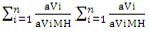 ≤ 1.

- Obrázok č. 1

- Posúdenie výsledkov stanovení rádiologických ukazovateľov

- 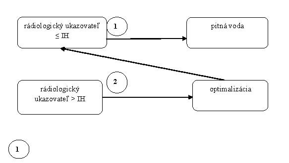

- Pri posudzovaní rádiologický ukazovateľ neprekračuje limit, ak rádiologický ukazovateľ ≤ IH, rádiologický ukazovateľ ≤ MH a 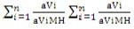 ≤ 1, kde aVi je objemová aktivita i–teho rádionuklidu, aViMH je medzná hodnota objemovej aktivity i–teho rádionuklidu.

- 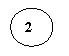

- Pri posudzovaní rádiologický ukazovateľ prekračuje limit, ak rádiologický ukazovateľ > IH, rádiologický ukazovateľ > MH a 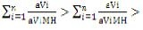 1.

- Postup optimalizácie pri riešení týchto situácií zahrňuje overenie alebo spresnenie situácie opakovaným odberom a následným stanovením rádiologických ukazovateľov v ďalších vzorkách, identifikáciu zdroja vody, ktorý je zodpovedný za zvýšený obsah rádionuklidov, analýzu situácie, návrh a realizáciu opatrení na zníženie obsahu rádionuklidov v pitnej vode.

- Postup optimalizácie pri prekročení IH pre aVRn222 v pitnej vode

- Opakovaný odber a následné stanovenie aVRn222. Ak priemerná aVRn222 z dvoch stanovení neprekračuje IH postupuje sa v monitorovaní podľa prílohy č. 2 obrázku č. 1.

- Ak priemerná aVRn222 z dvoch stanovení prekračuje IH, ale neprekračuje MH pre aVRn222 v pitnej vode v nasledujúcich troch rokoch sa vykoná opakovaný odber a následné stanovenie aVRn222 tak, aby odbery vzoriek zahŕňali štyri rôzne štvrťroky. Ak priemerná aVRn222 zo štyroch stanovení prekračuje IH, ale neprekračuje MH pre aVRn222 pokračuje sa v optimalizácii tak, že sa zváži možnosť vyradenia vodného zdroja zo zásobovania obyvateľstva pitnou vodou a technologická úprava na odstránenie 222Rn, pričom sa berie do úvahy aj výsledok stanovenia aVcα, aVcβ a ich porovnanie s príslušnými IH. Ak priemerná aVRn222 zo štyroch stanovení prekračuje MH pre aVRn222 pokračuje sa v optimalizácii tak, že sa zváži možnosť vyradenia vodného zdroja zo zásobovania obyvateľstva pitnou vodou a/alebo technologická úprava na odstránenie 222Rn.

- Postup optimalizácie pri prekročení IH pre aVcα v pitnej vode

- Opakovaný odber a následné stanovenie aVcα. Ak priemerná aVcα z dvoch stanovení neprekračuje IH postupuje sa v monitorovaní podľa prílohy č. 2 obrázku č. 1.

- Ak priemerná aVcα z dvoch stanovení prekračuje IH pokračuje sa bezodkladne v stanovení konkrétnych rádionuklidov emitujúcich alfa častice v nasledovnom poradí: aVRa226, aVU238,U234, aVPo210 a ďalších prírodných rádionuklidov alebo umelých rádionuklidov.

- Pri stanovení konkrétnych rádionuklidov sa postupuje podľa nasledovného kritéria:

- ak (aVcα - aVi ) ≤ IH nie je potrebné stanovenie ďalších rádionuklidov podľa poradia,

- ak (aVcα - aVi) > IH je potrebné stanovenie ďalších rádionuklidov podľa poradia.

- Ak výsledok stanovení konkrétnych rádionuklidov vyhovuje

- 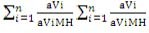 ≤ 1 a aVi neprekročí 20 % príslušnej MH, postupuje sa v monitorovaní podľa prílohy č. 2 obrázku č. 1.

- Ak výsledok stanovení konkrétnych rádionuklidov nevyhovuje

- 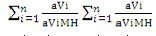 ≤ 1 a/alebo aVi prekročí 20 % príslušnej MH, v nasledujúcich troch rokoch sa vykoná opakovaný odber a následné stanovenia aVi tak, aby odbery vzoriek zahŕňali štyri rôzne štvrťroky. Ak priemerné aVi zo štyroch stanovení vyhovujú

- 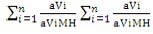 ≤ 1 a aVi neprekročí 20 % príslušnej MH, postupuje sa v monitorovaní podľa prílohy č. 2 obrázku č. 1.

- Ak priemerné aVi zo štyroch stanovení nevyhovujú

- 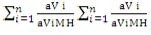 ≤ 1 a/alebo aVi prekročí 20 % príslušnej MH pokračuje sa v optimalizácii tak, že sa zváži možnosť vyradenia vodného zdroja zo zásobovania obyvateľstva pitnou vodou a/alebo technologická úprava na odstránenie konkrétnych rádionuklidov.

- Postup optimalizácie pri prekročení IH pre avcβv pitnej vode

- Opakovaný odber a následné stanovenie avcβ. Ak priemerná avcβ z dvoch stanovení neprekračuje IH postupuje sa v monitorovaní podľa prílohy č. 2 obrázku č. 1.

- Ak priemerná avcβ z dvoch stanovení prekračuje IH pokračuje sa bezodkladne v stanovení konkrétnych rádionuklidov emitujúcich beta častice v nasledovnom poradí: aVK40, aVRa228, aVPb210 a ďalších prírodných rádionuklidov alebo umelých rádionuklidov.

- Pri stanovení konkrétnych rádionuklidov sa postupuje podľa nasledovného kritéria:

- ak (avcβ - aVi) ≤ IH nie je potrebné stanovenie ďalších rádionuklidov podľa poradia,

- ak (avcβ - aVi) > IH je potrebné stanovenie ďalších rádionuklidov podľa poradia.

- Ak výsledok stanovení konkrétnych rádionuklidov vyhovuje

- 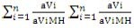 ≤ 1 a aVi neprekročí 20 % príslušnej MH, postupuje sa v monitorovaní podľa prílohy č. 2 obrázku č. 1.

- Ak výsledok stanovení konkrétnych rádionuklidov nevyhovuje

- 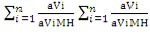 ≤ 1 a/alebo aVi prekročí 20 % príslušnej MH, v nasledujúcich troch rokoch sa vykoná opakovaný odber a následné stanovenia aVi tak, aby odbery vzoriek zahŕňali štyri rôzne štvrťroky.

- Ak priemerné aVi zo štyroch stanovení vyhovujú

- 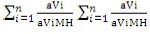 ≤ 1 a aVi neprekročí 20 % príslušnej MH, postupuje sa v monitorovaní podľa prílohy č. 2 obrázku č. 1.

- Ak priemerné aVi zo štyroch stanovení nevyhovujú

- 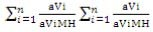 ≤ 1 a/alebo aVi prekročí 20 % príslušnej MH, pokračuje sa v optimalizácii tak, že sa zváži možnosť vyradenia vodného zdroja zo zásobovania obyvateľstva pitnou vodou a/alebo technologická úprava na odstránenie konkrétnych rádionuklidov.

- Postup optimalizácie pri prekročení IH pre ID v pitnej vode

- Do úvahy sa berie naraz súčasná optimalizácia pri prekročení IH pre aV,cα a aV,cβ. V prípade potreby sa vypočítajú MH ďalších prírodných rádionuklidov a umelých rádionuklidov na úrovni ročného úväzku efektívnej dávky 0,1 mSv a ročnom objeme pitnej vody prijatého ingesciou 730 litrov.

- Postup optimalizácie pri prekročení IH pre 3H v pitnej vode

- Opakovaný odber a následné stanovenie objemovej aktivity 3H. Ak priemerná objemová aktivita 3H z dvoch stanovení neprekračuje IH postupuje sa v monitorovaní podľa prílohy č. 2 obrázku č. 1.

- Ak priemerná objemová aktivita 3H z dvoch stanovení prekračuje IH pokračuje sa bezodkladne v stanovení konkrétnych umelých rádionuklidov.“.

- 16. Nadpis v prílohe č. 3 znie:

- „KRITÉRIÁ SPRÁVNOSTI A PRESNOSTI METÓD, KRITÉRIÁ NAJMENŠEJ DETEGOVATEĽNEJ AKTIVITY A RELATÍVNEJ ROZŠÍRENEJ NEISTOTY PRE RÁDIOLOGICKÉ UKAZOVATELE“.

- 17. Príloha č. 3 sa dopĺňa písmenom f), ktoré vrátane nadpisu znie:

- „f)

- Rádiologické ukazovatele

- Číslo ukazovateľa | Ukazovateľ | Najmenšia detegovateľná objemová aktivita Bq/l | Urel % | Poznámky

- 82. | 3H | 10 | 20 | Najmenšia detegovateľnáobjemová aktivita sa vypočíta pre kvantil normálneho rozdelenia k1-α=k1-β=1,65 a interval spoľahlivosti sa vypočíta pre kvantil normálneho rozdelenia k1-γ=1,96. 25) Urel je relatívna rozšírená neistota a zároveň cieľová neistota stanovenia

- 83. | 222Rn | 10 | 20 |

- 84. | Celková objemová aktivita alfa | 0,04 | 60 |

- 85. | Celková objemová aktivita beta | 0,20 | 20 |

- 87. | 238U | 0,02 | 20 |

- 88. | 234U | 0,02 | 20 |

- 89. | 226Ra | 0,04 | 20 |

- 90. | 228Ra | 0,02 | 20 |

- 91. | 210Pb | 0,02 | 20 |

- 92. | 210Po | 0,01 | 20 |

- 94. | 14C | 20 | 20 |

- 95. | 90Sr | 0,40 | 20 |

- 96. | 239Pu/240Pu | 0,04 | 20 |

- 97. | 241Am | 0,06 | 20 |

- 98. | 60Co | 0,50 | 20 |

- 99. | 134Cs | 0,50 | 20 |

- 100. | 137Cs | 0,50 | 20 |

- 101 | 131I | 0,50 | 20 |

- ".

- Poznámka pod čiarou k odkazu 25 znie:

- „“.

- 25)

- ISO 11929 Stanovenie charakteristických limitov (detekčných limitov a hraníc intervalu spoľahlivosti) pri meraniach ionizujúceho žiarenia - Základy a použitie.“.

- 18. Za prílohu č. 3 sa vkladá príloha č. 3a, ktorá vrátane nadpisu znie:

- „Príloha č. 3a k nariadeniu vlády č. 354/2006 Z. z.

- PROTOKOL O VÝSLEDKOCH STANOVENIA A HODNOTENIA RÁDIOLOGICKÝCH UKAZOVATEĽOV V PITNEJ VODE

- Identifikácia dodávateľa pitnej vody (názov, adresa) | | | | |

- Identifikácia vodného zdroja (názov, obec, okres) | | | | |

- Pôvod a druh vody | | | □ podzemná voda □ balená voda □ povrchová voda □ upravovaná voda po odstránení radónu □ upravovaná voda odstraňovaním iných rádionuklidov | |

- Miesto, dátum a čas odberu vzorky | | | | |

- Plán a postupy odberu | | | | |

- Výsledky stanovení: a - objemová aktivita, aV,cα – celková objemová aktivita alfa, aV,cβ – celková objemová aktivita beta, aVi – objemová aktivita i – teho rádionuklidu, Urel – relatívna rozšírená neistota pre kvantil normálneho rozdelenia k1-γ=1,96, aND – najmenšia detegovateľná objemová aktivita pre kvantil normálneho rozdelenia k1-α=k1-β=1,65 | | | | |

- Ukazovateľ | a Bq/l | Urel % | aND Bq/l | Použitá metodika | Merací prístroj

- aVcα | | | | |

- aVcβ | | | | |

- aVRn222 | | | | |

- aVi | | | | |

- Hodnotenie výsledkov stanovení | | | | |

- Dátum vykonania stanovení rádiologických ukazovateľov | | | | |

- Identifikačné údaje laboratória, ktoré vykonalo stanovenia (názov a adresa laboratória, číslo povolenia ÚVZ SR) | | | | |

- Vypracoval (meno, priezvisko a funkcia zodpovednej osoby) | | | | |

- “.

- 19. Nadpis prílohy č. 4 znie: „Zoznam preberaných a vykonávaných právne záväzných aktov Európskej únie“.

- 20. Príloha č. 4 sa dopĺňa tretím bodom, ktorý znie:

- „3.

- Smernica Rady 2013/51/EURATOM z 22. októbra 2013, ktorou sa stanovujú požiadavky na ochranu zdravia obyvateľstva vzhľadom na rádioaktívne látky obsiahnuté vo vode určenej na ľudskú spotrebu (Ú. v. EÚ L 296, 7. 11. 2013).“.
