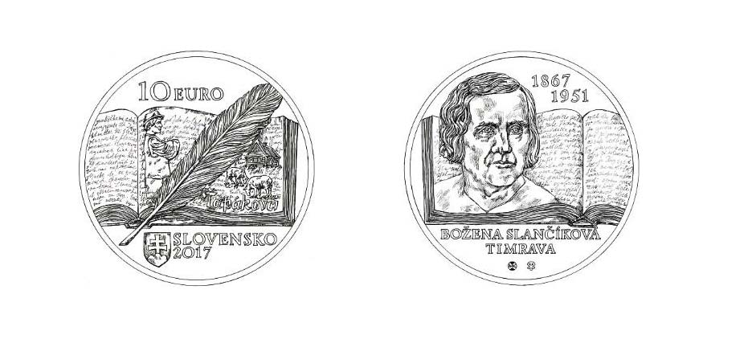

## 156

OZNÁMENIE

Národnej banky Slovenska

z 30. mája 2017

## o vydaní strieborných zberateľských euromincí v nominálnej hodnote 10 eur pri príležitosti 150. výročia narodenia Boženy Slančíkovej Timravy

1. Úvodné ustanovenia

- a) Národná banka Slovenska podľa § 17h ods. 1 zákona Národnej rady Slovenskej republiky č. 566/1992 Zb. o Národnej banke Slovenska v znení neskorších predpisov a podľa § 12 ods. 1 písm. b) zákona č. 400/2015 Z. z. o tvorbe právnych predpisov a o Zbierke zákonov Slovenskej republiky a o zmene a doplnení niektorých zákonov oznamuje, že vydáva do obehu strieborné zberateľské euromince v nominálnej hodnote 10 eur pri príležitosti 150. výročia narodenia Boženy Slančíkovej Timravy (ďalej len „zberateľská eurominca“).

- b) Zberateľská eurominca má štatút zákonného platidla len v Slovenskej republike.

- c) Zberateľská eurominca sa razí zo zliatiny obsahujúcej 900 dielov striebra a 100 dielov medi; jej hmotnosť je 18 g a priemer 34 mm. Pri razbe zberateľskej euromince je povolená horná a dolná odchýlka v priemere 0,1 mm; povolená horná odchýlka v hmotnosti je 0,4 g a v obsahu striebra 10/1000.

2. Vzhľad zberateľskej euromince

- a) Na líci zberateľskej euromince je vyobrazená otvorená kniha s motívom známeho diela Boženy Slančíkovej Timravy Ťapákovci. Na knihe je položené brko na písanie. Štátny znak Slovenskej republiky je v spodnej časti mincového poľa. Vedľa neho je názov štátu „SLOVENSKO“, pod ktorým je letopočet „2017“. Označenie nominálnej hodnoty zberateľskej euromince „10 EURO“ je v hornej časti mincového poľa.

- b) Na rube zberateľskej euromince je v kompozícii s otvorenou knihou vyobrazený portrét Boženy Slančíkovej Timravy. Pod kompozíciou je meno a priezvisko „BOŽENA SLANČÍKOVÁ“ a pod nimi pseudonym „TIMRAVA“. Pod pseudonymom je značka Mincovne Kremnica, štátny podnik, ktorú tvorí skratka „MK“ umiestnená medzi dvoma razidlami, a značka autora zberateľskej euromince Asamata Baltaeva, DiS. V hornej časti mincového poľa sú v dvoch riadkoch letopočty narodenia a úmrtia Boženy Slančíkovej Timravy „1867“ a „1951“.

- c) Na hrane mince je nápis do hĺbky „PREDSTAVITEĽKA NESKORÉHO LITERÁRNEHO REALIZMU“.

- Štát vydania: Slovenská republika

- Začiatok vydávania: september 2017

Jozef Makúch v. r.
