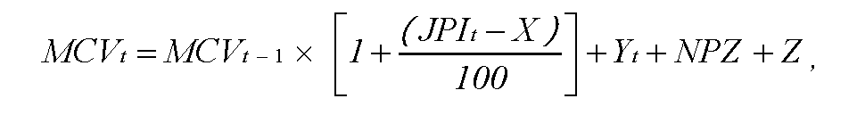
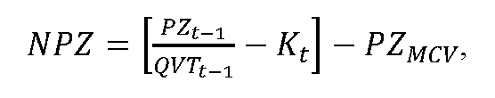
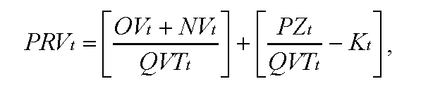
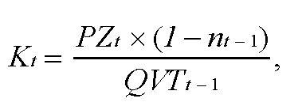

# § 8 Spôsob výpočtu maximálnej ceny za výrobu, distribúciu a dodávku pitnej vody a výšky primeraného zisku

(1) Maximálna cena za výrobu a dodávku pitnej vody, maximálna cena za výrobu a distribúciu pitnej vody, maximálna cena za dodávku pitnej vody alebo maximálna cena za výrobu a dodávku pitnej vody pre skupinu odberateľov2) v eurách na objemovú jednotku sa vypočíta podľa vzorca

ak (JPIt – X) < 0, na účely výpočtu maximálnej ceny sa hodnota rozdielu JPIt a X rovná nule,

kde

MCVt je maximálna cena za výrobu a dodávku pitnej vody, maximálna cena za výrobu a distribúciu pitnej vody, maximálna cena za dodávku pitnej vody alebo maximálna cena za výrobu a dodávku pitnej vody pre skupinu odberateľov2) v eurách na objemovú jednotku na rok t,

MCVt-1 je maximálna cena za výrobu a dodávku pitnej vody, maximálna cena za výrobu a distribúciu pitnej vody, maximálna cena za dodávku pitnej vody alebo maximálna cena za výrobu a dodávku pitnej vody pre skupinu odberateľov2) v eurách na objemovú jednotku schválená alebo určená v cenovom rozhodnutí na rok t-1, ktorá zohľadňuje ekonomicky oprávnené náklady a primeraný zisk,

JPIt je aritmetický priemer zverejnených hodnôt ukazovateľa „jadrová inflácia“ za posledných 12 mesiacov predchádzajúcich mesiacu, v ktorom sa návrh ceny predkladá, uvedených na webovom sídle Štatistického úradu Slovenskej republiky v časti „Jadrová a čistá inflácia – oproti rovnakému obdobiu minulého roku v percentách“,

X je faktor efektivity podľa § 5 ods. 6,

Yt je faktor investičného rozvoja určeného na podporu investícií do vodárenského majetku využívaného na výrobu, distribúciu a dodávku pitnej vody v eurách na objemovú jednotku vypočítaný podľa odseku 2,

NPZ je hodnota zmeny primeraného zisku v eurách na objemovú jednotku vypočítaná podľa odseku 3,

Z je hodnota zmeny nákladov v eurách na objemovú jednotku, ktorá sa vo výpočte použije, ak sa postupuje v cenovom konaní o zmene rozhodnutia podľa § 17 ods. 2 písm. d) zákona; hodnota zmeny vyjadruje zmenu ekonomických parametrov v roku t-1 a ekonomicky oprávnených nákladov podľa § 4 ods. 1 písm. c), ktoré ovplyvňujú ekonomicky oprávnené prevádzkové náklady NV regulovaného subjektu, z ktorých sa vychádzalo pri určení maximálnej ceny za výrobu a dodávku pitnej vody, za výrobu a distribúciu pitnej vody, za dodávku pitnej vody alebo za výrobu a dodávku pitnej vody pre skupinu odberateľov2) v eurách na objemovú jednotku a odôvodňuje sa analýzami v predloženom návrhu na zmenu cenového rozhodnutia.

(2) Faktor investičného rozvoja Ytsa vypočíta podľa vzorca

kde

OVt-1 je hodnota odpisov hmotného a nehmotného majetku a nájomného podľa § 4 ods. 1 písm. e) až h) v eurách využívaného výhradne na výrobu, distribúciu a dodávku pitnej vody skutočne zaradeného do účtovníctva do konca roka t-1,

QVTt-1 je skutočné množstvo dodanej pitnej vody v objemových jednotkách pre všetkých odberateľov v roku t-1 vrátane vlastnej spotreby,

OVMCV je hodnota odpisov hmotného a nehmotného majetku a nájomného podľa § 4 ods. 1 písm. e) až h) v eurách využívaného výhradne na výrobu, distribúciu a dodávku pitnej vody, ktoré sú uplatnené v maximálnej cene za výrobu a dodávku pitnej vody, maximálnej cene za výrobu a distribúciu pitnej vody, maximálnej cene za dodávku pitnej vody alebo maximálnej cene za výrobu a dodávku pitnej vody pre skupinu odberateľov2) schválenej alebo určenej v cenovom rozhodnutí na rok t-1; to platí aj pre prevádzkové spoločnosti, ktoré si takýto majetok prenajímajú,

QVTMCV je množstvo dodanej pitnej vody v objemových jednotkách pre všetkých odberateľov vrátane vlastnej spotreby uplatnené vo výpočte maximálnej ceny za výrobu a dodávku pitnej vody, maximálnej ceny za výrobu a distribúciu pitnej vody, maximálnej ceny za dodávku pitnej vody alebo maximálnej ceny za výrobu a dodávku pitnej vody pre skupinu odberateľov2) schválenej alebo určenej v cenovom rozhodnutí na rok t-1.

(3) Hodnota zmeny primeraného zisku NPZ sa vypočíta podľa vzorca

kde

PZt-1 je výška primeraného zisku v eurách vypočítaná podľa odseku 5, pričom najvyššia miera primeraného zisku je 0,08 eura na 1 m3 množstva dodanej pitnej vody v roku t-1 vrátane vlastnej spotreby, alebo podľa odseku 6; pri výpočte ceny za dodávku pitnej vody sa uplatní najviac polovica hodnoty PZt-1,

PZMCV je hodnota primeraného zisku v eurách na objemovú jednotku v maximálnej cene za výrobu a dodávku pitnej vody, maximálnej cene za výrobu a distribúciu pitnej vody, maximálnej cene za dodávku pitnej vody alebo maximálnej cene za výrobu a dodávku pitnej vody pre skupinu odberateľov2) schválenej alebo určenej v cenovom rozhodnutí na rok t-1.

(4) Ak regulovaný subjekt prvýkrát predkladá návrh na určenie maximálnej ceny za výrobu a dodávku pitnej vody, maximálnej ceny za výrobu a distribúciu pitnej vody, maximálnej ceny za dodávku pitnej vody alebo maximálnej ceny za výrobu a dodávku pitnej vody pre skupinu odberateľov2) v eurách na objemovú jednotku, priemerná cena sa vypočíta podľa vzorca

kde

PRVt je priemerná cena za výrobu, distribúciu a dodávku pitnej vody v eurách na objemovú jednotku,

OVt sú odpisy hmotného a nehmotného majetku používaného na výrobu, distribúciu a dodávku pitnej vody a nájomné za prenájom hmotného a nehmotného majetku v eurách na rok t podľa § 4 ods. 1 písm. e) až h),

NVt sú ekonomicky oprávnené prevádzkové náklady v eurách na výrobu, distribúciu a dodávku pitnej vody v roku t okrem OVt,

QVTt je množstvo dodanej pitnej vody v objemových jednotkách pre všetkých odberateľov2) v roku t vrátane vlastnej spotreby,

PZt je výška primeraného zisku v eurách vypočítaná podľa odseku 5, pričom najvyššia miera primeraného zisku je 0,08 eura na 1 m3 množstva dodanej pitnej vody v roku t vrátane vlastnej spotreby, alebo podľa odseku 6; pri výpočte ceny za dodávku pitnej vody sa uplatní najviac polovica hodnoty PZt,

Kt je faktor využitia kapacity vodárenského majetku používaného na výrobu, distribúciu a dodávku pitnej vody podľa odseku 7.

(5) Výška primeraného zisku PZt v eurách sa vypočíta podľa vzorca

PZt = RAB2015 × WACCt,

kde

RAB2015 je účtovná hodnota (zostatková cena) hmotného majetku a nehmotného majetku v eurách v roku 2015 používaného na regulovanú činnosť podľa prílohy č. 12.

(6) Výška primeraného zisku PZt pre regulovaný subjekt, ktorého dodávka pitnej vody verejným vodovodom nepresiahne 1 000 000 m3, je maximálne 0,04 eura na 1 m3 množstva dodanej pitnej vody v roku t vrátane vlastnej spotreby.

(7) Hodnota faktora využitia vodárenského majetku používaného na výrobu, distribúciu a dodávku pitnej vody v eurách na objemovú jednotku sa vypočíta podľa vzorca

kde

nt-1 je koeficient využitia projektovanej kapacity vodárenského majetku používaného na výrobu, distribúciu a dodávku pitnej vody, ktorý sa vypočíta ako priemer podielov skutočne využívanej kapacity a celkovej projektovanej kapacity jednotlivého vodárenského majetku v roku t-1 podľa prílohy č. 15; vypočítaná hodnota sa matematicky zaokrúhli na dve desatinné miesta.

(8) Maximálna cena za výrobu a dodávku pitnej vody MCVt v eurách na objemovú jednotku sa navrhuje tak, aby vážený priemer maximálnej ceny za výrobu a dodávku pitnej vody a maximálnej ceny za výrobu a distribúciu pitnej vody prepočítaný na objemovú jednotku neprekročil priemernú cenu na rok t vypočítanú podľa odseku 4. Maximálna cena za dodávku pitnej vody sa navrhuje najviac do výšky vypočítanej priemernej ceny. Pri návrhu maximálnej ceny sa prihliada na sociálne, environmentálne a ekonomické dôsledky úhrady za vodohospodárske služby, ako aj na geografické podmienky a klimatické podmienky príslušného regiónu.

(9) Ak regulovaný subjekt dodáva vodu inému regulovanému subjektu, návrh maximálnej ceny za výrobu a distribúciu pitnej vody sa predkladá tak, že maximálna cena za výrobu a distribúciu pitnej vody je cena znížená o priemerné náklady spojené s dodávkou pitnej vody konečným odberateľom.2)

(10) Návrh maximálnej ceny pre jednotlivé skupiny odberateľov2) sa predkladá tak, aby maximálne ceny zohľadňovali ekonomicky oprávnené náklady jednotlivých skupín odberateľov2) a výšku primeraného zisku.

(11) Ak sa návrh na určenie maximálnej ceny za výrobu a dodávku pitnej vody, maximálnej ceny za výrobu a distribúciu pitnej vody, maximálnej ceny za dodávku pitnej vody alebo maximálnej ceny za výrobu a dodávku pitnej vody pre skupinu odberateľov2) predkladá prvýkrát, vypočíta sa priemerná cena za výrobu, distribúciu a dodávku pitnej vody v eurách na objemovú jednotku na rok t podľa odseku 4, pričom sa na výpočet použijú plánované údaje na rok t a návrh maximálnej ceny sa predkladá podľa odsekov 8 až 10.
