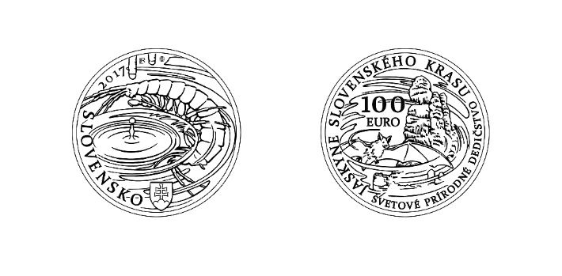

## 228

OZNÁMENIE

Národnej banky Slovenska

z 5. septembra 2017

## o vydaní zlatých zberateľských euromincí v nominálnej hodnote 100 eur s tematikou Svetové prírodné dedičstvo – Jaskyne Slovenského krasu

1. Úvodné ustanovenia

- a) Národná banka Slovenska podľa § 17h ods. 1 zákona Národnej rady Slovenskej republiky č. 566/1992 Zb. o Národnej banke Slovenska v znení neskorších predpisov a podľa § 12 ods. 1 písm. b) zákona č. 400/2015 Z. z. o tvorbe právnych predpisov a o Zbierke zákonov Slovenskej republiky a o zmene a doplnení niektorých zákonov oznamuje, že vydáva do obehu zlaté zberateľské euromince v nominálnej hodnote 100 eur s tematikou Svetové prírodné dedičstvo – Jaskyne Slovenského krasu (ďalej len „zberateľská eurominca“).

- b) Zberateľská eurominca má štatút zákonného platidla len v Slovenskej republike.

- c) Zberateľská eurominca sa razí zo zliatiny obsahujúcej 900 dielov zlata, 75 dielov striebra a 25 dielov medi; jej hmotnosť je 9,5 g a priemer 26 mm. Pri razbe euromince je povolená horná a dolná odchýlka v priemere 0,1 mm; povolená horná odchýlka v hmotnosti je 0,08 g a v obsahu zlata 10/1000.

2. Vzhľad zberateľskej euromince

- a) Na líci zberateľskej euromince sú vyobrazené kruhy na hladine jazierka spôsobené kvapkou z kvapľa, čo vyjadruje podstatu procesu tvorby jaskýň. Kruhy na hladine jazierka sú kompozične doplnené živočíchom, krivákom jaskynným. Štátny znak Slovenskej republiky je v spodnej časti mincového poľa. Názov štátu „SLOVENSKO“ a letopočet „2017“ sú v opise pri ľavom okraji zberateľskej euromince. Štylizované iniciálky mena a priezviska autora výtvarného návrhu zberateľskej euromince Mgr. art. Romana Lugára „RL“ a značka Mincovne Kremnica, štátny podnik, ktorú tvorí skratka „MK“ umiestnená medzi dvoma razidlami, sú pri hornom okraji zberateľskej euromince.

- b) Na rube zberateľskej euromince je vyobrazený kvapeľ z Krásnohorskej jaskyne kompozične doplnený letiacim netopierom. Označenie nominálnej hodnoty zberateľskej euromince „100 EURO“ je umiestnené v dvoch riadkoch nad netopierom. Pri okraji zberateľskej euromince sú v opise nápisy „JASKYNE SLOVENSKÉHO KRASU“ a „SVETOVÉ PRÍRODNÉ DEDIČSTVO“.

- c) Hrana zberateľskej euromince je vrúbkovaná.

- 

- Štát vydania: Slovenská republika

- Začiatok vydávania: november 2017

Jozef Makúch v. r.
