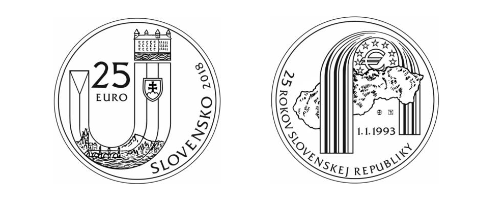

## 229

OZNÁMENIE

Národnej banky Slovenska

z 5. septembra 2017

## o vydaní strieborných zberateľských euromincí v nominálnej hodnote 25 eur pri príležitosti 25. výročia vzniku Slovenskej republiky

1. Úvodné ustanovenia

- a) Národná banka Slovenska podľa § 17h ods. 1 zákona Národnej rady Slovenskej republiky č. 566/1992 Zb. o Národnej banke Slovenska v znení neskorších predpisov a podľa § 12 ods. 1 písm. b) zákona č. 400/2015 Z. z. o tvorbe právnych predpisov a o Zbierke zákonov Slovenskej republiky a o zmene a doplnení niektorých zákonov oznamuje, že vydáva do obehu strieborné zberateľské euromince v nominálnej hodnote 25 eur pri príležitosti 25. výročia vzniku Slovenskej republiky (ďalej len „zberateľská eurominca“).

- b) Zberateľská eurominca má štatút zákonného platidla len v Slovenskej republike.

- c) Zberateľská eurominca sa razí zo striebra s rýdzosťou 999; jej hmotnosť je 31,1035 g a priemer 40 mm. Pri razbe zberateľskej euromince je povolená horná a dolná odchýlka v priemere 0,1 mm; povolená horná odchýlka v hmotnosti je 0,4 g.

2. Vzhľad zberateľskej euromince

- a) Na líci zberateľskej euromince je vyobrazená československá zástava, ktorá sa v oblúkovitej kompozícii mení na slovenskú zástavu, čo symbolicky vyjadruje vznik Slovenskej republiky. Nad slovenskou zástavou je Bratislavský hrad. V spodnej časti oblúka je vyobrazený Karlov most a vrch Kriváň ako symboly Československa. Vo vnútri oblúka je v dvoch riadkoch označenie nominálnej hodnoty zberateľskej euromince „25 EURO“. Pri spodnom okraji zberateľskej euromince je v opise názov štátu „SLOVENSKO“ a za ním letopočet „2018“.

- b) Na rube zberateľskej euromince sú vyobrazené mapa Slovenskej republiky, symbolická brána do Európskej únie, a znak eura s časťou hviezd Európskej únie, čo vyjadruje začlenenie Slovenskej republiky do Európskej únie a eurozóny. V spodnej časti mincového poľa je v opise nápis „25 ROKOV SLOVENSKEJ REPUBLIKY“. Dátum vzniku Slovenskej republiky „1.1.1993“ je pod mapou Slovenskej republiky. Nad ním sú umiestnené značka Mincovne Kremnica, štátny podnik, ktorú tvorí skratka „MK“ umiestnená medzi dvoma razidlami, a štylizované iniciálky autora výtvarného návrhu zberateľskej euromince Pavla Károlyho „PK“.

- c) Na hrane zberateľskej euromince sú v reliéfe prvky čičmianskeho ornamentu.

- 

Štát vydania: Slovenská republika

Začiatok vydávania: január 2018

Jozef Makúch v. r.
