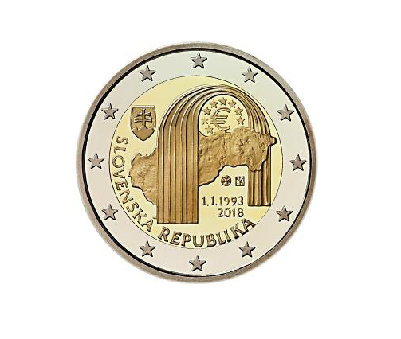

## 230

OZNÁMENIE

Národnej banky Slovenska

z 5. septembra 2017

## o vydaní pamätných euromincí v nominálnej hodnote 2 eurá pri príležitosti 25. výročia vzniku Slovenskej republiky

1. Úvodné ustanovenia

- a) Národná banka Slovenska podľa § 17h ods. 1 zákona Národnej rady Slovenskej republiky č. 566/1992 Zb. o Národnej banke Slovenska v znení neskorších predpisov a podľa § 12 ods. 1 písm. b) zákona č. 400/2015 Z. z. o tvorbe právnych predpisov a o Zbierke zákonov Slovenskej republiky a o zmene a doplnení niektorých zákonov oznamuje, že pri príležitosti 25. výročia vzniku Slovenskej republiky vydáva do obehu pamätné euromince v nominálnej hodnote 2 eurá (ďalej len „pamätná eurominca“).

- b) Pamätná eurominca má rovnaké technické parametre ako obehové euromince1) a na jej národnej strane bude použitý pamätný motív [bod 2 písm. b)].

- c) Pamätná eurominca má štatút zákonného platidla v celej eurozóne.

2. Vzhľad pamätnej euromince

- a) Pamätná eurominca sa vydáva s novou spoločnou európskou stranou.2)

- b) Na národnej strane pamätnej euromince sú vyobrazené mapa Slovenskej republiky, symbolická brána do Európskej únie, a znak eura s časťou hviezd Európskej únie, čo vyjadruje začlenenie Slovenskej republiky do Európskej únie a eurozóny. Štátny znak Slovenskej republiky je v ľavej časti mincového poľa. Názov štátu „SLOVENSKÁ REPUBLIKA“ je v opise vnútorného kruhu v spodnej časti mincového poľa. Dátum vzniku Slovenskej republiky „1.1.1993“ a letopočet „2018“ sú pod mapou Slovenskej republiky. Nad nimi sú umiestnené značka Mincovne Kremnica, štátny podnik, ktorú tvorí skratka „MK“ umiestnená medzi dvoma razidlami, a štylizované iniciálky autora výtvarného návrhu pamätnej euromince Pavla Károlyho „PK“. Pri okraji pamätnej euromince je 12 do kruhu umiestnených hviezd Európskej únie.

- c) Na hrane pamätnej euromince je nápis „SLOVENSKÁ REPUBLIKA“. Začiatok a koniec nápisu je oddelený dvoma hviezdami, medzi ktorými je lipový list.

- 

- Štát vydania: Slovenská republika

- Začiatok vydávania: január 2018

Jozef Makúch v. r.
