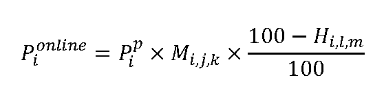
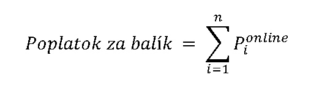
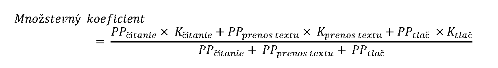
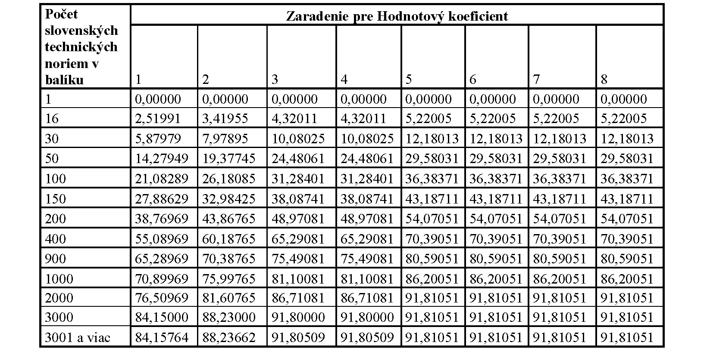
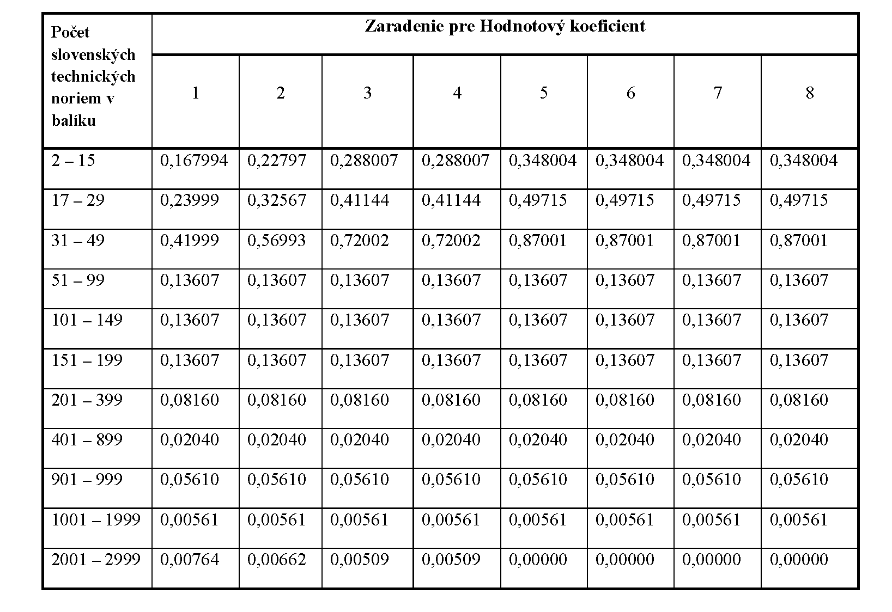
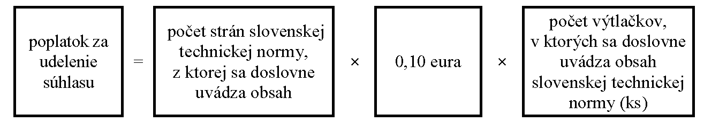

Príloha k vyhláške č. 61/2017 Z. z.

- I. Poplatky za technické normy

  - A. Poplatok za slovenské technické normy poskytované v listinnej podobe

    - Poplatok za slovenské technické normy poskytované v listinnej podobe sa určuje podľa počtu strán slovenských technických noriem.

  - Tabuľka č. 1

  - Poradové číslo | Počet strán | Poplatok

  - 1 | do 2 | 1,90 eura

  - 2 | 3 – 7 | 2,80 eura

  - 3 | 8 – 15 | 9,70 eura

  - 4 | 16 – 31 | 14,10 eura

  - 5 | 32 – 39 | 17,20 eura

  - 6 | 40 – 51 | 18,90 eura

  - 7 | 52 – 59 | 21,40 eura

  - 8 | 60 – 71 | 24,40 eura

  - 9 | 72 – 91 | 28,80 eura

  - 10 | 92 – 115 | 31,80 eura

  - 11 | 116 – 131 | 35,00 eura

  - 12 | 132 – 391 | 36,30 eura

  - 13 | 392 – 621 | 40,40 eura

  - 14 | 622 – 931 | 49,20 eura

  - 15 | 932 – 1331 | 62,60 eura

  - 16 | 1332 a viac | 74,40 eura

  - B. Poplatok za slovenské technické normy poskytované v elektronickej podobe

    - Poplatok za slovenské technické normy poskytované v elektronickej podobe sa vypočíta ako súčin poplatku podľa tabuľky č. 1 a koeficientu podľa tabuľky č. 2.

  - Tabuľka č. 2

  - Slovenská technická norma | Koeficient | | | | |

  - | pre 1 prístup | do 5 prístupov | do 10 prístupov | do 20 prístupov | do 50 prístupov | nad 50 prístupov

  - iba na čítanie | 0,9 | 1,3 | 1,7 | 2,5 | 3,0 | 5,0

  - na čítanie s prenosom textu alebo grafiky | 1,0 | 1,7 | 2,5 | 3,0 | 5,0 | 7,0

  - na čítanie s prenosom textu alebo grafiky, ak formát umožňuje prenos textu alebo grafiky, s možnosťou tlače | 1,3 | 2,5 | 3,0 | 5,0 | 7,0 | 9,0

  - C. Poplatok za službu STN-online

    - 1. Poplatok za jednu slovenskú technickú normu v rámci služby STN-online sa vypočíta takto:

    - 

      - Vysvetlivky:

      - Pionline – poplatok za službu STN-online za jednu slovenskú technickú normu pričom i – jedna slovenská technická norma v balíku,

      - Pip – poplatok za jednu slovenskú technickú normu v listinnej podobe podľa tabuľky č. 1,

      - Mi,j,k – množstevný koeficient podľa počtu a typu prístupov k službe STN-online pričom j – počet prístupov pre i; k – typ prístupu (iba na čítanie; na čítanie s prenosom textu alebo grafiky; na čítanie s prenosom textu alebo grafiky s možnosťou tlače) podľa tabuľky č. 3 po zohľadnení tabuľky č. 4,

      - Hi,l,m – hodnotový koeficient pričom l – celkový počet slovenských technických noriem v balíku; m – hodnotové zaradenie slovenskej technickej normy na základe tried slovenských technických noriem podľa tabuľky č. 5 a počtu objednaných slovenských technických noriem podľa tabuľky č. 6 po zohľadnení tabuľky č. 5 a tabuľky č. 7.

    - 2. Poplatok za balík slovenských technických noriem v rámci služby STN-online sa vypočíta podľa tohto vzorca:

    - 

      - Vysvetlivky:

      - n – počet slovenských technických noriem v balíku.

    - 3. Množstevný koeficient je určený podľa tabuľky č. 3, pričom za každý ďalší prístup v rámci intervalov sa množstevný koeficient zvyšuje o množstevný koeficient uvedený v tabuľke č. 4. Ak za jednu slovenskú technickú normu je objednaná kombinácia viacerých prístupov, množstevný koeficient sa vypočíta ako vážený priemer koeficientov takto:

    - 

      - Vysvetlivky:

      - PPčítanie – počet prístupov iba na čítanie,

      - PPprenos textu – počet prístupov na čítanie s prenosom textu alebo grafiky,

      - PPtlač – počet prístupov na čítanie s prenosom textu alebo grafiky s možnosťou tlače,

      - Kčítanie – príslušný koeficient podľa tabuľky č. 3 po zohľadnení tabuľky č. 4 iba na čítanie,

      - Kprenos textu – príslušný koeficient podľa tabuľky č. 3 po zohľadnení tabuľky č. 4 na čítanie s prenosom textu alebo grafiky,

      - Ktlač – príslušný koeficient podľa tabuľky č. 3 po zohľadnení tabuľky č. 4 na čítanie s prenosom textu alebo grafiky s možnosťou tlače.

    - Tabuľka č. 3 – množstevný koeficient

    - Typ objednaného prístupu | Počet prístupov | | | | |

    - | 1 | 20 | 50 | 100 | 1000 | 3000 a viac

    - iba na čítanie | 0,730 | 2,040 | 2,450 | 4,080 | 8,970 | 12,230

    - na čítanie s prenosom textu alebo grafiky | 0,820 | 2,450 | 4,080 | 5,710 | 10,600 | 13,860

    - na čítanie s prenosom textu alebo grafiky s možnosťou tlače | 1,060 | 4,080 | 5,710 | 7,340 | 12,230 | 15,490

    - Tabuľka č. 4 - množstevný koeficient pre ďalšie prístupy

    - Typ objednaného prístupu | Počet prístupov | | | |

    - | do 19 | do 49 | do 99 | do 999 | do 2999

    - iba na čítanie | 0,0689 | 0,0136667 | 0,0326 | 0,0054333 | 0,000815

    - na čítanie s prenosom textu alebo grafiky | 0,0858 | 0,0543333 | 0,0326 | 0,0054333 | 0,000815

    - na čítanie s prenosom textu alebo grafiky s možnosťou tlače | 0,1589 | 0,0543333 | 0,0326 | 0,0054333 | 0,000815

    - 4. Triedy slovenských technických noriem zoradené do skupín podľa hodnotového koeficientu sú uvedené v tabuľke č. 5.

    - Tabuľka č. 5

    - Skupina hodnotového koeficientu | Triedy slovenských technických noriem

    - 1 | 1, 33, 75

    - 2 | 5, 27, 34 až 36, 42, 72,75, 83

    - 3 | 6, 7, 13, 38, 69, 92

    - 4 | 2, 3, 25, 25, 49, 56, 64, 65, 74, 94

    - 5 | 11, 12, 18, 30, 37, 46, 48, 67, 70, 80, 85, 98

    - 6 | 8, 14, 20, 21, 28, 50, 66, 77, 82, 91, 95

    - 7 | 16, 32, 44, 45, 47, 51, 57, 58, 84, 88, 99

    - 8 | 4, 9,10, 15, 17, 19, 22 až 24, 29, 31, 39 až 41, 43, 52 až 55, 59 až 63, 68,71, 76, 78, 79, 81, 86, 87, 89, 90, 93, 96, 97

    - 5. Hodnotový koeficient slovenskej technickej normy je uvedený v tabuľke č. 6 a za každú ďalšiu slovenskú technickú normu sa zvýši o hodnotový koeficient podľa tabuľky č. 7.

      - Tabuľka č. 6 – hodnotový koeficient v percentách

    - 

      - Tabuľka č. 7 – zmena hodnotového koeficientu v percentách pre výpočet hodnotového koeficientu za počet slovenských technických noriem explicitne neuvedených v tabuľke č. 6, ale nachádzajúcich sa v niektorom z týchto intervalov:

    - 

    - 6. Služba STN-online sa sprístupňuje na základe objednávky služby STN-online alebo zmluvy o poskytovaní služby STN-online na obdobie jedného roka najmenej v hodnote 332 eur.

    - 7. Vypočítaný poplatok sa zaokrúhľuje matematicky na celé eurá.

    - 8. Poplatok za službu STN-online pre knižnice a informačné centrá škôl a univerzít v Slovenskej republike poskytnutú na jeden rok s možnosťou čítania slovenských technických noriem za všetky platné slovenské technické normy v sústave slovenských technických noriem sa určuje takto:

    - Tabuľka č. 8

    - Počet prístupov | Ročný poplatok

    - 1 | 649 eur

    - 2 až 4 | 1 149 eur

    - 5 až 10 | 2 149 eur

    - 11 až 15 | 2 949 eur

    - 9. Poplatok za súbory slovenských technických noriem v rámci služby STN-online pre malé podniky,1) stredné podniky,2) komory3) a združenia.4)

    - Tabuľka č. 9

    - Súbory slovenských technických noriem v rámci služby STN-online | Poplatok za jeden prístup | |

    - | iba na čítanie | na čítanie s prenosom textu alebo grafiky | na čítanie s prenosom textu alebo grafiky s možnosťou tlače

    - výber technických noriem z oblasti energetickej hospodárnosti budov | – | – | 70 eur

    - 33 až 38 súbor technických noriem z oblasti elektrotechniky | 1 518 eur | 1 705 eur | 2 211 eur

    - 72 až 74 súbor technických noriem z oblasti stavebníctva | 589 eur | 649 eur | 849 eur

    - 46, 47, 51 ,53, 54, 56, 57, 58 súbor technických noriem z oblasti poľnohospodárstva a potravinárstva | 257 eur | 289 eur | 373 eur

    - 10. Zľava z poplatku za službu STN-online pre malé podniky,1) stredné podniky,2) komory3) a združenia4) k poplatku za službu STN-online určenému podľa bodu 1.

    - Tabuľka č. 10

    - Výška poplatku | Zľava

    - 332 eur – 1 000 eur | 0 %

    - 1 001 eur – 3 000 eur | 5 %

    - 3 001 eur – 5 000 eur | 10 %

    - 5 001 eur – 10 000 eur | 15 %

    - 10 001 eur -– 20 000 eur | 20 %

    - 20 001 eur – 35 000 eur | 30 %

    - 35 001 eur – 50 000 eur | 40 %

    - od 50 001 eur | 50 %

    - 11. Zľava z poplatku za službu STN-online pre iných užívateľov ako užívateľov podľa bodu 10. k poplatku za službu STN-online určenému podľa bodu 1.

    - Tabuľka č. 11

    - Výška poplatku | Zľava

    - 332 eur – 5 000 eur | 0 %

    - 5 001 eur – 10 000 eur | 5 %

    - 10 001 eur – 20 000 eur | 10 %

    - 20 001 eur – 30 000 eur | 20 %

    - 30 001 eur – 40 000 eur | 30 %

    - 40 001 eur – 50 000 eur | 40 %

    - od 50 001 eur | 50 %

  - D. Poplatok za poskytovanie slovenských technických noriem pre študenta denného štúdia alebo interného doktoranda

    - Študentovi denného štúdia alebo internému doktorandovi, ktorý pre svoju bakalársku prácu, diplomovú prácu alebo dizertačnú prácu potrebuje slovenské technické normy, sa poskytne pri sprístupnení zľava 80 % z poplatku vypočítaného podľa časti B. pre bakalára a diplomanta a

    - 50 % z poplatku vypočítaného podľa časti B. pre interného doktoranda na slovenské technické normy v elektronickej podobe (verzia iba na čítanie) na základe potvrdenia školy alebo školiteľa, že požadované slovenské technické normy študent denného štúdia alebo interný doktorand potrebuje na vypracovanie bakalárskej práce, diplomovej práce alebo dizertačnej práce.

  - E. Poplatok za udelenie súhlasu na doslovné uvádzanie obsahu slovenských technických noriem

    - 1. Poplatok za udelenie súhlasu na doslovné uvádzanie obsahu slovenskej technickej normy sa vypočíta podľa tabuľky č. 12.

    - 2. Poplatok za jednu aj začatú stranu slovenskej technickej normy, z ktorej sa doslovne uvádza obsah, je 0,10 eura.

      - Tabuľka č. 12

    - 

    - 3. Poplatok za udelenie súhlasu na doslovné uvedenie obsahu slovenskej technickej normy je

    - 0 eur, ak ide o použitie doslovného uvedenia obsahu slovenskej technickej normy

      - a) na vyučovacie, vzdelávacie a vedecko-výskumné účely súvisiace so štúdiom podľa osobitného predpisu,5)

      - b) na vypracovanie odbornej ročníkovej práce, záverečnej práce, bakalárskej práce, diplomovej práce alebo dizertačnej práce študentov stredného odborného štúdia alebo vysokoškolského štúdia, interného vysokoškolského štúdia doktorandov.

    - 4. Za doslovné uvedenie obsahu technickej normy sa nepovažuje uvedenie názvu slovenskej technickej normy.

  - F. Poplatok za poskytovanie iných technických noriem

    - 1. Výška poplatku, za ktorú úrad poskytuje inú technickú normu v listinnej podobe, sa rovná výške poplatku, za ktorý bola iná technická norma poskytnutá úradu príslušnou normalizačnou organizáciou, prepočítaného na euro podľa menového kurzu vyhláseného Európskou centrálnou bankou alebo Národnou bankou Slovenska platného ku dňu podania žiadosti o poskytnutie inej technickej normy.

    - 2. Za inú technickú normu sa považuje česká technická norma, nemecká technická norma, technická norma Medzinárodnej organizácie pre normalizáciu, technická norma Medzinárodnej organizácie pre normalizáciu v elektrotechnike alebo technická norma medzinárodnej organizácie ASTM International.

- II. Poplatky za činnosti súvisiace s poskytovaním slovenskej technickej normy

  - A. Poštovné a balné

    - 1. Poštovné a balné v rámci Slovenskej republiky sa určuje takto:

    - Tabuľka č. 13

    - Poštovné a balné | do 1,0 kg = 3,40 eura | do 5,0 kg = 5,20 eura | nad 5,0 kg = 7 eur

    - 2. Poštovné a balné do zahraničia sa určuje na základe individuálnej kalkulácie.

  - B. Poplatok za poskytnutie zoznamu slovenských technických noriem na dátovom nosiči CD s aktualizáciou vo formáte PDF

  - Tabuľka č. 14

  - Aktualizácia | Ročný poplatok

  - mesačná | 274,40 eura

  - štvrťročná | 166,30 eura

  - polročná | 109,50 eura

  - ročná | 80,30 eura

  - C. Poplatok za trvalé sledovanie zmien slovenských technických noriem a rešeršné služby

    - 1. Tabuľka č. 15

    - | | Podľa vlastnej špecifikácie tried | Bez uvedenia špecifikácie tried

    - zaslanie zoznamu nových slovenských technických noriem | v listinnej podobe (ročný poplatok za mesačné zasielanie zoznamu) | 93,60 eura | 62,40 eura

    - | v elektronickej podobe (ročný poplatok za mesačné zasielanie zoznamu) | 76,60 eura | 51,10 eura

    - | v elektronickej podobe v tvare vestníkovej zostavy (jednorázové rešerše) | – | 102,20 eura

    - zaslanie zoznamu nových zmien slovenských technických noriem | v listinnej podobe (ročný poplatok za mesačné zasielanie zoznamu) | 20,20 eura | 20,20 eura

    - | v elektronickej podobe (ročný poplatok za mesačné zasielanie zoznamu) | 16,50 eura | 16,50 eura

    - | v elektronickej podobe v tvare vestníkovej zostavy (jednorazové rešerše) | – | 21,90 eura

    - 2. Poplatok za trvalé sledovanie zmien iných technických noriem poskytovaných na jeden rok s mesačným zasielaním informácií o zmenách iných technických noriem v elektronickej podobe alebo v listinnej podobe.

    - Tabuľka č. 16

    - Počet kľúčových slov podľa Medzinárodného normalizačného triedenia technických noriem | Ročný poplatok

    - do 10 kľúčových slov vrátane | 131,40 eura

    - do 50 kľúčových slov vrátane | 167,90 eura

    - za každú ďalšiu aj začatú päťdesiatku kľúčových slov | 18,60 eura

  - D. Poplatky v Infocentre úradu

    - 1. Poplatok za poskytovanie slovenských technických noriem v Infocentre úradu na základe ročného čitateľského preukazu

    - Tabuľka č. 17

    - Čitateľský preukaz | právnická osoba | študent alebo dôchodca | iná fyzická osoba

    - poplatok za zápis | 19,90 eura | 7,90 eura | 11,90 eura

    - poplatok za obnovenie po roku | 11,90 eura | 3,90 eura | 7,90 eura

    - poplatok za vystavenie nového preukazu v prípade straty | 3,90 eura | 3,90 eura | 3,90 eura

    - 2. Poplatok za poskytovanie slovenských technických noriem v Infocentre úradu bez čitateľského preukazu

    - Tabuľka č. 18

    - Jednorazový poplatok bez čitateľského preukazu | právnická osoba | študent alebo dôchodca | iná fyzická osoba

    - prezenčná výpožička jedného dokumentu v listinnej podobe alebo v elektronickej podobe | 0,30 eura | 0,10 eura | 0,30 eura
